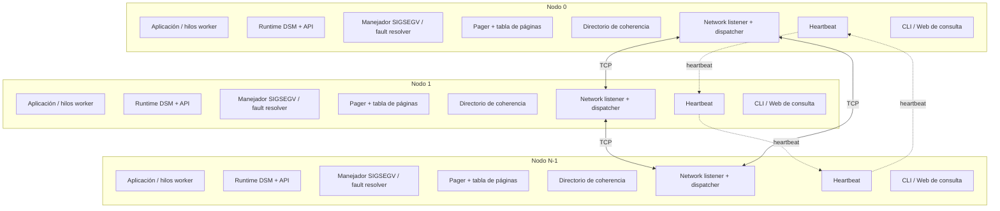
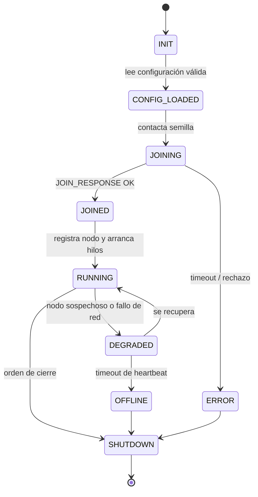
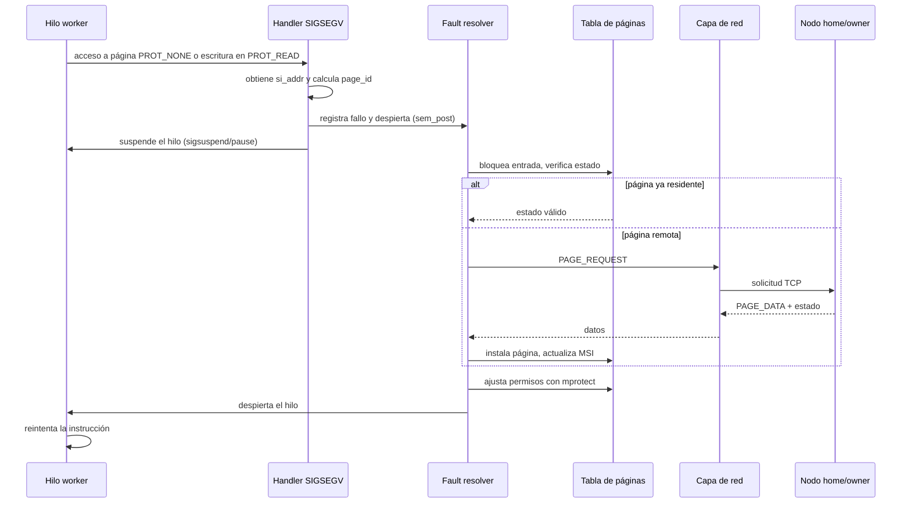
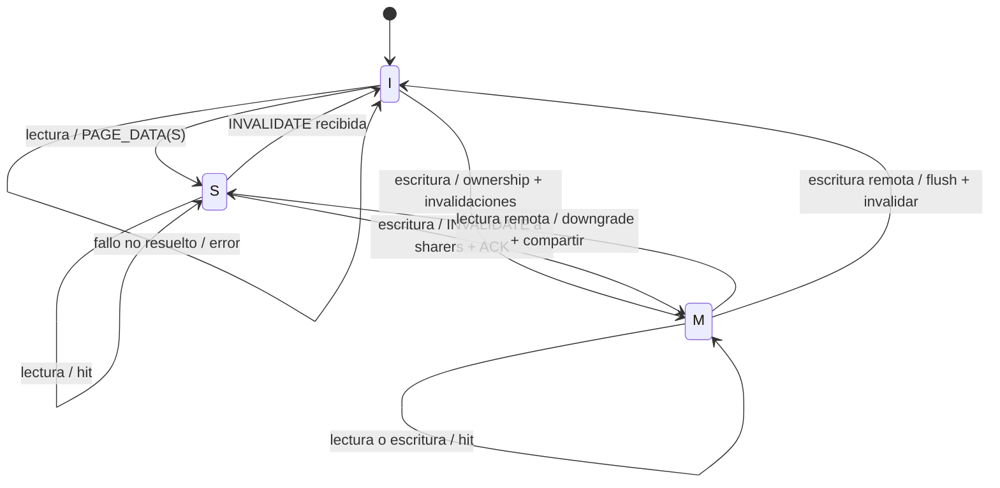
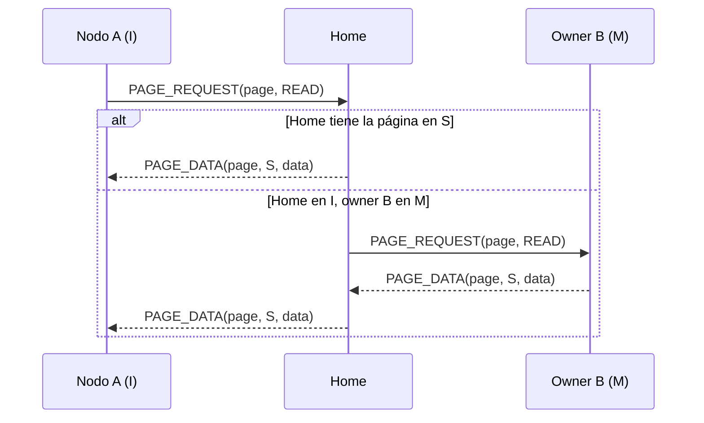
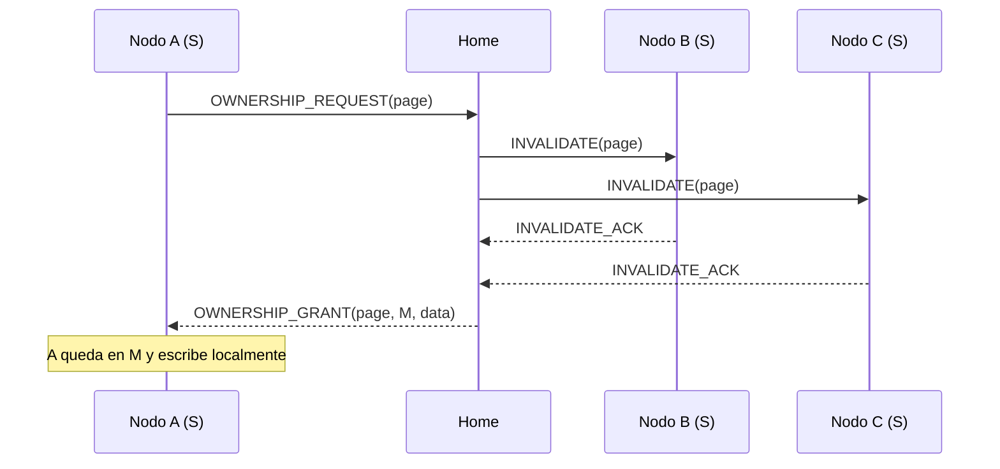
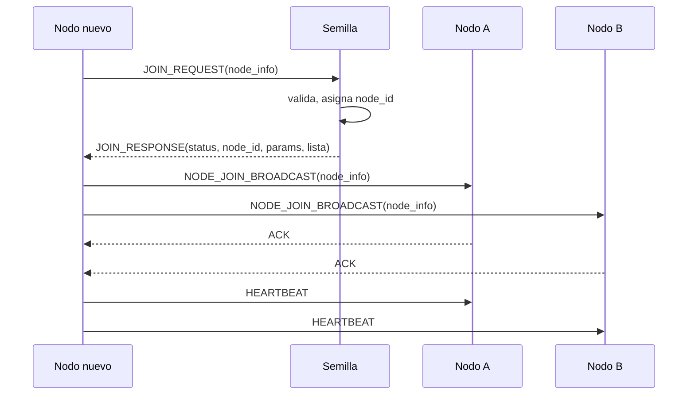

# Proyecto Programado — Sistema de Memoria Compartida Distribuida (DSM)

## Documento general del proyecto

| Campo | Valor |
|---|---|
| **Institución** | Instituto Tecnológico de Costa Rica |
| **Escuela** | Escuela de Ingeniería en Computación, Cartago |
| **Curso** | IC-6600 Principios de Sistemas Operativos |
| **Semestre** | II-Semestre 2026 |
| **Profesor** | M.Sc. Esteban Arias Méndez |
| **Proyecto** | Implementación de un Sistema de Memoria Compartida Distribuida (DSM) con Paginación bajo Demanda y Coherencia MSI |
| **Modalidad** | En parejas (2 estudiantes máximo) |
| **Integrantes** | José Daniel Monterrosa Quirós · Sebastián Aguero Brenes |
| **Entorno** | Linux (C11; confirmado por el profesor) |
| **Herramientas obligatorias** | Sockets TCP/IP, Pthreads, semáforos POSIX, `mmap`, `mprotect` y manejo de señales con `sigaction` |
| **Fuente primaria** | `20261027 - Proyecto SO - Sistema DSM.pdf` |
| **Repositorio Git** | Pendiente de confirmar |
| **Versión del documento** | 1.5 |
| **Fecha de elaboración** | 30 de octubre de 2026 |
| **Estado** | Documento maestro de referencia; decisiones base confirmadas y pendientes operativos identificados |

### Control de versiones

| Versión | Fecha | Cambio |
|---|---|---|
| 1.0 | 30 oct 2026 | Documento general inicial con todo el contenido del PDF. |
| 1.1 | 30 oct 2026 | Integrantes, C11, pool de marcos, runtime embebido recomendado, apps matrices + archivo/video, extras condicionados y registro de decisiones. |
| 1.2 | 30 oct 2026 | Rango temporal de 100 puertos, CLI + web confirmados y nota de pendientes/respuestas temporales. |
| 1.3 | 30 oct 2026 | Confirmados runtime embebido, 4 KB de página, 1 MB por nodo, 4 nodos ideales y formato académico formal para el E1. |
| 1.4 | 30 oct 2026 | Documento general movido a la raíz; carpetas por entregable con instrucciones y estructura documental actualizada. |
| 1.5 | 30 oct 2026 | Redactado el diseño formal del Entregable 1 en `Entregable_1/01_Entregable_1_Diseno.md`. |

> [!IMPORTANT]
> **Nota de decisiones pendientes y respuestas temporales**
>
> Las siguientes respuestas son **temporales** o están **pendientes de confirmación**. No deben tomarse como definitivas para la Entrega Final.
>
> | Tema | Respuesta actual | Estado | Impacto |
> |---|---|---|---|
> | Rango de puertos | **100 puertos**: `50000–50099` | **Confirmado para planificación** | Validar contra el rango real del laboratorio; si cambia la base, se mantiene el esquema. |
> | Equipos del laboratorio | No asignados todavía | **Pendiente** | Afecta pruebas multi-nodo y guion de demo. |
> | URL del repositorio Git | No entregada todavía | **Pendiente** | Es obligatoria para los entregables. |
> | Cita de demo | PDF: 27 de noviembre; hora y laboratorio exactos pendientes | **Pendiente** | Afecta planificación final. |
> | Número de nodos para la demo | **4 nodos ideales**; mínimo 2 | **Confirmado** | Confirmar disponibilidad física en el laboratorio. |
> | Memoria por nodo | **1 MB configurable** | **Confirmado** | Puede ajustarse por configuración. |
> | Tamaño de página | **4 KB configurable** | **Confirmado** | Puede ajustarse por configuración. |
> | Runtime | **Embebido (Modelo A)** | **Confirmado** | No se implementará daemon en la versión base. |
> | Extras | Intentar ambos si la base queda estable | **Provisional** | Priorizar Extra 1; Extra 2 solo si hay tiempo. |
> | Web | CLI + web básica | **Confirmado** | Implementar ambos. |
> | Dataset de las apps | Por definir | **Pendiente** | Matriz y archivo/video concretos. |
> | Formato del Entregable 1 | Académico formal: portada, índice, tablas, figuras, Mermaid y referencias | **Confirmado** | Aplicar desde el E1. |
> | Plantilla o rúbrica adicional | No existe; solo el PDF y las instrucciones del profesor | **Confirmado** | No hay formato externo que seguir. |
> | Formato del informe final | Un MD final con manual de usuario | **Recomendación** | Confirmar si se separa el manual. |

> **Propósito.** Concentrar, ordenar y explicar toda la información del enunciado oficial del proyecto, para que sirva como documento maestro de planificación, diseño, implementación, pruebas y defensa. No sustituye los entregables formales: el **Entregable 1** profundizará en arquitectura, API, protocolo, estructuras y tamaños; el **Entregable 2** documentará el primer prototipo; el **Entregable 3** documentará el segundo prototipo; y la **Entrega Final** consolidará el informe técnico y la demo en vivo.

> **Alcance de este documento.** Es un documento de documentación y planificación. No contiene la implementación del sistema ni archivos de código fuente. Las estructuras, firmas de funciones y mensajes que aparecen aquí son **borradores de diseño** que se congelarán y detallarán en el Entregable 1.

---

## Tabla de contenido

1. [Resumen ejecutivo](#1-resumen-ejecutivo)
2. [Contexto académico](#2-contexto-académico)
3. [Problema, visión y objetivos](#3-problema-visión-y-objetivos)
4. [Alcance y supuestos](#4-alcance-y-supuestos)
5. [Glosario](#5-glosario)
6. [Arquitectura general](#6-arquitectura-general)
7. [Modelo de coherencia MSI](#7-modelo-de-coherencia-msi)
8. [Módulos técnicos](#8-módulos-técnicos)
9. [Configuración del sistema](#9-configuración-del-sistema)
10. [API del DSM](#10-api-del-dsm)
11. [Protocolo de mensajería](#11-protocolo-de-mensajería)
12. [Aplicaciones de prueba y validación](#12-aplicaciones-de-prueba-y-validación)
13. [Pruebas, métricas y demo](#13-pruebas-métricas-y-demo)
14. [Entregables](#14-entregables)
15. [Criterios de evaluación y cumplimiento](#15-criterios-de-evaluación-y-cumplimiento)
16. [Extras](#16-extras)
17. [Requisitos no funcionales](#17-requisitos-no-funcionales)
18. [Riesgos y mitigaciones](#18-riesgos-y-mitigaciones)
19. [Plan de trabajo y Git](#19-plan-de-trabajo-y-git)
20. [Estructura documental y de repositorio propuesta](#20-estructura-documental-y-de-repositorio-propuesta)
21. [Decisiones abiertas y preguntas](#21-decisiones-abiertas-y-preguntas)
22. [Anexos](#22-anexos)

---

## 1. Resumen ejecutivo

El proyecto consiste en construir, en espacio de usuario sobre Linux y en **C11** (el enunciado permite C o C++), un **subsistema de Memoria Compartida Distribuida (DSM)**. El sistema emula un espacio de direcciones virtual compartido sobre un conjunto de computadoras independientes conectadas por red, sin memoria física compartida. Para lograrlo, cada nodo reserva memoria local, intercepta los fallos de segmento (`SIGSEGV`) producidos por accesos a páginas no residentes o sin permisos, y mueve páginas dinámicamente entre nodos mediante sockets TCP/IP, manteniendo coherencia de caché con un **protocolo MSI simplificado** (`Modified`, `Shared`, `Invalid`).

La administración es **distribuida**: cada nodo conoce a los demás, intercambia latidos (`heartbeat`), mantiene su tabla de páginas y participa en la localización, transferencia e invalidación de páginas. El sistema debe permitir que aplicaciones reales, intensivas en memoria, usen el espacio DSM mediante un API propio y transparente; debe ofrecer consultas de estado local y global por terminal y, opcionalmente, por HTML; debe documentarse completamente y demostrarse en vivo en los laboratorios de la Escuela de Ingeniería en Computación en Cartago.

Los hitos oficiales son: **Entregable 1** (documento de diseño, 6 de noviembre), **Entregable 2** (prototipo 1 y arquitectura actualizada, 13 de noviembre), **Entregable 3** (prototipo 2 y arquitectura actualizada, 20 de noviembre) y **Entrega Final con demo en vivo** (27 de noviembre). La nota es individual y depende del cumplimiento de la especificación y de la defensa que cada estudiante haga del sistema completo. Existen dos extras de 10 % cada uno: ejecución distribuida de procesos y tolerancia a fallos con redundancia.

---

## 2. Contexto académico

| Elemento | Detalle |
|---|---|
| Curso | IC-6600 Principios de Sistemas Operativos |
| Escuela | Ingeniería en Computación, Instituto Tecnológico de Costa Rica, Cartago |
| Semestre | II-Semestre 2026 |
| Profesor | M.Sc. Esteban Arias Méndez |
| Modalidad | Parejas, máximo 2 estudiantes |
| Integrantes | José Daniel Monterrosa Quirós · Sebastián Aguero Brenes |
| Lenguaje | C (C11, confirmado por el profesor) |
| Sistema operativo | Linux |
| Herramientas obligatorias | Sockets TCP/IP, Pthreads, semáforos POSIX (`sem_init`, `sem_wait`, `sem_post`), `mmap`, `mprotect`, `sigaction` |
| Evaluación | Individual, basada en cumplimiento y defensa |
| Demo | En vivo, laboratorios de la Escuela de Ing. en Computación, Cartago, Lab H o similar; 1 a 2 horas por pareja; ambas personas presentes |

**Restricción crítica:** las pruebas del proyecto deben realizarse en las computadoras de los laboratorios de la Escuela de Ingeniería en Computación, **no en computadoras personales, sin excepción**. Esto condiciona el diseño de despliegue, los puertos, las dependencias y la reproducibilidad.

---

## 3. Problema, visión y objetivos

### 3.1 Problema

En sistemas distribuidos sin memoria física compartida, la comunicación tradicional se realiza mediante **paso de mensajes** (sockets, RPC). Ese modelo obliga a que las aplicaciones serialicen datos, definan protocolos y gestionen explícitamente la comunicación. La DSM busca que un conjunto de nodos independientes aparezca ante las aplicaciones como un espacio de direcciones virtual compartido, de forma transparente.

### 3.2 Visión de la solución

Construir un subsistema DSM en espacio de usuario que:

1. Reserve un bloque de memoria virtual local en cada nodo participante.
2. Componga la memoria compartida global como la suma de los bloques aportados por los nodos.
3. Intercepte los accesos inválidos mediante `SIGSEGV` y paginación bajo demanda.
4. Transfiera páginas entre nodos por TCP/IP cuando sea necesario.
5. Mantenga coherencia con MSI, invalidando copias antes de una escritura.
6. Administre nodos, páginas, procesos y estadísticas de forma distribuida.
7. Exponga un API sencillo para aplicaciones reales y herramientas de consulta.

### 3.3 Objetivo general

Implementar un sistema DSM funcional, documentado y demostrable, con paginación bajo demanda, coherencia MSI, comunicación TCP/IP, concurrencia con Pthreads y semáforos POSIX, y aplicaciones de validación que usen grandes cantidades de memoria distribuida.

### 3.4 Objetivos específicos

- Reservar memoria con `mmap` y controlar permisos con `mprotect`.
- Capturar fallos de página con `sigaction` y `SA_SIGINFO`, usando `siginfo_t.si_addr`.
- Implementar un protocolo de mensajes completo entre nodos.
- Implementar un hilo dedicado a escuchar y atender peticiones de red.
- Mantener tablas de páginas y directorios de coherencia protegidos contra condiciones de carrera.
- Implementar las transiciones MSI y documentarlas con diagrama de estados.
- Soportar varios nodos en una misma máquina y varios nodos en máquinas físicas distintas.
- Proveer consultas de estadísticas, nodos, tablas de páginas y asignación por proceso.
- Adaptar al menos dos aplicaciones reales intensivas en memoria al API DSM.
- Documentar configuración, instalación, ejecución, API, protocolo, pruebas y manual de usuario.
- Demostrar el sistema en el laboratorio, con ambas personas capaces de explicar todas las partes.

---

## 4. Alcance y supuestos

### 4.1 Alcance obligatorio

| Área | Incluido |
|---|---|
| Memoria | Reserva con `mmap`, permisos con `mprotect`, paginación bajo demanda |
| Fallos | Manejador `SIGSEGV` con `sigaction` y `SA_SIGINFO` |
| Red | Sockets TCP/IP, puerto de escucha, hilo de red dedicado |
| Coherencia | MSI simplificado: `M`, `S`, `I` |
| Concurrencia | Pthreads, mutex, semáforos POSIX |
| Administración | Registro de nodos, tabla de nodos, heartbeat |
| Configuración | Archivo compartido con todos los parámetros |
| API | API propio para aplicaciones de prueba |
| Consultas | Terminal de texto + HTML (confirmado; el PDF lo plantea opcional) |
| Pruebas | Al menos 2 aplicaciones reales, datos reales, varias terminales/equipos |
| Documentación | Informe técnico completo, manual de usuario, Git, Makefile |
| Demo | En vivo, en laboratorio, con defensa individual |

### 4.2 Alcance opcional (extras)

- **Extra 1 (10 %):** ejecución distribuida de procesos, coordinada desde un nodo, con procesamiento paralelo local en varios nodos y memoria distribuida.
- **Extra 2 (10 %):** tolerancia a fallos y redundancia ante caída de nodos o de la red, documentando proceso, nivel de tolerancia y overhead.

### 4.3 Fuera de alcance o no exigido explícitamente

- No se exige un sistema de archivos distribuido.
- No se exige tolerancia a fallos en la versión base; es un extra.
- No se exige una interfaz web obligatoria; el PDF la plantea como posibilidad.
- No se exige seguridad criptográfica ni autenticación fuerte; no se menciona en el enunciado.
- No se exige compatibilidad con Windows ni con otros sistemas operativos.
- No se especifican pesos porcentuales de los rubros de evaluación; solo los extras valen 10 % cada uno.

### 4.4 Supuestos de trabajo

- Los nodos ejecutan Linux con GCC (C11) y soporte de Pthreads.
- Todos los nodos comparten el mismo archivo de configuración o una copia idéntica.
- La red del laboratorio permite conexiones TCP entre los equipos y los puertos configurados.
- Cada pareja dispone de un rango de puertos asignado para evitar colisiones.
- Las pruebas finales se harán en los equipos del laboratorio, no en equipos personales.
- El tamaño de página por defecto es 4 KB, configurable.
- La memoria aportada por nodo es configurable; el enunciado usa 1 MB como ejemplo.
- El número de nodos es variable; el diseño debe escalar al menos a los nodos disponibles en el laboratorio. Para la demo se buscan **4 nodos ideales** y un mínimo de 2.

---

## 5. Glosario

| Término | Definición |
|---|---|
| **DSM** | Memoria Compartida Distribuida. Espacio de direcciones virtual compartido emulado sobre nodos independientes. |
| **Nodo** | Proceso o instancia que participa en el DSM, aporta memoria y ejecuta el runtime DSM. |
| **Página** | Unidad de transferencia y coherencia; por defecto 4 KB, configurable. |
| **Marco** | Espacio físico local capaz de contener una página. |
| **Paginación bajo demanda** | Técnica de traer una página solo cuando se accede a ella. |
| **Fallo de página** | Acceso a una página no residente o sin permisos; en este proyecto se manifiesta como `SIGSEGV`. |
| **MSI** | Protocolo de coherencia con estados `Modified`, `Shared`, `Invalid`. |
| **Modified (M)** | El nodo posee la versión más reciente y exclusiva; otros nodos no la tienen o la tienen invalidada. |
| **Shared (S)** | Copia de solo lectura, sincronizada; varios nodos pueden tenerla. |
| **Invalid (I)** | La página no está disponible localmente o su contenido está desactualizado. |
| **Home node** | Nodo responsable del directorio de una página; coordina solicitudes y mantiene metadatos. |
| **Owner** | Nodo que posee la copia válida actual de una página, especialmente en estado `M`. |
| **Directorio** | Estructura que registra estado, propietario y copias compartidas de una página. |
| **Heartbeat** | Mensaje periódico para detectar si un nodo está en línea. |
| **Invalidación** | Orden para que otros nodos descarten o marquen inválida su copia de una página. |
| **False sharing** | Contención artificial cuando dos hilos/nodos escriben variables distintas en la misma página. |
| **Thrashing** | Transferencia excesiva de páginas por contención o mala localidad. |
| **Ping-pong** | Transferencia repetida de una página entre dos nodos por escrituras alternadas. |
| **Overhead** | Costo adicional en memoria, red, CPU o latencia introducido por una solución (por ejemplo, redundancia). |
| **Commit** | Registro de cambios en Git; se validará la autoría de cada integrante. |

---

## 6. Arquitectura general

### 6.1 Vista de despliegue

El clúster está compuesto por **N nodos**. Cada nodo puede ejecutarse en una terminal distinta de la misma máquina o en computadoras distintas conectadas por red. Cada nodo:

- Reserva un bloque de memoria virtual local.
- Aporta ese bloque a la memoria compartida global.
- Mantiene una tabla con la información de los demás nodos.
- Abre un puerto TCP de escucha.
- Ejecuta un hilo dedicado a la red.
- Ejecuta hilos de usuario que leen y escriben memoria compartida.
- Envía heartbeats periódicos.
- Atiende consultas locales y globales.
- Puede ejecutar aplicaciones de validación.

La memoria compartida total del sistema es la suma de los bloques aportados por todos los nodos. Al agregar nodos, aumenta la memoria disponible y la capacidad de trabajo.



### 6.2 Modelo de memoria global

El enunciado establece que cada nodo gestiona un bloque de memoria virtual reservado localmente que representa una parte de la memoria compartida global, y que el total de esos bloques es el total de memoria compartida disponible.

Para el diseño deben distinguirse dos interpretaciones:

#### Interpretación A — partición fija

Cada nodo aporta un bloque que corresponde a un rango fijo de direcciones globales. El nodo es dueño de esas páginas. Cuando otro nodo necesita una página, la copia en un espacio local adicional o en un marco libre de su propio bloque.

**Ventaja:** conceptualmente simple; el mapa global se conoce de antemano.

**Desventaja:** si la copia remota ocupa un marco del bloque propio, el nodo debe expulsar una página propia; el modelo se parece más a un pool de marcos que a una partición fija. Si se reserva memoria extra para cache, el total físico deja de ser exactamente la suma de aportes.

#### Interpretación B — pool de marcos (recomendada)

Cada nodo reserva un **pool de marcos** de tamaño configurable (`node_memory`). El total de marcos del sistema es la suma de los pools. El espacio de direcciones global tiene `total_frames * page_size` bytes. Cada página global tiene un **home node** para efectos de directorio y localización, pero cualquier nodo puede cachear cualquier página en cualquiera de sus marcos. Cuando un nodo necesita un marco para una página remota, expulsa una página local según la política de reemplazo; si la expulsada está en `M`, debe escribirla de vuelta al home o transferir la propiedad.

**Ventajas:**

- Modela correctamente una DSM real: la memoria local es a la vez aporte y caché.
- El total de memoria física coincide con la suma de aportes.
- Permite localidad y migración de páginas.
- Facilita la implementación de reemplazo y de tolerancia a fallos.

**Costo:** requiere un asignador global de páginas, directorio por página y política de expulsión.

**Decisión:** adoptar la Interpretación B (pool de marcos) para el diseño. La Interpretación A queda solo como referencia conceptual y no se usará en la implementación base.

#### Direcciones virtuales

- Cada nodo mapea un **segmento global** de tamaño `total_memory` mediante `mmap`.
- El segmento se mapea inicialmente como `PROT_NONE` y con `MAP_NORESERVE` para no comprometer memoria física.
- Las páginas locales y las páginas remotas se materializan en marcos del pool.
- La dirección virtual global se calcula como `base + page_id * page_size + offset`.
- El API entrega punteros dentro de ese segmento; la aplicación no distingue páginas locales de remotas.
- El orden lógico de las páginas se conserva mediante el `page_id` y el desplazamiento dentro del objeto compartido.

#### Identificadores

| Identificador | Tipo propuesto | Descripción |
|---|---|---|
| `node_id` | `uint32_t` | Identificador único de nodo. |
| `page_id` | `uint64_t` | Índice global de página. |
| `object_id` | `uint64_t` | Identificador de objeto compartido. |
| `request_id` | `uint64_t` | Correlación de peticiones y respuestas. |
| `version` | `uint64_t` | Versión de página para detectar copias obsoletas. |

### 6.3 Administración distribuida y membresía

La administración debe ser distribuida. No se exige un coordinador central permanente, pero se permite un nodo semilla para el arranque.

Flujo de incorporación:

1. El nodo nuevo lee el archivo de configuración.
2. Se conecta a un nodo semilla (`seed_host`, `seed_port`).
3. Envía `JOIN_REQUEST` con su información: IP, puerto, memoria aportada, hostname, capacidades.
4. El nodo semilla valida y responde con `JOIN_RESPONSE`: `node_id` asignado, tamaño de página, memoria global, lista de nodos.
5. El nodo nuevo se registra localmente y envía `NODE_JOIN_BROADCAST` a los nodos existentes.
6. Cada nodo actualiza su tabla de nodos.
7. El nodo nuevo comienza a enviar heartbeats.
8. Los demás nodos comienzan a incluirlo en sus heartbeats y consultas.

La tabla de nodos debe contener al menos:

- `node_id`
- IP o hostname
- puerto de escucha
- memoria aportada
- estado (`ONLINE`, `SUSPECT`, `OFFLINE`)
- último heartbeat
- carga o métricas básicas
- versión del protocolo

### 6.4 Ciclo de vida de un nodo



### 6.5 Gestión local de memoria y solicitudes

Cada nodo administra:

- Su tabla de páginas local.
- Su pool de marcos.
- Las solicitudes de memoria de los procesos o hilos locales.
- La asignación de páginas a objetos y procesos.
- El orden de las páginas dentro de cada objeto.
- Las copias compartidas y el estado MSI.

Cuando un programa local solicita memoria:

1. El runtime intenta satisfacer la solicitud con páginas locales disponibles.
2. Si la solicitud excede la memoria local, solicita páginas a otros nodos.
3. El asignador global o distribuido reserva páginas y las asocia al objeto.
4. El programa recibe un puntero al espacio global.
5. Los accesos provocan fallos de página y el runtime trae las páginas necesarias.

Todos los nodos deben coordinarse para conocer:

- Espacios de memoria disponibles y ocupados.
- Qué páginas pertenecen a qué procesos.
- En qué nodo reside cada página.
- El orden de las páginas de cada objeto.
- Las copias válidas y sus estados.

### 6.6 Transparencia

El nodo debe facilitar las páginas necesarias al proceso de forma transparente, sean locales o distribuidas. La aplicación no debe saber si una página está en memoria local, en otro nodo o en tránsito. Para lograrlo:

- El API devuelve punteros normales.
- Los accesos se realizan con instrucciones normales de lectura/escritura.
- El manejador de `SIGSEGV` resuelve la página y reintenta la instrucción.
- El runtime actualiza permisos con `mprotect`.
- La aplicación no llama explícitamente a funciones de red para acceder a datos.

### 6.7 Observabilidad y consultas

Desde cualquier nodo se debe poder consultar:

- Información local del nodo.
- Información global del sistema.
- Datos estadísticos: uso, consumo, disponibilidad.
- Tabla de páginas local.
- Tabla de páginas de todo el sistema.
- Uso y asignación de páginas en cada memoria de cada nodo.
- Procesos asociados a las páginas.
- Orden de las páginas.

Formatos:

- **Terminal de texto (confirmado):** formato claro, tablas alineadas, mensajes explícitos.
- **HTML (confirmado):** servidor HTTP local básico, visible en navegador; puede generar vistas de nodo, estadísticas, tabla de páginas y nodos.
- Si hay varios nodos en la misma computadora, la web debe mostrar los datos de cada nodo por separado (un puerto HTTP por nodo).
- Desde cualquier nodo se podrá consultar información global.
- La web no sustituye la CLI: **se implementarán ambas**.

#### 6.7.1 Web básica propuesta

- Servidor HTTP mínimo implementado con sockets TCP y `poll`/`select`; sin dependencias externas.
- Un hilo `web` por nodo y un puerto distinto por nodo (`web_port`, offset `+3`).
- Páginas HTML generadas en el servidor con datos actuales.
- Endpoints sugeridos:

| Ruta | Contenido |
|---|---|
| `/` | Panel general del nodo: estado, memoria, nodos, enlaces. |
| `/nodes` | Tabla de nodos, estado, IP, puerto, memoria, último heartbeat. |
| `/stats` | Estadísticas locales y globales. |
| `/pages` | Tabla de páginas local. |
| `/pages?node=N` | Tabla de páginas del nodo N. |
| `/api/nodes` | JSON con nodos. |
| `/api/stats` | JSON con estadísticas. |
| `/api/pages` | JSON con páginas. |

- Si hay varios nodos en la misma máquina, cada uno tiene su propio puerto y su propia vista.
- La web debe ser de solo lectura; no debe permitir modificar el estado del sistema.
- Debe funcionar sin JavaScript; JavaScript es opcional para refresco automático.

### 6.8 Hilos internos propuestos

| Hilo | Función | Observaciones |
|---|---|---|
| `main` | Arranque, configuración, registro, coordinación | Crea los demás hilos. |
| `network_listener` | `accept()` de conexiones TCP | Dedicado exclusivamente a escuchar. |
| `network_worker` (pool) | Atiende conexiones y mensajes | Varios hilos para concurrencia. |
| `fault_resolver` | Resuelve fallos de página | Desacopla el handler de señal. |
| `heartbeat` | Envía latidos y detecta nodos caídos | Intervalo configurable. |
| `stats` / `monitor` | Recolecta métricas | Puede ser periódico. |
| `web` | Servidor HTTP (confirmado) | Puerto propio por nodo. |
| `worker` (aplicación) | Hilos de usuario que leen/escriben DSM | Creados por la app de prueba. |

> **Nota de diseño:** el manejador de `SIGSEGV` no debe realizar E/S de red ni tomar mutex no seguro para señales. Se recomienda que el handler registre el fallo y despierte a un hilo `fault_resolver`, que es quien ejecuta el protocolo y actualiza la tabla de páginas. Esta decisión se justifica en la sección 8.1.

### 6.9 Flujo de un fallo de página



### 6.10 Decisiones arquitectónicas clave

| Decisión | Opciones | Decisión |
|---|---|---|
| Lenguaje | C vs C++ | **C11** (confirmado por el profesor). |
| Modelo de memoria | Partición fija vs pool de marcos | **Pool de marcos** (confirmado). |
| Tamaño de página | 4 KB vs otro | **4 KB configurable** (confirmado). |
| Memoria por nodo | 1 MB vs otro | **1 MB configurable** (confirmado). |
| Ubicación del runtime | Dentro de cada app vs daemon por nodo | **Runtime embebido** en el proceso de la app (confirmado; ver 6.11). |
| Directorio | Centralizado vs distribuido por página | Distribuido: home node por página. |
| Asignación global | Coordinador vs arenas por nodo | Arenas por nodo para el prototipo; asignador global después. |
| Transporte | TCP por conexión vs pool persistente | Conexiones persistentes con framing y timeout. |
| Concurrencia | Un hilo por conexión vs pool | Listener + pool de workers. |
| Resolución de fallos | En el handler vs hilo dedicado | Hilo dedicado `fault_resolver`. |
| Reemplazo | FIFO vs LRU | LRU aproximado por página. |
| Web | Obligatoria vs opcional | **CLI + web básica** (confirmado). |

### 6.11 Runtime embebido vs daemon: recomendación

Esta es la decisión que más afecta la complejidad del proyecto. Hay dos modelos:

#### Modelo A — runtime embebido (recomendado para este proyecto)

Cada nodo es **un proceso** que contiene:

- La aplicación (o sus hilos worker).
- El runtime DSM.
- El manejador de `SIGSEGV`.
- El `fault_resolver`.
- El listener TCP y el protocolo.
- La tabla de páginas y el directorio.
- El heartbeat y las consultas.

La aplicación y el DSM viven en el mismo espacio de direcciones. Cuando un hilo toca una página inválida, el fallo ocurre en ese mismo proceso y el runtime lo resuelve directamente.

**Ventajas:**

- Es el modelo más directo para cumplir con `SIGSEGV`, `mmap`, `mprotect` y `sigaction`.
- No requiere IPC entre aplicación y daemon.
- No requiere pasar descriptores de memoria entre procesos.
- Menos piezas móviles, menos fallos, menos tiempo de implementación.
- El PDF lo permite explícitamente cuando dice “cada nodo **o programa** debe reservar un bloque”.
- Permite varios nodos en la misma máquina: cada proceso es un nodo con su propio puerto.
- Es suficiente para la demo: una app por nodo, con varios hilos.

**Desventajas:**

- Un proceso = un nodo. Si se quieren varias aplicaciones independientes compartiendo el mismo aporte de memoria, cada una tendría que ser un nodo aparte.
- No hay un daemon central que sobreviva a la aplicación.
- La frase “procesos locales” del PDF se interpreta como los hilos/procesos que forman parte del nodo, no como múltiples clientes de un daemon.

#### Modelo B — daemon por nodo

Cada máquina ejecuta un proceso `dsmd` que:

- Reserva la memoria.
- Abre el puerto de escucha.
- Mantiene las tablas y el protocolo.
- Atiende a una o varias aplicaciones locales.

Las aplicaciones se conectan al daemon por un socket Unix o por memoria compartida. El daemon les presta el espacio DSM.

**Ventajas:**

- Varias aplicaciones pueden compartir el mismo nodo y el mismo aporte de memoria.
- Modelo más parecido a un sistema operativo distribuido “real”.
- Separación clara entre runtime y aplicación.

**Desventajas:**

- El fallo de página ocurre en el proceso de la aplicación, no en el daemon. Por eso la aplicación necesita su propio handler y un mecanismo de IPC para pedir páginas al daemon.
- Hay que mapear la misma memoria en varios procesos (`memfd_create`, `mmap` compartido, paso de descriptores por `SCM_RIGHTS`).
- Hay que coordinar permisos `mprotect` por proceso.
- Hay que manejar el ciclo de vida de las apps, desconexiones, seguridad y errores de IPC.
- Mucho más código y muchos más puntos de fallo para un proyecto de cuatro semanas.

#### Comparación

| Criterio | Modelo A: embebido | Modelo B: daemon |
|---|---|---|
| Complejidad | Media | Alta |
| Tiempo de implementación | Menor | Mayor |
| Manejo de `SIGSEGV` | Directo en el proceso | Requiere IPC y handler en cada app |
| Múltiples apps por nodo | Cada app es un nodo | Sí, compartiendo daemon |
| Riesgo para la demo | Bajo/medio | Alto |
| Cumplimiento del PDF | Sí | Sí |
| Recomendación | **Sí, para E1–E3 y demo** | Solo si sobra tiempo o se exige explícitamente |

#### Recomendación

Adoptar el **Modelo A (runtime embebido)** para el diseño, los prototipos y la demo. Es la opción más segura para cumplir el enunciado en el tiempo disponible y la que mejor se adapta a la naturaleza de `SIGSEGV`.

Para no cerrar la puerta al Modelo B, el diseño debe separar bien:

- `memory.c` / `pager.c`: memoria y fallos.
- `network.c` / `protocol.c`: red y mensajes.
- `directory.c` / `coherence.c`: MSI.
- `dsm.c`: API.
- `node.c`: ciclo de vida del nodo.

Así, si más adelante se quiere mover el runtime a un daemon, la lógica central se reutiliza.

> **Decisión confirmada:** Modelo A (runtime embebido). Solo se revisaría si el profesor exigiera explícitamente un daemon o si el equipo decidiera demostrar múltiples aplicaciones por nodo.

---

## 7. Modelo de coherencia MSI

### 7.1 Granularidad

La unidad de coherencia es la **página**. El tamaño por defecto es **4 KB**, pero debe ser configurable. Toda la lógica de MSI, transferencia, invalidación y permisos se aplica por página.

Consideraciones:

- El tamaño debe ser potencia de dos y múltiplo del tamaño de página del sistema operativo.
- Un tamaño mayor reduce el número de mensajes pero aumenta el false sharing.
- Un tamaño menor reduce el false sharing pero aumenta la sobrecarga de red y de metadatos.
- El tamaño elegido debe ser igual en todos los nodos.

### 7.2 Estados

| Estado | Significado | Permisos locales típicos |
|---|---|---|
| **M — Modified** | El nodo posee la versión más reciente y exclusiva. Otros nodos no la tienen o la tienen invalidada. | Lectura y escritura. |
| **S — Shared** | La página es de solo lectura; varios nodos pueden tener una copia sincronizada. | Lectura; escritura prohibida hasta obtener propiedad. |
| **I — Invalid** | La página no está disponible localmente o su contenido está desactualizado. | Sin acceso (`PROT_NONE`). |

El enunciado permite definir estados adicionales si se justifican y documentan. Para la primera versión se recomienda **no agregar estados MSI adicionales**: el propietario y la lista de copias se modelan como metadatos del directorio, no como estados. Si más adelante se agrega un estado `O` (Owner) o `E` (Exclusive), debe justificarse con un beneficio medible y documentarse en el entregable correspondiente.

### 7.3 Invariantes

1. Para cada página global existe como máximo un nodo en estado `M`.
2. Si un nodo está en `M`, ningún otro nodo tiene una copia válida en `S`.
3. Si varios nodos están en `S`, todas las copias son equivalentes y no hay ningún `M`.
4. Un nodo en `I` no puede leer ni escribir la página sin antes solicitar una copia.
5. Antes de pasar de `S` a `M`, el nodo debe invalidar todas las demás copias y recibir sus acknowledgment.
6. Antes de conceder `M` a un solicitante, el home/owner debe invalidar todas las copias `S`.
7. Toda transición debe ser serializable por página; no puede haber dos transiciones concurrentes conflictivas sobre la misma página.
8. Las escrituras en `M` son locales y no requieren mensajes hasta que otro nodo solicite la página o se expulse.
9. Una página `M` debe escribirse de vuelta antes de perderse por expulsión, cierre o fallo (si hay recuperación).
10. El orden lógico de las páginas de un objeto se conserva; la ubicación física puede cambiar.

### 7.4 Tabla de transiciones

La tabla siguiente describe las transiciones desde el punto de vista de un nodo. El home node actúa como coordinador del directorio.

| Evento | Estado inicial | Acción | Estado final |
|---|---|---|---|
| Lectura local, página presente | `S` | Hit de lectura | `S` |
| Lectura local, página presente | `M` | Hit de lectura | `M` |
| Lectura local, página ausente | `I` | `PAGE_REQUEST` al home; recibir `PAGE_DATA` en `S` | `S` |
| Escritura local, página presente | `M` | Hit de escritura | `M` |
| Escritura local, página presente | `S` | Invalidar todas las copias; esperar ACK; obtener propiedad | `M` |
| Escritura local, página ausente | `I` | Solicitar propiedad; invalidar copias; recibir datos | `M` |
| Lectura remota, home es `M` | `M` (home) | Degradar a `S`; enviar datos al solicitante; registrar sharer | `S` |
| Lectura remota, home es `S` | `S` (home) | Agregar sharer; enviar datos en `S` | `S` |
| Lectura remota, home es `I` y owner remoto `M` | `I` (home) | Reenviar solicitud al owner; owner degrada a `S`; actualizar directorio | `S` |
| Escritura remota, home es `M` | `M` (home) | Enviar datos y propiedad al solicitante; quedar `I` | `I` |
| Escritura remota, home es `S` | `S` (home) | Invalidar todos los sharers; esperar ACK; enviar datos/propiedad | `I` |
| Invalidación recibida | `S` | Descartar copia; responder `INVALIDATE_ACK` | `I` |
| Invalidación recibida | `M` | Escribir de vuelta si corresponde; responder ACK | `I` |
| Expulsión de página `S` | `S` | Descartar copia; notificar al home si es necesario | `I` |
| Expulsión de página `M` | `M` | Escribir de vuelta al home o transferir propiedad | `I` |
| Fallo de nodo owner | `M` | Página no disponible; recuperar de réplica si existe (extra) | `I` / recuperación |

### 7.5 Diagrama de estados



### 7.6 Directorio de coherencia

Para localizar páginas y coordinar transiciones se propone un **directorio distribuido por página**:

- Cada página tiene un `home_node`.
- El home mantiene una entrada con:
  - `page_id`
  - `state` del home (`M`, `S`, `I`)
  - `owner_node` (nodo con la copia válida, si aplica)
  - `sharers` (bitmap o lista de nodos con copia `S`)
  - `version`
  - `last_update`
  - `object_id`
  - `is_present` (si el home tiene datos o solo metadatos)
- Si el home no tiene los datos, redirige la solicitud al `owner_node`.
- Las respuestas actualizan el directorio de forma atómica.
- El directorio debe protegerse con locks por página y un lock global de tabla.
- Las solicitudes concurrentes sobre la misma página se serializan o se coalescen.

**Alternativa centralizada:** un solo nodo mantiene todo el directorio. Es más simple, pero crea un cuello de botella y un punto único de fallo; no se recomienda para el diseño distribuido exigido.

### 7.7 Problemas conocidos y estrategias

| Problema | Descripción | Estrategia |
|---|---|---|
| **False sharing** | Dos nodos escriben variables distintas en la misma página y se invalidan mutuamente. | Alinear estructuras por página; separar contadores; padding; documentar el efecto. |
| **Ping-pong** | Dos nodos alternan escrituras sobre la misma página. | Detectar en métricas; agrupar escrituras; locks o partición de datos. |
| **Thrashing** | Expulsión y recarga excesiva de páginas. | LRU aproximado; aumentar memoria; localidad; medir fallos. |
| **Convivencia** | Múltiples solicitudes simultáneas sobre la misma página. | Coalescing: una sola petición en vuelo; los demás esperan la misma respuesta. |
| **Starvation** | Un nodo no obtiene la página por prioridades o timeouts. | Orden FIFO por página; timeouts y reintentos. |
| **Página M perdida** | El owner cae antes de escribir de vuelta. | Extra de tolerancia: réplica, write-back periódico o checkpoint. |

### 7.8 Coherencia vs sincronización

MSI garantiza coherencia de **memoria** (lecturas ven la última escritura una vez completada la transición), pero no resuelve condiciones de carrera de **nivel de aplicación**. Para operaciones como incrementos concurrentes se necesita además:

- Particionar los datos por hilo/nodo para evitar escrituras conflictivas.
- Usar `dsm_mutex` o `dsm_atomic_add` provistos por el API.
- Usar barreras (`dsm_barrier`) para fases de computación.
- Documentar que una operación de lectura-escritura no atómica puede perder actualizaciones aunque MSI sea correcto.

---

## 8. Módulos técnicos

El sistema debe desarrollarse en **C11** (el enunciado permite C o C++) y estructurarse en módulos limpios. El enunciado menciona como ejemplo `dsm.c`, `network.c`, `pager.c`, `main.c`, etc. La separación debe permitir compilar, probar y explicar cada parte por separado.

### 8.1 Módulo 1 — Gestión de memoria virtual y paginación bajo demanda

#### 8.1.1 Reserva de memoria

- Al iniciar, cada nodo reserva un bloque grande de memoria mediante `mmap`.
- El tamaño es configurable; el enunciado usa **1 MB** como ejemplo.
- Cada nodo aporta esa cantidad de “memoria” al sistema.
- A mayor número de nodos, mayor memoria disponible y mayor capacidad de trabajo.
- La reserva debe ser virtual; no toda la memoria debe comprometerse físicamente al inicio.
- Debe definirse la política de `MAP_PRIVATE` vs `MAP_SHARED`, `MAP_ANONYMOUS` y `MAP_NORESERVE`.
- Para el segmento global se propone `mmap(NULL, total_memory, PROT_NONE, MAP_PRIVATE | MAP_ANONYMOUS | MAP_NORESERVE, -1, 0)`.
- Para los marcos locales se propone un pool separado o reutilizar el segmento con `mprotect` y escritura controlada.

#### 8.1.2 Control de permisos

- Las páginas que no pertenecen al nodo local o están inválidas deben configurarse con `PROT_NONE` mediante `mprotect`.
- Las páginas en `S` se configuran como `PROT_READ`.
- Las páginas en `M` se configuran como `PROT_READ | PROT_WRITE`.
- La transición de permisos debe ser atómica respecto de la tabla de páginas.
- Debe cuidarse el orden: primero actualizar datos y estado, luego `mprotect`; o bloquear la página durante la actualización.
- `mprotect` opera sobre rangos alineados al tamaño de página del sistema.

#### 8.1.3 Manejador de fallos `SIGSEGV`

Requisitos explícitos:

- Registrar un manejador con `sigaction`.
- Usar la bandera `SA_SIGINFO`.
- Capturar la dirección exacta que causó el fallo con `siginfo_t.si_addr`.
- Determinar a qué número de página corresponde.
- Pausar la ejecución del hilo afectado.
- Disparar el protocolo de red para obtener la página y los permisos correctos.
- Reintentar la instrucción cuando la página esté disponible.

Consideraciones técnicas:

1. **Distinguir fallos del DSM de fallos reales.** Verificar que `si_addr` esté dentro del segmento DSM. Si no, restaurar el manejador por defecto y volver a levantar la señal.
2. **Código de fallo.** `SEGV_ACCERR` indica violación de permisos; `SEGV_MAPERR` indica dirección no mapeada. Solo los accesos dentro del segmento DSM deben manejarse.
3. **Lectura vs escritura.** En `PROT_NONE` no se distingue directamente. Estrategias:
   - Decodificar el bit de escritura del contexto (`ucontext_t`) en x86-64.
   - O usar una estrategia de dos fases: traer la página en `S` con `PROT_READ`; si la aplicación intenta escribir, se produce un segundo fallo y se solicita propiedad `M`.
   - La estrategia de dos fases es más portable y facilita la corrección; la decodificación es una optimización.
4. **Seguridad de señales.** Un manejador de señal solo debe usar funciones async-signal-safe. `pthread_mutex_lock`, `malloc`, `printf` y la mayoría de las llamadas de red no lo son. Por eso se recomienda:
   - El handler registra el fallo en una estructura por hilo.
   - Usa `sem_post` (async-signal-safe) para despertar al `fault_resolver`.
   - Se suspende con `sigsuspend` o `pause` hasta que el resolver ajuste la página.
   - El resolver despierta al hilo con una señal dedicada (por ejemplo `SIGUSR1`) o con un mecanismo async-signal-safe equivalente.
   - El resolver hace el trabajo pesado fuera del contexto de señal.
5. **Reintento.** Al retornar del handler, la instrucción que falló se reintenta. Si los permisos ya son correctos, continúa; si no, se repite el ciclo.
6. **Múltiples hilos.** Cada hilo puede fallar en una página distinta. Debe haber una cola o ranuras por hilo y un mecanismo de espera independiente.
7. **Señales en el hilo de red.** El hilo de red no debe tocar memoria DSM; así se evita que un fallo suyo entre al protocolo. Si lo hace, debe tener su propio manejo.
8. **Alternativas no exigidas.** `userfaultfd` resolvería el problema de forma más limpia, pero el enunciado exige `SIGSEGV`; puede mencionarse como comparación, no como reemplazo.

#### 8.1.4 Flujo detallado de resolución

1. El hilo worker accede a `addr`.
2. El kernel genera `SIGSEGV`.
3. El handler calcula `page_id = (addr - dsm_base) / page_size`.
4. Verifica que `page_id` esté dentro del rango global.
5. Registra `{thread_id, page_id, addr, access_type}`.
6. Despierta al `fault_resolver`.
7. El hilo se suspende.
8. El resolver bloquea la entrada de página.
9. Si la página ya está residente y válida, solo ajusta permisos.
10. Si no, determina el home/owner.
11. Envía `PAGE_REQUEST` o `OWNERSHIP_REQUEST`.
12. Espera `PAGE_DATA` con timeout y reintentos.
13. Copia los datos al marco local.
14. Actualiza estado MSI, versión y permisos.
15. Desbloquea la entrada.
16. Despierta al hilo.
17. El hilo reintenta la instrucción.

#### 8.1.5 Configuración del módulo

El archivo general de configuración debe ser compartido y leído por todos los nodos, para que todos usen los mismos valores. Debe definir al menos:

- Tamaño de página (default 4 KB).
- Cantidad de memoria inicial que aporta cada nodo al unirse.
- Direcciones IP o nombres de las computadoras.
- Puerto de comunicación principal.
- Otros puertos: control, heartbeat, web, etc.
- Timeouts, reintentos, intervalo de heartbeat.
- Número máximo de nodos.
- Política de reemplazo.
- Nivel de log.

Todos los valores deben documentarse con nombre, tipo, unidad, valor por defecto, rango válido y efecto.

#### 8.1.6 API

El módulo debe exponer un API para las aplicaciones de prueba y validación. El listado completo de funciones, tipos, parámetros, uso, entradas, salidas y errores se detalla en el Entregable 1 y en el informe final. En este documento se presenta un borrador en la sección 10.

#### 8.1.7 Criterios de aceptación

- Una página `PROT_NONE` genera un fallo capturado y se vuelve accesible tras el protocolo.
- Una escritura en página `S` (`PROT_READ`) genera un fallo y se resuelve con una transición a `M`.
- Un acceso fuera del segmento DSM no se confunde con un fallo DSM.
- El sistema soporta varios hilos fallando concurrentemente.
- No hay corrupción de la tabla de páginas.
- Los permisos finales coinciden con el estado MSI.

### 8.2 Módulo 2 — Capa de red y protocolo de mensajería

#### 8.2.1 Puerto de escucha

- Cada nodo debe abrir un puerto de escucha TCP.
- El puerto se toma del archivo de configuración.
- Debe soportar conexiones concurrentes de varios nodos.
- Debe manejar correctamente `EINTR`, `EAGAIN`, `EWOULDBLOCK` y cierres parciales.
- Debe usar `SO_REUSEADDR` para facilitar reinicios.
- Opcionalmente `TCP_NODELAY` para reducir latencia.
- Debe registrarse el puerto real si se usa `bind` con puerto 0.

#### 8.2.2 Hilo `Network Listener`

- Debe existir un hilo independiente dedicado exclusivamente a escuchar y atender peticiones de red.
- El hilo acepta conexiones y las entrega a un pool de workers o crea un hilo por conexión.
- La atención de mensajes no debe bloquear al listener.
- Las estructuras compartidas con los hilos de usuario deben protegerse.
- El listener no debe hacer trabajo de aplicación.

#### 8.2.3 Conexiones

Opciones:

| Modelo | Ventaja | Desventaja |
|---|---|---|
| Una conexión por mensaje | Simple | Alto costo de `connect`/`close`. |
| Conexión persistente por par de nodos | Bajo overhead; orden por conexión | Más estado y reconexión. |
| Pool de conexiones | Balanceado | Más complejo. |

Recomendación: **conexión persistente por par de nodos**, con framing, timeout y reconexión. Para el primer prototipo puede usarse una conexión por solicitud si el tiempo apremia.

#### 8.2.4 Framing

TCP es un flujo de bytes, no mensajes. Cada mensaje debe tener:

- Cabecera de longitud fija.
- Longitud explícita del payload.
- Funciones `send_all` y `recv_all` que manejen lecturas parciales.
- Límite máximo de mensaje para evitar ataques o errores.
- Validación de `magic`, versión, tipo y longitudes.
- Checksum opcional.

#### 8.2.5 Mensajes mínimos exigidos

| Mensaje | Propósito | Contenido mínimo | Respuesta esperada | Errores |
|---|---|---|---|---|
| `PAGE_REQUEST` | Solicitar una página a su propietario o nodo poseedor. | `page_id`, modo (lectura/escritura), `request_id`, nodo solicitante | `PAGE_DATA` o `ERROR` | Página inexistente, sin permisos, timeout, nodo caído |
| `PAGE_DATA` | Enviar el contenido de una página junto con el estado del permiso. | `page_id`, estado MSI, `owner`, `version`, datos, `request_id` | `ACK` opcional | Checksum inválido, tamaño incorrecto, estado inválido |
| `INVALIDATE` | Ordenar a otros nodos invalidar su copia local cuando un nodo va a escribir. | `page_id`, `request_id`, nodo solicitante | `INVALIDATE_ACK` | Nodo no tiene la página, timeout, nodo caído |

#### 8.2.6 Mensajes adicionales recomendados

El enunciado exige “documentar el detalle de todos los mensajes internos”; estos son los mínimos viables para un sistema completo:

| Mensaje | Uso |
|---|---|
| `JOIN_REQUEST` | Un nodo nuevo solicita incorporarse. |
| `JOIN_RESPONSE` | Aceptación, `node_id`, parámetros globales y lista de nodos. |
| `NODE_JOIN_BROADCAST` | Notifica a todos los nodos la incorporación. |
| `NODE_LEAVE` | Notifica salida ordenada. |
| `HEARTBEAT` | Latido periódico con estado y carga. |
| `HEARTBEAT_ACK` | Confirmación de latido. |
| `PAGE_REQUEST` | Solicitud de página. |
| `PAGE_DATA` | Transferencia de página. |
| `PAGE_FORWARD` | Redirección al owner actual. |
| `OWNERSHIP_REQUEST` | Solicitud de propiedad para escritura. |
| `OWNERSHIP_GRANT` | Concesión de propiedad. |
| `INVALIDATE` | Invalidación de copia. |
| `INVALIDATE_ACK` | Confirmación de invalidación. |
| `PAGE_RELEASE` | Liberación o write-back de una página. |
| `PAGE_FLUSH` | Escritura de vuelta al home. |
| `ALLOC_REQUEST` | Solicitud de páginas a otro nodo. |
| `ALLOC_RESPONSE` | Concesión o rechazo de páginas. |
| `FREE_REQUEST` | Liberación de páginas. |
| `STATS_REQUEST` | Consulta de estadísticas. |
| `STATS_RESPONSE` | Respuesta con métricas. |
| `PAGE_TABLE_REQUEST` | Consulta de tabla de páginas. |
| `PAGE_TABLE_RESPONSE` | Respuesta con entradas. |
| `NODE_LIST_REQUEST` | Consulta de nodos. |
| `NODE_LIST_RESPONSE` | Respuesta con nodos. |
| `ERROR` | Error genérico con código y detalle. |
| `ACK` | Confirmación genérica. |
| `SHUTDOWN` | Cierre ordenado. |
| `TASK_SUBMIT` | Extra: envío de tarea a otro nodo. |
| `TASK_RESULT` | Extra: resultado de tarea. |
| `REPLICA_WRITE` | Extra: escritura de réplica. |
| `REPLICA_ACK` | Extra: confirmación de réplica. |

#### 8.2.7 Formato de mensaje propuesto

Cabecera de 64 bytes (borrador; se congela en el Entregable 1):

| Campo | Tipo | Bytes | Descripción |
|---|---|---:|---|
| `magic` | `uint32_t` | 4 | Valor fijo para identificar el protocolo. |
| `version` | `uint16_t` | 2 | Versión del protocolo. |
| `type` | `uint16_t` | 2 | Tipo de mensaje. |
| `flags` | `uint32_t` | 4 | Flags (respuesta, último fragmento, etc.). |
| `header_len` | `uint32_t` | 4 | Tamaño de la cabecera. |
| `payload_len` | `uint32_t` | 4 | Tamaño del payload. |
| `src_node` | `uint32_t` | 4 | Nodo origen. |
| `dst_node` | `uint32_t` | 4 | Nodo destino. |
| `request_id` | `uint64_t` | 8 | Correlación. |
| `page_id` | `uint64_t` | 8 | Página involucrada. |
| `status` | `uint32_t` | 4 | Código de estado/error. |
| `checksum` | `uint32_t` | 4 | Checksum del payload. |
| `ttl` | `uint16_t` | 2 | Saltos máximos (para forwarding). |
| `reserved` | `uint16_t` | 2 | Reservado. |
| `payload_off` | `uint32_t` | 4 | Offset del payload. |
| `reserved2` | `uint32_t` | 4 | Reservado. |
| **Total** | | **64** | |

Reglas:

- Todos los campos numéricos se envían en **network byte order**.
- No se deben enviar estructuras C directamente por la red; se serializan campo por campo.
- `payload_len` máximo configurable (por ejemplo, `page_size + 64`).
- Los mensajes con `page_id` inválido se rechazan.
- Los mensajes duplicados deben ser idempotentes o detectarse por `request_id`.

#### 8.2.8 Flujos principales

**Lectura de página remota:**



**Escritura con invalidación:**



#### 8.2.9 Errores de red

- Timeout de conexión.
- Timeout de respuesta.
- Nodo caído.
- Mensaje truncado.
- `magic` o versión incorrectos.
- `payload_len` fuera de rango.
- Checksum inválido.
- `page_id` inexistente.
- Estado MSI inválido.
- Intento de escritura sin propiedad.
- Recurso ocupado.
- Demasiadas conexiones.
- Error de serialización.

Cada error debe tener código, mensaje legible, nodo y `request_id` para trazabilidad.

#### 8.2.10 Criterios de aceptación

- Dos nodos intercambian una página completa por TCP.
- El listener atiende varias conexiones concurrentes.
- Un mensaje truncado no corrompe el estado.
- Un timeout no bloquea indefinidamente.
- La invalidación se confirma antes de conceder `M`.
- El protocolo tolera mensajes duplicados o fuera de orden razonablemente.

### 8.3 Módulo 3 — Concurrencia, hilos y sincronización local

#### 8.3.1 Hilos de usuario

- El programa de prueba principal ejecutará múltiples `pthreads`.
- Cada hilo realizará operaciones de lectura y escritura sobre el espacio de memoria compartido.
- Los programas de prueba pueden incluir:
  - Sumas o multiplicaciones de matrices distribuidas.
  - Incrementos concurrentes de arreglos.
  - Almacenamiento de un archivo grande en memoria distribuida, por ejemplo un video.
- Los hilos deben poder fallar por memoria de forma concurrente.
- El runtime debe identificar el hilo que falló y despertarlo correctamente.

#### 8.3.2 Estructuras de control

Las tablas de estado de las páginas deben contener al menos:

- `page_id`
- `state` MSI
- `owner_node`
- `sharers` (bitmap o lista)
- `version`
- `home_node`
- `object_id`
- `offset_in_object`
- `is_resident`
- `frame_index`
- `last_access`
- `dirty`
- `refcount`
- `lock` por página
- `cond` o mecanismo de espera
- `pending_request_id`
- `flags`

La lista de copias debe protegerse estrictamente.

#### 8.3.3 Semáforos POSIX y mutex

El enunciado exige usar semáforos POSIX (`sem_init`, `sem_wait`, `sem_post`) y mutexes para evitar condiciones de carrera entre:

- Hilos de usuario que fallan por memoria.
- El hilo de red que recibe mensajes asíncronos.
- El hilo de heartbeat.
- El hilo de estadísticas.
- El hilo web.

Recomendaciones:

- Usar un **mutex global** para la tabla de nodos y el directorio global.
- Usar un **mutex por página** para el estado MSI y la lista de sharers.
- Usar **semáforos** para señalizar eventos entre el handler, el resolver y los hilos de red.
- No mantener un lock mientras se espera una respuesta de red.
- No tomar un lock de página y luego un lock global en orden inverso.
- Definir una **jerarquía de locks** y documentarla.
- Usar `pthread_cond_t` para esperas con timeout, o semáforos cuando se requiera `sem_post` desde el handler.
- Medir contención y evitar un lock global para todo el acceso a páginas.

#### 8.3.4 Jerarquía de locks propuesta

1. `config_lock` (solo lectura después del arranque).
2. `node_table_lock`.
3. `directory_lock` (por página o por bucket).
4. `page_lock` (por página).
5. `frame_lock` (pool de marcos).

Regla: siempre adquirir en ese orden; nunca al revés. Si se necesita otro orden, liberar y reintentar.

#### 8.3.5 Condiciones de carrera típicas

| Carrera | Riesgo | Mitigación |
|---|---|---|
| Dos hilos fallan en la misma página | Duplicación de solicitudes | Coalescing por `page_id`; uno solicita, los demás esperan. |
| El hilo de red actualiza estado mientras el worker lee | Estado inconsistente | `page_lock` y versión. |
| Invalidación llega mientras se escribe | Pérdida de coherencia | Completar escritura local, luego ACK; no conceder `M` hasta ACK. |
| Expulsión mientras hay una solicitud en vuelo | Página se pierde | `refcount` y pin de página. |
| Heartbeat marca nodo caído mientras responde | Falso positivo | Margen de timeout; estado `SUSPECT` antes de `OFFLINE`. |
| Cierre mientras hay hilos activos | Corrupción | `shutdown` ordenado; esperar hilos; write-back de `M`. |

#### 8.3.6 Interbloqueos

El informe final debe explicar cómo se resuelven los posibles deadlocks en la red. Estrategias:

- Serializar por página en el home node.
- No mantener locks de usuario mientras se espera red.
- Timeouts en todas las operaciones de red.
- Reintentos con backoff.
- `request_id` y detección de duplicados.
- Evitar espera circular entre páginas: ordenar solicitudes por `page_id`.
- Si se necesita más de una página, solicitarlas en orden global.
- Limitar el número de páginas que un hilo puede tener “pinneadas”.
- En caso de timeout, liberar locks y reintentar; no bloquear para siempre.
- Documentar el grafo de espera y las pruebas de estrés con contención.

#### 8.3.7 Señales y sockets

- `SIGSEGV` es síncrona: la recibe el hilo que ejecutó el acceso inválido.
- El handler no debe hacer E/S de red ni tomar locks no seguros.
- El hilo de red debe usar buffers propios, no memoria DSM, para evitar fallos dentro del protocolo.
- Si el hilo de red necesita escribir en DSM, debe hacerlo a través del mismo mecanismo de fallos.
- No usar `printf` dentro del handler.
- Usar `sigaltstack` si se quiere manejar fallos de pila (opcional).
- Bloquear señales no deseadas en hilos auxiliares si es necesario, con cuidado.
- Documentar el enmascaramiento de señales por hilo.

#### 8.3.8 Criterios de aceptación

- Varios hilos leen y escriben páginas distintas sin corrupción.
- Varios hilos compiten por la misma página y el sistema no se bloquea.
- El hilo de red y los workers no producen carreras detectables.
- Las pruebas de estrés no producen deadlocks.
- El cierre ordenado escribe de vuelta las páginas `M`.

---

## 9. Configuración del sistema

### 9.1 Archivo general

Debe existir un archivo general de configuración, compartido y leído por todos los nodos, para que todos usen los mismos valores y parámetros. Debe poder modificarse para restablecer el sistema con nuevos parámetros según se requiera.

Formato recomendado: `clave = valor`, con comentarios `#`, una sección por bloque lógico. También puede usarse JSON o INI, pero debe ser fácil de leer y validar sin dependencias externas.

### 9.2 Parámetros mínimos

| Parámetro | Tipo | Unidad | Default propuesto | Obligatorio | Descripción |
|---|---|---|---:|---|---|
| `config_version` | entero | — | 1 | Sí | Versión del formato. |
| `page_size` | entero | bytes | 4096 | Sí | Tamaño de página; potencia de dos. |
| `node_memory` | entero | bytes | 1048576 | Sí | Memoria que aporta cada nodo. |
| `max_nodes` | entero | — | 16 | Sí | Máximo de nodos. |
| `node_id` | entero | — | 0 (auto) | No | ID fijo; 0 = asignado por semilla. |
| `bind_address` | string | — | `0.0.0.0` | Sí | Interfaz de escucha. |
| `listen_port` | entero | puerto | 50000 | Sí | Puerto TCP principal. |
| `seed_host` | string | — | — | Sí | Host del nodo semilla. |
| `seed_port` | entero | puerto | 50000 | Sí | Puerto del semilla. |
| `port_range_start` | entero | puerto | 50000 | Sí | Inicio del rango asignado a la pareja. |
| `port_range_end` | entero | puerto | 50099 | Sí | Fin del rango. |
| `control_port` | entero | puerto | 50001 | No | Puerto de control. |
| `heartbeat_port` | entero | puerto | 50002 | No | Puerto de heartbeat (si se separa). |
| `web_port` | entero | puerto | 50003 | No | Puerto HTTP local (nodo 0; offset +3). |
| `web_enabled` | booleano | — | 1 | No | Activa la web. |
| `heartbeat_interval_ms` | entero | ms | 1000 | Sí | Intervalo de latido. |
| `heartbeat_timeout_ms` | entero | ms | 5000 | Sí | Tiempo para declarar sospecha/caída. |
| `network_timeout_ms` | entero | ms | 3000 | Sí | Timeout de operaciones TCP. |
| `retry_count` | entero | — | 3 | Sí | Reintentos ante fallo. |
| `retry_backoff_ms` | entero | ms | 200 | No | Espera entre reintentos. |
| `max_message_size` | entero | bytes | 65536 | Sí | Tamaño máximo de mensaje. |
| `thread_pool_size` | entero | — | 4 | No | Workers de red. |
| `fault_queue_size` | entero | — | 1024 | No | Capacidad de cola de fallos. |
| `eviction_policy` | string | — | `LRU` | No | Política de reemplazo. |
| `log_level` | string | — | `INFO` | No | `DEBUG`, `INFO`, `WARN`, `ERROR`. |
| `log_file` | string | — | `dsm.log` | No | Archivo o `stdout`. |
| `stats_interval_ms` | entero | ms | 1000 | No | Periodicidad de métricas. |
| `barrier_timeout_ms` | entero | ms | 30000 | No | Timeout de barrera. |
| `replication_factor` | entero | — | 0 | No | Extra: 0 = sin réplica, 1 = una réplica. |
| `checkpoint_interval_ms` | entero | ms | 0 | No | Extra: checkpoint periódico. |
| `scheduler_policy` | string | — | `round_robin` | No | Extra: reparto de tareas. |

### 9.3 Ejemplo de archivo

```ini
# dsm.conf — configuración compartida del clúster
config_version = 1

# Memoria y paginación
page_size = 4096
node_memory = 1048576
max_nodes = 16

# Identidad y red
node_id = 0
bind_address = 0.0.0.0
listen_port = 50000
seed_host = 192.168.1.10
seed_port = 50000
port_range_start = 50000
port_range_end = 50099

# Puertos auxiliares (nodo 0: 50000-50003)
# Fórmula: base = port_range_start + (node_id * 4)
control_port = 50001
heartbeat_port = 50002
web_enabled = 1
web_port = 50003

# Tiempos
heartbeat_interval_ms = 1000
heartbeat_timeout_ms = 5000
network_timeout_ms = 3000
retry_count = 3
retry_backoff_ms = 200

# Runtime
max_message_size = 65536
thread_pool_size = 4
fault_queue_size = 1024
eviction_policy = LRU
log_level = INFO
log_file = dsm.log
stats_interval_ms = 1000
barrier_timeout_ms = 30000

# Extras (0 = deshabilitado)
replication_factor = 0
checkpoint_interval_ms = 0
```

### 9.4 Validación

Al cargar la configuración, el nodo debe validar:

- `page_size` es potencia de dos y múltiplo del tamaño de página del sistema.
- `node_memory` es múltiplo de `page_size`.
- `listen_port`, `control_port`, `heartbeat_port` y `web_port` están dentro del rango permitido.
- No hay puertos duplicados en el mismo nodo.
- `max_nodes` es coherente con la memoria virtual disponible.
- `seed_host` resuelve.
- `node_id` no está duplicado (si es fijo).
- `replication_factor` es válido para el número de nodos.
- Los timeouts son mayores que cero.
- El archivo es legible por todos los nodos.

Si la configuración es inválida, el nodo debe fallar con un mensaje claro y no iniciar el protocolo.

### 9.5 Puertos por pareja

El enunciado indica que se utilizará un rango de puertos específico para cada pareja de trabajo.

**Decisión del equipo:** se usará un rango de **100 puertos**, `50000–50099`. Si el laboratorio asigna otra base, solo se cambia el inicio del rango; el esquema de offsets se mantiene.

Esquema propuesto para 100 puertos:

- Cada nodo reserva **4 puertos consecutivos**:

| Offset | Uso |
|---:|---|
| `+0` | `listen_port` (TCP principal) |
| `+1` | `control_port` |
| `+2` | `heartbeat_port` |
| `+3` | `web_port` |

- Fórmula: `puerto_base_nodo = port_range_start + (node_id * 4)`.
- Con 100 puertos se pueden acomodar hasta **25 nodos**; el default de `max_nodes = 16` ocupa 64 puertos.
- Si el rango real es menor, se reduce `max_nodes` o se comparten puertos auxiliares.
- Si hay varios nodos en la misma máquina, cada uno debe tener puertos distintos.
- La web debe usar un puerto distinto por nodo.
- El archivo de configuración debe documentar el rango, la fórmula y los offsets.
- **Pendiente:** confirmar la cantidad de equipos del laboratorio y validar que `50000–50099` esté disponible en la red del laboratorio.

### 9.6 Recarga y reinicio

El enunciado dice que el archivo “podría ser modificado para restablecer el sistema con nuevos parámetros según se requiera”. Para la versión base:

- La configuración se lee al arrancar.
- Cambios en caliente no son obligatorios.
- Para aplicar cambios, se reinicia el clúster de forma ordenada.
- Documentar el procedimiento de reinicio.
- Opcional: `SIGHUP` para recargar parámetros seguros (nivel de log, timeouts), no tamaño de página ni memoria.

---

## 10. API del DSM

### 10.1 Principios

- La aplicación debe usar **punteros normales** al espacio DSM.
- Las lecturas y escrituras deben ser transparentes; el runtime resuelve las páginas.
- El API debe ser pequeño, estable y documentado.
- Todas las funciones deben devolver códigos de error claros.
- Las funciones deben ser seguras para múltiples hilos, salvo que se indique lo contrario.
- El API debe permitir crear, adjuntar, liberar y consultar objetos compartidos.
- El API debe permitir sincronización (barreras, mutex, atómicos) para aplicaciones concurrentes.
- El API debe permitir consultar estadísticas y tablas de páginas.

### 10.2 Tipos propuestos

```c
typedef uint32_t dsm_node_id_t;
typedef uint64_t dsm_page_id_t;
typedef uint64_t dsm_object_id_t;
typedef uint64_t dsm_request_id_t;
typedef uint64_t dsm_version_t;

typedef enum {
    DSM_STATE_INVALID   = 0,
    DSM_STATE_SHARED    = 1,
    DSM_STATE_MODIFIED  = 2
} dsm_state_t;

typedef enum {
    DSM_ACCESS_READ  = 0,
    DSM_ACCESS_WRITE = 1
} dsm_access_t;

typedef struct {
    dsm_node_id_t node_id;
    char          host[64];
    uint16_t      port;
    uint64_t      memory_bytes;
    uint32_t      state;       /* ONLINE, SUSPECT, OFFLINE */
    uint64_t      last_seen_ms;
    uint32_t      load_percent;
} dsm_node_info_t;

typedef struct {
    dsm_page_id_t page_id;
    dsm_object_id_t object_id;
    dsm_node_id_t home_node;
    dsm_node_id_t owner_node;
    dsm_state_t   state;
    uint32_t      sharers;     /* bitmap o máscara */
    dsm_version_t version;
    uint32_t      is_resident;
    uint32_t      is_dirty;
    uint64_t      last_access_ms;
    uint32_t      refcount;
} dsm_page_info_t;

typedef struct {
    uint64_t page_faults;
    uint64_t local_hits;
    uint64_t remote_reads;
    uint64_t remote_writes;
    uint64_t invalidations_sent;
    uint64_t invalidations_received;
    uint64_t evictions;
    uint64_t bytes_sent;
    uint64_t bytes_received;
    uint64_t messages_sent;
    uint64_t messages_received;
    uint64_t timeouts;
    uint64_t errors;
    uint64_t uptime_ms;
} dsm_stats_t;
```

### 10.3 Funciones propuestas

| Función | Firma | Entradas | Salidas | Errores principales |
|---|---|---|---|---|
| `dsm_init` | `int dsm_init(const char *config_path)` | Ruta de configuración | `DSM_OK` o error | `DSM_ERR_CONFIG`, `DSM_ERR_NET`, `DSM_ERR_IO` |
| `dsm_join` | `int dsm_join(void)` | — | Se une al clúster | `DSM_ERR_NET`, `DSM_ERR_TIMEOUT`, `DSM_ERR_STATE` |
| `dsm_shutdown` | `int dsm_shutdown(void)` | — | Cierre ordenado | `DSM_ERR_STATE`, `DSM_ERR_IO` |
| `dsm_create` | `int dsm_create(const char *name, size_t size, void **addr)` | Nombre, tamaño | Puntero al objeto | `DSM_ERR_NOMEM`, `DSM_ERR_EXISTS`, `DSM_ERR_INVAL` |
| `dsm_attach` | `int dsm_attach(const char *name, void **addr, size_t *size)` | Nombre | Puntero y tamaño | `DSM_ERR_NOT_FOUND`, `DSM_ERR_NET` |
| `dsm_detach` | `int dsm_detach(void *addr)` | Puntero | — | `DSM_ERR_INVAL`, `DSM_ERR_BUSY` |
| `dsm_malloc` | `void *dsm_malloc(size_t size)` | Tamaño | Puntero | `NULL` + `dsm_errno` |
| `dsm_calloc` | `void *dsm_calloc(size_t nmemb, size_t size)` | Cantidad, tamaño | Puntero | `NULL` + `dsm_errno` |
| `dsm_free` | `void dsm_free(void *ptr)` | Puntero | — | `DSM_ERR_INVAL` |
| `dsm_sync` | `int dsm_sync(void *addr, size_t size, int flags)` | Rango, flags | — | `DSM_ERR_INVAL`, `DSM_ERR_NET` |
| `dsm_barrier_init` | `int dsm_barrier_init(dsm_barrier_t *b, unsigned count)` | Barrera, count | — | `DSM_ERR_INVAL` |
| `dsm_barrier_wait` | `int dsm_barrier_wait(dsm_barrier_t *b)` | Barrera | — | `DSM_ERR_TIMEOUT` |
| `dsm_barrier_destroy` | `int dsm_barrier_destroy(dsm_barrier_t *b)` | Barrera | — | `DSM_ERR_BUSY` |
| `dsm_mutex_init` | `int dsm_mutex_init(dsm_mutex_t *m)` | Mutex | — | `DSM_ERR_INVAL` |
| `dsm_mutex_lock` | `int dsm_mutex_lock(dsm_mutex_t *m)` | Mutex | — | `DSM_ERR_TIMEOUT` |
| `dsm_mutex_unlock` | `int dsm_mutex_unlock(dsm_mutex_t *m)` | Mutex | — | `DSM_ERR_STATE` |
| `dsm_mutex_destroy` | `int dsm_mutex_destroy(dsm_mutex_t *m)` | Mutex | — | `DSM_ERR_BUSY` |
| `dsm_atomic_add` | `int dsm_atomic_add(int64_t *ptr, int64_t value, int64_t *old)` | Puntero, valor | Valor anterior | `DSM_ERR_INVAL` |
| `dsm_get_stats` | `int dsm_get_stats(dsm_stats_t *out)` | — | Estadísticas | `DSM_ERR_INVAL` |
| `dsm_get_nodes` | `int dsm_get_nodes(dsm_node_info_t *buf, size_t *count)` | Buffer, capacidad | Lista y cantidad | `DSM_ERR_NOMEM`, `DSM_ERR_OVERFLOW` |
| `dsm_get_page_table` | `int dsm_get_page_table(dsm_page_info_t *buf, size_t *count, int node_id)` | Buffer, capacidad, nodo | Tabla | `DSM_ERR_INVAL`, `DSM_ERR_OVERFLOW` |
| `dsm_strerror` | `const char *dsm_strerror(int err)` | Código | Mensaje | — |
| `dsm_task_create` | `int dsm_task_create(const dsm_task_t *task, dsm_task_id_t *id)` | Tarea | ID | Extra |
| `dsm_task_join` | `int dsm_task_join(dsm_task_id_t id, dsm_task_result_t *res)` | ID | Resultado | Extra |

### 10.4 Códigos de error

```c
enum {
    DSM_OK             = 0,
    DSM_ERR_INVAL      = 1,
    DSM_ERR_NOMEM      = 2,
    DSM_ERR_NET        = 3,
    DSM_ERR_TIMEOUT    = 4,
    DSM_ERR_NOT_FOUND  = 5,
    DSM_ERR_EXISTS     = 6,
    DSM_ERR_PERM       = 7,
    DSM_ERR_STATE      = 8,
    DSM_ERR_IO         = 9,
    DSM_ERR_CONFIG     = 10,
    DSM_ERR_NOT_JOINED = 11,
    DSM_ERR_BUSY       = 12,
    DSM_ERR_OVERFLOW   = 13,
    DSM_ERR_PROTOCOL   = 14,
    DSM_ERR_SIGNAL     = 15,
    DSM_ERR_INTERNAL   = 16
};
```

### 10.5 Ejemplo de uso

```c
#include "dsm.h"

int main(void) {
    if (dsm_init("dsm.conf") != DSM_OK) {
        fprintf(stderr, "init: %s\n", dsm_strerror(dsm_errno));
        return 1;
    }
    if (dsm_join() != DSM_OK) {
        fprintf(stderr, "join: %s\n", dsm_strerror(dsm_errno));
        return 1;
    }

    size_t n = 1024 * 1024;
    int *data = dsm_malloc(n * sizeof(int));
    if (!data) {
        fprintf(stderr, "malloc: %s\n", dsm_strerror(dsm_errno));
        return 1;
    }

    for (size_t i = 0; i < n; i++) {
        data[i] = (int)i;          /* provoca fallos de página bajo demanda */
    }

    dsm_barrier_wait(&global_barrier);

    dsm_free(data);
    dsm_shutdown();
    return 0;
}
```

> El ejemplo es ilustrativo. La versión final debe documentar la inicialización de la barrera, el manejo de errores y el uso correcto de `dsm_free`.

### 10.6 Semántica que debe documentarse

- ¿`dsm_malloc` devuelve memoria zero-initialized o no?
- ¿La memoria es compartida entre todos los nodos o por objeto?
- ¿Cómo se nombra un objeto compartido?
- ¿Qué pasa si dos nodos crean el mismo nombre?
- ¿`dsm_free` libera en todos los nodos?
- ¿Qué ocurre si un nodo muere con páginas `M`?
- ¿`dsm_sync` es flush, invalidate o ambos?
- ¿Las operaciones son thread-safe?
- ¿Se permite acceso desde señales?
- ¿Cuál es la alineación garantizada?
- ¿Cuál es el tamaño máximo de objeto?
- ¿Cómo se comporta el sistema si se supera la memoria global?

### 10.7 API de consulta

Además del API de aplicación, debe existir una API o interfaz de consulta para:

- Nodos y estado.
- Estadísticas locales y globales.
- Tabla de páginas local.
- Tabla de páginas global.
- Páginas por proceso.
- Uso y disponibilidad.
- Orden de páginas por objeto.

Puede implementarse como funciones C, comandos de CLI o endpoints HTTP. El equipo implementará **CLI y web**; el PDF plantea la web como opcional, pero se decidió incluirla.

---

## 11. Protocolo de mensajería

### 11.1 Objetivo

Definir un protocolo entre nodos que permita:

- Incorporación y descubrimiento de nodos.
- Heartbeat y detección de fallos.
- Localización de páginas.
- Transferencia de páginas.
- Invalidación y concesión de propiedad.
- Asignación y liberación de memoria.
- Consultas de estado.
- Cierre ordenado.
- Extras de ejecución distribuida y redundancia.

### 11.2 Capas

| Capa | Responsabilidad |
|---|---|
| Transporte | TCP, conexiones, framing, timeouts. |
| Mensaje | Cabecera, tipos, serialización, checksum. |
| Protocolo | Semántica de solicitud/respuesta, estados, idempotencia. |
| Coherencia | MSI, directorio, invalidaciones. |
| Aplicación | API DSM, tareas, consultas. |

### 11.3 Catálogo de mensajes

| Código | Mensaje | Dirección | Payload | Semántica |
|---:|---|---|---|---|
| 1 | `JOIN_REQUEST` | Nuevo → Semilla | `node_info` | Solicita incorporación. |
| 2 | `JOIN_RESPONSE` | Semilla → Nuevo | `join_result` + lista | Acepta/rechaza y da parámetros. |
| 3 | `NODE_JOIN_BROADCAST` | Nuevo → Todos | `node_info` | Anuncia el nuevo nodo. |
| 4 | `NODE_LEAVE` | Nodo → Todos | `node_id`, motivo | Salida ordenada. |
| 5 | `HEARTBEAT` | Nodo → Todos | `seq`, timestamp, carga | Latido. |
| 6 | `HEARTBEAT_ACK` | Todos → Nodo | `seq` | Confirmación. |
| 10 | `PAGE_REQUEST` | Solicitante → Home | `page_id`, `access` | Pide página. |
| 11 | `PAGE_DATA` | Home/Owner → Solicitante | `page_id`, `state`, `owner`, `version`, datos | Entrega página. |
| 12 | `PAGE_FORWARD` | Home → Solicitante | `page_id`, `owner` | Redirige al owner. |
| 13 | `OWNERSHIP_REQUEST` | Solicitante → Home | `page_id`, `request_id` | Pide propiedad. |
| 14 | `OWNERSHIP_GRANT` | Home → Solicitante | `page_id`, `state`, datos | Concede propiedad. |
| 15 | `INVALIDATE` | Home → Sharer | `page_id`, `request_id` | Invalida copia. |
| 16 | `INVALIDATE_ACK` | Sharer → Home | `page_id`, `request_id`, `status` | Confirma. |
| 17 | `PAGE_RELEASE` | Nodo → Home | `page_id`, `state` | Libera copia. |
| 18 | `PAGE_FLUSH` | Owner → Home | `page_id`, datos, `version` | Write-back. |
| 20 | `ALLOC_REQUEST` | Nodo → Nodo | `bytes`, `object_id` | Pide páginas. |
| 21 | `ALLOC_RESPONSE` | Nodo → Nodo | `page_id` inicial, cantidad, status | Concede/rechaza. |
| 22 | `FREE_REQUEST` | Nodo → Home | `page_id`, cantidad | Libera páginas. |
| 30 | `STATS_REQUEST` | Nodo → Nodo | `scope` | Pide estadísticas. |
| 31 | `STATS_RESPONSE` | Nodo → Nodo | `dsm_stats_t` | Responde. |
| 32 | `PAGE_TABLE_REQUEST` | Nodo → Nodo | `node_id`, rango | Pide tabla. |
| 33 | `PAGE_TABLE_RESPONSE` | Nodo → Nodo | entradas | Responde. |
| 34 | `NODE_LIST_REQUEST` | Nodo → Nodo | — | Pide lista. |
| 35 | `NODE_LIST_RESPONSE` | Nodo → Nodo | `node_info[]` | Responde. |
| 40 | `TASK_SUBMIT` | Coordinador → Nodo | tarea, datos | Extra. |
| 41 | `TASK_RESULT` | Nodo → Coordinador | resultado | Extra. |
| 50 | `REPLICA_WRITE` | Owner → Réplica | `page_id`, datos, `version` | Extra. |
| 51 | `REPLICA_ACK` | Réplica → Owner | `page_id`, `version` | Extra. |
| 90 | `ERROR` | Cualquiera | código, detalle | Error. |
| 91 | `ACK` | Cualquiera | `request_id` | Confirmación genérica. |
| 99 | `SHUTDOWN` | Cualquiera | motivo | Cierre. |

### 11.4 Estructuras de payload

Borrador:

```c
typedef struct {
    uint32_t node_id;
    char     host[64];
    uint16_t port;
    uint16_t reserved;
    uint64_t memory_bytes;
    uint32_t capabilities;
    uint32_t protocol_version;
} dsm_wire_node_info_t;   /* 88 bytes aprox. */

typedef struct {
    uint32_t status;
    uint32_t assigned_node_id;
    uint32_t page_size;
    uint32_t max_nodes;
    uint64_t total_memory;
    uint32_t node_count;
    /* followed by dsm_wire_node_info_t[node_count] */
} dsm_wire_join_response_t;

typedef struct {
    uint64_t page_id;
    uint32_t state;
    uint32_t owner_node;
    uint64_t version;
    uint32_t data_len;
    uint32_t checksum;
    /* followed by data[data_len] */
} dsm_wire_page_data_t;

typedef struct {
    uint64_t page_id;
    uint32_t access;       /* READ / WRITE */
    uint32_t flags;
} dsm_wire_page_request_t;

typedef struct {
    uint64_t page_id;
    uint64_t request_id;
    uint32_t reason;
    uint32_t reserved;
} dsm_wire_invalidate_t;
```

> Los tamaños exactos y el alineamiento deben fijarse en el Entregable 1. No se debe asumir que `sizeof(struct)` es igual al tamaño en red; usar serialización explícita.

### 11.5 Flujo de incorporación



### 11.6 Flujo de heartbeat y detección de fallos

- Cada nodo envía `HEARTBEAT` cada `heartbeat_interval_ms`.
- Cada nodo espera respuesta o actualiza `last_seen`.
- Si pasa `heartbeat_timeout_ms`, marca al nodo como `SUSPECT`.
- Si pasa otro intervalo, lo marca `OFFLINE`.
- Un nodo `OFFLINE` no recibe nuevas solicitudes.
- Las páginas `M` del nodo caído quedan no disponibles; si hay réplica, se recuperan.
- Al volver, el nodo debe reincorporarse y sincronizar.

### 11.7 Idempotencia y duplicados

- `PAGE_REQUEST` puede repetirse; el home debe responder de forma idempotente.
- `INVALIDATE` puede repetirse; el receptor debe responder ACK aunque ya esté en `I`.
- `PAGE_DATA` duplicado debe descartarse si la versión es menor o igual.
- `JOIN_REQUEST` duplicado debe devolver el mismo `node_id` si el nodo ya existe.
- Usar `request_id` para correlacionar y detectar duplicados.
- Los mensajes fuera de orden deben descartarse o encolarse según el caso.

### 11.8 Timeouts y reintentos

- Toda operación de red debe tener timeout.
- Si no hay respuesta, reintentar hasta `retry_count`.
- Si se agota, devolver `DSM_ERR_TIMEOUT` y marcar el nodo como sospechoso.
- No reintentar indefinidamente una operación que puede haber tenido efecto; usar idempotencia.
- El reintento no debe duplicar invalidaciones ni escrituras.

### 11.9 Versionado

- Cada página tiene `version`.
- Una respuesta con versión menor que la local se descarta.
- Un `PAGE_DATA` con versión mayor reemplaza la copia local.
- La versión se incrementa en cada transición a `M` que modifica datos.
- El home mantiene la versión autoritativa.

### 11.10 Seguridad básica

El enunciado no exige seguridad fuerte, pero el protocolo debe:

- Validar `magic`, versión y longitudes.
- Limitar el tamaño de payload.
- No confiar en `node_id` sin validar la conexión.
- Evitar desbordamientos en buffers.
- Registrar errores de protocolo.
- Opcional: token compartido en configuración para evitar conexiones accidentales.

### 11.11 Errores y códigos

| Código | Nombre | Descripción |
|---:|---|---|
| 0 | `DSM_OK` | Sin error. |
| 1 | `DSM_ERR_INVAL` | Argumento inválido. |
| 2 | `DSM_ERR_NOMEM` | Sin memoria. |
| 3 | `DSM_ERR_NET` | Error de red. |
| 4 | `DSM_ERR_TIMEOUT` | Timeout. |
| 5 | `DSM_ERR_NOT_FOUND` | Página/nodo/objeto no encontrado. |
| 6 | `DSM_ERR_EXISTS` | Ya existe. |
| 7 | `DSM_ERR_PERM` | Sin permisos. |
| 8 | `DSM_ERR_STATE` | Estado inválido. |
| 9 | `DSM_ERR_IO` | Error de E/S. |
| 10 | `DSM_ERR_CONFIG` | Configuración inválida. |
| 11 | `DSM_ERR_NOT_JOINED` | Nodo no unido. |
| 12 | `DSM_ERR_BUSY` | Recurso ocupado. |
| 13 | `DSM_ERR_OVERFLOW` | Buffer insuficiente. |
| 14 | `DSM_ERR_PROTOCOL` | Mensaje inválido. |
| 15 | `DSM_ERR_SIGNAL` | Error de señal. |
| 16 | `DSM_ERR_INTERNAL` | Error interno. |

### 11.12 Criterios de aceptación

- Todos los mensajes tienen tipo, tamaño y semántica documentados.
- El protocolo funciona con al menos 2 nodos y escala a los nodos del laboratorio.
- Las respuestas de error son claras.
- El sistema se recupera de timeouts sin bloquearse.
- La transferencia de una página de 4 KB se completa correctamente.
- La invalidación se confirma antes de la escritura.

---

## 12. Aplicaciones de prueba y validación

### 12.1 Requisitos del enunciado

- El sistema debe probarse con **al menos dos tipos de aplicaciones diferentes e independientes**.
- Los programas deben correr en terminales distintas o computadoras en la red.
- Se debe investigar sobre problemas útiles de resolver con grandes cantidades de memoria.
- Se deben localizar **2 implementaciones** de ese tipo de aplicaciones.
- Se deben adaptar para que usen el **API DSM**, no las peticiones regulares al sistema operativo.
- Se debe demostrar la funcionalidad del DSM con esas 2 aplicaciones.
- Se deben documentar varios escenarios con amplias cantidades de memoria.
- Se debe documentar el uso de memoria en los múltiples nodos.
- Se deben mostrar datos de prueba, estadísticas, rendimiento y problemas presentados.
- Se deben usar datos reales y generar las salidas esperadas.
- Las pruebas finales se hacen en las computadoras del laboratorio, sin excepción.

### 12.2 Candidatos de aplicación

| Aplicación | Problema que resuelve | Uso intensivo de memoria | Adaptación al DSM |
|---|---|---|---|
| Multiplicación/suma de matrices | Álgebra lineal, cómputo científico | Matrices grandes, varias copias | Matrices en `dsm_malloc`; bloques por nodo; barreras; verificación. |
| Incrementos concurrentes de arreglos | Contadores, simulaciones, reducciones | Arreglos grandes y contención | Arreglos en DSM; `dsm_atomic_add` o mutex; verificación de suma. |
| Almacenamiento de archivo grande / video | Procesamiento de medios, respaldo en memoria | Archivo completo en memoria | Buffer DSM del tamaño del archivo; lectura/escritura; checksum. |
| Procesamiento de imágenes | Filtros, segmentación, visión | Imágenes de alta resolución | Matriz de píxeles en DSM; dividir por franjas. |
| Grafo a gran escala | Búsqueda, redes sociales | Vértices y aristas | Estructuras en DSM; partición por nodo. |
| Clave-valor en memoria | Caché distribuida | Grandes tablas | Hash table en DSM; operaciones concurrentes. |
| Alineamiento de secuencias | Bioinformática | Matrices de programación dinámica | Matriz en DSM; paralelismo por bloques. |

**Selección confirmada:** una aplicación de **matrices** (cómputo intensivo y verificable) y una de **archivo/video** (transferencia de grandes volúmenes y checksum). Los **incrementos concurrentes** se usarán como tercera aplicación de **prueba de estrés de coherencia**, no necesariamente como demo principal. La selección debe justificarse en el informe.

### 12.3 Aplicación 1 — Matrices

Objetivo: demostrar computación paralela con datos distribuidos y coherencia.

Diseño:

- Matrices `A`, `B`, `C` de `N x N` en DSM.
- Cada nodo/hilo calcula un bloque de filas de `C`.
- Se usan barreras entre inicialización, cómputo y verificación.
- Se compara `C` contra una implementación de referencia local.
- Se miden tiempos, fallos de página, páginas transferidas y speedup.

Escenarios:

- 2 nodos, matriz pequeña (validación).
- 2–4 nodos, matriz grande (memoria distribuida).
- Matriz mayor que la memoria local de un nodo.
- Nodo lento o caído durante el cómputo (extra).

### 12.4 Aplicación 2 — Archivo grande o video

Objetivo: demostrar almacenamiento y recuperación de grandes volúmenes en memoria distribuida.

Diseño:

- Se reserva un buffer DSM del tamaño del archivo.
- Se lee el archivo desde disco hacia el buffer (la escritura provoca fallos de página).
- Se calcula un checksum por bloques y global.
- Se distribuyen bloques entre nodos.
- Se recupera el contenido y se compara con el original.
- Se miden throughput, bytes transferidos y fallos.

Escenarios:

- Archivo de varios MB, mayor que la memoria de un nodo.
- Varios nodos almacenando partes.
- Verificación de integridad con checksum.
- Repetición con diferentes tamaños de página.

### 12.5 Aplicación 3 — Incrementos concurrentes (estrés)

Objetivo: estresar la coherencia y la sincronización.

Diseño:

- Arreglo de contadores en DSM.
- Múltiples hilos/nodos incrementan.
- Se usa `dsm_atomic_add` o `dsm_mutex`.
- Se verifica que la suma final sea la esperada.
- Se comparan variantes: particionado vs contención.

Escenarios:

- Todos los hilos en un nodo.
- Hilos en varios nodos.
- Contadores en la misma página (false sharing).
- Contadores separados por página (comparación).

### 12.6 Adaptación al API

Reglas:

- Reemplazar `malloc`/`calloc` por `dsm_malloc`/`dsm_calloc` para datos compartidos.
- Reemplazar `free` por `dsm_free`.
- No usar memoria estática compartida fuera del segmento DSM.
- Usar `dsm_barrier` para fases.
- Usar `dsm_mutex` o `dsm_atomic_add` para secciones críticas.
- Medir y registrar estadísticas.
- Verificar resultados contra una referencia local.
- Documentar los cambios realizados al código original.

### 12.7 Datos y evidencia

Para cada escenario se debe conservar:

- Código fuente de la aplicación.
- Configuración usada.
- Comandos de ejecución.
- Salida de terminal.
- Logs del sistema.
- Estadísticas antes/después.
- Tiempos y métricas.
- Checksums o resultados esperados.
- Capturas de la web o CLI.
- Descripción de problemas y soluciones.

---

## 13. Pruebas, métricas y demo

### 13.1 Tipos de prueba

| Tipo | Objetivo | Ejemplos |
|---|---|---|
| Unitaria | Verificar funciones y estructuras | Serialización, tabla de páginas, MSI. |
| Integración | Verificar módulos juntos | Fallo de página + red + página. |
| Funcional | Verificar requisitos | Dos nodos comparten datos. |
| Estrés | Verificar concurrencia y carga | Muchos hilos, muchas páginas. |
| Coherencia | Verificar MSI | Lectura/escritura concurrente. |
| Fallos | Verificar robustez | Nodo caído, red lenta, timeout. |
| Rendimiento | Medir costo | Latencia, throughput, speedup. |
| Transparencia | Verificar que la app no distingue | Misma app local vs DSM. |
| Regresión | Evitar romper lo anterior | Suite automatizada. |

### 13.2 Escenarios mínimos

1. **Dos nodos en la misma máquina**, cada uno en una terminal, con puertos distintos.
2. **Dos nodos en máquinas físicas distintas**, en el laboratorio.
3. **Cuatro nodos** en el laboratorio, si hay equipos disponibles.
4. **Memoria solicitada mayor que la memoria local** de un nodo.
5. **Varios hilos por nodo** accediendo a páginas distintas.
6. **Varios hilos por nodo** accediendo a la misma página.
7. **Escritura concurrente** con invalidaciones.
8. **Nodo que se desconecta** durante una operación.
9. **Red lenta o timeout** simulado.
10. **Consulta global** desde un nodo distinto.
11. **Web local** con varios nodos en la misma máquina.
12. **Cierre ordenado** con páginas `M`.

### 13.3 Métricas

- Número de fallos de página.
- Hits locales.
- Lecturas remotas.
- Escrituras remotas.
- Invalidaciones enviadas/recibidas.
- Expulsiones.
- Bytes enviados/recibidos.
- Mensajes enviados/recibidos.
- Latencia de fallo (p50, p95, máximo).
- Throughput (MB/s).
- Tiempo de ejecución de la aplicación.
- Speedup vs ejecución local.
- Uso de memoria por nodo.
- Porcentaje de memoria ocupada/libre.
- Tasa de errores/timeouts.
- Tiempo de recuperación (extra).
- Overhead de redundancia (extra).

### 13.4 Presentación de resultados

- Tablas por escenario.
- Gráficos de latencia y throughput.
- Comparación local vs DSM.
- Comparación 2 vs 4 nodos.
- Logs representativos.
- Capturas de CLI y web.
- Análisis de cuellos de botella.
- Problemas encontrados y soluciones.

### 13.5 Demo en vivo

Condiciones del enunciado:

- Demo en los laboratorios de la Escuela de Ing. en Computación, Cartago, Lab H o similar.
- Se reservan de 1 a 2 horas por pareja.
- Ambas personas deben estar presentes.
- Ambas deben poder explicar todas y cada una de las partes.
- La nota es individual.
- Se evalúa cumplimiento de la especificación y defensa.

Guion sugerido:

1. **Minuto 0–5:** contexto, arquitectura y objetivos.
2. **Minuto 5–15:** arranque del clúster, configuración, nodos, heartbeat.
3. **Minuto 15–30:** demo de CLI: nodos, estadísticas, tablas de páginas.
4. **Minuto 30-50:** aplicación 1 (matrices), con 4 nodos ideales (mínimo 2); mostrar fallos y transferencias.
5. **Minuto 50–70:** aplicación 2 (archivo/video), verificar checksum y uso de memoria.
6. **Minuto 70–85:** prueba de estrés y coherencia; mostrar invalidaciones.
7. **Minuto 85–95:** fallo de nodo o extra de tolerancia, si se implementó.
8. **Minuto 95–110:** consulta web/global y cierre ordenado.
9. **Minuto 110–120:** preguntas y defensa.

Preparación:

- Llevar el repositorio clonado y compilado.
- Llevar configuración de respaldo.
- Probar los puertos del laboratorio.
- Tener datos de prueba listos.
- Tener una ejecución grabada o logs por si falla la red.
- Ensayar la explicación de cada módulo.
- Preparar respuestas sobre MSI, señales, deadlocks y rendimiento.

---

## 14. Entregables

### 14.1 Calendario oficial

| Fecha | Hito | Contenido del enunciado |
|---|---|---|
| **V. 06.Nov.2026** | **Entregable 1** | Documento de Diseño del sistema DSM. Arquitectura general, borrador de API inicial, protocolo de mensajes, datos de configuración. Incluye detalles de implementación: estructuras, tipos de datos, tamaños, etc. |
| **V. 13.Nov.2026** | **Entregable 2** | Prototipo 1 y Arquitectura actualizada. Primera implementación de la arquitectura inicial propuesta y documentación de los cambios o ajustes realizados a la primera versión. |
| **V. 20.Nov.2026** | **Entregable 3** | Prototipo 2 y Arquitectura actualizada. Implementación mejorada del prototipo inicial propuesto y documentación de los cambios o ajustes realizados para esta segunda versión. |
| **V. 27.Nov.2026** | **Entrega Final** | Demo en Vivo en el Laboratorio mediante citas de revisión. |

> **Aclaración importante:** el cuarto hito del PDF se llama **“Entrega Final”**, no “Entregable 3”. En el mensaje del usuario aparece como “Entregable 3. Demo en Vivo”; se trata de una numeración informal. Para efectos de planificación se usará: E1, E2, E3 y **Final**. La fecha de la demo es el 27 de noviembre de 2026.

### 14.2 Entregable 1 — Documento de diseño

**Objetivo:** demostrar que el equipo entiende el problema y tiene un diseño coherente antes de implementar.

Contenido mínimo:

- Portada, integrantes, curso, fecha.
- Introducción, objetivos y alcance.
- Arquitectura general y diagramas.
- Modelo de memoria global.
- Administración distribuida, membresía y heartbeat.
- Modelo MSI y diagrama de estados.
- Módulos: memoria, red, concurrencia.
- Estructuras de datos y tipos, con tamaños.
- Borrador de API: funciones, parámetros, entradas, salidas, errores.
- Protocolo de mensajes: tipos, campos, tamaños, semántica, errores.
- Formato y parámetros del archivo de configuración.
- Modelo de hilos y sincronización.
- Estrategia de resolución de fallos de página.
- Estrategia de manejo de deadlocks.
- Plan de pruebas y aplicaciones candidatas.
- Riesgos y decisiones abiertas.
- Referencias.

#### 14.2.1 Estructura académica formal propuesta para el E1

1. **Portada:** institución, escuela, curso, semestre, profesor, título, integrantes, fecha, versión.
2. **Resumen ejecutivo.**
3. **Índice de contenido, figuras y tablas.**
4. **Introducción:** problema, motivación, objetivos, alcance.
5. **Marco teórico:** DSM, paginación bajo demanda, MSI, señales, sockets, Pthreads.
6. **Arquitectura general:** nodos, componentes, despliegue, memoria global, membresía, heartbeat.
7. **Modelo de coherencia MSI:** estados, invariantes, transiciones, directorio, diagrama.
8. **Diseño de módulos:** memoria virtual, red/protocolo, concurrencia/sincronización.
9. **Estructuras de datos y tamaños:** tablas, structs, campos, tipos, alineamiento.
10. **API del DSM:** tipos, funciones, parámetros, entradas, salidas, errores, ejemplos.
11. **Protocolo de mensajería:** cabecera, catálogo, payloads, flujos, timeouts, errores.
12. **Configuración:** archivo, parámetros, validación, puertos, ejemplo.
13. **Concurrencia y manejo de fallos:** `SIGSEGV`, `sigaction`, handler, resolver, locks, deadlocks.
14. **Aplicaciones de prueba:** matrices, archivo/video, incrementos; adaptación al API.
15. **Plan de pruebas y métricas.**
16. **Plan de trabajo y riesgos.**
17. **Conclusiones.**
18. **Referencias.**
19. **Anexos:** glosario, tablas auxiliares, cálculos de tamaños, decisiones.

Formato:

- Markdown con encabezados numerados.
- Tablas para estructuras, mensajes, parámetros y errores.
- Diagramas Mermaid para arquitectura, estados, secuencias y despliegue.
- Figuras referenciadas en el texto.
- Código de ejemplo solo para tipos, firmas y structs; no implementación completa.
- Numeración de secciones, tablas y figuras.
- Citas y referencias al final.
- Tono formal, en tercera persona o primera persona del plural.

Criterio de aceptación: un lector técnico puede entender qué se va a construir, cómo se comunican los nodos, cómo se mantiene la coherencia y qué estructuras se usarán.

### 14.3 Entregable 2 — Prototipo 1 y arquitectura actualizada

**Objetivo:** primera implementación funcional de la arquitectura inicial.

Contenido mínimo:

- Código fuente del prototipo 1.
- Makefile.
- Instrucciones de compilación, configuración y ejecución.
- Arquitectura actualizada.
- Documentación de cambios y ajustes respecto al Entregable 1.
- Evidencia de funcionamiento: dos nodos, transferencia de página, MSI básico.
- Pruebas realizadas y resultados.
- Limitaciones conocidas.
- Repositorio Git con commits de ambos integrantes.

Criterio de aceptación: el prototipo compila, arranca al menos dos nodos, comparte memoria y resuelve fallos de página.

### 14.4 Entregable 3 — Prototipo 2 y arquitectura actualizada

**Objetivo:** implementación mejorada, con más robustez, rendimiento y funcionalidad.

Contenido mínimo:

- Código fuente del prototipo 2.
- Arquitectura actualizada.
- Documentación de cambios respecto al prototipo 1.
- Mejoras de concurrencia, red, MSI o rendimiento.
- Pruebas de estrés y resultados.
- Aplicaciones de prueba adaptadas.
- Estadísticas y métricas.
- Limitaciones y trabajo pendiente para la entrega final.
- Repositorio Git actualizado.

Criterio de aceptación: el prototipo 2 mejora de forma medible al prototipo 1 y ejecuta las aplicaciones de prueba con datos reales.

### 14.5 Entrega Final — Demo en vivo

**Objetivo:** demostrar el sistema completo en el laboratorio y defenderlo individualmente.

Contenido mínimo:

- Código fuente final documentado y modular (`dsm.c`, `network.c`, `pager.c`, `main.c`, etc.).
- Makefile.
- Guía de configuración, instalación y ejecución.
- Enlace al repositorio Git.
- Historial de commits de cada integrante durante las semanas de trabajo.
- Aplicaciones cliente reales usando el espacio DSM.
- Prueba de estrés / validación con datos reales y salidas esperadas.
- Informe técnico completo.
- Manual de usuario.
- Demo en vivo.
- Defensa individual.

Contenido del informe técnico según el enunciado:

- Explicación total del sistema implementado.
- Módulos y partes.
- Diagramas.
- Diagrama de estados MSI.
- Manejo de concurrencia entre señales y sockets.
- Resolución de interbloqueos (deadlocks) en la red.
- Uso de semáforos y recursos.
- Uso de señales del sistema.
- Estructuras de datos.
- Archivos.
- Detalle del API implementado.
- Detalle del protocolo de mensajería.
- Detalle de las aplicaciones de prueba.
- Pruebas de uso y ejecución.
- Manual de usuario.

### 14.6 Checklist transversal de entregables

- [ ] Portada y datos del curso.
- [ ] Nombres de ambos integrantes.
- [ ] Fecha y versión del documento.
- [ ] Diagramas claros y referenciados.
- [ ] Estructuras y tamaños.
- [ ] API completa.
- [ ] Protocolo completo.
- [ ] Configuración completa.
- [ ] Pruebas y evidencia.
- [ ] Cambios respecto a la versión anterior.
- [ ] Riesgos y limitaciones.
- [ ] Enlace al repositorio.
- [ ] Commits de ambos integrantes.
- [ ] Conclusiones.

---

## 15. Criterios de evaluación y cumplimiento

### 15.1 Rubros del enunciado

| Rubro | Qué se evalúa | Evidencia |
|---|---|---|
| **Código fuente documentado** | Módulos limpios (`dsm.c`, `network.c`, `pager.c`, `main.c`, etc.), Makefile, configuración, instalación, ejecución, Git | Repositorio, README, Makefile, commits |
| **Prueba de estrés / aplicación de validación** | Aplicaciones cliente reales usando DSM, datos reales, salidas esperadas, sincronización entre terminales/redes | Código de apps, ejecuciones, logs, resultados |
| **Documentación técnica (informe)** | Explicación total, módulos, diagramas, MSI, concurrencia, deadlocks, semáforos, señales, estructuras, archivos, API, protocolo, apps, pruebas, manual | Informe final |
| **Entregas semanales** | Cumplimiento de E1, E2, E3 | Documentos y prototipos |
| **Demo en vivo** | Funcionamiento y defensa individual | Demo en laboratorio |

> El PDF **no especifica pesos porcentuales** para estos rubros. No deben inventarse. Los únicos porcentajes explícitos son los extras: **10 % cada uno**.

### 15.2 Restricciones de evaluación

- Pruebas en computadoras del laboratorio, no personales, sin excepción.
- Demo en Lab H o similar.
- 1 a 2 horas por pareja.
- Ambos integrantes presentes.
- Ambos deben explicar todas las partes.
- Nota individual.
- Se evalúa cumplimiento y defensa.

### 15.3 Matriz de trazabilidad resumida

| Requisito | Sección | Entregable | Evidencia |
|---|---|---|---|
| Arquitectura general | 6 | E1 | Diagramas y texto |
| API inicial | 10 | E1 | Tabla de funciones |
| Protocolo de mensajes | 11 | E1 | Catálogo y formatos |
| Configuración | 9 | E1 | Archivo y tabla de parámetros |
| Estructuras y tamaños | 8, 10, 11 | E1 | Tablas y structs |
| Prototipo 1 | 8, 14.3 | E2 | Código y demo |
| Cambios E1→E2 | 14.3 | E2 | Sección de cambios |
| Prototipo 2 | 8, 14.4 | E3 | Código y demo |
| Cambios E2→E3 | 14.4 | E3 | Sección de cambios |
| Demo final | 13.5, 14.5 | Final | Demo y defensa |
| Informe técnico | 14.5 | Final | Documento |
| Manual de usuario | 14.5 | Final | Documento |
| Git y commits | 19 | Todos | Repositorio |
| Makefile | 20 | E2+ | Archivo |
| Apps reales | 12 | E2/E3/Final | Código y resultados |
| Pruebas de estrés | 13 | E3/Final | Resultados |
| Extras | 16 | Final | Documento y demo |

### 15.4 Checklist de cumplimiento del PDF

- [ ] Sistema en C11 sobre Linux (el PDF permite C/C++).
- [ ] Sockets TCP/IP.
- [ ] Pthreads.
- [ ] Semáforos POSIX.
- [ ] `mmap`.
- [ ] `mprotect`.
- [ ] `sigaction` con `SA_SIGINFO`.
- [ ] `SIGSEGV` y `si_addr`.
- [ ] Paginación bajo demanda.
- [ ] MSI con `M`, `S`, `I`.
- [ ] Diagrama de estados MSI.
- [ ] Protocolo con `PAGE_REQUEST`, `PAGE_DATA`, `INVALIDATE`.
- [ ] Hilo de red dedicado.
- [ ] Heartbeat.
- [ ] Tabla de nodos.
- [ ] Tabla de páginas local y global.
- [ ] Consultas de estadísticas.
- [ ] CLI de texto.
- [ ] HTML básico (confirmado; el PDF lo plantea opcional).
- [ ] Múltiples nodos en una máquina.
- [ ] Múltiples máquinas físicas.
- [ ] API documentado.
- [ ] Dos aplicaciones reales.
- [ ] Datos reales.
- [ ] Pruebas de estrés.
- [ ] Makefile.
- [ ] Guía de instalación y ejecución.
- [ ] Repositorio Git.
- [ ] Commits de ambos integrantes.
- [ ] Informe técnico.
- [ ] Manual de usuario.
- [ ] Demo en laboratorio.
- [ ] Defensa individual.

---

## 16. Extras

### 16.1 Extra 1 — Ejecución distribuida de procesos (10 %)

**Qué pide:** que desde un nodo se coordine la ejecución de procesos paralelos en otros nodos, usando la memoria distribuida en todo el sistema, pero procesando en múltiples nodos separados de forma local y paralela.

Diseño sugerido:

- Un nodo coordinador recibe una tarea.
- Divide la tarea en unidades.
- Envía `TASK_SUBMIT` a nodos trabajadores.
- Cada trabajador ejecuta localmente y escribe resultados en DSM.
- El coordinador recolecta y verifica.
- Se usa `dsm_barrier` o `TASK_RESULT` para sincronizar.
- Se documenta el modelo de scheduling, balanceo y tolerancia a fallos.

Métricas:

- Speedup.
- Balance de carga.
- Overhead de coordinación.
- Throughput.
- Escalabilidad.

Riesgos:

- Complejidad adicional.
- Necesidad de un planificador.
- Sincronización de tareas.
- Manejo de fallos de trabajadores.

### 16.2 Extra 2 — Tolerancia a fallos y redundancia (10 %)

**Qué pide:** considerar la seguridad del sistema ante fallas o caída de nodos o de la conexión de red, con cierto nivel de tolerancia para mantener la integridad y no perder información ante la ausencia esporádica de un nodo. Se debe construir redundancia de datos para la recuperación, documentar el proceso, el nivel de tolerancia (cuántos nodos se pueden perder sin pérdida de datos) y el costo de overhead.

Diseño sugerido:

- Réplica de páginas `M` en uno o más nodos.
- `replication_factor` configurable.
- `REPLICA_WRITE` y `REPLICA_ACK`.
- Detección de fallo por heartbeat.
- Promoción de réplica a owner.
- Recuperación de páginas.
- Checkpoints periódicos.
- Log de transiciones.

Nivel de tolerancia:

- Con `replication_factor = 1`, tolerar la caída de 1 nodo sin pérdida de datos.
- Con `replication_factor = 2`, tolerar 2 nodos.
- El nivel debe documentarse y probarse.

Overhead:

- Espacio adicional: `replication_factor * tamaño de datos`.
- Red adicional: escrituras de réplica.
- CPU adicional: coordinación.
- Latencia adicional: esperar ACK de réplica.
- Se debe medir y comparar.

Riesgos:

- Consistencia de réplicas.
- Split-brain.
- Recuperación compleja.
- Mayor consumo de memoria.
- Tiempo de implementación.

### 16.3 Decisión sobre extras

Los extras no son obligatorios, pero cada uno agrega hasta 10 %. **Decisión inicial del equipo:** intentar implementar **ambos extras si el sistema base queda estable**.

Estrategia recomendada:

1. **Primero la base:** E1, E2 y E3 deben entregar un DSM funcional, coherente y demostrable. Sin base no hay extras.
2. **Extra 1 después del E3:** la ejecución distribuida de procesos es más natural sobre la arquitectura ya existente y requiere planificador, `TASK_SUBMIT`/`TASK_RESULT` y balanceo.
3. **Extra 2 al final:** la tolerancia a fallos exige réplicas, recuperación, consistencia y documentación de overhead. Es el extra de mayor riesgo.
4. **Documentar siempre:** qué se implementó, qué no, por qué, nivel de tolerancia y costo.
5. **No sacrificar la demo base:** si un extra compromete la estabilidad, se desactiva por configuración (`replication_factor = 0`) y se documenta como trabajo futuro.

> Una tolerancia a fallos mal implementada puede ser peor que no tenerla. El extra debe demostrarse con pruebas reproducibles, no solo con diseño.

---

## 17. Requisitos no funcionales

| Categoría | Requisito | Criterio de verificación |
|---|---|---|
| **Rendimiento** | Transferencia de página en tiempos razonables para la red del laboratorio. | Medir latencia p50/p95; documentar. |
| **Escalabilidad** | Soportar al menos los nodos del laboratorio. | Pruebas con 2, 4 y más nodos. |
| **Transparencia** | La app no distingue páginas locales de remotas. | Misma app funciona sin cambios. |
| **Confiabilidad** | No corromper datos ante concurrencia. | Pruebas de estrés y checksums. |
| **Robustez** | Tolerar timeouts y nodos caídos sin bloquearse. | Pruebas de fallo. |
| **Portabilidad** | Linux, C11, GCC. | Compilación en laboratorio. |
| **Mantenibilidad** | Módulos separados y documentados. | Revisión de código. |
| **Observabilidad** | Logs, estadísticas y consultas. | CLI y web. |
| **Reproducibilidad** | Cualquiera puede compilar y ejecutar. | README y Makefile. |
| **Seguridad básica** | Validar mensajes y buffers. | Pruebas de mensajes inválidos. |
| **Usabilidad** | Mensajes claros en CLI. | Revisión de salida. |
| **Documentación** | Todo el sistema explicado. | Informe y manual. |

---

## 18. Riesgos y mitigaciones

| Riesgo | Probabilidad | Impacto | Mitigación |
|---|---|---|---|
| Complejidad de `SIGSEGV` y async-signal-safety | Alta | Alto | Handler mínimo + `fault_resolver`; pruebas tempranas. |
| Condiciones de carrera en tablas | Alta | Alto | Locks por página, jerarquía, pruebas de estrés. |
| Deadlocks en red | Media | Alto | Timeouts, orden de locks, no esperar con locks. |
| Incorrecta implementación de MSI | Media | Alto | Modelo formal, tabla de transiciones, tests. |
| False sharing / thrashing | Alta | Medio | Alineación, partición, métricas, ajuste de página. |
| Timeouts y nodos caídos | Media | Alto | Heartbeat, reintentos, estado `SUSPECT`. |
| Conflictos de puertos en laboratorio | Media | Medio | Rango asignado, configuración por nodo. |
| Varios nodos en una máquina | Media | Medio | Puertos distintos, límites de memoria, pruebas. |
| Diferencias entre máquinas del laboratorio | Media | Alto | Pruebas en lab, configuración portable. |
| Falta de tiempo | Alta | Alto | Priorizar base; extras después. |
| Pérdida de commits o autoría | Media | Medio | Commits frecuentes por integrante. |
| Demo falla en vivo | Media | Alto | Ensayo, logs, ejecución de respaldo. |
| Dependencias no disponibles | Baja | Medio | Solo librerías estándar/POSIX. |
| Memoria insuficiente | Media | Medio | Configuración ajustable; monitoreo. |
| Seguridad | Baja | Bajo | Validación básica; no exponer a Internet. |
| Documentación incompleta | Media | Alto | Checklist y revisión cruzada. |

---

## 19. Plan de trabajo y Git

### 19.1 Plan sugerido por semana

| Semana | Fechas | Foco | Entregable |
|---|---|---|---|
| 1 | 30 oct – 5 nov | Diseño, arquitectura, API, protocolo, configuración | E1 (6 nov) |
| 2 | 6 nov – 12 nov | Prototipo 1: mmap, SIGSEGV, red básica, MSI inicial | E2 (13 nov) |
| 3 | 13 nov – 19 nov | Prototipo 2: concurrencia, robustez, apps, métricas | E3 (20 nov) |
| 4 | 20 nov – 26 nov | Informe final, pruebas de estrés, ensayo de demo | Final (27 nov) |
| 5 | 27 nov | Demo en vivo y defensa | Final |

### 19.2 Actividades por integrante

El PDF no asigna roles, pero se recomienda:

- **Integrante A:** memoria virtual, `SIGSEGV`, pager, MSI, API.
- **Integrante B:** red, protocolo, heartbeat, nodos, CLI/web.
- **Ambos:** concurrencia, pruebas, aplicaciones, documentación, demo.

La división no exime a ninguno de entender todo el sistema: la nota es individual y ambos deben explicar todas las partes.

### 19.3 Git

Requisitos:

- Repositorio Git accesible.
- Commits de cada persona autora durante las semanas de trabajo.
- Historial que permita validar autoría.
- No concentrar todo en un solo commit final.
- Commits atómicos y con mensajes claros.
- Ramas para features si se desea.
- README con instrucciones.
- `.gitignore` para binarios, logs y resultados temporales.

Convención sugerida:

```text
feat(pager): agregar resolución de fallo de página
fix(network): manejar lectura parcial de cabecera
docs(api): documentar dsm_malloc
test(msi): agregar prueba de invalidación
```

### 19.4 Definición de terminado

Una tarea está terminada cuando:

- Compila sin warnings graves.
- Tiene pruebas o evidencia.
- Está documentada.
- Está integrada en la rama principal.
- No rompe pruebas existentes.
- Fue revisada por el otro integrante.

---

## 20. Estructura documental y de repositorio propuesta

> Esta sección es una **propuesta documental**. No implica que los archivos de código ya existan; el usuario indicó que por ahora solo se elaboran los Markdown.

```text
ProyectoSO/
├── 00_Proyecto_DSM_General.md
├── 20261027 - Proyecto SO - Sistema DSM.pdf
├── Entregable_1/
│   ├── INSTRUCCIONES.md
│   └── 01_Entregable_1_Diseno.md
├── Entregable_2/
│   ├── INSTRUCCIONES.md
│   └── 02_Entregable_2_Prototipo_1.md     (a generar)
├── Entregable_3/
│   ├── INSTRUCCIONES.md
│   └── 03_Entregable_3_Prototipo_2.md     (a generar)
├── Entrega_Final/
│   ├── INSTRUCCIONES.md
│   └── 04_Entrega_Final.md                (a generar)
│
├── README.md                              (futuro)
├── Makefile                               (futuro)
├── config/                                (futuro)
│   ├── dsm.conf
│   └── dsm.conf.example
├── include/                               (futuro)
│   ├── dsm.h
│   ├── dsm_types.h
│   ├── dsm_protocol.h
│   ├── dsm_config.h
│   └── dsm_log.h
├── src/                                   (futuro)
│   ├── main.c
│   ├── dsm.c
│   ├── pager.c
│   ├── memory.c
│   ├── network.c
│   ├── protocol.c
│   ├── directory.c
│   ├── coherence.c
│   ├── config.c
│   ├── node.c
│   ├── heartbeat.c
│   ├── stats.c
│   ├── web.c
│   ├── cli.c
│   ├── sync.c
│   └── util.c
├── apps/                                  (futuro)
│   ├── matrix/
│   ├── increment/
│   └── filevideo/
├── tests/                                 (futuro)
│   ├── unit/
│   ├── integration/
│   └── scripts/
├── scripts/                               (futuro)
│   ├── run_cluster.sh
│   ├── stop_cluster.sh
│   └── collect_stats.sh
└── results/                               (futuro)
```

### 20.1 Documentos Markdown previstos

| Archivo | Contenido |
|---|---|
| `00_Proyecto_DSM_General.md` | Este documento maestro. |
| `Entregable_1/INSTRUCCIONES.md` | Instrucciones y checklist del Entregable 1. |
| `Entregable_1/01_Entregable_1_Diseno.md` | Diseño formal, API, protocolo, estructuras, tamaños. |
| `Entregable_2/INSTRUCCIONES.md` | Instrucciones y checklist del Entregable 2. |
| `Entregable_2/02_Entregable_2_Prototipo_1.md` | Prototipo 1, cambios y evidencias. |
| `Entregable_3/INSTRUCCIONES.md` | Instrucciones y checklist del Entregable 3. |
| `Entregable_3/03_Entregable_3_Prototipo_2.md` | Prototipo 2, cambios y evidencias. |
| `Entrega_Final/INSTRUCCIONES.md` | Instrucciones y checklist de la Entrega Final. |
| `Entrega_Final/04_Entrega_Final.md` | Informe final, manual, demo y defensa. |

### 20.2 README del repositorio

Debe incluir:

- Descripción del proyecto.
- Requisitos.
- Compilación (`make`).
- Configuración.
- Ejecución de nodos.
- Ejecución de aplicaciones.
- Consultas CLI/web.
- Pruebas.
- Estructura del código.
- Autores.
- Enlace a documentos.

### 20.3 Makefile

Targets sugeridos:

- `all`: compila biblioteca, nodo y apps.
- `debug`: con símbolos y sanitizers.
- `release`: optimizado.
- `clean`.
- `test`: ejecuta pruebas.
- `apps`: compila aplicaciones.
- `docs`: genera documentación (opcional).

---

## 21. Decisiones tomadas y pendientes

### 21.1 Registro de decisiones

| ID | Decisión | Estado | Detalle |
|---|---|---|---|
| D-001 | Lenguaje | **Confirmado** | C11 (“C normal”, confirmado por el profesor). |
| D-002 | Modelo de memoria | **Confirmado** | Pool de marcos. |
| D-003 | Runtime | **Confirmado** | Runtime embebido en el proceso de la app (Modelo A, sección 6.11). |
| D-004 | Extras | **Deseado, condicionado** | Intentar ambos si la base queda estable; priorizar Extra 1 y luego Extra 2. |
| D-005 | Aplicaciones | **Confirmado** | Matrices + archivo/video; incrementos concurrentes como estrés. |
| D-006 | Integrantes | **Confirmado** | José Daniel Monterrosa Quirós y Sebastián Aguero Brenes. |
| D-007 | Repositorio Git | **Pendiente** | URL, ramas y política de commits por confirmar. |
| D-008 | Puertos | **Confirmado** | 100 puertos: `50000–50099`. Validar disponibilidad en el laboratorio. |
| D-009 | Equipos del laboratorio | **Pendiente** | Cantidad de máquinas físicas disponibles. |
| D-010 | Web | **Confirmado** | CLI + web básica; un puerto HTTP por nodo. |
| D-011 | Tamaño de página | **Confirmado** | 4 KB por defecto, configurable. |
| D-012 | Memoria por nodo | **Confirmado** | 1 MB por defecto, configurable. |
| D-013 | Nodos para demo | **Confirmado** | Ideal 4 nodos; mínimo 2. |
| D-014 | Formato de entregables | **Confirmado** | Académico formal: portada, índice, tablas, figuras, Mermaid, referencias y fragmentos de código. |
| D-015 | Idioma | **Confirmado** | Español. |
| D-016 | Fecha de demo | **Según PDF** | 27 de noviembre de 2026; citas exactas pendientes. |
| D-017 | Plantilla o rúbrica adicional | **Confirmado** | No existe; solo el PDF y las instrucciones del profesor. |
| D-018 | Informe final | **Pendiente** | Un MD final con sección de manual de usuario; confirmar si se separa. |
| D-019 | Dataset de las apps | **Pendiente** | Matriz y archivo/video concretos por definir. |

### 21.2 Preguntas que siguen abiertas

1. **Equipos del laboratorio:** ¿cuántas máquinas físicas habrá disponibles para la demo? Se quieren 4 nodos ideales.
2. **Nodos en una misma máquina:** si no hay 4 equipos, ¿se permite simular 4 nodos con 4 procesos y puertos distintos en menos máquinas?
3. **Extras:** ¿ambos desde el E3 o solo el Extra 1? ¿Hay tiempo real para el Extra 2?
4. **Git:** URL del repositorio y nombres de usuario de ambos integrantes.
5. **Demo:** fecha/hora de cita y laboratorio exacto.
6. **Dataset:** ¿se usará un video/matriz real específico o se generará uno?
7. **Informe final:** ¿manual de usuario separado o dentro del mismo MD?
8. **Web:** ya está confirmada; falta definir estilo visual y si se quiere refresco automático.
9. **Puertos:** validar que `50000–50099` esté libre en la red del laboratorio.

### 21.3 Decisiones que no deben cambiarse a la ligera

- El lenguaje C11.
- El uso de `SIGSEGV` + `sigaction` (es obligatorio).
- El uso de `mmap` y `mprotect` (obligatorio).
- El protocolo MSI con `M`, `S`, `I`.
- Los mensajes mínimos `PAGE_REQUEST`, `PAGE_DATA`, `INVALIDATE`.
- El archivo de configuración compartido.
- Las pruebas en el laboratorio, no en equipos personales.
- La demo con ambos integrantes y defensa individual.

---

## 22. Anexos

### Anexo A — Requisitos literales del PDF y cobertura

| ID | Requisito del PDF | Sección | Entregable | Evidencia |
|---|---|---|---|---|
| CTX-01 | Curso IC-6600, II-Semestre 2026, Prof. M.Sc. Esteban Arias Méndez | 2 | Todos | Portada |
| CTX-02 | Modalidad en parejas, máximo 2 estudiantes | 2 | Todos | Portada |
| CTX-03 | Entorno Linux, C/C++ | 2 | Todos | Código |
| CTX-04 | Sockets TCP/IP, Pthreads, semáforos POSIX, `mmap`, `mprotect`, `sigaction` | 2, 8 | Todos | Código |
| ARQ-01 | N nodos en terminales o computadoras distintas | 6.1 | E1 | Diagrama |
| ARQ-02 | Cada nodo reserva un bloque de memoria virtual local | 6.2, 8.1 | E1/E2 | Código |
| ARQ-03 | Total de bloques = memoria compartida global | 6.2 | E1 | Diseño |
| ARQ-04 | Administración distribuida | 6.3 | E1 | Diseño |
| ARQ-05 | Registro de nodos: IP, memoria, etc. | 6.3 | E1/E2 | Tabla |
| ARQ-06 | Tabla de nodos en todos los nodos | 6.3 | E1/E2 | Código |
| ARQ-07 | Heartbeat frecuente | 6.3, 11.6 | E2 | Código |
| ARQ-08 | Archivo de configuración con puertos | 9 | E1 | Archivo |
| ARQ-09 | Rango de puertos por pareja | 9.5 | E1 | Config |
| ARQ-10 | Configuración modificable para reiniciar | 9.6 | E1 | Manual |
| ARQ-11 | Cada nodo administra su tabla de páginas | 6.5, 8.1 | E1/E2 | Código |
| ARQ-12 | Cada nodo atiende solicitudes locales | 6.5 | E1 | Diseño |
| ARQ-13 | Solicitud local o remota según memoria | 6.5 | E2 | Código |
| ARQ-14 | Coordinación de espacios libres/ocupados | 6.5 | E1/E2 | Diseño |
| ARQ-15 | Páginas por proceso y orden conservado | 6.5 | E1 | Estructuras |
| ARQ-16 | Aplicación de validación ejecutada por cada nodo | 6.6, 12 | E2/E3 | Apps |
| ARQ-17 | Transparencia local/distribuida | 6.6 | E1/E2 | API |
| ARQ-18 | Consultas locales y globales | 6.7 | E2/E3 | CLI |
| ARQ-19 | Estadísticas de uso, consumo, disponibilidad | 6.7 | E2/E3 | CLI |
| ARQ-20 | Tabla de páginas local y global | 6.7 | E2/E3 | CLI |
| ARQ-21 | Uso/asignación por nodo, proceso y orden | 6.7 | E3 | CLI |
| ARQ-22 | Salida de texto clara | 6.7 | E2 | CLI |
| ARQ-23 | HTML en navegador local (PDF opcional; equipo lo implementa) | 6.7 | E3 | Web |
| ARQ-24 | Varios nodos en una máquina, web separada | 6.7 | E3 | Web |
| ARQ-25 | Consulta global desde cualquier nodo | 6.7 | E3 | CLI/Web |
| EXT-01 | Extra 1: ejecución distribuida de procesos (10 %) | 16.1 | Final | Demo |
| EXT-02 | Extra 2: tolerancia a fallos/redundancia (10 %) | 16.2 | Final | Demo |
| MSI-01 | Página en M, S o I | 7.2 | E1 | Diagrama |
| MSI-02 | M = versión reciente y exclusiva | 7.2 | E1 | Diseño |
| MSI-03 | S = solo lectura, copias sincronizadas | 7.2 | E1 | Diseño |
| MSI-04 | I = no disponible o desactualizada | 7.2 | E1 | Diseño |
| MSI-05 | Estados adicionales justificados y documentados | 7.2 | E1 | Documento |
| MSI-06 | Tamaño de página 4 KB o configurable | 7.1, 9 | E1 | Config |
| M1-01 | Reserva con `mmap` | 8.1.1 | E1/E2 | Código |
| M1-02 | 1 MB o configurable por nodo | 8.1.1, 9 | E1 | Config |
| M1-03 | `PROT_NONE` para páginas inválidas/remotas | 8.1.2 | E1/E2 | Código |
| M1-04 | `mprotect` para permisos | 8.1.2 | E1/E2 | Código |
| M1-05 | `sigaction` con `SA_SIGINFO` | 8.1.3 | E1/E2 | Código |
| M1-06 | Capturar `si_addr` | 8.1.3 | E1/E2 | Código |
| M1-07 | Determinar página | 8.1.3 | E1/E2 | Código |
| M1-08 | Pausar hilo afectado | 8.1.3 | E1/E2 | Código |
| M1-09 | Disparar protocolo de red | 8.1.3 | E1/E2 | Código |
| M1-10 | Obtener página y permisos correctos | 8.1.3 | E1/E2 | Código |
| M1-11 | Archivo de configuración compartido | 9 | E1 | Archivo |
| M1-12 | Definir todos los parámetros | 9.2 | E1 | Tabla |
| M1-13 | API para apps de prueba | 10 | E1 | Documento |
| M1-14 | Apps usan el API | 12.6 | E2/E3 | Código |
| M1-15 | Documentar funciones, tipos, parámetros, uso, entradas, salidas, errores | 10 | E1/Final | Documento |
| M2-01 | Puerto de escucha TCP | 8.2.1 | E1/E2 | Código |
| M2-02 | Hilo `Network Listener` dedicado | 8.2.2 | E1/E2 | Código |
| M2-03 | Atender peticiones concurrentes | 8.2.2 | E1/E2 | Código |
| M2-04 | Protocolo de comunicación documentado | 11 | E1 | Documento |
| M2-05 | Documentar mensajes, usos, parámetros, entradas, salidas, errores | 11 | E1/Final | Documento |
| M2-06 | `PAGE_REQUEST` | 11.3 | E1/E2 | Código |
| M2-07 | `PAGE_DATA` | 11.3 | E1/E2 | Código |
| M2-08 | `INVALIDATE` | 11.3 | E1/E2 | Código |
| M3-01 | Hilos de usuario con Pthreads | 8.3.1 | E1/E2 | Código |
| M3-02 | Operaciones de lectura/escritura | 8.3.1 | E2 | Código |
| M3-03 | Sumas de matrices | 12.3 | E2/E3 | App |
| M3-04 | Incrementos concurrentes | 12.5 | E2/E3 | App |
| M3-05 | Archivo grande/video | 12.4 | E2/E3 | App |
| M3-06 | Proteger tablas MSI y copias | 8.3.2 | E1/E2 | Código |
| M3-07 | Semáforos POSIX `sem_init`, `sem_wait`, `sem_post` | 8.3.3 | E1/E2 | Código |
| M3-08 | Mutexes | 8.3.3 | E1/E2 | Código |
| M3-09 | Evitar carreras entre workers y red | 8.3.3 | E1/E2 | Código |
| APP-01 | Al menos 2 apps diferentes e independientes | 12.1 | E2/E3 | Apps |
| APP-02 | Correr en terminales o computadoras distintas | 12.1 | E3/Final | Demo |
| APP-03 | Investigar problemas de gran memoria | 12.2 | E1/E2 | Documento |
| APP-04 | Localizar 2 implementaciones | 12.2 | E2 | Documento |
| APP-05 | Adaptar al API DSM | 12.6 | E2/E3 | Código |
| APP-06 | Demostrar funcionalidad | 12 | E3/Final | Demo |
| APP-07 | Documentar escenarios de gran memoria | 12.7 | E3/Final | Documento |
| APP-08 | Documentar uso en múltiples nodos | 12.7 | E3/Final | Documento |
| APP-09 | Mostrar datos, estadísticas, rendimiento, problemas | 13 | E3/Final | Documento |
| APP-10 | Pruebas en computadoras del laboratorio | 2, 13.5 | Final | Demo |
| APP-11 | Demo en Lab H o similar | 13.5 | Final | Demo |
| APP-12 | 1 a 2 horas por pareja | 13.5 | Final | Demo |
| APP-13 | Ambos presentes | 13.5 | Final | Demo |
| APP-14 | Ambos explican todo | 13.5 | Final | Defensa |
| APP-15 | Nota individual | 13.5 | Final | Defensa |
| ENT-01 | Código documentado y modular | 14.5, 20 | Final | Repo |
| ENT-02 | Makefile | 20.3 | E2+ | Archivo |
| ENT-03 | Configurar, instalar, ejecutar | 20.2 | E2+ | README |
| ENT-04 | Enlace a Git | 19.3 | Todos | Repo |
| ENT-05 | Commits de cada autor | 19.3 | Todos | Git |
| ENT-06 | Prueba de estrés / validación | 13 | E3/Final | Resultados |
| ENT-07 | Apps cliente reales con DSM | 12 | E3/Final | Código |
| ENT-08 | Datos reales y salidas esperadas | 12.7 | Final | Resultados |
| ENT-09 | Informe técnico completo | 14.5 | Final | Documento |
| ENT-10 | Manual de usuario | 14.5 | Final | Documento |
| ENT-11 | Entregas semanales E1, E2, E3 | 14 | Todos | Documentos |
| ENT-12 | Demo final 27 nov | 14.1 | Final | Demo |

### Anexo B — Referencias internas

- Enunciado oficial: `20261027 - Proyecto SO - Sistema DSM.pdf`.
- Documento maestro: este archivo.
- Entregable 1: por elaborar.
- Entregable 2: por elaborar.
- Entregable 3: por elaborar.
- Entrega Final: por elaborar.

### Anexo C — Notas de interpretación

1. El PDF usa “4 kb” y “1 MB”; se normaliza a 4 KB y 1 MB.
2. El PDF dice “no do” en “nuevo no do”; es un error tipográfico de “nodo”.
3. El PDF dice “SIN EXEPCIÓN”; se interpreta como “SIN EXCEPCIÓN”.
4. El PDF numera el cuarto hito como “Entrega Final”; no como “Entregable 3”.
5. El PDF no define pesos de evaluación; no se inventan.
6. El PDF permite HTML opcional; el equipo decidió implementarlo de forma básica junto con la CLI.
7. El PDF permite estados MSI adicionales; se recomienda no agregarlos en la primera versión.
8. El PDF no especifica si el runtime es un daemon o va embebido; se deja como decisión abierta.
9. El PDF no especifica el número mínimo de nodos para la demo; se recomienda 2 y, si es posible, 4.
10. El PDF no especifica el formato del archivo de configuración; se propone `clave = valor`.

---

## Cierre

Este documento concentra el enunciado completo y la interpretación técnica del proyecto. Los siguientes pasos son:

1. Cerrar las decisiones abiertas de la sección 21.
2. Elaborar el **Entregable 1** con arquitectura, API, protocolo, estructuras y tamaños definitivos.
3. Elaborar el **Entregable 2** con el prototipo 1 y los cambios.
4. Elaborar el **Entregable 3** con el prototipo 2 y los cambios.
5. Elaborar la **Entrega Final** con informe, manual, pruebas y demo.

> **Recordatorio:** por indicación del usuario, este trabajo es únicamente documental. No se implementará código ni se crearán archivos fuente; solo se elaborarán los Markdown solicitados.

