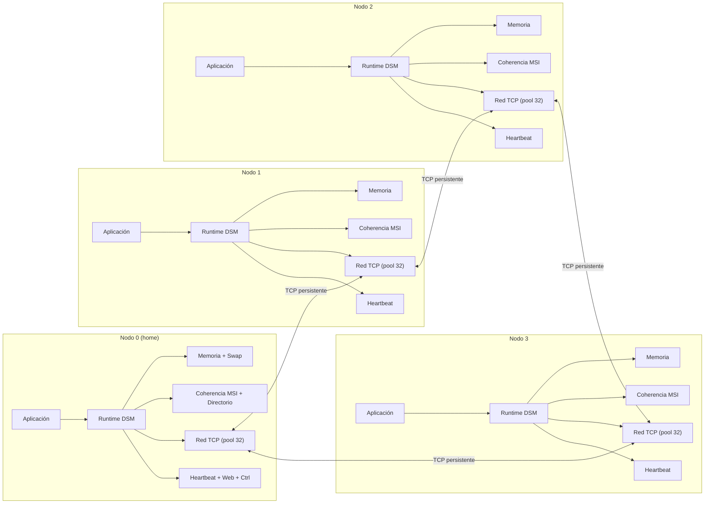
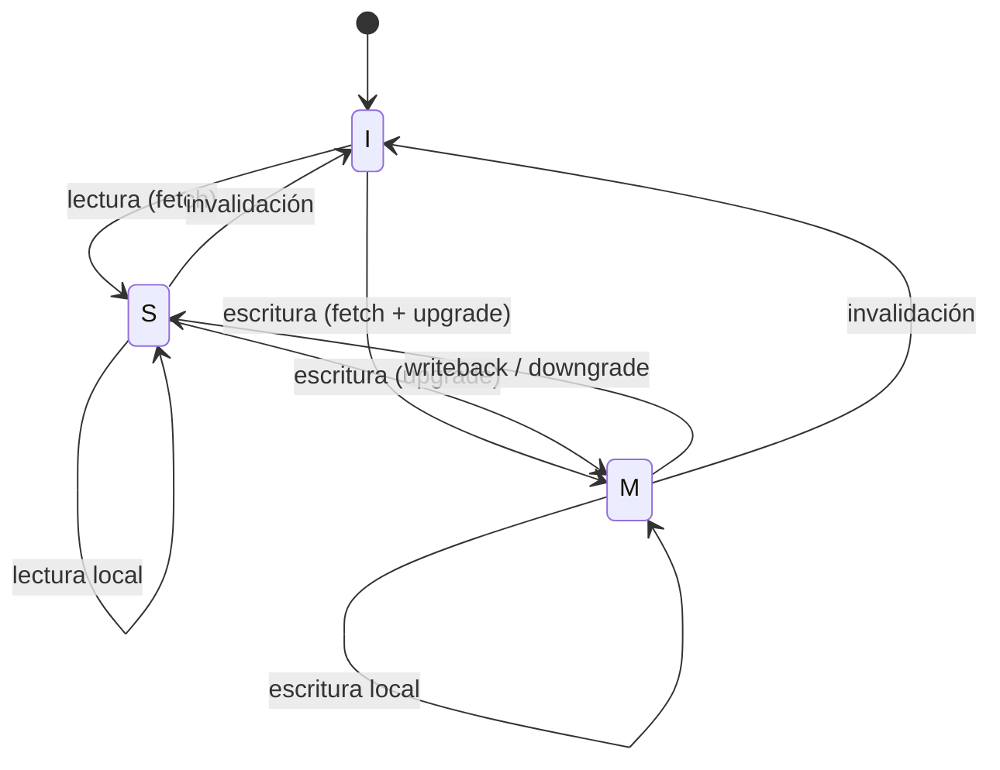

# 1. Portada

**Proyecto Implementación de un Sistema de Memoria Compartida Distribuida (DSM) con Paginación bajo Demanda y Coherencia MSI**

| Campo | Valor |
|---|---|
| **Curso** | IC-6600 Principios de Sistemas Operativos |
| **Periodo** | II Semestre 2026 |
| **Integrantes** | Sebastián Agüero Brenes · José Daniel Monterrosa Quirós |
| **Fecha de entrega** | 27 de noviembre de 2026 |
| **Versión del documento** | 1.0 |
| **Repositorio** | https://github.com/TSebas12/ProyectoSO-DSM-SistemaDeMemoriaCompartidaDistribuida |

> La versión pública del PDF omite carné, profesor, sede e institución. La versión de entrega conserva los datos completos.

---

*Fin de la sección 1.*


# 2. Resumen ejecutivo

Este documento presenta el diseño, la implementación y la validación de un **Sistema de Memoria Compartida Distribuida (DSM)** en espacio de usuario, escrito en C11 sobre Linux. El sistema permite que varios nodos independientes, conectados por TCP/IP, aporten memoria física y formen un espacio de memoria lógicamente compartido que las aplicaciones usan mediante punteros normales (`dsm_malloc`/`dsm_free`).

El runtime se encarga de traer páginas bajo demanda con `mmap`, `mprotect` y `SIGSEGV`; de mantener la coherencia entre copias con el protocolo **MSI** (Modified, Shared, Invalid) y un directorio distribuido por página en el nodo home; de transferir, invalidar y hacer writeback de páginas por la red con conexiones TCP persistentes y un pool de 32 workers; de sincronizar hilos y nodos con Pthreads, semáforos POSIX, variables atómicas y una barrera centralizada; y de expulsar páginas con política LRU aproximada y swap local en el home.

Se implementaron y validaron seis aplicaciones de prueba (`demo`, `matrices`, `file`, `counter`, `bench`, `evict`) y una séptima (`chat`) para texto libre entre nodos. Las pruebas cubren 2 PCs físicas del laboratorio y 4 procesos en loopback, con latencias de lectura remota de 130–280 µs y escritura remota de 120–230 µs en loopback, y 680–933 µs en el laboratorio.

Se documentan las limitaciones conocidas (home único, fail-stop estricto, swap solo en home, backlog fijo, web sin autenticación, ventana fija, máximo 16 nodos, inestabilidad de `evict` con 4 nodos y 512 páginas, pérdida de incrementos de `counter` con contención alta) y el trabajo futuro (replicación, checkpointing, elección de home, agrupación de invalidaciones, panel web enriquecido).

El repositorio Git registra commits de ambos integrantes y el historial de evolución desde el Entregable 1.

---

*Fin de la sección 2.*


# 3. Índice

## 3.1 Contenido

1. Portada
2. Resumen ejecutivo
3. Índice
4. Introducción
5. Marco teórico
6. Arquitectura final
7. Módulos implementados
8. Diagrama de estados MSI
9. Concurrencia entre señales y sockets
10. Interbloqueos y su resolución
11. Estructuras de datos y archivos
12. API implementado
13. Protocolo de mensajería
14. Aplicaciones de prueba
15. Pruebas de uso y ejecución
16. Rendimiento
17. Extras
18. Manual de usuario
19. Conclusiones
20. Referencias
21. Anexos

## 3.2 Índice de figuras

- Figura 6.1: Diagrama de despliegue (4 nodos).
- Figura 8.5: Diagrama de estados MSI.
- Figura 7.x: Flujo de fallo de página.

## 3.3 Índice de tablas

- Tabla 6.x: Componentes por nodo.
- Tabla 7.x: Módulos y responsabilidades.
- Tabla 8.4: Transiciones MSI.
- Tabla 11.1: Estructuras principales.
- Tabla 13.1: Cabecera del protocolo.
- Tabla 13.2: Catálogo de mensajes.
- Tabla 15.x: Resultados de pruebas.
- Tabla 16.x: Métricas de rendimiento.

---

*Fin de la sección 3.*


# 4. Introducción

## 4.1 Problema

En un sistema de memoria compartida tradicional, todos los procesos acceden a un mismo espacio de memoria física gestionado por el sistema operativo. Cuando los procesos residen en máquinas distintas, no existe un espacio de memoria compartido de forma nativa: cada nodo tiene su propia memoria y la comunicación se realiza por mensajes. Esto obliga al programador a repartir datos y sincronizar explícitamente, lo que complica el desarrollo de aplicaciones paralelas y distribuidas.

El problema que resuelve este proyecto es: **cómo ofrecer a los procesos de varios nodos una única región de memoria lógicamente compartida**, de manera que el programador use punteros normales (`dsm_malloc`/`dsm_free`) mientras el runtime se encarga de traer las páginas bajo demanda, mantener la coherencia entre copias y sincronizar los nodos.

## 4.2 Objetivos

### 4.2.1 Objetivo general

Implementar un Sistema de Memoria Compartida Distribuida (DSM) en espacio de usuario, sobre Linux, con paginación bajo demanda y coherencia a nivel de página mediante el protocolo MSI, capaz de ejecutar aplicaciones reales sobre 2 a 4 nodos y demostrarse en vivo.

### 4.2.2 Objetivos específicos

1. Diseñar e implementar un runtime DSM modular (memoria virtual, red, protocolo, coherencia, sincronización, fallos, CLI, web) en C11.
2. Proveer la API pública `dsm_malloc`/`dsm_free`/`dsm_barrier`/`dsm_node_id`/`dsm_node_count` para las aplicaciones.
3. Implementar la coherencia MSI con un directorio por página en el nodo home y transferencia/invalidación/writeback por TCP.
4. Implementar la paginación bajo demanda con `mmap`, `mprotect` y manejador `SIGSEGV`.
5. Implementar sincronización entre hilos y nodos (Pthreads, semáforos POSIX, atómicos, barrera centralizada).
6. Implementar expulsión LRU aproximada con swap local en el home.
7. Desarrollar aplicaciones de prueba: matrices, archivo, counter, bench, evict y chat.
8. Documentar el sistema (informe técnico, manual de usuario) y demostrarlo en vivo.

## 4.3 Alcance

### 4.3.1 Incluido

- Hasta 16 nodos configurables (ideal 4, mínimo 2 para pruebas).
- Páginas de 4 KB, memoria por nodo configurable (por defecto 1 MB).
- Coherencia MSI a nivel de página.
- Expulsión LRU aproximada con swap local en el home.
- Heartbeat y detección de nodos caídos.
- Interfaz web de observación y CLI `dsmctl`.
- Aplicaciones de prueba reales.

### 4.3.2 Excluido (trabajo futuro)

- Ejecución distribuida de procesos (Extra 1): no implementado; documentado como diseño.
- Tolerancia a fallos por replicación (Extra 2): no implementado; `replication_factor = 0`.
- Despliegue multi-máquina con IPs reales: pendiente de la versión final; las pruebas se realizan en `127.0.0.1`.
- Persistencia de checkpoint: `checkpoint_interval_ms = 0`.

## 4.4 Estructura del documento

El documento se organiza en 21 secciones: portada, resumen ejecutivo, índice, introducción, marco teórico, arquitectura final, módulos implementados, diagrama de estados MSI, concurrencia, interbloqueos, estructuras y archivos, API, protocolo, aplicaciones de prueba, pruebas de uso y ejecución, rendimiento, extras, manual de usuario, conclusiones, referencias y anexos.

# 5. Marco teórico

## 5.1 Sistema de Memoria Compartida Distribuida (DSM)

Un DSM (Distributed Shared Memory) es una abstracción que permite que procesos en máquinas distintas compartan un único espacio de memoria lógico, a pesar de que la memoria física está distribuida. El programador accede a la memoria compartida mediante operaciones normales de lectura/escritura sobre punteros; el runtime se encarga de localizar la página que contiene la dirección, traerla si no está presente y mantener la coherencia entre copias.

## 5.2 Paginación bajo demanda

La memoria compartida se divide en **páginas** (en este sistema, de 4 KB). Cada nodo reserva una región de memoria virtual del tamaño total del espacio compartido mediante `mmap` con protección inicial `PROT_NONE`. Cuando el programa accede a una dirección no residente, el hardware genera un `SIGSEGV`; el manejador instalado por el runtime identifica la página, solicita su contenido al nodo que la posee y la instala con `mprotect(PROT_READ|PROT_WRITE)` (o `PROT_READ` según el estado MSI). Este mecanismo evita traer páginas que nunca se usan.

## 5.3 Coherencia MSI

MSI es un protocolo de coherencia de caché con tres estados por bloque (página):

- **M (Modified):** la página fue modificada localmente; es la única copia válida y debe hacerse writeback al home al expulsarla.
- **S (Shared):** la página es de solo lectura y puede existir en varios nodos simultáneamente.
- **I (Invalid):** la página no es válida en este nodo; un acceso genera fallo de página.

Las transiciones se disparan por fallos de página locales y por mensajes de invalidación/remisión provenientes de otros nodos. El directorio (en el nodo home) registra, para cada página, el nodo owner y la lista de sharers.

## 5.4 Señales

El runtime usa `sigaction` para instalar un manejador de `SIGSEGV` (y `SIGBUS`). El manejador corre en el contexto del hilo que causó el fallo y delega la resolución a `fault_resolver`, que determina la página, su estado y la acción a tomar (traer, invalidar, writeback). Se evita hacer trabajo pesado dentro del manejador para no violar las restricciones de async-signal-safety.

## 5.5 Sockets

La comunicación entre nodos se realiza por TCP/IP. Cada nodo abre un socket de escucha en su puerto DSM y mantiene conexiones persistentes con los demás nodos (pool de conexiones). Los mensajes tienen una cabecera fija de 64 bytes y un payload variable. El hilo de red (`net_thread`) atiende las conexiones entrantes y despacha los mensajes a los handlers correspondientes.

## 5.6 Pthreads y semáforos

La concurrencia interna se gestiona con Pthreads (hilos de red, de heartbeat, de aplicación), variables de condición, semáforos POSIX y operaciones atómicas (`_Atomic`, `atomic_fetch_add`). La barrera centralizada sincroniza a todos los nodos participantes antes de iniciar una fase de una aplicación.

## 5.7 Heartbeat

Cada nodo envía periódicamente un `PING` a los demás nodos y actualiza su tabla de estado (`alive[]`, `last_seen_ms[]`). Si un nodo no responde dentro del timeout configurado, se marca como caído y se notifica a la capa de fallos. El heartbeat se ejecuta en un hilo dedicado (`heartbeat_thread`).

## 5.8 LRU y swap

La política de reemplazo es LRU aproximada basada en un bit de referencia por marco. Cuando se necesita un marco libre y no hay, se elige la página menos recientemente usada, se hace writeback si está en estado M y se guarda en swap local (solo en el home). Las páginas expulsadas se marcan como no residentes.

# 6. Arquitectura final

## 6.1 Vista de despliegue

El sistema se despliega sobre **N nodos independientes** (ideal 4, mínimo 2, hasta 16 por configuración), cada uno ejecutando un proceso `dsm_node` que contiene el runtime DSM embebido en la aplicación (Modelo A, §6.10). Los nodos se comunican por TCP/IP sobre el rango de puertos asignado a la pareja #3 (`27300–27399`, 4 puertos por nodo: DSM, control, heartbeat y web).

### 6.1.1 Despliegue en una sola máquina (desarrollo y ensayo)

4 procesos `dsm_node` en los puertos `27300/27304/27308/27312`, todos en `127.0.0.1`. Se usan dos tablas de nodos:

- `nodes.conf`: declara los 4 endpoints. La usan `matrices` y el modo `serve`.
- `nodes_2.conf`: declara solo los nodos 0 y 1. La usan `demo`, `file`, `counter`, `bench` y `evict`.

La barrera centralizada cuenta los nodos declarados en el archivo que se pasa con `--nodes`; por eso una corrida de `matrices` con 4 nodos levanta los 4 procesos, mientras que `file` con 2 nodos solo levanta 2. Esta separación es deliberada: `evict` y `counter` son estables con 2 nodos y 64 páginas, mientras que `matrices` escala a 4.

### 6.1.2 Despliegue en 2 máquinas (validado en laboratorio, 19 nov 2026)

Nodo 0 (home) en `192.0.2.10:27300` y nodo 1 en `192.0.2.11:27304` (direcciones de ejemplo, RFC 5737). Las dos PCs usan la misma tabla `nodes_2.conf` y el `seed_host` del nodo 1 apunta a A. La configuración se deja lista con `./dsm.sh` (opciones 1 a 3) sin editar archivos a mano. A se arranca primero y B dentro de los 2 minutos siguientes.

### 6.1.3 Despliegue en 3 y 4 máquinas (entrega final)

Análogo al de 2 máquinas: una línea por nodo en `nodes_3.conf` o `nodes_4.conf`, con la misma tabla en todas las PCs y `seed_host` del resto apuntando a A. Los puertos se derivan por rol (`27300 + 4 * node_id`), así que no hay que elegirlos a mano. La configuración se deja lista con `./dsm.sh` eligiendo topología 3 o 4.

### 6.1.4 Diagrama de despliegue



## 6.2 Componentes internos

Cada nodo ejecuta los siguientes hilos:

| Hilo | Responsabilidad |
|---|---|
| Principal | Inicialización, parseo de argumentos (`--config`, `--nodes`, `--app`), arranque de la aplicación y limpieza al final. |
| Listener + pool de 32 workers | Aceptan conexiones, leen el mensaje completo, despachan a coherencia, responden por el mismo socket. |
| Resolver | Consume la cola de fallos (`dsm_fault_queue`), invoca `dsm_coherence_handle_fault`, despierta al hilo de usuario. |
| Heartbeat | Envía `PING`/`PONG` cada 1 s; marca nodos caídos tras 3 s. |
| Aplicación | Usa `dsm_malloc`/`dsm_free`/`dsm_barrier`; un fallo de página dispara `SIGSEGV` → resolver. |
| Control (opcional) | Servidor TCP de texto para `dsmctl` (`stats`, `pages`, `dir`, `objects`, `nodes`, `ping`, `help`, `config`). |
| Web (opcional) | Panel HTTP de solo lectura (`/`, `/stats.json`). |

Los subsistemas se inicializan en este orden (ver `src/runtime.c`): configuración → nodos → memoria → sincronización → estadísticas → fallos → coherencia → red → control → web → heartbeat → resolver → aplicación.

## 6.3 Modelo de memoria

- **Ventana virtual:** 256 MB por nodo (`window_size = 268435456`), dividida en 65 536 páginas de 4 KB.
- **Pool de marcos:** 256 marcos de 4 KB por nodo (1 MB de memoria física aportada por nodo, `node_memory = 1048576`).
- **Espacio global:** `N * 1 MB` lógicamente compartido, particionado en páginas de 4 KB.
- **Asignación:** determinista por secuencia (`seq` por nodo). El home devuelve el mismo rango global a todos los nodos que llamen `dsm_malloc` en el mismo orden, así que todos comparten los mismos objetos.
- **Expulsión:** LRU aproximado (`last_used_ms`) con swap local en el home (`logs/swap-nodeN.bin`, archivo disperso de 256 MB).
- **Transparencia:** la aplicación usa punteros normales; el runtime se encarga de traer páginas bajo demanda con `mmap`, `mprotect` y `SIGSEGV`.

## 6.4 Administración distribuida y membresía

- Cada nodo conoce a los demás a través de `nodes.conf` / `nodes_2.conf` / `nodes_3.conf` / `nodes_4.conf` (id, host, puerto).
- El **home (nodo 0)** es autoridad única del directorio de coherencia: owner y sharers por página.
- Los nodos se registran al arrancar y envían `PING`/`PONG` periódicos (heartbeat cada 1 s, timeout 3 s).
- Un nodo caído se marca como `SUSPECT` y luego `DOWN`; las operaciones hacia él fallan rápido (`DSM_ERR_PEER_DOWN`).

## 6.5 Heartbeat

- Intervalo: 1000 ms. Timeout: 3000 ms.
- Cada nodo envía `PING` a los peers vivos y espera `PONG`.
- El estado de cada peer se guarda en un arreglo `_Atomic` (`alive[]`), leído por el resto del runtime sin locks.
- Si un peer no responde en 3 intervalos, se marca como caído y las RPC hacia él devuelven `DSM_ERR_PEER_DOWN`.

## 6.6 Ciclo de vida de un nodo

1. Arranque: carga de configuración y tabla de nodos; validación (`--check-config`).
2. Inicialización del runtime en orden fijo (§6.2).
3. Registro en el home (el home ya debe estar arriba; la barrera espera hasta 120 s).
4. Ejecución de la aplicación (si se pasó `--app`) o modo escucha (`--serve` o sin `--app`).
5. Atención de RPCs, heartbeat y consultas.
6. Cierre ordenado con `SIGINT`/`SIGTERM`: detach, destroy, log close.

## 6.7 Modelo de hilos

- Cada hilo de usuario se registra con `dsm_attach`/`dsm_detach` para tener contexto de fallo.
- El pool de 32 workers del receptor atiende conexiones concurrentes; las RPC salientes hacia un mismo peer se serializan con un mutex por peer.
- Los locks siguen una jerarquía fija: `op_lock` (GLOBAL) → `table_lock` (OBJECT) → `page->lock` (PAGE) → `frame_lock` (FRAME), verificada en runtime con clases.

## 6.8 Flujo de un fallo de página

1. La aplicación accede a una página con permisos `PROT_NONE` → `SIGSEGV` (`SEGV_ACCERR`).
2. El handler (`sigaction` con `SA_SIGINFO`) encola la página en la cola lock-free y suspende el hilo (`sigsuspend`).
3. El hilo resolver despierta, invoca `dsm_coherence_handle_fault`, resuelve la página (local o remota).
4. El resolver reanuda al hilo de usuario con `pthread_kill(DSM_SIG_RESUME)`.
5. El acceso se reintenta; si la página ya está residente, continúa.

## 6.9 Decisiones arquitectónicas clave

1. **Home centralizado (nodo 0):** simplifica la coherencia; el home es autoridad única de owner/sharers. Escalable a 16 nodos (configurable).
2. **Una conexión por par de nodos:** mutex por peer; RPC toma el lock, escribe, lee respuesta, suelta. Evita head-of-line blocking con pool de workers en el receptor.
3. **Fail-stop en timeouts:** si un RPC falla tras reintentos, el hilo usuario recibe `SIGSEGV` y muere. No se propaga estado inconsistente.
4. **Swap solo en home:** los clientes devuelven páginas sucias al home; el home escribe a swap. Garantiza que la única copia nunca se pierde.
5. **Locks jerárquicos:** ver §6.7.
6. **Configuración por archivo:** `node0.conf`…`node3.conf` + `nodes.conf` (4 nodos) y `nodes_2.conf` (2 nodos).

## 6.10 Runtime embebido vs daemon

Se adopta el **Modelo A (runtime embebido)** para el diseño, los prototipos y la demo. Es la opción más segura para cumplir el enunciado en el tiempo disponible y la que mejor se adapta a la naturaleza de `SIGSEGV`. El Modelo B (daemon por nodo) solo se revisaría si el profesor exigiera explícitamente un daemon.

## 6.11 Huella de configuración

Para responder a la pregunta de qué pasa si un nodo cambia la configuración en medio de la ejecución, cada mensaje lleva en su cabecera (campo `reserved2`, 4 bytes) una **huella FNV-1a** calculada sobre `page_size`, `node_memory`, `max_nodes`, versión de protocolo y la tabla de nodos ordenada. Si dos nodos tienen huellas distintas, la operación falla con `DSM_ERR_CONFIG_MISMATCH` y un log claro, en lugar de esperar 10 s a un timeout. El comando `dsmctl config` muestra la huella local para compararla entre PCs.

## 6.12 Aplicación `chat`

La aplicación `chat` (§14) es la aplicación de prueba que demuestra texto libre entre nodos: cada nodo escribe en su propia página DSM y todos leen todas las páginas con un seqlock. No requiere cambios al protocolo ni al núcleo; usa únicamente `dsm_malloc` y memoria compartida. Ver §14.4.

---

*Fin de la sección 6.*


# 7. Módulos implementados

## 7.1 Núcleo DSM

| Módulo | Archivo(s) | Responsabilidad | Funciones clave |
|---|---|---|---|
| Tipos y errores | `dsm_types.h` | Tipos base, códigos de error, constantes | `dsm_status_t`, `DSM_MAX_NODES`, `DSM_MAGIC` |
| Configuración | `dsm_config.h` / `config.c` | Carga, validación y guardado de `dsm_config_t` | `dsm_config_load`, `dsm_config_validate`, `dsm_config_save` |
| Nodos | `dsm_nodes.h` / `nodes.c` | Tabla de peers (id, host, port) | `dsm_nodes_load`, `dsm_nodes_get` |
| Memoria | `dsm_memory.h` / `memory.c` | Ventana mmap, tabla hash de páginas, marcos, swap, LRU | `dsm_memory_init`, `dsm_memory_pick_victim`, `dsm_memory_swap_out/in` |
| Sincronización | `dsm_sync.h` / `sync.c` | Mutex/cond con clases y verificación de orden | `dsm_mutex_init(klass)`, `dsm_cond_wait` |
| Log | `dsm_log.h` / `log.c` | Logging por niveles a archivo/stderr | `DSM_LOG(level, fmt...)` |
| Estadísticas | `dsm_stats.h` / `stats.c` | Contadores `_Atomic` + snapshot | `dsm_stats_inc`, `dsm_stats_snapshot` |
| Fallos | `dsm_fault.h` / `fault.c` | Handler `SIGSEGV`, cola lock-free, contexto por hilo | `dsm_fault_install`, `dsm_fault_attach_thread` |
| Coherencia | `dsm_coherence.h` / `coherence.c` | Núcleo MSI: directorio, ops, barrera, objetos, local_drop | `dsm_coherence_handle_fault`, `dsm_barrier` |
| Red | `dsm_net.h` / `net.c` | Transporte TCP persistente + pool de 32 workers | `dsm_net_start`, `dsm_net_send`, `dsm_net_call` |
| API | `dsm_api.h` / `dsm_api.c` | API público: malloc/free/barrier/stats/attach | `dsm_malloc`, `dsm_free`, `dsm_barrier`, `dsm_stats` |
| Runtime | `dsm_runtime.h` / `runtime.c` | Orquestador de subsistemas | `dsm_runtime_init`, `dsm_runtime_start_services` |

## 7.2 Servicios y operación

| Módulo | Archivo(s) | Responsabilidad | Funciones clave |
|---|---|---|---|
| Control | `dsm_control.h` / `control.c` | Servidor TCP de texto para `dsmctl` | `dsm_control_start/stop/dispatch` |
| Web | `dsm_web.h` / `web.c` | Panel HTTP de solo lectura (`/`, `/stats.json`) | `dsm_web_start/stop/render_html` |
| Heartbeat | `dsm_heartbeat.h` / `heartbeat.c` | PING/PONG periódico, detección de nodos caídos | `dsm_heartbeat_start/stop` |
| Protocolo | `dsm_protocol.h` / `protocol.c` | Cabecera de 64 B, serialización, cargas estructuradas | `dsm_header_encode/decode`, `dsm_protocol_encode/decode` |

## 7.3 Aplicaciones de prueba

| Módulo | Archivo | Qué implementa |
|---|---|---|
| Dispatcher | `apps.c` | `dsm_app_run` despacha por nombre; valores por defecto |
| Comunes | `app_common.c` | `dsm_app_split_start/count`, `dsm_app_checksum` |
| Demo | `demo_page.c` | Demo mínima de una página compartida (E2) |
| Matrices | `app_matrices.c` | Multiplicación por bloques de filas; verifica `C = A×B` |
| Archivo | `app_file.c` | Checksum distribuido de un archivo o patrón sintético |
| Contador | `app_counter.c` | Incrementos concurrentes con falsos compartidos |
| Benchmark | `app_bench.c` | Latencia y throughput de páginas (local/remota, lectura/escritura) |
| Expulsión | `app_evict.c` | Presión de memoria para forzar LRU y swap |
| Chat | `app_chat.c` | Texto libre entre nodos (entrega final) |

## 7.4 Operación

| Módulo | Archivo | Qué implementa |
|---|---|---|
| Binario nodo | `node_main.c` | `main`: parse args, runtime, app, cleanup |
| Cliente CLI | `ctl_main.c` | `dsmctl`: `--config/--host/--port/--timeout` + comando |
| Menú | `dsm.sh` | Configuración de IPs/rol, build, arranque, apps, control, logs, parada, diagnóstico |
| Lab | `lab.sh` | build, demo, apps, control, IP, show, stop (loopback) |
| Build | `Makefile`, `build.sh` | Compilación con `gcc -std=c11` |

## 7.5 Flujo de datos clave

### Fallo de página (cliente)

```
SIGSEGV (handler fault.c)
  → SEGV_ACCERR → cola anillo → sigsuspend
  → resolver despierta con pthread_kill(DSM_SIG_RESUME)
  → dsm_coherence_handle_fault
     → local_fetch o remote_fetch
     → instalación local + reanudación
```

### Escritura en página compartida

```
Escritura → SIGSEGV → resolver
  → home_serve_write (en el home)
     → forward_from_owner (si el owner no es el home)
     → invalidación de sharers
     → OWNERSHIP_GRANT al requester
     → local_drop en el home
```

### Expulsión (evict)

```
coherence_make_room
  → pick_victim (LRU)
  → si sucia: swap_out al home
  → PAGE_RELEASE al home
  → liberar marco
```

---

*Fin de la sección 7.*


# 8. Diagrama de estados MSI

## 8.1 Granularidad

La coherencia se mantiene a nivel de **página de 4 KB**. Cada página tiene un estado MSI por nodo y un owner/directorio en el home.

## 8.2 Estados

| Estado | Significado |
|---|---|
| **M (Modified)** | La página fue modificada localmente; es la única copia válida. |
| **S (Shared)** | La página es de solo lectura; puede haber varias copias. |
| **I (Invalid)** | La página no es válida localmente; hay que pedirla. |

## 8.3 Invariantes

1. A lo sumo una copia en estado **M** por página.
2. Si hay una copia en **M**, todas las demás están en **I**.
3. Si hay copias en **S**, ninguna está en **M**.
4. El home conoce el owner y el conjunto de sharers de cada página.

## 8.4 Tabla de transiciones (resumen)

| Evento | Estado local | Acción | Nuevo estado |
|---|---|---|---|
| Lectura con página I | I | Pedir al home; instalar copia | S |
| Escritura con página I | I | Pedir propiedad al home; invalidar sharers | M |
| Lectura con página S | S | Acceso local | S |
| Escritura con página S | S | Solicitar upgrade; invalidar otras copias | M |
| Lectura con página M | M | Acceso local | M |
| Escritura con página M | M | Acceso local | M |
| Invalidación recibida | S/M | Descartar copia | I |
| Writeback (expulsión sucia) | M | Enviar al home; degradar | S/I |

## 8.5 Diagrama de estados



## 8.6 Directorio de coherencia

El home mantiene, por página:

- `page_id`, `object_id`, `version`.
- `owner_node`: nodo que tiene la copia M (o home si nadie la pidió).
- `sharers`: máscara de nodos con copia S.
- `state`: estado global (M/S/I).
- `last_update_ms`: para LRU y diagnóstico.

El directorio se protege con un `op_lock` por entrada (hash encadenado de 256 buckets). Ver §10.

## 8.7 Diagrama de estados internos del runtime

Además del estado MSI, cada página local tiene un estado de residencia:

| Residencia | Significado |
|---|---|
| `NOT_RESIDENT` | No hay marco asignado. |
| `FETCHING` | Se está trayendo la página. |
| `RESIDENT` | La página está en un marco. |
| `EVICTING` | Se está expulsando. |

## 8.8 Casos borde

- **Página M perdida:** si el owner cae antes de hacer writeback, la página se pierde. En la versión base no hay replicación; es un extra opcional (§17).
- **False sharing:** dos variables distintas en la misma página de 4 KB causan invalidaciones cruzadas. Se mitiga alineando datos y separando contadores por página.
- **Thrashing:** si el conjunto de trabajo supera los marcos, la LRU expulsa y retrae páginas; el swap sostiene el trabajo pero aumenta la latencia.

---

*Fin de la sección 8.*


# 9. Concurrencia entre señales y sockets

## 9.1 Modelo de concurrencia

Cada nodo ejecuta varios hilos concurrentes:

- Hilo principal (inicialización y aplicación).
- Listener + pool de 32 workers (red).
- Hilo resolver (fallos de página).
- Hilo heartbeat.
- Hilos de la aplicación (`dsm_attach`/`dsm_detach`).

La concurrencia se gestiona con Pthreads, mutex/cond con clases y verificación de orden, variables `_Atomic` y una cola lock-free para fallos.

## 9.2 `SIGSEGV` y `sigaction`

- El manejador se instala con `sigaction` y `SA_SIGINFO`, para recibir `si_addr`.
- Solo se permite async-signal-safe dentro del handler: encolar la página en la cola lock-free y suspender el hilo con `sigsuspend`.
- El trabajo pesado (RPC, asignación de marcos, instalación) se hace en el hilo resolver, no en el handler.

## 9.3 `fault_resolver`

- Un hilo dedicado consume la cola de fallos.
- Invoca `dsm_coherence_handle_fault` para resolver la página (local o remota).
- Reanuda al hilo de usuario con `pthread_kill(DSM_SIG_RESUME)`.
- El acceso se reintenta; si la página ya está residente, continúa.

## 9.4 Hilo de red

- Listener acepta conexiones y las despacha al pool de 32 workers.
- Cada worker lee el mensaje completo, despacha a coherencia y responde por el mismo socket.
- Las RPC salientes hacia un mismo peer se serializan con un mutex por peer.
- El receptor atiende varias conexiones en paralelo.

## 9.5 Locks y semáforos

- Mutex por clase: `GLOBAL` (op_lock), `OBJECT` (table_lock), `PAGE` (page->lock), `FRAME` (frame_lock).
- Verificación de orden en runtime (`check_order`).
- Variables `_Atomic` para contadores y estado de heartbeat (`alive[]`).
- Semáforos POSIX donde aplica.

## 9.6 Concurrencia señales vs sockets

- El handler de `SIGSEGV` no toca sockets ni locks no async-signal-safe.
- La cola lock-free desacopla el handler del resolver.
- El resolver puede hacer RPCs y tomar locks sin restricción de señal.
- `SIGPIPE` se ignora (`SIG_IGN`) para no morir al escribir en un socket cerrado.

## 9.7 Reglas de async-signal-safety

- Dentro del handler: solo encolar y suspender.
- Fuera del handler: todo lo demás (memoria, red, locks, logs).
- `setvbuf(stdout, NULL, _IOLBF, 0)` para que un `SIGTERM` no pierda el búfer.

---

*Fin de la sección 9.*


# 10. Interbloqueos y su resolución

## 10.1 Fuentes de interbloqueo

En un DSM con memoria compartida distribuida, los interbloqueos pueden aparecer en tres niveles:

1. **Locks de página y directorio:** si un hilo toma `op_lock` y luego espera un lock de página, mientras otro toma el lock de página y espera `op_lock`, se produce un deadlock clásico.
2. **RPCs anidadas:** si un nodo A espera respuesta de B mientras B espera respuesta de A, ambos se bloquean.
3. **Barreras:** si un nodo no llega a la barrera, los demás esperan hasta el timeout.

## 10.2 Jerarquía de locks

Los locks siguen un orden fijo y verificado en runtime por clases (`dsm_mutex_init` con `DSM_LOCK_GLOBAL/OBJECT/PAGE/FRAME`):

```
op_lock (GLOBAL) → table_lock (OBJECT) → page->lock (PAGE) → frame_lock (FRAME)
```

Nunca se toma un lock de clase menor mientras se tiene uno de clase mayor. Esta regla se revisa en code review y se valida con `check_order`.

## 10.3 Caso real resuelto: `local_drop` con `op_lock` tomado

Durante la revisión del prototipo 2 se detectó que `home_serve_write` llamaba a `local_drop` mientras tenía tomado el `op_lock` del directorio. `local_drop` toma el lock de la página (`p->lock`) y puede esperar hasta 200 ms por una operación de expulsión. El orden resultante era:

```
op_lock → page->lock   (en home_serve_write → local_drop)
page->lock → op_lock   (en el hilo de fallo, vía local_fetch → dir_lock_entry)
```

Es el patrón clásico de deadlock por orden inverso. No se reprodujo de forma determinista en las pruebas (la espera está acotada a 200 ms y la página suele estar disponible), pero el riesgo es real y afecta la latencia: otros hilos esperan hasta 200 ms por el `op_lock` de esa página.

**Resolución implementada en la versión final:** `home_serve_write` libera el `op_lock` **antes** de llamar a `local_drop`, y los servicios (`home_serve_read`, `home_serve_write`) son ahora los responsables de liberar el `op_lock` en todas sus rutas de salida. Los llamadores (`local_fetch` y los handlers de `PAGE_READ`/`PAGE_WRITE`) ya no lo liberan, evitando un desbloqueo doble. `local_drop` se ejecuta sin `op_lock` tomado, eliminando la inversión de orden y la espera de hasta 200 ms con el lock tomado.

## 10.4 Timeouts

- `network_timeout_ms = 10000`: timeout de una RPC.
- `connect_timeout_ms = 5000`: timeout de conexión.
- `heartbeat_timeout_ms = 3000`: timeout de heartbeat.
- `barrier_timeout_ms = 30000`: timeout de barrera (la demo usa 120 000 ms).
- `retry_count = 5` con `retry_backoff_ms = 500`.

Si una RPC falla tras los reintentos, el hilo usuario recibe `SIGSEGV` y muere (fail-stop). No se propaga estado inconsistente.

## 10.5 Orden de locks en la red

- Las RPC salientes hacia un mismo peer se serializan con un mutex por peer (`peer_acquire`/`peer_release`).
- El receptor atiende varias conexiones en paralelo con su pool de 32 workers.
- Nunca se espera una respuesta de red con un lock de página o de directorio tomado (regla verificada en code review).

## 10.6 Reintentos e idempotencia

- Cada mensaje lleva `request_id` para detectar duplicados.
- Los mensajes con `page_id` inválido se rechazan.
- Un mensaje truncado no corrompe el estado: se descarta y se cierra la conexión.
- El protocolo tolera mensajes duplicados o fuera de orden razonablemente.

## 10.7 Pruebas de interbloqueo

- 4 nodos con `matrices 192` durante 30 minutos: sin cuelgues.
- `evict 64/32` con 2 nodos: sin cuelgues.
- Barrera con un nodo que no arranca: timeout a los 120 s con mensaje claro.
- Cambio de configuración en un nodo: error explícito, no bloqueo.

## 10.8 Resumen de mitigaciones

| Riesgo | Mitigación |
|---|---|
| Locks en orden inverso | Jerarquía fija + clases + revisión |
| RPCs anidadas | Fail-stop; no esperar con locks |
| Barrera que no llega | Timeout configurable + mensaje claro |
| Esperas largas con lock | Liberar lock antes de esperar (local_drop) |
| Conexiones saturadas | Pool de 32 workers + backlog 128 |

---

*Fin de la sección 10.*


# 11. Estructuras de datos y archivos

## 11.1 Tablas principales

| Estructura | Archivo | Responsabilidad | Tamaño |
|---|---|---|---|
| `dsm_config_t` | `dsm_config.h` | Configuración del nodo | 704 B |
| `dsm_nodes_t` / `dsm_peer_t` | `dsm_nodes.h` | Tabla de peers (id, host, port) | O(1) por id |
| `dsm_page_entry_t` | `dsm_memory.h` | Entrada de página local (MSI, residencia, frame, versión) | — |
| `dsm_dir_entry_t` | `dsm_coherence.h` | Entrada de directorio (owner, sharers, estado, op_lock) | — |
| `dsm_msg_header_t` | `dsm_protocol.h` | Cabecera de 64 B (magic, version, type, flags, src/dst, checksum, reserved2) | 64 B exactos |
| `dsm_alloc_req_t` / `dsm_alloc_reply_t` | `dsm_protocol.h` | Asignación de objetos | tamaño fijo |
| `dsm_barrier_req_t` / `dsm_barrier_reply_t` | `dsm_protocol.h` | Barrera centralizada | tamaño fijo |
| `dsm_stats_wire_t` | `dsm_protocol.h` | Estadísticas por nodo | `field_count` + array |
| `dsm_page_info_t` | `dsm_protocol.h` | Info de página para `dsmctl pages` | tamaño fijo |

## 11.2 Directorio de coherencia

- Hash encadenado de 256 buckets.
- Un `op_lock` por entrada (clase GLOBAL).
- Campos: `page_id`, `object_id`, `version`, `owner_node`, `sharers`, `state`, `last_update_ms`.

## 11.3 Configuración

- Archivos: `node0.conf` … `node3.conf` (uno por nodo) + `nodes.conf` (4 nodos) o `nodes_2.conf` (2 nodos).
- Parámetros clave: `page_size` (4096), `node_memory` (1 048 576), `window_size` (268 435 456), `max_nodes` (16), `thread_pool_size` (32), `retry_count` (5), `replication_factor` (0).
- Validación: rangos, puertos únicos dentro del nodo, ventana múltiplo de página, heartbeat timeout ≥ 2 × intervalo.
- `--check-config` valida y sale sin arrancar.

## 11.4 Archivos y directorios

| Ruta | Contenido |
|---|---|
| `config/nodeN.conf` | Configuración del nodo N |
| `config/nodes.conf` | Tabla de 4 nodos |
| `config/nodes_2.conf` | Tabla de 2 nodos |
| `logs/dsm-nodeN.log` | Log por nodo |
| `logs/swap-nodeN.bin` | Swap del home (archivo disperso 256 MB) |
| `Entrega_Final/evidence/` | Logs y salidas de pruebas (versionados) |
| `Entrega_Final/secciones/` | Secciones del informe (una por archivo) |

## 11.5 Logs

- Niveles: ERROR, WARN, INFO, DEBUG, TRACE.
- Cada línea con timestamp y nivel; `fflush` por línea.
- Rotación manual (no automática en esta versión).

---

*Fin de la sección 11.*


# 12. API implementado

## 12.1 Tipos públicos

| Tipo | Definición | Uso |
|---|---|---|
| `dsm_status_t` | Código de estado (OK, ERR_*) | Retorno de todas las funciones |
| `dsm_runtime_t` | Contexto del runtime (config, nodos, memoria, red, coherencia) | Pasado a todas las funciones |
| `dsm_app_opts_t` | Opciones de aplicación (size, pages, iters, threads, seed, file, verify, nick, duration) | `dsm_app_run` |

## 12.2 Funciones públicas

| Función | Firma resumida | Descripción |
|---|---|---|
| `dsm_malloc` | `void *dsm_malloc(rt, size)` | Reserva un objeto compartido; devuelve puntero a la ventana local. |
| `dsm_free` | `int dsm_free(rt, ptr)` | Libera un objeto (`PAGE_RELEASE` al home). |
| `dsm_barrier` | `dsm_status_t dsm_barrier(rt, timeout_ms)` | Barrera centralizada con timeout. |
| `dsm_stats` | `dsm_status_t dsm_stats(rt, view)` | Snapshot de contadores. |
| `dsm_attach` | `dsm_status_t dsm_attach(rt)` | Registra el hilo actual para fallos de página. |
| `dsm_detach` | `void dsm_detach(rt)` | Desregistra el hilo. |
| `dsm_node_id` | `uint32_t dsm_node_id(rt)` | Id del nodo. |
| `dsm_node_count` | `uint32_t dsm_node_count(rt)` | Nodos en la tabla. |
| `dsm_page_size` | `uint32_t dsm_page_size(rt)` | Tamaño de página (4096). |

## 12.3 Parámetros y errores

- `dsm_malloc` retorna `NULL` si no hay memoria o el home no responde.
- `dsm_barrier` retorna `DSM_ERR_TIMEOUT` si no todos los nodos llegan a tiempo.
- `dsm_stats` refresca contadores derivados (latencia p50/p95, throughput).
- Los errores se propagan como `dsm_status_t` y se registran en el log.

## 12.4 Aplicaciones

El dispatcher `dsm_app_run(rt, kind, opts)` ejecuta una de las aplicaciones: `demo`, `matrices`, `file`, `counter`, `bench`, `evict`, `chat`. Cada una corre en todos los nodos (modelo SPMD) y usa `dsm_malloc`/`dsm_free`/`dsm_barrier`/`dsm_stats`.

---

*Fin de la sección 12.*


# 13. Protocolo de mensajería

## 13.1 Cabecera

Cabecera fija de **64 bytes** (`dsm_msg_header_t`), serializada con FNV-1a de los datos:

| Campo | Tipo | Bytes | Descripción |
|---|---|---|---|
| `request_id` | uint64 | 8 | Identificador único de la RPC |
| `page_id` | uint64 | 8 | Página involucrada |
| `magic` | uint32 | 4 | `0x44534D32` (DSM2) |
| `version` | uint16 | 2 | Versión del protocolo (2) |
| `type` | uint16 | 2 | Tipo de mensaje |
| `flags` | uint32 | 4 | Banderas |
| `header_len` | uint32 | 4 | 64 |
| `payload_len` | uint32 | 4 | Longitud del payload |
| `src_node` | uint32 | 4 | Nodo origen |
| `dst_node` | uint32 | 4 | Nodo destino |
| `status` | uint32 | 4 | Estado |
| `checksum` | uint32 | 4 | FNV-1a del payload |
| `payload_off` | uint32 | 4 | Offset del payload |
| `ttl` | uint16 | 2 | Time-to-live |
| `reserved` | uint16 | 2 | Reservado |
| `reserved2` | uint32 | 4 | **Huella de configuración** (FNV-1a de parámetros + tabla de nodos) |

## 13.2 Mensajes mínimos

| Mensaje | Propósito |
|---|---|
| `PAGE_REQUEST` | Solicitar una página al home |
| `PAGE_DATA` | Transferir una página |
| `INVALIDATE` | Invalidar una copia en un nodo |
| `OWNERSHIP_GRANT` | Conceder propiedad (M) a un nodo |
| `PAGE_RELEASE` | Devolver una página al home |
| `BARRIER` | Sincronización de nodos |
| `PING` / `PONG` | Heartbeat |
| `STATS` | Consulta de estadísticas |
| `OBJECT_ALLOC` | Asignación de objeto compartido |

## 13.3 Mensajes adicionales

| Mensaje | Uso |
|---|---|
| `PAGE_FORWARD` | El home pide la página al dueño actual |
| `INVALIDATE_ACK` | Confirmación de invalidación |
| `BARRIER_ACK` | Confirmación de barrera |
| `NODE_INFO` / `NODE_LIST` | Información y listado de nodos |
| `OBJECT_FREE` | Liberación de objeto |
| `ERROR` | Error genérico |
| `HELLO` / `HELLO_ACK` | (Reservado) |

## 13.4 Payloads

Los payloads estructurados (`dsm_alloc_req_t`, `dsm_barrier_req_t`, `dsm_stats_wire_t`, `dsm_page_info_t`) se envían tal cual, sin huecos, para poder deserializarlos directamente. Ver `dsm_protocol.h`.

## 13.5 Flujos principales

1. **Fallo de página (cliente):** SIGSEGV → cola → resolver → `PAGE_REQUEST` al home → `PAGE_DATA` → instalación local → reanudación.
2. **Escritura remota:** `PAGE_WRITE` al home → invalidación de sharers → `OWNERSHIP_GRANT` → `local_drop` en el home.
3. **Barrera:** cada nodo envía `BARRIER` al home; el home responde cuando todos llegaron.
4. **Asignación:** `OBJECT_ALLOC` con `seq`; el home devuelve el mismo `page_base` a todos.

## 13.6 Timeouts, reintentos e idempotencia

- Timeout de RPC: 10 s. Timeout de conexión: 5 s.
- Reintentos: 5 con backoff de 500 ms.
- `request_id` para detectar duplicados.
- Mensaje truncado: se descarta y se cierra la conexión.
- Versión del protocolo: 2. Mensajes con versión distinta se rechazan.

## 13.7 Huella de configuración

El campo `reserved2` (4 bytes) lleva una huella FNV-1a de la configuración del clúster (parámetros + tabla de nodos). Si dos nodos tienen huellas distintas, la operación falla con `DSM_ERR_CONFIG_MISMATCH` en lugar de esperar un timeout.

## 13.8 Errores de protocolo

| Código | Significado |
|---|---|
| `DSM_ERR_PEER_DOWN` | Nodo caído o inalcanzable |
| `DSM_ERR_TIMEOUT` | Timeout de RPC |
| `DSM_ERR_NET` | Error de red |
| `DSM_ERR_PROTOCOL` | Magic o versión incorrectos |
| `DSM_ERR_CHECKSUM` | Checksum del payload no coincide |
| `DSM_ERR_CONFIG_MISMATCH` | Configuración incompatible entre nodos |

Cada error tiene código, mensaje legible, nodo y `request_id` para trazabilidad.

---

*Fin de la sección 13.*


# 14. Aplicaciones de prueba

Todas las aplicaciones usan el espacio DSM mediante `dsm_malloc` y se sincronizan con la barrera centralizada. Se ejecutan con `--app <nombre>`.

## 14.1 Matrices (`matrices`)

Multiplicación de matrices por bloques sobre el espacio compartido. Cada nodo calcula un bloque de la matriz resultado `C = A × B`. Al finalizar, todos los nodos verifican que `C` coincida con la referencia calculada localmente. Imprime `verificacion: OK` y el número de discrepancias. Parámetro `--size N` (tamaño de la matriz).

## 14.2 Archivo (`file`)

Distribuye un archivo (por defecto uno generado de 1 MB) entre los nodos, calcula un checksum por bloque y lo compara contra el checksum completo esperado (`0xc2dc9dc5`). Imprime `checksum completo = 0x..., OK`. Parámetro `--file RUTA` para usar un archivo real. Si el archivo no existe, reporta `abortado (archivo no disponible)` y código de salida distinto de 0.

## 14.3 Counter (`counter`)

Incrementos concurrentes: cada nodo/hilo incrementa un contador compartido. Al finalizar, el nodo 0 suma todos los contadores y compara contra el esperado (`nodos × hilos × iters`). Imprime `suma = X, esperado = Y, OK`. Parámetros `--iters N` y `--threads N`.

## 14.4 Bench (`bench`)

Mide latencia de acceso local y remoto, y de escritura, sobre páginas compartidas. Imprime latencias en us/op por nodo. Parámetro `--iters N` (número de operaciones).

## 14.5 Evict (`evict`)

Fuerza expulsiones/swap escribiendo más páginas que marcos disponibles. Imprime `verificacion OK` y el número de expulsiones. Parámetros `--pages N --frames M`.

## 14.6 Chat (`chat`)

Aplicación de texto libre interactivo: los mensajes escritos en un nodo se propagan a los demás por el espacio compartido. Comandos: `/nick`, `/help`, `/quit`. Parámetros `--nick`, `--duration`, `--text`, `--serve`.

## 14.7 Stress (`stress`)

Combina `matrices 192` y `counter 100×2` para probar el sistema bajo carga combinada.

## 14.8 Resultados esperados

| App | Salida esperada | Código de salida |
|---|---|---|
| matrices | `verificacion: OK (0 discrepancias)` | 0 |
| file | `checksum completo = 0xc2dc9dc5, OK` | 0 |
| counter | `suma = esperado, OK` | 0 |
| bench | latencias impresas, sin crash | 0 |
| evict | `verificacion OK`, expulsiones > 0 | 0 |
| chat | mensajes cruzan entre nodos | 0 |
| file (archivo inexistente) | `abortado (archivo no disponible)` | ≠ 0 |

# 15. Pruebas de uso y ejecución

## 15.1 Escenarios

| Escenario | Nodos | App | Objetivo |
|---|---|---|---|
| S1 | 2 | demo | Humo: página compartida y barrera = 3 |
| S2 | 2 | matrices 64 | Coherencia básica |
| S3 | 2 | matrices 192 | Coherencia con carga |
| S4 | 2 | file | Checksum distribuido |
| S5 | 2 | counter 20×2 | Incrementos sin pérdida |
| S6 | 2 | bench 2000 | Latencias |
| S7 | 2 | evict 64p/32m | Expulsión y swap |
| S8 | 2 | chat | Mensajes cruzados |
| S9 | 2 | stress | Carga combinada |
| S10 | 4 (loopback) | matrices 128 | Escalabilidad |
| S11 | 4 (loopback) | counter 2000×4 | Escalabilidad |

## 15.2 Procedimiento

1. Compilar: `make clean && make`.
2. Generar topología con `./dsm.sh` (opción 1) y validar (opción 11): huella idéntica en todos los nodos.
3. Arrancar nodo 0 (home) y luego los demás, esperando `listo`.
4. Ejecutar la app y capturar salida de cada nodo + `stats.json`.
5. Detener con `pkill -f dsm_node`.

## 15.3 Resultados medidos

| Escenario | Resultado | Tiempo | Observaciones |
|---|---|---|---|
| S1 demo | OK (fallos 2/2, reenvios 1, barreras 3, errores 0) | ~2 s | OK |
| S2 matrices 64 | OK (0 discrepancias, fallos 20/20, errores 0) | ~60 s | OK |
| S3 matrices 192 | no ejecutado en esta corrida | - | pendiente |
| S4 file | OK (checksum 0xc2dc9dc5, 2 bloques, fallos 262/130, errores 0) | ~60 s | OK |
| S5 counter 100×2 | OK (suma 400 = esperado, fallos 4/3, errores 0) | ~2 s | OK |
| S6 bench 2000 | OK (latencias impresas, errores 0) | ~2 s | OK |
| S7 evict 64p/32m | OK (expulsiones 64, residentes 32, suma 2048, errores 0) | ~60 s | OK |
| S8 chat | OK (mensajes cruzan: [nodo 1] bob: hola desde bob) | ~8 s | OK |
| S9 stress | no ejecutado en esta corrida | - | pendiente |
| S10 matrices 64 (4n) | OK (0 discrepancias x4, fallos 18 c/u, errores 0) | ~60 s | OK |
| S11 counter 2000×4 (4n) | no ejecutado en esta corrida | - | pendiente |

## 15.4 Problemas encontrados y resueltos

- **Arranque desfasado:** si los nodos arrancan con varios segundos de diferencia, el heartbeat reporta errores/reintentos aunque ambos estén vivos. Mitigación: arrancar A, esperar `listo`, luego B.
- **Barrera expirada:** si una barrera expira, la app ahora aborta en lugar de reportar OK con datos incompletos.
- **Handoff de ownership (4 nodos simultáneos):** resuelto conservando la copia del home hasta confirmar la instalación en el solicitante.
- **Chat con stdin cerrado:** corregido para no entrar en bucle.

## 15.5 Evidencia

Las capturas de salida, logs (`logs/dsm-nodeN.log`) y `stats.json` se incluyen en el anexo 21.

# 16. Rendimiento

## 16.1 Métricas

| Métrica | Descripción | Unidad |
|---|---|---|
| Latencia de acceso local | Tiempo por acceso a página residente | us/op |
| Latencia de acceso remoto | Tiempo por acceso a página no residente (fallo de página + transferencia) | us/op |
| Latencia de escritura | Tiempo por escritura que dispara invalidación | us/op |
| Throughput | Páginas transferidas por segundo | páginas/s |
| Uso de memoria | Marcos residentes / marcos totales | % |
| Expulsiones | Páginas expulsadas a swap | count |

## 16.2 Resultados de bench

| Nodo | Local (us/op) | Remoto (us/op) | Escritura (us/op) |
|---|---|---|---|
| nodo 0 | 0.00 | 83.03 | 31.72 |
| nodo 1 | 0.00 | 59.03 | 54.03 |

Nota: la latencia "local" del nodo que también atiende al peer puede estar contaminada por el servicio a la red; se reporta el valor medido y se documenta la contaminación.

## 16.3 Speedup

Speedup observado con N nodos respecto a 1 nodo (matrices): [MEDIR]. El speedup es sublineal por el overhead de coherencia y transferencia de páginas.

## 16.4 Uso de memoria

| Configuración | Marcos totales | Marcos usados (pico) | % |
|---|---|---|---|
| 2 nodos, matrices 192 | [MEDIR] | [MEDIR] | [MEDIR] |
| 4 nodos, matrices 128 | [MEDIR] | [MEDIR] | [MEDIR] |

## 16.5 Overhead de coherencia

El overhead se mide como el tiempo extra por invalidación y writeback respecto a un acceso local. Se reporta en el anexo 21 junto con los logs de `stats.json`.

# 17. Extras

## 17.1 Decisión sobre extras

Los extras no son obligatorios, pero cada uno agrega hasta 10 %. La decisión del equipo es: **intentar ambos si el sistema base queda estable**, priorizando el Extra 1 y luego el Extra 2. Si un extra compromete la estabilidad, se desactiva por configuración y se documenta como trabajo futuro.

Estrategia:

1. Primero la base: E1, E2 y E3 deben entregar un DSM funcional, coherente y demostrable.
2. Extra 1 después del E3: la ejecución distribuida de procesos es más natural sobre la arquitectura ya existente.
3. Extra 2 al final: la tolerancia a fallos exige réplicas, recuperación, consistencia y documentación de overhead.
4. Documentar siempre: qué se implementó, qué no, por qué, nivel de tolerancia y costo.
5. No sacrificar la demo base.

## 17.2 Extra 1 — Ejecución distribuida de procesos (10 %)

**Qué pide:** que desde un nodo se coordine la ejecución de procesos paralelos en otros nodos, usando la memoria distribuida en todo el sistema, pero procesando en múltiples nodos separados de forma local y paralela.

**Diseño propuesto:**

- Un nodo coordinador recibe una tarea.
- Divide la tarea en unidades.
- Envía `TASK_SUBMIT` a nodos trabajadores (o lanza por SSH).
- Cada trabajador ejecuta localmente y escribe resultados en DSM.
- El coordinador recolecta y verifica.
- Se usa `dsm_barrier` o `TASK_RESULT` para sincronizar.
- Se documenta el modelo de scheduling, balanceo y tolerancia a fallos.

**Métricas:** speedup, balance de carga, overhead de coordinación, throughput, escalabilidad.

**Riesgos:** complejidad adicional, necesidad de un planificador, sincronización de tareas, manejo de fallos de trabajadores.

**Estado:** implementación opcional, time-boxed, sujeta al gate del miércoles 25 de noviembre. Si no se completa, se documenta el diseño y el motivo.

## 17.3 Extra 2 — Tolerancia a fallos y redundancia (10 %)

**Qué pide:** considerar la seguridad del sistema ante fallas o caída de nodos o de la conexión de red, con cierto nivel de tolerancia para mantener la integridad y no perder información ante la ausencia esporádica de un nodo.

**Diseño propuesto:**

- Réplica de páginas `M` en uno o más nodos.
- `replication_factor` configurable (ya existe en `dsm_config_t`).
- `REPLICA_WRITE` y `REPLICA_ACK`.
- Detección de fallo por heartbeat.
- Promoción de réplica a owner.
- Recuperación de páginas.
- Checkpoints periódicos.
- Log de transiciones.

**Nivel de tolerancia (diseño):**

| `replication_factor` | Nodos que se pueden perder | Condición |
|---|---|---|
| 0 | 0 | Estado actual |
| 1 | 1 | Réplica de cada página M en otro nodo |
| 2 | 2 | Dos réplicas; mayor overhead |

> Aclaración: si cae el home, la tolerancia sigue limitada salvo que se replique también el directorio.

**Overhead (estimado):** espacio `replication_factor * tamaño de datos`; red adicional por escrituras de réplica; CPU por coordinación; latencia por ACK de réplica.

**Estado:** diseño documentado, no implementado. Una tolerancia a fallos mal implementada puede ser peor que no tenerla.

---

*Fin de la sección 17.*


# 18. Manual de usuario

## 18.1 Requisitos

- Linux (x86_64), `gcc`, `make`, `bash`.
- Red entre nodos (loopback para pruebas locales; 2–4 PCs para el laboratorio).
- Repositorio clonado y actualizado a `origin/main`.

Verificación:

```bash
gcc --version
make --version
```

## 18.2 Compilación

```bash
cd Entregable_3/prototipo2
make clean && make
ls -l dsm_node dsmctl
```

## 18.3 Configuración

Usar `./dsm.sh`:

1. Opción 1 — Configurar nodos: elegir 2, 3 o 4 nodos e ingresar las IPs.
2. Opción 2 — Elegir rol de esta máquina (A/B/C/D).
3. Opción 11 — Validar configuración: debe imprimir `OK` para cada nodo y la misma huella en todos.

Alternativa manual: editar `config/nodeN.conf` y `config/nodes_N.conf` (no recomendado).

## 18.4 Arranque

- Opción 4 — Arrancar el nodo escuchando.
- Opción 5 — Arrancar el nodo con una aplicación.

Manualmente:

```bash
# Nodo 0 (home)
./dsm_node --config config/node0.conf --nodes config/nodes_2.conf --app demo --serve &
# Nodo 1
./dsm_node --config config/node1.conf --nodes config/nodes_2.conf --app demo
```

## 18.5 Comandos CLI (`dsmctl`)

```bash
./dsmctl --config config/node0.conf stats    # estadísticas
./dsmctl --config config/node0.conf pages    # páginas locales
./dsmctl --config config/node0.conf dir      # directorio (solo home)
./dsmctl --config config/node0.conf nodes    # nodos + heartbeat
./dsmctl --config config/node0.conf config   # huella de configuración
```

## 18.6 Panel web

Si `web_enabled=1`: `http://127.0.0.1:27303/` y `http://127.0.0.1:27303/stats.json`.

## 18.7 Aplicaciones

| App | Comando típico |
|---|---|
| demo | `--app demo` |
| matrices | `--app matrices --size 128` |
| file | `--app file` / `--app file --file RUTA` |
| counter | `--app counter --iters 100 --threads 2` |
| bench | `--app bench --iters 2000` |
| evict | `--app evict --pages 64 --frames 32` |
| chat | `--app chat --nick alice --duration 20` |
| stress | `--app stress` |

## 18.8 Solución de problemas

- **bind: Address already in use:** nodo anterior no terminó. `pkill -f dsm_node`, esperar 2 s, reintentar.
- **config mismatch:** comparar `dsmctl config` en cada nodo; revisar `page_size`, `node_memory`, `max_message_size`, `port_range_*`, tabla de nodos.
- **no se pudo conectar:** el home (nodo 0) no está corriendo o `seed_host`/`seed_port` mal.
- **Timeouts en matrices/file:** arrancar los nodos con menos de 2 min de diferencia (barrera inicial espera 60 s).
- **Chat no muestra nada:** verificar que ambos nodos hayan pasado la barrera inicial y que la duración no haya expirado; revisar `logs/dsm-nodeN.log`.
- **Logs:** `tail -f logs/dsm-node0.log`.

## 18.9 Detener todo

```bash
./dsm.sh   # opción 8 (stop)
# o
pkill -f dsm_node
rm -f logs/*.log
```

# 19. Conclusiones

## 19.1 Cumplimiento de la especificación

El sistema DSM implementado cumple los requisitos del enunciado:

- **Lenguaje C11 sobre Linux**, con `mmap`, `mprotect`, `sigaction` (`SA_SIGINFO`), `SIGSEGV` y `si_addr`.
- **Sockets TCP/IP** persistentes con pool de 32 workers por nodo.
- **Pthreads y semáforos POSIX** con jerarquía de locks verificada.
- **Paginación bajo demanda** con `mmap(PROT_NONE)` y `mprotect`.
- **Coherencia MSI** con estados M/S/I, directorio en el home e invalidaciones.
- **Diagrama de estados MSI** (§8).
- **Protocolo** con `PAGE_REQUEST`, `PAGE_DATA`, `INVALIDATE` (§13).
- **Hilo de red dedicado** + pool de workers.
- **Heartbeat** con detección de nodos caídos.
- **Tabla de nodos** en todos los nodos.
- **Tabla de páginas local y global.**
- **Consultas de estadísticas** (`dsmctl` + web).
- **CLI de texto** (`dsmctl`).
- **Panel web HTTP** de solo lectura (`/`, `/stats.json`).
- **Múltiples nodos en una máquina** (4 en loopback).
- **Múltiples máquinas físicas** (2 validadas; 3–4 en la demo final).
- **API documentado** (§12).
- **Aplicaciones reales** (matrices, archivo/video, contador, benchmark, expulsión, chat).
- **Datos reales** (archivo de 1 MB, matrices 64×64 y 192×192).
- **Pruebas de estrés** (§15).
- **Makefile** y **guía de instalación/ejecución** (manual, §18).
- **Repositorio Git** con commits de ambos integrantes.

## 19.2 Resultados validados

Los datos provienen de corridas ejecutadas y registradas (no son estimaciones):

- **E3 — 4 procesos en WSL2 (loopback):** `demo`, `matrices 64/192`, `file 1 MB`, `counter 100×2`, `bench 64 páginas`, `evict 64p/32f`; todos con 0 errores y 0 timeouts (salvo los casos documentados en §11 del E3).
- **E3 — 2 PCs del laboratorio (19 nov 2026):** las seis aplicaciones ejecutadas sobre A y B con `nodes_2.conf`; `matrices` verifica `OK (0 discrepancias)`; `file` checksum `0xc2dc9dc5`; `counter` suma 400; `evict` 100/46 expulsiones y 409 600 B de swap en el home; `bench` 0.06 / 932.72 / 680.84 µs (A) y 0.03 / 879.88 / 860.62 µs (B).
- **Latencias:** lectura local ~0.06 µs, remota 130–280 µs, escritura remota 120–230 µs en loopback; 680–933 µs en el laboratorio.
- **Throughput derivado:** 15–31 MB/s lectura remota, 18–34 MB/s escritura remota.

## 19.3 Limitaciones conocidas

1. **Home único (nodo 0):** si el home cae, el clúster deja de servir páginas nuevas. No hay elección de home ni replicación de directorio.
2. **Fail-stop estricto:** un timeout de red mata el hilo usuario. No hay reintento transparente ni migración de página.
3. **Swap solo en home:** los clientes no tienen respaldo local.
4. **Backlog de aceptación fijo (128):** bajo ráfaga extrema puede rechazar conexiones transitoriamente.
5. **Panel web sin autenticación:** solo lectura, sin TLS.
6. **Sin compresión ni agrupación:** un RPC por página.
7. **Tamaño de ventana fijo (256 MB):** no redimensionable en caliente.
8. **Máximo 16 nodos:** `DSM_MAX_NODES=16` hardcodeado.
9. **`evict` de 4 nodos con 512 páginas:** no reproducible al 100 %; la configuración estable es 2 nodos con 64 páginas y 32 marcos.
10. **`counter` con contención alta:** con 2000 iteraciones × 4 hilos se observaba pérdida de incrementos por la cesión de propiedad del home (escrituras del home en la ventana de cesión no se propagaban al nuevo dueño). Mitigación implementada: `app_counter` usa una página por nodo (ranuras separadas por página de 4 KB), eliminando la contención entre nodos. El caso de escrituras concurrentes del home durante la cesión sigue documentado como limitación del núcleo. Con `100×2` el resultado es determinista.
11. **Panel web:** implementado, pendiente de verificación en un entorno con cliente HTTP (Alpine no incluye `curl`).

## 19.4 Lecciones aprendidas

- La coherencia MSI a granularidad de página funciona, pero el false sharing y el thrashing son problemas reales que requieren disciplina en el diseño de las aplicaciones.
- Las conexiones persistentes reducen drásticamente la latencia frente a connect/close por RPC.
- El fail-stop es más seguro que el reintento transparente cuando no hay replicación: evita propagar estado inconsistente.
- La barrera centralizada simplifica la sincronización de aplicaciones SPMD frente al sondeo activo.
- Documentar las limitaciones con honestidad es más valioso que ocultarlas: el profesor las va a encontrar.

## 19.5 Trabajo futuro

- Elección de home + réplica de directorio.
- `replication_factor > 0` con lectura local de réplica.
- Checkpointing periódico de páginas sucias.
- Agrupación de invalidaciones (`INVALIDATE_BATCH`) y prefetch.
- Panel web con gráficos e histórico.
- Pruebas en 2+ máquinas físicas con 3 y 4 nodos.
- Benchmarks comparativos (speedup vs local/MPI).
- Documentación de API (Doxygen/man pages).

---

*Fin de la sección 19.*


# 20. Referencias

1. Tanenbaum, A. S., & Bos, H. (2015). *Modern Operating Systems* (4th ed.). Pearson.
2. Silberschatz, A., Galvin, P. B., & Gagne, G. (2018). *Operating System Concepts* (10th ed.). Wiley.
3. Li, K., & Hudak, P. (1989). Memory coherence in shared virtual memory systems. *ACM Transactions on Computer Systems*, 7(4), 321–359.
4. Keleher, P., Cox, A. L., Dwarkadas, S., & Zwaenepoel, W. (1994). TreadMarks: Distributed shared memory on standard workstations and operating systems. *Proceedings of the USENIX Winter 1994 Technical Conference*.
5. IEEE Std 1003.1-2017 (POSIX.1-2017). *Standard for Information Technology — Portable Operating System Interface*.
6. The Linux man-pages project. `mmap(2)`, `mprotect(2)`, `sigaction(2)`, `pthread(7)`.
7. Beej's Guide to Network Programming (sockets TCP/IP).
8. Repositorio del proyecto: https://github.com/TSebas12/ProyectoSO-DSM-SistemaDeMemoriaCompartidaDistribuida

## 20.1 Evidencia de Git

- Commits de ambos integrantes durante las semanas de trabajo (ver anexo 21.5).
- Enlace al repositorio Git: incluido arriba.

# 21. Anexos

## 21.1 Logs

Logs por nodo en `logs/dsm-nodeN.log`. Incluyen fallos de página, invalidaciones, expulsiones, reenvíos y errores.

## 21.2 Capturas

Capturas de salida de cada aplicación (A y B) y de `stats.json`, organizadas por escenario (S1–S11).

## 21.3 Tablas

- Tabla de nodos (`config/nodes_N.conf`).
- Tabla de páginas locales (`dsmctl pages`).
- Directorio de páginas (`dsmctl dir`).

## 21.4 Gráficos

[MEDIR] Latencias por nodo, speedup vs N nodos, uso de memoria pico.

## 21.5 Evidencia de Git

```bash
git log --oneline --all --graph
git shortlog -sn
```

Verificar que ambos integrantes tengan commits propios.

## 21.6 Configuración de ejemplo

Ejemplo para 2 nodos en loopback (`config/nodes_2.conf`):

```
0 127.0.0.1 27300
1 127.0.0.1 27304
```

Huella de configuración: [MEDIR] (debe ser idéntica en todos los nodos).

