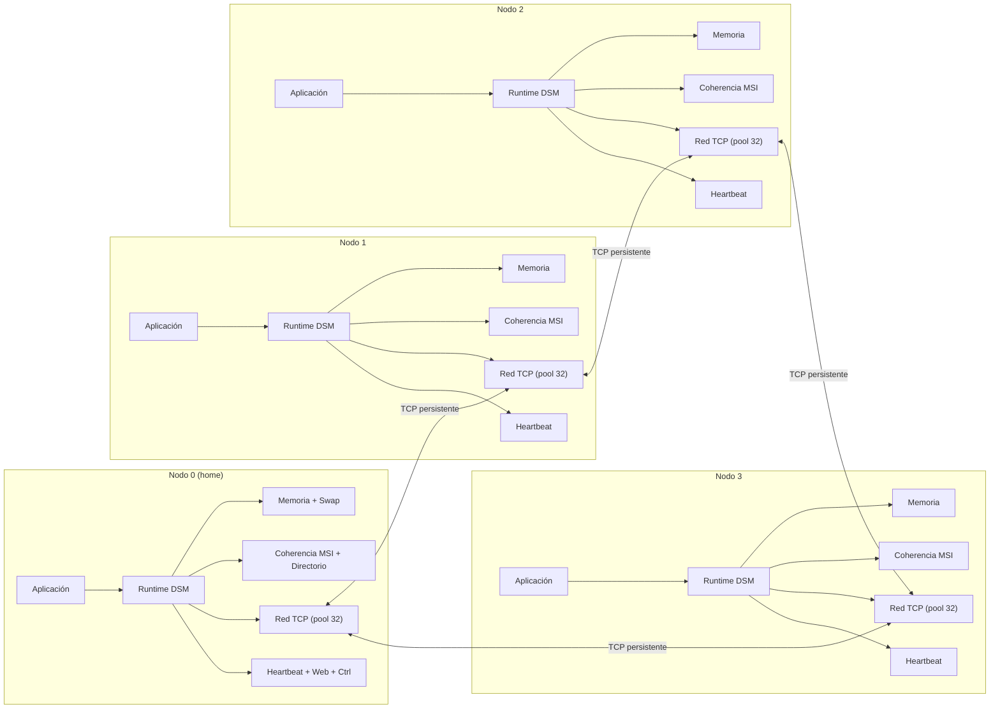

# 6. Arquitectura final

## 6.1 Vista de despliegue

El sistema se despliega sobre **N nodos independientes** (ideal 4, mínimo 2, hasta 16 por configuración), cada uno ejecutando un proceso `dsm_node` que contiene el runtime DSM embebido en la aplicación (Modelo A, §6.10). Los nodos se comunican por TCP/IP sobre el rango de puertos asignado a la pareja #3 (`27300–27399`, 4 puertos por nodo: DSM, control, heartbeat y web).

### 6.1.1 Despliegue en una sola máquina (desarrollo y ensayo)

4 procesos `dsm_node` en los puertos `27300/27304/27308/27312`, todos en `127.0.0.1`. Se usan dos tablas de nodos:

- `nodes.conf`: declara los 4 endpoints. La usan `matrices` y el modo `serve`.
- `nodes_2.conf`: declara solo los nodos 0 y 1. La usan `demo`, `file`, `counter`, `bench` y `evict`.

La barrera centralizada cuenta los nodos declarados en el archivo que se pasa con `--nodes`; por eso una corrida de `matrices` con 4 nodos levanta los 4 procesos, mientras que `file` con 2 nodos solo levanta 2. Esta separación es deliberada: `evict` y `counter` son estables con 2 nodos y 64 páginas, mientras que `matrices` escala a 4.

### 6.1.2 Despliegue en 2 máquinas (validado en laboratorio, 19 nov 2026)

Nodo 0 (home) en `192.0.2.10:27300` y nodo 1 en `192.0.2.11:27304` (direcciones de ejemplo, RFC 5737). Las dos PCs usan la misma tabla `nodes_2.conf` y el `seed_host` del nodo 1 apunta a A. La configuración se deja lista con `./dsm.sh` (opciones 1 a 3) sin editar archivos a mano. A se arranca primero y B dentro de los 2 minutos siguientes.

### 6.1.3 Despliegue en 3 y 4 máquinas (entrega final)

Análogo al de 2 máquinas: una línea por nodo en `nodes_3.conf` o `nodes_4.conf`, con la misma tabla en todas las PCs y `seed_host` del resto apuntando a A. Los puertos se derivan por rol (`27300 + 4 * node_id`), así que no hay que elegirlos a mano. La configuración se deja lista con `./dsm.sh` eligiendo topología 3 o 4.

### 6.1.4 Diagrama de despliegue

## 6.2 Componentes internos

Cada nodo ejecuta los siguientes hilos:

| Hilo | Responsabilidad |
|---|---|
| Principal | Inicialización, parseo de argumentos (`--config`, `--nodes`, `--app`), arranque de la aplicación y limpieza al final. |
| Listener + pool de 32 workers | Aceptan conexiones, leen el mensaje completo, despachan a coherencia, responden por el mismo socket. |
| Resolver | Consume la cola de fallos (`dsm_fault_queue`), invoca `dsm_coherence_handle_fault`, despierta al hilo de usuario. |
| Heartbeat | Envía `PING`/`PONG` cada 1 s; marca nodos caídos tras 3 s. |
| Aplicación | Usa `dsm_malloc`/`dsm_free`/`dsm_barrier`; un fallo de página dispara `SIGSEGV` → resolver. |
| Control (opcional) | Servidor TCP de texto para `dsmctl` (`stats`, `pages`, `dir`, `objects`, `nodes`, `ping`, `help`, `config`). |
| Web (opcional) | Panel HTTP de solo lectura (`/`, `/stats.json`). |

Los subsistemas se inicializan en este orden (ver `src/runtime.c`): configuración → nodos → memoria → sincronización → estadísticas → fallos → coherencia → red → control → web → heartbeat → resolver → aplicación.

## 6.3 Modelo de memoria

- **Ventana virtual:** 256 MB por nodo (`window_size = 268435456`), dividida en 65 536 páginas de 4 KB.
- **Pool de marcos:** 256 marcos de 4 KB por nodo (1 MB de memoria física aportada por nodo, `node_memory = 1048576`).
- **Espacio global:** `N * 1 MB` lógicamente compartido, particionado en páginas de 4 KB.
- **Asignación:** determinista por secuencia (`seq` por nodo). El home devuelve el mismo rango global a todos los nodos que llamen `dsm_malloc` en el mismo orden, así que todos comparten los mismos objetos.
- **Expulsión:** LRU aproximado (`last_used_ms`) con swap local en el home (`logs/swap-nodeN.bin`, archivo disperso de 256 MB).
- **Transparencia:** la aplicación usa punteros normales; el runtime se encarga de traer páginas bajo demanda con `mmap`, `mprotect` y `SIGSEGV`.

## 6.4 Administración distribuida y membresía

- Cada nodo conoce a los demás a través de `nodes.conf` / `nodes_2.conf` / `nodes_3.conf` / `nodes_4.conf` (id, host, puerto).
- El **home (nodo 0)** es autoridad única del directorio de coherencia: owner y sharers por página.
- Los nodos se registran al arrancar y envían `PING`/`PONG` periódicos (heartbeat cada 1 s, timeout 3 s).
- Un nodo caído se marca como `SUSPECT` y luego `DOWN`; las operaciones hacia él fallan rápido (`DSM_ERR_PEER_DOWN`).

## 6.5 Heartbeat

- Intervalo: 1000 ms. Timeout: 3000 ms.
- Cada nodo envía `PING` a los peers vivos y espera `PONG`.
- El estado de cada peer se guarda en un arreglo `_Atomic` (`alive[]`), leído por el resto del runtime sin locks.
- Si un peer no responde en 3 intervalos, se marca como caído y las RPC hacia él devuelven `DSM_ERR_PEER_DOWN`.

## 6.6 Ciclo de vida de un nodo

1. Arranque: carga de configuración y tabla de nodos; validación (`--check-config`).
2. Inicialización del runtime en orden fijo (§6.2).
3. Registro en el home (el home ya debe estar arriba; la barrera espera hasta 120 s).
4. Ejecución de la aplicación (si se pasó `--app`) o modo escucha (`--serve` o sin `--app`).
5. Atención de RPCs, heartbeat y consultas.
6. Cierre ordenado con `SIGINT`/`SIGTERM`: detach, destroy, log close.

## 6.7 Modelo de hilos

- Cada hilo de usuario se registra con `dsm_attach`/`dsm_detach` para tener contexto de fallo.
- El pool de 32 workers del receptor atiende conexiones concurrentes; las RPC salientes hacia un mismo peer se serializan con un mutex por peer.
- Los locks siguen una jerarquía fija: `op_lock` (GLOBAL) → `table_lock` (OBJECT) → `page->lock` (PAGE) → `frame_lock` (FRAME), verificada en runtime con clases.

## 6.8 Flujo de un fallo de página

1. La aplicación accede a una página con permisos `PROT_NONE` → `SIGSEGV` (`SEGV_ACCERR`).
2. El handler (`sigaction` con `SA_SIGINFO`) encola la página en la cola lock-free y suspende el hilo (`sigsuspend`).
3. El hilo resolver despierta, invoca `dsm_coherence_handle_fault`, resuelve la página (local o remota).
4. El resolver reanuda al hilo de usuario con `pthread_kill(DSM_SIG_RESUME)`.
5. El acceso se reintenta; si la página ya está residente, continúa.

## 6.9 Decisiones arquitectónicas clave

1. **Home centralizado (nodo 0):** simplifica la coherencia; el home es autoridad única de owner/sharers. Escalable a 16 nodos (configurable).
2. **Una conexión por par de nodos:** mutex por peer; RPC toma el lock, escribe, lee respuesta, suelta. Evita head-of-line blocking con pool de workers en el receptor.
3. **Fail-stop en timeouts:** si un RPC falla tras reintentos, el hilo usuario recibe `SIGSEGV` y muere. No se propaga estado inconsistente.
4. **Swap solo en home:** los clientes devuelven páginas sucias al home; el home escribe a swap. Garantiza que la única copia nunca se pierde.
5. **Locks jerárquicos:** ver §6.7.
6. **Configuración por archivo:** `node0.conf`…`node3.conf` + `nodes.conf` (4 nodos) y `nodes_2.conf` (2 nodos).

## 6.10 Runtime embebido vs daemon

Se adopta el **Modelo A (runtime embebido)** para el diseño, los prototipos y la demo. Es la opción más segura para cumplir el enunciado en el tiempo disponible y la que mejor se adapta a la naturaleza de `SIGSEGV`. El Modelo B (daemon por nodo) solo se revisaría si el profesor exigiera explícitamente un daemon.

## 6.11 Huella de configuración

Para responder a la pregunta de qué pasa si un nodo cambia la configuración en medio de la ejecución, cada mensaje lleva en su cabecera (campo `reserved2`, 4 bytes) una **huella FNV-1a** calculada sobre `page_size`, `node_memory`, `max_nodes`, versión de protocolo y la tabla de nodos ordenada. Si dos nodos tienen huellas distintas, la operación falla con `DSM_ERR_CONFIG_MISMATCH` y un log claro, en lugar de esperar 10 s a un timeout. El comando `dsmctl config` muestra la huella local para compararla entre PCs.

## 6.12 Aplicación `chat`

La aplicación `chat` (§14) es la aplicación de prueba que demuestra texto libre entre nodos: cada nodo escribe en su propia página DSM y todos leen todas las páginas con un seqlock. No requiere cambios al protocolo ni al núcleo; usa únicamente `dsm_malloc` y memoria compartida. Ver §14.4.

---

*Fin de la sección 6.*
