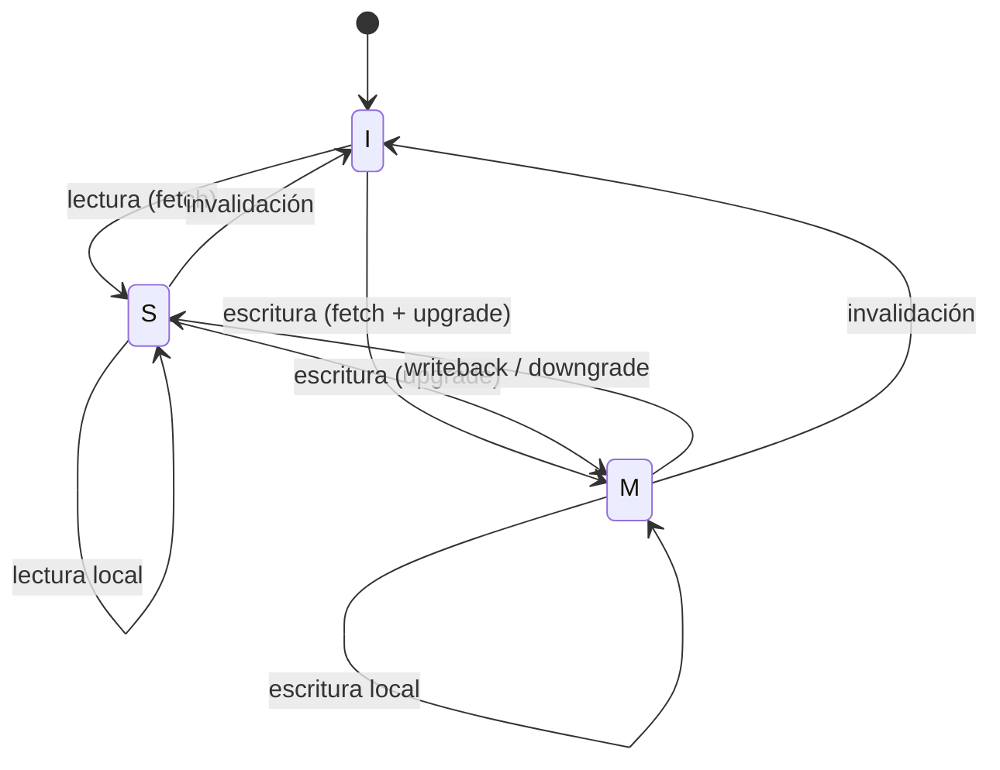

# 8. Diagrama de estados MSI

## 8.1 Granularidad

La coherencia se mantiene a nivel de **página de 4 KB**. Cada página tiene un estado MSI por nodo y un owner/directorio en el home.

## 8.2 Estados

| Estado | Significado |
|---|---|
| **M (Modified)** | La página fue modificada localmente; es la única copia válida. |
| **S (Shared)** | La página es de solo lectura; puede haber varias copias. |
| **I (Invalid)** | La página no es válida localmente; hay que pedirla. |

## 8.3 Invariantes

1. A lo sumo una copia en estado **M** por página.
2. Si hay una copia en **M**, todas las demás están en **I**.
3. Si hay copias en **S**, ninguna está en **M**.
4. El home conoce el owner y el conjunto de sharers de cada página.

## 8.4 Tabla de transiciones (resumen)

| Evento | Estado local | Acción | Nuevo estado |
|---|---|---|---|
| Lectura con página I | I | Pedir al home; instalar copia | S |
| Escritura con página I | I | Pedir propiedad al home; invalidar sharers | M |
| Lectura con página S | S | Acceso local | S |
| Escritura con página S | S | Solicitar upgrade; invalidar otras copias | M |
| Lectura con página M | M | Acceso local | M |
| Escritura con página M | M | Acceso local | M |
| Invalidación recibida | S/M | Descartar copia | I |
| Writeback (expulsión sucia) | M | Enviar al home; degradar | S/I |

## 8.5 Diagrama de estados

## 8.6 Directorio de coherencia

El home mantiene, por página:

- `page_id`, `object_id`, `version`.
- `owner_node`: nodo que tiene la copia M (o home si nadie la pidió).
- `sharers`: máscara de nodos con copia S.
- `state`: estado global (M/S/I).
- `last_update_ms`: para LRU y diagnóstico.

El directorio se protege con un `op_lock` por entrada (hash encadenado de 256 buckets). Ver §10.

## 8.7 Diagrama de estados internos del runtime

Además del estado MSI, cada página local tiene un estado de residencia:

| Residencia | Significado |
|---|---|
| `NOT_RESIDENT` | No hay marco asignado. |
| `FETCHING` | Se está trayendo la página. |
| `RESIDENT` | La página está en un marco. |
| `EVICTING` | Se está expulsando. |

## 8.8 Casos borde

- **Página M perdida:** si el owner cae antes de hacer writeback, la página se pierde. En la versión base no hay replicación; es un extra opcional (§17).
- **False sharing:** dos variables distintas en la misma página de 4 KB causan invalidaciones cruzadas. Se mitiga alineando datos y separando contadores por página.
- **Thrashing:** si el conjunto de trabajo supera los marcos, la LRU expulsa y retrae páginas; el swap sostiene el trabajo pero aumenta la latencia.

---

*Fin de la sección 8.*
