# Entregable 1 — Documento de Diseño del Sistema DSM

## Sistema de Memoria Compartida Distribuida con Paginación bajo Demanda y Coherencia MSI

| Campo | Valor |
|---|---|
| **Institución** | Instituto Tecnológico de Costa Rica |
| **Escuela** | Escuela de Ingeniería en Computación, Cartago |
| **Curso** | IC-6600 Principios de Sistemas Operativos |
| **Semestre** | `[COMPLETAR: semestre]` |
| **Profesor** | `[COMPLETAR: nombre del profesor]` |
| **Proyecto** | Implementación de un Sistema de Memoria Compartida Distribuida (DSM) con Paginación bajo Demanda y Coherencia MSI |
| **Entregable** | Entregable 1 — Documento de Diseño |
| **Integrantes** | José Daniel Monterrosa Quirós · Sebastián Aguero Brenes |
| **Fecha oficial** | 6 de noviembre de 2026 |
| **Versión del documento** | 1.0 |
| **Estado** | Borrador de diseño para revisión |
| **Repositorio Git** | `[COMPLETAR: URL del repositorio]` |
| **Documento maestro** | `00_Proyecto_DSM_General.md` |

> **Nota de alcance.** Este documento es un **diseño técnico**. No contiene la implementación completa ni resultados de ejecución. Las estructuras, firmas, mensajes y tamaños aquí definidos son la base para los prototipos de los Entregables 2 y 3.

> **Nota de formato.** El contenido está preparado para que luego se le aplique el formato académico definitivo (Word, PDF o plantilla institucional). Las tablas, figuras y diagramas Mermaid están numerados o identificados para facilitar esa conversión.

---

## 2. Resumen ejecutivo

El proyecto implementa un subsistema de **Memoria Compartida Distribuida (DSM)** en espacio de usuario sobre Linux, escrito en C11. El sistema emula un espacio de memoria compartida sobre varios nodos independientes conectados por TCP/IP. Cada nodo aporta un pool de marcos de memoria física y participa en la localización, transferencia e invalidación de páginas.

La paginación es **bajo demanda**: las páginas se cargan cuando un hilo las toca por primera vez. El runtime intercepta el fallo de segmento con `sigaction` y `SA_SIGINFO`, obtiene la dirección exacta con `siginfo_t.si_addr`, identifica la página, pausa el hilo afectado y solicita la página al nodo correspondiente. Cuando la página llega, se instala en la ventana local, se ajustan los permisos con `mprotect` y el hilo reintenta la instrucción.

La coherencia se implementa con un **protocolo MSI simplificado**:

- `M` (`Modified`): copia exclusiva y más reciente.
- `S` (`Shared`): copia de solo lectura, compartida.
- `I` (`Invalid`): copia ausente o desactualizada.

La administración es distribuida: cada nodo mantiene una tabla de nodos, un directorio de páginas, heartbeats y estadísticas. Las aplicaciones usan un API propio que devuelve punteros normales; la red y la coherencia son transparentes para la aplicación.

El diseño prioriza:

1. Corrección de la coherencia.
2. Estabilidad del manejo de señales.
3. Concurrencia segura entre hilos de usuario y hilo de red.
4. Facilidad de prueba en el laboratorio.
5. Documentación completa para la defensa individual.

---

## 3. Índice

### 3.1 Contenido

| Sección | Título |
|---:|---|
| — | [Portada](#entregable-1--documento-de-diseño-del-sistema-dsm) |
| 2 | [Resumen ejecutivo](#2-resumen-ejecutivo) |
| 3 | [Índice](#3-índice) |
| 4 | [Introducción](#4-introducción) |
| 5 | [Marco teórico](#5-marco-teórico) |
| 6 | [Arquitectura general](#6-arquitectura-general) |
| 7 | [Modelo de coherencia MSI](#7-modelo-de-coherencia-msi) |
| 8 | [Módulo 1: memoria virtual y paginación bajo demanda](#8-módulo-1-memoria-virtual-y-paginación-bajo-demanda) |
| 9 | [Módulo 2: red y protocolo](#9-módulo-2-red-y-protocolo) |
| 10 | [Módulo 3: concurrencia y sincronización](#10-módulo-3-concurrencia-y-sincronización) |
| 11 | [Estructuras de datos, tipos y tamaños](#11-estructuras-de-datos-tipos-y-tamaños) |
| 12 | [API del DSM](#12-api-del-dsm) |
| 13 | [Configuración del sistema](#13-configuración-del-sistema) |
| 14 | [Aplicaciones de prueba](#14-aplicaciones-de-prueba) |
| 15 | [Plan de pruebas y métricas](#15-plan-de-pruebas-y-métricas) |
| 16 | [Plan de trabajo, riesgos y decisiones](#16-plan-de-trabajo-riesgos-y-decisiones) |
| 17 | [Conclusiones](#17-conclusiones) |
| 18 | [Referencias](#18-referencias) |
| 19 | [Anexos](#19-anexos) |

### 3.2 Índice de figuras

| Figura | Título | Sección |
|---:|---|---|
| 1 | Vista de despliegue de cuatro nodos. | §6.1 |
| 2 | Ventana local del DSM dentro del proceso. | §6.4 |
| 3 | Incorporación de un nodo al clúster. | §6.5.1 |
| 4 | Ciclo de vida de un nodo. | §6.6 |
| 5 | Flujo de resolución de un fallo de página. | §6.8 |
| 6 | Diagrama de estados MSI. | §7.5 |
| 7 | Lectura remota con home y owner. | §7.6.2 |
| 8 | Escritura con invalidación de sharers. | §7.6.3 |
| 9 | Secuencia completa de resolución de un fallo. | §8.11 |
| 10 | Lectura remota con transferencia o reenvío. | §9.9.1 |
| 11 | Escritura con invalidación de todas las copias. | §9.9.2 |
| 12 | Write-back antes de expulsar una página modificada. | §9.9.3 |
| 13 | Heartbeat y detección de nodo caído. | §9.9.4 |
| 14 | Hilos y estructuras compartidas dentro de un nodo. | §10.1 |
| 15 | Cierre ordenado de un nodo. | §10.10 |

### 3.3 Índice de tablas

| Tabla | Título | Sección |
|---:|---|---|
| 1 | Componentes internos. | §6.2 |
| 2 | Modelo de hilos. | §6.7 |
| 3 | Decisiones arquitectónicas. | §6.9 |
| 4 | Estados MSI y permisos. | §7.2 |
| 5 | Tabla de transiciones MSI. | §7.4 |
| 6 | Estados internos del runtime. | §7.7 |
| 7 | Permisos y `mprotect`. | §8.4 |
| 8 | Flags de `sigaction`. | §8.5 |
| 9 | Detección de lectura/escritura por arquitectura. | §8.8 |
| 10 | Errores del Módulo 1. | §8.15 |
| 11 | Puertos por nodo. | §9.2 |
| 12 | Campos de la cabecera. | §9.6 |
| 13 | Flags de cabecera. | §9.6 |
| 14 | Catálogo de mensajes. | §9.7 |
| 15 | Timeouts y reintentos. | §9.10 |
| 16 | Errores de protocolo. | §9.12 |
| 17 | Estructuras compartidas y protección. | §10.2 |
| 18 | Primitivas de sincronización. | §10.3 |
| 19 | Jerarquía de locks. | §10.4 |
| 20 | Condiciones de carrera. | §10.6 |
| 21 | Timeouts de locks. | §10.7 |
| 22 | Resumen de tamaños. | §11.11 |
| 23 | Límites del sistema. | §11.13 |
| 24 | Códigos de error del API. | §12.9 |
| 25 | Parámetros de configuración. | §13.2 |
| 26 | Reglas de validación. | §13.7 |
| 27 | Pruebas unitarias. | §15.3 |
| 28 | Pruebas de integración. | §15.4 |
| 29 | Pruebas MSI. | §15.5 |
| 30 | Métricas. | §15.8 |
| 31 | Riesgos. | §16.4 |

---

## 4. Introducción

### 4.1 Problema

En un clúster sin memoria física compartida, las aplicaciones que necesitan colaborar deben comunicarse por paso de mensajes: sockets, RPC, colas, archivos compartidos o bases de datos. Ese modelo obliga a serializar datos, definir protocolos de aplicación y gestionar explícitamente la coherencia. Para problemas intensivos en memoria, como matrices grandes, procesamiento de imágenes, video o simulaciones, el costo de programación y de copia de datos puede ser alto.

La DSM propone una abstracción distinta: un espacio de memoria compartida emulado sobre nodos independientes. La aplicación lee y escribe punteros normales; el runtime se encarga de traer páginas, moverlas por la red y mantener la coherencia.

### 4.2 Motivación

El proyecto permite aplicar conceptos centrales de sistemas operativos:

- Gestión de memoria virtual.
- Paginación bajo demanda.
- Protección de memoria.
- Señales y manejo de fallos.
- Concurrencia y sincronización.
- Comunicación entre procesos y entre máquinas.
- Protocolos de coherencia de caché.
- Tolerancia a fallos y rendimiento.

También obliga a resolver problemas reales de ingeniería: condiciones de carrera, interbloqueos, latencias de red, false sharing, límites de memoria y reproducibilidad en el laboratorio.

### 4.3 Objetivos

**Objetivo general:** diseñar e implementar un sistema DSM funcional, documentado y demostrable, con paginación bajo demanda, coherencia MSI, comunicación TCP/IP, concurrencia con Pthreads y semáforos POSIX, y aplicaciones reales que usen grandes cantidades de memoria distribuida.

**Objetivos específicos:**

1. Reservar memoria virtual con `mmap` y controlar permisos con `mprotect`.
2. Capturar fallos de página con `sigaction` y `SA_SIGINFO`, usando `siginfo_t.si_addr`.
3. Implementar un protocolo de mensajes completo entre nodos.
4. Implementar un hilo dedicado a escuchar y atender peticiones de red.
5. Mantener tablas de páginas y directorios de coherencia protegidos contra condiciones de carrera.
6. Implementar las transiciones MSI y documentarlas con diagrama de estados.
7. Soportar varios nodos en una misma máquina y varios nodos en máquinas físicas distintas.
8. Proveer consultas de estadísticas, nodos, tablas de páginas y asignación por proceso.
9. Adaptar al menos dos aplicaciones reales intensivas en memoria al API DSM.
10. Documentar configuración, instalación, ejecución, API, protocolo, pruebas y manual de usuario.
11. Demostrar el sistema en el laboratorio, con ambas personas capaces de explicar todas las partes.

### 4.4 Alcance

**Incluido en el diseño:**

- Nodos Linux en C11.
- Sockets TCP/IP.
- Pthreads.
- Semáforos POSIX y mutex.
- `mmap`, `mprotect`, `sigaction`.
- MSI con `M`, `S`, `I`.
- Paginación bajo demanda.
- Administración distribuida y heartbeat.
- CLI de consulta.
- Web básica de consulta.
- API para aplicaciones.
- Dos aplicaciones de prueba: matrices y archivo/video.
- Incrementos concurrentes como prueba de estrés.
- Extras deseados: ejecución distribuida y tolerancia a fallos, condicionados al tiempo.

**Fuera del alcance de la versión base:**

- Sistema de archivos distribuido.
- Seguridad criptográfica fuerte.
- Tolerancia a fallos obligatoria.
- Compatibilidad con Windows.
- Interfaz gráfica de escritorio.
- Orquestación de contenedores.
- Consenso distribuido formal (Raft/Paxos).

### 4.5 Supuestos

- Los nodos ejecutan Linux de 64 bits con GCC y Pthreads.
- Todos los nodos usan el mismo archivo de configuración o una copia idéntica.
- La red del laboratorio permite conexiones TCP entre los equipos y los puertos configurados.
- El rango de puertos asignado es de 100 puertos: `50000–50099` (a validar en el laboratorio).
- El tamaño de página por defecto es 4 KB, configurable.
- La memoria aportada por nodo es 1 MB por defecto, configurable.
- Se buscan 4 nodos ideales para la demo, con mínimo 2.
- Las pruebas finales se hacen en computadoras del laboratorio, no en equipos personales.

### 4.6 Restricciones

- El lenguaje es C11.
- El sistema operativo es Linux.
- Las herramientas obligatorias son sockets TCP/IP, Pthreads, semáforos POSIX, `mmap`, `mprotect` y `sigaction`.
- La demo es en vivo, en el laboratorio, con ambas personas presentes.
- La nota es individual.
- No hay plantilla adicional; solo el PDF y las instrucciones del profesor.
- El tiempo de implementación es de cuatro semanas.

### 4.7 Metodología

1. Diseño documentado en este entregable.
2. Prototipo 1 en el Entregable 2.
3. Prototipo 2 en el Entregable 3.
4. Pruebas de estrés y aplicaciones reales.
5. Demo final y defensa individual.

El diseño se revisará después de cada prototipo y se documentarán los cambios.

---

## 5. Marco teórico

### 5.1 Memoria Compartida Distribuida

Una DSM es un mecanismo que permite a procesos de nodos distintos acceder a un espacio de memoria lógicamente compartido, aunque físicamente esté distribuido. Existen dos grandes enfoques:

- **DSM por hardware:** memoria compartida físicamente, accesible por varios procesadores.
- **DSM por software:** el sistema operativo o una biblioteca emula la memoria compartida sobre una red.

Este proyecto implementa una DSM por software en espacio de usuario. La memoria física está distribuida; la coherencia se mantiene por software.

### 5.2 Paginación bajo demanda

La paginación bajo demanda carga una página solo cuando se accede a ella. Si la página no está presente, se produce un fallo. El sistema trae la página desde disco, en el caso de memoria virtual tradicional, o desde otro nodo, en el caso de una DSM.

Ventajas:

- No se requiere cargar toda la memoria al inicio.
- Se usa memoria física solo para páginas activas.
- Permite objetos más grandes que la memoria local.

Desventajas:

- Latencia por fallo.
- Complejidad de reemplazo.
- Riesgo de thrashing.

### 5.3 `mmap` y `mprotect`

`mmap` crea una proyección de memoria. En este proyecto se usa para reservar la ventana local del DSM y para materializar páginas.

`mprotect` cambia los permisos de un rango de páginas. En el DSM se usa para:

- `PROT_NONE`: página ausente o inválida.
- `PROT_READ`: página compartida, solo lectura.
- `PROT_READ | PROT_WRITE`: página modificada, lectura y escritura.

### 5.4 `SIGSEGV` y `sigaction`

Cuando un hilo accede a una página sin permisos, el kernel genera `SIGSEGV`. Con `sigaction` y `SA_SIGINFO`, el manejador recibe un `siginfo_t` con `si_addr`, la dirección exacta que causó el fallo.

El manejador debe:

- Verificar que la dirección pertenece al DSM.
- Calcular la página.
- Registrar el fallo.
- Pausar el hilo.
- Despertar al resolvedor.
- Reintentar la instrucción cuando la página esté lista.

### 5.5 Sockets TCP/IP

TCP ofrece un flujo de bytes confiable, orientado a conexión, con entrega ordenada. No conserva límites de mensaje; por eso el protocolo debe definir un **framing** con longitud explícita.

Cada nodo abre un puerto de escucha. Las conexiones pueden ser persistentes por par de nodos para reducir el costo de `connect`/`close`.

### 5.6 Pthreads y semáforos POSIX

Pthreads permite ejecutar varios hilos dentro de un proceso. En el DSM se usan para:

- Hilos de usuario que leen y escriben memoria.
- Hilo de red que atiende mensajes.
- Hilo de heartbeat.
- Hilo de estadísticas.
- Hilo web.
- Hilo resolvedor de fallos.

Los semáforos POSIX (`sem_init`, `sem_wait`, `sem_post`) y los mutex permiten proteger estructuras compartidas y señalizar eventos. `sem_post` es async-signal-safe, lo que permite usarlo desde un manejador de señal para despertar a otro hilo.

### 5.7 Protocolo MSI

MSI es un protocolo de coherencia de caché con tres estados:

- `Modified`: una copia exclusiva y modificada.
- `Shared`: varias copias limpias de solo lectura.
- `Invalid`: copia no válida.

El protocolo garantiza que, antes de una escritura, todas las demás copias se invaliden. La versión de este proyecto es **simplificada**: no hay estado `Exclusive` ni `Owner`; el propietario y la lista de copias se manejan como metadatos del directorio.

### 5.8 Modelos de consistencia

El proyecto garantiza **coherencia de memoria** a nivel de página: una lectura posterior a una escritura completada ve el valor actualizado. No garantiza atomicidad de operaciones de nivel de aplicación. Para incrementos concurrentes se necesita un mutex distribuido o una operación atómica provista por el API.

---

## 6. Arquitectura general

### 6.1 Vista de despliegue

El sistema está compuesto por **N nodos**. Cada nodo es un proceso independiente que ejecuta el runtime DSM y, opcionalmente, una aplicación de prueba. Los nodos pueden ejecutarse en terminales distintas de la misma máquina o en computadoras distintas conectadas por red.

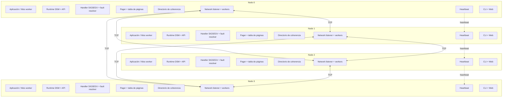

**Figura 1.** Vista de despliegue de cuatro nodos.

### 6.2 Componentes internos

Cada nodo se divide en los siguientes componentes:

| Componente | Responsabilidad |
|---|---|
| **API DSM** | Funciones públicas para la aplicación. |
| **Memory/Pager** | Ventana local, páginas, permisos, reemplazo. |
| **Fault handler** | Captura `SIGSEGV`, identifica la página, despierta al resolver. |
| **Fault resolver** | Ejecuta el protocolo para traer la página y ajustar permisos. |
| **Directory/Coherence** | Estado MSI, propietario, sharers, versiones. |
| **Network listener** | `accept()` de conexiones TCP. |
| **Network workers** | Lectura, escritura y despacho de mensajes. |
| **Protocol** | Serialización, framing, tipos de mensaje, errores. |
| **Node manager** | Membresía, tabla de nodos, heartbeat. |
| **Stats** | Contadores y métricas. |
| **CLI** | Consultas de texto. |
| **Web** | Consultas HTML/JSON. |
| **Config** | Lectura y validación de `dsm.conf`. |
| **Logger** | Logs con nivel, timestamp, nodo e hilo. |

### 6.3 Modelo de memoria: ventana local y pool de marcos

El diseño adopta un modelo de **ventana local + pool de marcos**. Es una decisión central y se explica a continuación.

#### 6.3.1 Ventana local

Cada nodo reserva una **ventana de direcciones virtuales** para el DSM:

```text
dsm_window_size = 256 MB (valor por defecto, configurable)
```

La ventana se crea con:

```c
mmap(NULL, dsm_window_size, PROT_NONE,
     MAP_PRIVATE | MAP_ANONYMOUS | MAP_NORESERVE, -1, 0);
```

La ventana es **virtual**: no consume memoria física hasta que se materializan páginas. Los objetos compartidos se mapean dentro de esta ventana en rangos contiguos y alineados a página.

Ventajas:

- No se requiere que todos los nodos usen la misma dirección virtual.
- El tamaño de la ventana no tiene que ser igual a la memoria total del sistema.
- Cada nodo puede mapear objetos grandes aunque su aporte físico sea pequeño.
- El direccionamiento local es simple: `dirección = base_objeto + offset`.

#### 6.3.2 Pool de marcos

Cada nodo aporta un **pool de marcos** de tamaño `node_memory` (1 MB por defecto). El número de marcos es:

```text
frames_per_node = node_memory / page_size
```

Con 1 MB y páginas de 4 KB: `256 marcos` por nodo.

El pool es **lógico**: cada marco es una página física que el nodo puede mantener residente dentro de su ventana. La suma de marcos de todos los nodos es la memoria física total del DSM:

```text
total_frames = Σ frames_per_node(i)
```

Un nodo no puede tener más de `frames_per_node` páginas residentes al mismo tiempo. Cuando necesita un marco para una página remota, expulsa una página local según la política de reemplazo.

#### 6.3.3 Direccionamiento

Existen dos direcciones:

- **Dirección local:** la dirección virtual dentro de la ventana del nodo, válida solo en ese proceso.
- **Identificador global de página:** `page_id`, válido en todo el sistema.

La tabla de páginas traduce `page_id` a la dirección local del objeto correspondiente. El protocolo de red usa `page_id`; la aplicación usa direcciones locales.

```text
dirección_local = objeto->local_base + (page_index * page_size)
page_id         = objeto->first_page_id + page_index
```

Esto permite que el mismo objeto esté en direcciones locales distintas en nodos distintos, sin afectar la coherencia.

#### 6.3.4 Objetos compartidos

Un objeto compartido tiene:

- `object_id` único.
- Nombre lógico.
- Tamaño en bytes.
- Rango de `page_id`.
- Rango de direcciones locales por nodo.
- Nodo creador.
- Metadatos de directorio.

El objeto se crea con `dsm_create` y se adjunta con `dsm_attach`. Las páginas se materializan bajo demanda.

#### 6.3.5 Asignación de páginas

- El `page_id` se asigna al crear el objeto, de forma contigua.
- El `home_node` de cada página se asigna en round-robin entre los nodos con marcos disponibles, o según la política configurada.
- El `home_node` mantiene la entrada de directorio.
- Los datos pueden residir en cualquier nodo que tenga un marco.
- La página puede estar en `M`, `S` o `I` en cada nodo.

#### 6.3.6 Reemplazo

Política inicial: **LRU aproximado**.

1. Se elige una página residente con `refcount == 0`.
2. Si está en `M`, se escribe de vuelta al home.
3. Se marca `is_resident = 0`.
4. Se libera el marco con `madvise(addr, page_size, MADV_DONTNEED)`.
5. Se actualiza la tabla.

Si no hay marcos libres ni páginas expulsables, se devuelve `DSM_ERR_NOMEM`.

### 6.4 Mapa de memoria

```text
Proceso del nodo
┌─────────────────────────────────────────────────────────────┐
│ Espacio de direcciones del proceso                          │
│                                                             │
│  ┌───────────────────────────────────────────────────────┐  │
│  │ Ventana DSM (mmap PROT_NONE, MAP_NORESERVE)          │  │
│  │                                                       │  │
│  │  [Objeto A: páginas 0..N]  [Objeto B: páginas 0..M]  │  │
│  │   ^ local_base_A            ^ local_base_B            │  │
│  │                                                       │  │
│  │  Páginas residentes: respaldadas por marcos físicos   │  │
│  │  Páginas ausentes: PROT_NONE, sin memoria física      │  │
│  └───────────────────────────────────────────────────────┘  │
│                                                             │
│  Heap normal, stack, código, bibliotecas                    │
└─────────────────────────────────────────────────────────────┘
```

**Figura 2.** Ventana local del DSM dentro del proceso.

### 6.5 Administración distribuida

La administración es distribuida. Cada nodo mantiene:

- Tabla de nodos.
- Tabla de páginas local.
- Directorio de las páginas cuyo `home_node` es él.
- Estado de heartbeats.
- Estadísticas.

No hay un servidor central permanente. Se permite un **nodo semilla** para el arranque y para la asignación inicial de `node_id` y `object_id`.

#### 6.5.1 Incorporación de un nodo

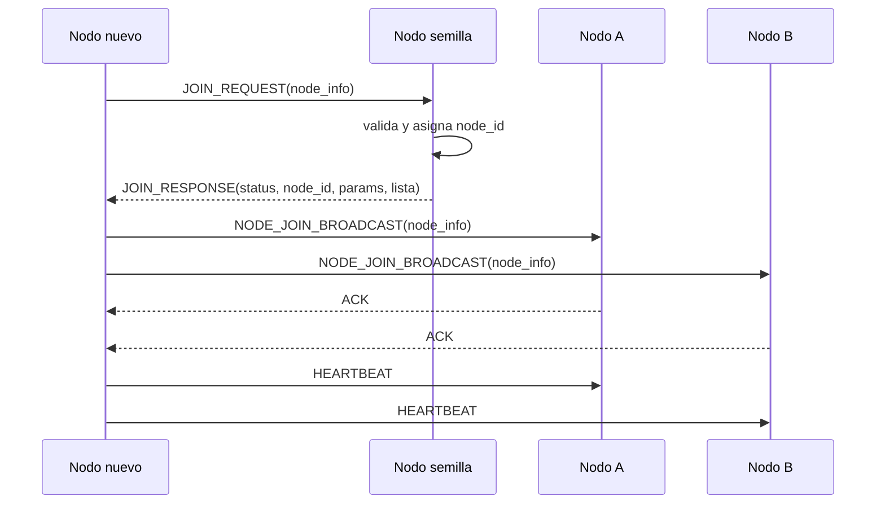

**Figura 3.** Incorporación de un nodo al clúster.

#### 6.5.2 Tabla de nodos

Cada entrada contiene:

- `node_id`.
- Host/IP.
- Puerto.
- Memoria aportada.
- Estado (`ONLINE`, `SUSPECT`, `OFFLINE`).
- Último heartbeat.
- Carga.
- Capacidades.
- Versión del protocolo.

#### 6.5.3 Heartbeat

- Cada nodo envía `HEARTBEAT` cada `heartbeat_interval_ms`.
- Si no hay respuesta en `heartbeat_timeout_ms`, el nodo pasa a `SUSPECT`.
- Si pasa otro intervalo, pasa a `OFFLINE`.
- Un nodo `OFFLINE` no recibe nuevas solicitudes.
- Las páginas `M` de un nodo caído quedan no disponibles, salvo que exista réplica (extra).

### 6.6 Ciclo de vida de un nodo

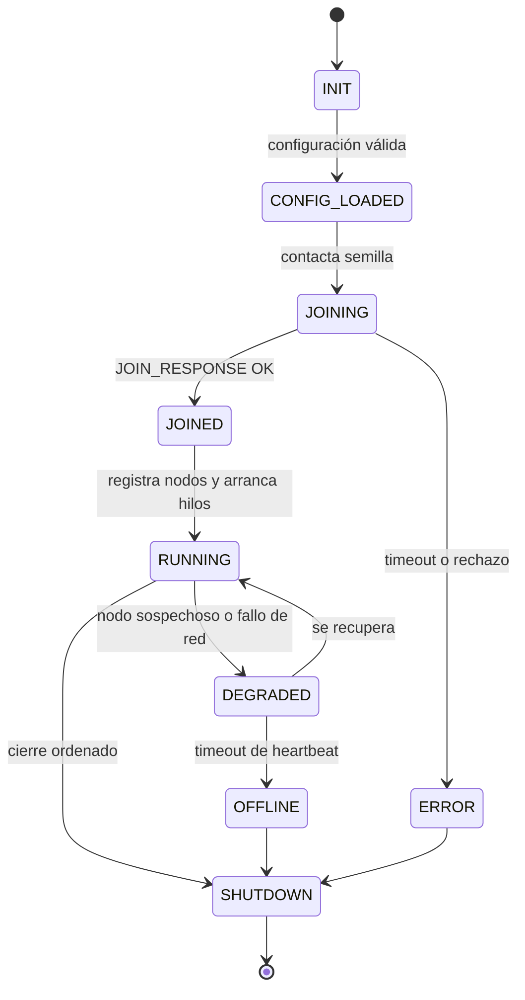

**Figura 4.** Ciclo de vida de un nodo.

### 6.7 Modelo de hilos

| Hilo | Cantidad | Función |
|---|---:|---|
| `main` | 1 | Arranque, configuración, join, coordinación. |
| `network_listener` | 1 | `accept()` de conexiones. |
| `network_worker` | `thread_pool_size` | Atiende conexiones y mensajes. |
| `fault_resolver` | 1 o pool | Resuelve fallos de página. |
| `heartbeat` | 1 | Envía latidos y detecta nodos caídos. |
| `stats` | 1 | Recolecta métricas. |
| `web` | 1 | Servidor HTTP. |
| `worker` | N | Hilos de la aplicación. |
| `signal handler` | — | Se ejecuta en el hilo que falla. |

### 6.8 Flujo de un fallo de página

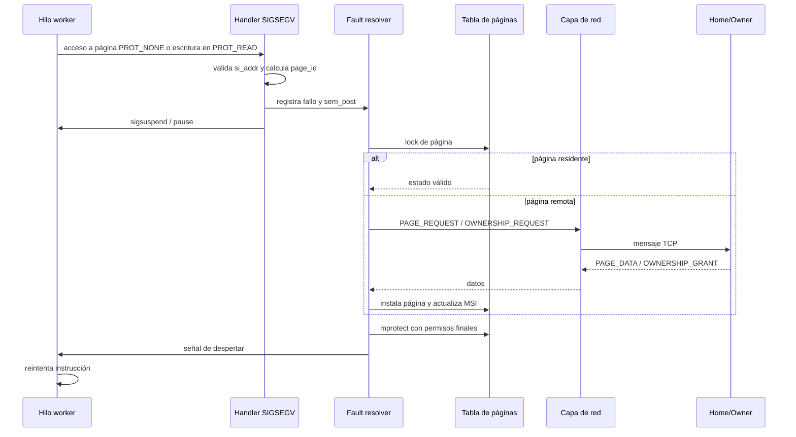

**Figura 5.** Flujo de resolución de un fallo de página.

### 6.9 Decisiones arquitectónicas

| Decisión | Opción elegida | Justificación |
|---|---|---|
| Lenguaje | C11 | Confirmado por el profesor; control de memoria y señales. |
| Modelo de memoria | Ventana local + pool de marcos | Evita exigir la misma dirección virtual en todos los nodos. |
| Runtime | Embebido en el proceso | El `SIGSEGV` ocurre en el proceso que accede; evita IPC compleja. |
| Directorio | Distribuido por página | Evita un cuello de botella central. |
| Transporte | TCP persistente | Menos overhead que una conexión por mensaje. |
| Concurrencia | Listener + pool | Atiende varias conexiones sin bloquear. |
| Fallos | Handler mínimo + resolver | Respeta async-signal-safety. |
| Reemplazo | LRU aproximado | Balance entre simplicidad y localidad. |
| Web | CLI + web básica | Confirmado por el equipo. |
| Extras | Condicionados | Base primero; extras después del E3. |

---

## 7. Modelo de coherencia MSI

### 7.1 Granularidad

La unidad de coherencia es la **página**. El tamaño por defecto es 4 KB, configurable. Todos los nodos deben usar el mismo `page_size`.

Consideraciones:

- El tamaño debe ser potencia de dos y múltiplo del tamaño de página del sistema.
- Páginas más grandes reducen mensajes pero aumentan false sharing.
- Páginas más pequeñas reducen false sharing pero aumentan overhead.
- El tamaño se valida al cargar la configuración.

### 7.2 Estados

| Estado | Significado | Permisos locales |
|---|---|---|
| **M — Modified** | El nodo posee la versión más reciente y exclusiva. Otros nodos no la tienen o la tienen invalidada. | `PROT_READ \| PROT_WRITE` |
| **S — Shared** | La página es de solo lectura; varios nodos pueden tener una copia sincronizada. | `PROT_READ` |
| **I — Invalid** | La página no está disponible localmente o su contenido está desactualizado. | `PROT_NONE` |

No se agregan estados MSI adicionales en la versión base. El propietario y los sharers son metadatos del directorio, no estados.

### 7.3 Invariantes

1. Para cada página existe como máximo un nodo en estado `M`.
2. Si un nodo está en `M`, ningún otro nodo tiene una copia válida en `S`.
3. Si varios nodos están en `S`, todas las copias son equivalentes y no hay ningún `M`.
4. Un nodo en `I` no puede leer ni escribir sin solicitar la página.
5. Antes de pasar de `S` a `M`, se invalidan todas las demás copias y se reciben sus ACK.
6. Antes de conceder `M`, el home invalida todas las copias `S`.
7. Las transiciones sobre una página son serializables.
8. Una página `M` debe escribirse de vuelta antes de perderse por expulsión, cierre o fallo.
9. El orden lógico de las páginas de un objeto se conserva; la ubicación física puede cambiar.
10. La versión de una página solo aumenta cuando se modifica su contenido.

### 7.4 Tabla de transiciones

| Evento | Estado inicial | Acción | Estado final |
|---|---|---|---|
| Lectura local, página residente | `S` | Hit de lectura | `S` |
| Lectura local, página residente | `M` | Hit de lectura | `M` |
| Lectura local, página ausente | `I` | `PAGE_REQUEST` al home; recibir `PAGE_DATA` en `S` | `S` |
| Escritura local, página residente | `M` | Hit de escritura | `M` |
| Escritura local, página residente | `S` | Invalidar sharers; esperar ACK; obtener propiedad | `M` |
| Escritura local, página ausente | `I` | `OWNERSHIP_REQUEST`; invalidar copias; recibir datos | `M` |
| Lectura remota, home en `M` | `M` (home) | Degradar a `S`; enviar datos; registrar sharer | `S` |
| Lectura remota, home en `S` | `S` (home) | Agregar sharer; enviar datos en `S` | `S` |
| Lectura remota, home en `I`, owner remoto `M` | `I` (home) | Reenviar al owner; owner degrada a `S`; actualizar directorio | `S` |
| Escritura remota, home en `M` | `M` (home) | Enviar datos y propiedad al solicitante; quedar `I` | `I` |
| Escritura remota, home en `S` | `S` (home) | Invalidar sharers; esperar ACK; enviar datos/propiedad | `I` |
| Invalidación recibida | `S` | Descartar copia; responder `INVALIDATE_ACK` | `I` |
| Invalidación recibida | `M` | Escribir de vuelta si corresponde; responder ACK | `I` |
| Expulsión de página `S` | `S` | Descartar copia; notificar al home si es necesario | `I` |
| Expulsión de página `M` | `M` | Escribir de vuelta al home o transferir propiedad | `I` |
| Fallo del owner | `M` | Página no disponible; recuperar de réplica si existe | `I` / recuperación |

### 7.5 Diagrama de estados

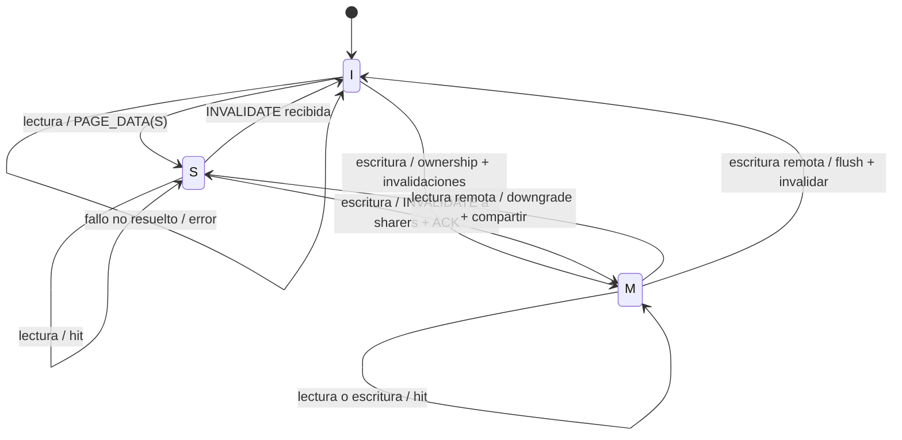

**Figura 6.** Diagrama de estados MSI.

### 7.6 Directorio de coherencia

Cada página tiene un `home_node`. El home mantiene una entrada de directorio con:

- `page_id`
- `object_id`
- `state` del home (`M`, `S`, `I`)
- `owner_node`
- `sharers` (bitmap de 64 bits)
- `version`
- `last_update_ms`
- `pending_request_id`
- `flags`

El home no necesariamente tiene los datos. Si no los tiene, redirige la solicitud al `owner_node`.

#### 7.6.1 Reglas del directorio

1. El home serializa las transiciones de la página.
2. El home registra el owner actual.
3. El home registra los sharers.
4. El home actualiza la versión cuando recibe un write-back.
5. El home responde `PAGE_FORWARD` si el owner es otro nodo.
6. El home no concede `M` hasta recibir todos los `INVALIDATE_ACK`.
7. Si el home cae, la página queda no disponible en la versión base.
8. El bitmap de sharers es **aproximado**: un nodo que expulsa una copia `S` puede no notificarlo. El home tolera `INVALIDATE` hacia nodos sin copia; esos nodos responden `INVALIDATE_ACK` sin acción.
9. Si el owner cambia (por write-back o por concesión), el home actualiza `owner_node` antes de responder al solicitante.

#### 7.6.2 Ejemplo de lectura

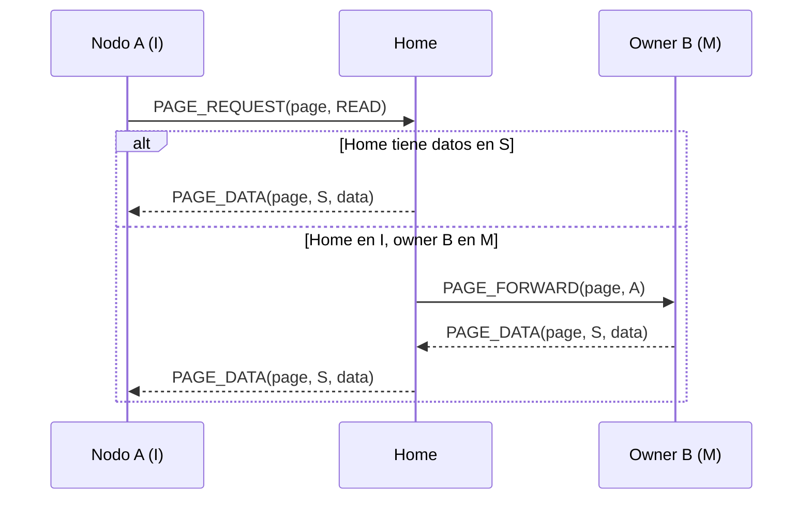

**Figura 7.** Lectura remota con home y owner.

#### 7.6.3 Ejemplo de escritura

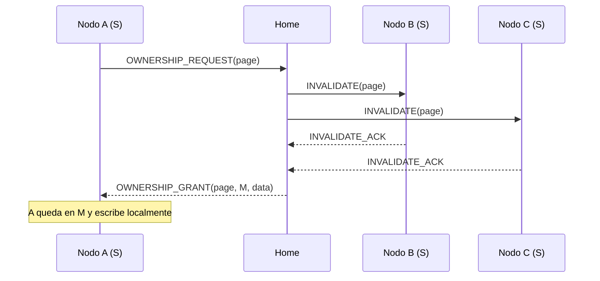

**Figura 8.** Escritura con invalidación de sharers.

### 7.7 Estados internos del runtime

Además del estado MSI, la entrada de página tiene estados internos transitorios:

| Estado interno | Significado |
|---|---|
| `NOT_RESIDENT` | La página no está en memoria local. |
| `FETCHING` | Hay una solicitud en vuelo. |
| `RESIDENT` | La página está en memoria local; el estado MSI indica `M`, `S` o `I`. |
| `EVICTING` | La página se está expulsando. |
| `ERROR` | La página quedó en error; requiere reintento o aborto. |

Estos estados no son parte del protocolo MSI; son estados de implementación para coordinar hilos.

### 7.8 Casos borde

| Caso | Comportamiento |
|---|---|
| Dos hilos fallan en la misma página | Coalescing: uno solicita, el otro espera la misma respuesta. |
| Invalidación mientras hay lectura | La lectura termina antes de invalidar; se respeta `refcount`. |
| Expulsión con `refcount > 0` | No se expulsa; se elige otra página. |
| Home sin marcos | El home conserva metadatos y redirige; no necesita datos. |
| Owner cae con página `M` | Página no disponible; error o recuperación por réplica. |
| Página `M` expulsada | Write-back al home antes de liberar. |
| Dos escritores simultáneos | El home serializa; uno obtiene `M`, el otro espera y luego invalida. |
| Mensaje duplicado | Se detecta por `request_id`; respuesta idempotente. |
| Timeout | Se reintenta; si persiste, se marca nodo sospechoso. |

### 7.9 False sharing, ping-pong y thrashing

- **False sharing:** dos nodos escriben variables distintas en la misma página. Mitigación: alinear estructuras, separar contadores, padding, documentar.
- **Ping-pong:** dos nodos alternan escrituras sobre la misma página. Mitigación: agrupar escrituras, usar locks, particionar datos.
- **Thrashing:** expulsión y recarga excesiva. Mitigación: LRU, aumentar memoria, mejorar localidad, medir.

### 7.10 Coherencia vs sincronización

MSI garantiza coherencia de memoria, no atomicidad de aplicación. Para incrementos concurrentes se requiere:

- `dsm_atomic_add`, o
- `dsm_mutex`, o
- partición de datos por hilo/nodo.

---

## 8. Módulo 1: memoria virtual y paginación bajo demanda

### 8.1 Responsabilidades

El Módulo 1 implementa el mecanismo que hace que la memoria distribuida parezca memoria normal. Sus responsabilidades son:

1. Reservar la **ventana local** del DSM con `mmap`.
2. Mantener la **tabla de páginas local** y el **pool de marcos**.
3. Instalar y controlar los permisos de cada página con `mprotect`.
4. Instalar el manejador de `SIGSEGV` con `sigaction` y `SA_SIGINFO`.
5. Identificar la página y el tipo de acceso a partir de `siginfo_t.si_addr` y del contexto del fallo.
6. Pausar el hilo que falla y despertar al **fault resolver**.
7. Resolver el fallo: hit local, página remota, propiedad, invalidación o error.
8. Ajustar los permisos finales y reanudar el hilo.
9. Expulsar páginas cuando no hay marcos libres.
10. Liberar objetos, páginas y recursos al cerrar.

### 8.2 Reserva de la ventana local

La ventana se reserva una sola vez por proceso, al inicializar el runtime:

```c
/* include/dsm.h — firma de inicialización */
int dsm_init(const dsm_config_t *cfg);
```

Internamente:

```c
void *window = mmap(NULL,
                    cfg->window_size,
                    PROT_NONE,
                    MAP_PRIVATE | MAP_ANONYMOUS | MAP_NORESERVE,
                    -1, 0);
if (window == MAP_FAILED) {
    return DSM_ERR_MMAP;
}
```

| Aspecto | Decisión |
|---|---|
| Tamaño por defecto | 256 MB virtuales |
| Permisos iniciales | `PROT_NONE` |
| Flags | `MAP_PRIVATE \| MAP_ANONYMOUS \| MAP_NORESERVE` |
| Alineación | Alineada al tamaño de página del sistema |
| Consumo físico inicial | Cero; solo espacio de direcciones |
| Visibilidad | Solo el proceso del nodo |

La ventana es **virtual y dispersa**. Las páginas se materializan cuando se solicitan. `MAP_NORESERVE` evita que el kernel reserve swap para toda la ventana.

**Justificación del tamaño.** La ventana debe ser mayor que la memoria física aportada por el nodo (`node_memory`), porque un nodo puede mapear objetos más grandes que su propio pool. Con 1 MB de memoria física y una ventana de 256 MB, el nodo puede participar en objetos de hasta 256 MB por mapeo, manteniendo solo 256 marcos residentes a la vez.

### 8.3 Estructura de la tabla de páginas local

Cada página mapeada en el proceso tiene una entrada local:

```c
typedef struct dsm_local_page {
    uint64_t page_id;          /* identificador global */
    uint64_t object_id;        /* objeto al que pertenece */
    uint64_t version;          /* versión conocida */
    void    *local_addr;       /* dirección dentro de la ventana */
    uint32_t frame_slot;       /* marco asignado, o UINT32_MAX */
    uint32_t refcount;         /* hilos con acceso en curso */
    uint8_t  msi_state;        /* DSM_PAGE_M / S / I */
    uint8_t  residency;        /* NOT_RESIDENT / FETCHING / RESIDENT / EVICTING / ERROR */
    uint8_t  is_dirty;         /* modificada sin write-back */
    uint8_t  flags;
    uint32_t pending_request_id_low;
    uint32_t reserved;
} dsm_local_page_t;
```

La tabla se indexa por `page_id` mediante una **tabla hash abierta** o un **árbol** según el tamaño del objeto. Para el prototipo se propone una tabla hash con encadenamiento simple y un mutex por bucket, más un mutex por página para las transiciones MSI.

```text
page_index   = (page_id - object->first_page_id)
local_addr   = object->local_base + page_index * page_size
frame_slot   = page_index % frames_per_node   (asignación inicial, ajustable)
```

### 8.4 Permisos y `mprotect`

Los permisos locales reflejan el estado MSI y la residencia:

| Situación | Permisos | Efecto |
|---|---|---|
| Página no residente | `PROT_NONE` | Cualquier acceso genera `SIGSEGV`. |
| Página en `S` | `PROT_READ` | Lectura permitida; escritura genera `SIGSEGV`. |
| Página en `M` | `PROT_READ \| PROT_WRITE` | Lectura y escritura permitidas. |
| Página en `I` | `PROT_NONE` | Fuerza nuevo fallo y solicitud. |
| Página en transición | `PROT_NONE` | Evita accesos durante la actualización. |

La transición se hace siempre en este orden:

```c
/* 1. quitar permisos mientras se modifica el contenido */
mprotect(addr, page_size, PROT_NONE);

/* 2. copiar datos recibidos o actualizar metadatos */

/* 3. publicar permisos finales */
mprotect(addr, page_size, final_prot);
```

Este orden evita que otro hilo lea una página a medio actualizar.

**Nota sobre `mprotect` y alineación.** `addr` debe estar alineada a página del sistema y `page_size` debe ser múltiplo del tamaño de página del sistema. La configuración se valida para garantizar ambas condiciones.

### 8.5 Instalación del manejador con `sigaction`

```c
struct sigaction sa;
memset(&sa, 0, sizeof(sa));
sa.sa_sigaction = dsm_sigsegv_handler;
sa.sa_flags = SA_SIGINFO | SA_RESTART | SA_ONSTACK;
sigemptyset(&sa.sa_mask);
sigaction(SIGSEGV, &sa, &g_old_sigsegv);
```

| Flag | Motivo |
|---|---|
| `SA_SIGINFO` | Permite recibir `siginfo_t` con `si_addr`. |
| `SA_RESTART` | Reinicia llamadas interrumpidas cuando sea posible. |
| `SA_ONSTACK` | Usa una pila alternativa para el manejador. |
| `sa_mask` vacío | El manejador es corto; no se bloquean señales adicionales. |

También se reserva una **pila alternativa** con `sigaltstack`, porque un fallo por desbordamiento de pila no podría manejarse sobre la pila agotada:

```c
static char g_altstack[SIGSTKSZ * 4];
stack_t ss = { .ss_sp = g_altstack, .ss_size = sizeof(g_altstack), .ss_flags = 0 };
sigaltstack(&ss, NULL);
```

### 8.6 Reglas del manejador de señal

El manejador se ejecuta en el contexto del hilo que falló y debe ser **mínimo**. Solo puede usar funciones async-signal-safe. En este diseño el manejador:

1. Verifica que `si_addr` esté dentro de la ventana DSM.
2. Calcula la página afectada.
3. Verifica que la página pertenezca a un objeto mapeado.
4. Registra el fallo en una cola **lock-free** o con un mutex probado como seguro.
5. Hace `sem_post` sobre el semáforo de la cola de fallos.
6. Duerme el hilo con `sigsuspend` hasta que el resolver lo despierte con `SIGUSR1`.

Lo que el manejador **no** hace:

- No llama a `malloc` ni a `free`.
- No hace E/S ni logs con `printf`.
- No toma locks de larga duración.
- No envía mensajes de red.
- No llama a `mprotect` de forma directa si puede delegarlo.
- No usa `pthread_mutex_lock` sobre locks que puedan estar tomados por el hilo interrumpido.

> **Riesgo de interbloqueo por señal.** Si el hilo que falla ya tenía tomado el mutex de la página, el manejador no puede intentar tomarlo. Por eso el manejador solo encola el fallo y despierta al resolver; el resolver toma los locks en un contexto normal.

### 8.7 Cálculo de la página desde `si_addr`

```c
static inline uint64_t addr_to_page(const dsm_runtime_t *rt, const void *addr)
{
    uintptr_t a = (uintptr_t)addr;
    uintptr_t base = (uintptr_t)rt->window_base;

    if (a < base || a >= base + rt->window_size) {
        return DSM_INVALID_PAGE_ID;   /* no es un fallo del DSM */
    }
    uint64_t index = (a - base) / rt->page_size;
    return rt->page_base_id + index;
}
```

Si la dirección no pertenece a la ventana, el manejador **restaura el manejador anterior y se reenvía la señal** (`sigaction` + `raise`), para no ocultar errores reales del programa.

### 8.8 Detección de lectura vs escritura

El estado MSI necesita distinguir un fallo de lectura de uno de escritura:

- Un fallo de lectura sobre una página `PROT_NONE` requiere traer la página en `S`.
- Un fallo de escritura sobre una página `PROT_READ` requiere propiedad (`M`).

La detección depende de la arquitectura:

| Arquitectura | Mecanismo |
|---|---|
| x86-64 | `ucontext_t.uc_mcontext.gregs[REG_ERR]`; bit 1 (`0x2`) indica escritura. |
| ARM64 | `ucontext_t.uc_mcontext` con el registro de fallo (`ESR`); el bit WnR indica escritura. |

El diseño encapsula la detección en una función por arquitectura:

```c
typedef enum {
    DSM_FAULT_READ  = 0,
    DSM_FAULT_WRITE = 1,
    DSM_FAULT_EXEC  = 2,
    DSM_FAULT_UNKNOWN = 3
} dsm_fault_kind_t;

dsm_fault_kind_t dsm_decode_fault(int sig, siginfo_t *si, void *uctx);
```

Para el prototipo se implementa x86-64 y se deja ARM64 como adaptación documentada. Si no se puede determinar el tipo, se asume **escritura** (política conservadora: se pide propiedad), lo que es correcto aunque menos eficiente.

### 8.9 Pausa y reanudación del hilo

Cada hilo de usuario registra su contexto DSM en un `__thread`:

```c
typedef struct dsm_thread_ctx {
    pthread_t tid;             /* hilo que debe despertar */
    uint64_t  pending_page;    /* página que está esperando */
    uint32_t  pending_request; /* identificador de solicitud */
    int       in_fault;        /* bandera de reentrada (atómica) */
    int       fault_kind;      /* lectura o escritura */
} dsm_thread_ctx_t;

static __thread dsm_thread_ctx_t *t_ctx;
```

Flujo:

```text
hilo accede → SIGSEGV → handler
  handler: t_ctx->pending_page = page_id
           t_ctx->in_fault = 1
           encola fallo
           sem_post(&resolver_sem)          /* despierta al resolver */
           while (t_ctx->in_fault)
               sigsuspend(&mask)            /* espera SIGUSR1 */
  resolver: resuelve página
            t_ctx->in_fault = 0
            pthread_kill(t_ctx->tid, DSM_SIG_RESUME)   /* SIGUSR1 */
  hilo: sale de sigsuspend, retorna del handler
        el kernel reintenta la instrucción
```

La instrucción que causó el fallo se reintenta automáticamente al retornar del manejador, porque el contador de programa no avanzó.

**Máscara de señales.** Antes de `sigsuspend` se bloquea `SIGSEGV` para evitar reentradas y se usa una máscara que solo permite `DSM_SIG_RESUME` (`SIGUSR1`). El resolver despierta al hilo con `pthread_kill`, que es async-signal-safe. No se usa `sem_wait` en el handler porque no es async-signal-safe; `sem_post` solo se usa para avisar al resolver.

**Manejador de `SIGUSR1`.** Se instala un manejador vacío con `sigaction`:

```c
static void dsm_resume_handler(int sig) { (void)sig; }
```

Su única función es interrumpir `sigsuspend`. Si el hilo recibe la señal antes de entrar en `sigsuspend`, la condición `in_fault` ya está en cero y el bucle no se ejecuta.

**Señales por hilo.** `SIGUSR1` se dirige al hilo concreto con `pthread_kill`, no al proceso, para no despertar a hilos que no tienen fallos pendientes.

### 8.10 El `fault_resolver`

El resolver es un hilo (o pool) que consume fallos de una cola:

```c
typedef struct dsm_fault_req {
    uint64_t page_id;
    uint32_t thread_id;
    uint32_t request_id_low;
    dsm_fault_kind_t kind;
    void    *fault_addr;
    dsm_thread_ctx_t *ctx;
} dsm_fault_req_t;
```

Algoritmo:

```text
loop:
  req = cola_pop()                       /* bloqueante */
  if shutdown: break

  page = tabla_buscar(req.page_id)
  lock(page)

  if page->residency == RESIDENT and estado compatible:
      unlock(page)
      despertar(req.ctx)
      continue

  if page->residency == FETCHING:
      /* coalescing: esperar la misma solicitud */
      esperar(page->fetch_cv, timeout)
      unlock(page)
      despertar(req.ctx)
      continue

  page->residency = FETCHING
  unlock(page)

  if req.kind == READ:
      r = pedir_pagina(page, DSM_MSG_PAGE_REQUEST)
  else:
      r = pedir_propiedad(page)

  lock(page)
  if r == OK:
      instalar_datos(page)
      page->msi_state = (req.kind == READ) ? S : M
      page->residency = RESIDENT
      mprotect(page->local_addr, page_size, permisos_de(page->msi_state))
  else:
      page->residency = ERROR
  unlock(page)

  despertar(req.ctx)
```

**Timeout.** Si la red no responde en `network_timeout_ms`, el resolver reintenta hasta `retry_count` veces. Si falla, marca la página en `ERROR` y despierta al hilo con un código de error. El hilo de usuario recibe `SIGSEGV` de nuevo o una señal de aborto controlado, según la política configurada.

**`despertar(ctx)`.** Se implementa como `pthread_kill(ctx->tid, DSM_SIG_RESUME)`. La bandera `in_fault` se declara `_Atomic int` para garantizar que el hilo que sale de `sigsuspend` observe el valor cero. El resolver no libera la página hasta que el hilo haya salido del handler; para eso usa `refcount` y una barrera de memoria.

### 8.11 Secuencia completa de un fallo

```mermaid
sequenceDiagram
    autonumber
    participant U as Hilo de usuario
    participant K as Kernel
    participant H as Handler SIGSEGV
    participant Q as Cola de fallos
    participant R as Fault resolver
    participant T as Tabla de páginas
    participant N as Red
    participant P as Par (home/owner)

    U->>K: load/store sobre página sin permiso
    K->>H: SIGSEGV(si_addr, ucontext)
    H->>H: valida si_addr y calcula page_id
    H->>Q: push(fault_req)
    H->>R: sem_post
    H->>U: sigsuspend
    R->>T: lock(page)
    T-->>R: residency = NOT_RESIDENT
    R->>T: residency = FETCHING; unlock
    R->>N: PAGE_REQUEST / OWNERSHIP_REQUEST
    N->>P: TCP frame
    P-->>N: PAGE_DATA / OWNERSHIP_GRANT
    N-->>R: payload
    R->>T: lock(page); instalar; MSI; unlock
    R->>R: mprotect(addr, page_size, prot)
    R->>U: in_fault = 0; pthread_kill(SIGUSR1)
    U->>K: retorno del handler
    K->>U: reintenta la instrucción
```

**Figura 9.** Secuencia completa de resolución de un fallo de página.

### 8.12 Coalescing de fallos

Si dos o más hilos fallan sobre la misma página mientras hay una solicitud en vuelo:

1. El primero marca `FETCHING` y lanza la solicitud.
2. Los siguientes ven `FETCHING` y se registran como **waiter** de la página.
3. Cuando llega la respuesta, el resolver instala una sola vez y despierta a todos.
4. Cada hilo reintenta su instrucción.

Esto evita solicitudes duplicadas y reduce el tráfico. El campo `refcount` cuenta los hilos con acceso en curso y protege la página de expulsión.

### 8.13 Expulsión y reemplazo

Cuando el resolver necesita un marco y no hay libres:

```text
1. Elegir víctima con refcount == 0 (LRU aproximado por last_access_ms).
2. Si víctima está en M:
     enviar PAGE_WRITEBACK al home
     esperar PAGE_WRITEBACK_ACK
3. mprotect(victima, PROT_NONE)
4. madvise(victima, page_size, MADV_DONTNEED)
5. víctima->residency = NOT_RESIDENT
6. víctima->frame_slot = FREE
7. Reutilizar el marco.
```

| Política | Estado | Comentario |
|---|---|---|
| LRU aproximado | Base | Usa `last_access_ms` actualizado en cada fallo. |
| Reloj (clock) | Alternativa | Más simple, menos preciso. |
| Aleatoria | Descartada | Mala localidad. |
| LFU | Descartada | Costo de mantenimiento alto. |

**Regla de seguridad.** Nunca se expulsa una página con `refcount > 0`, ni una página en `FETCHING` o `EVICTING`. Si todas las páginas tienen `refcount > 0`, se devuelve `DSM_ERR_NOMEM` y se registra el evento.

### 8.14 Desmapeo y liberación

Al cerrar un objeto:

1. Se espera a que `refcount == 0` en todas sus páginas.
2. Se hace write-back de las páginas `M`.
3. Se invalidan las copias remotas (`OBJECT_RELEASE`).
4. Se hace `madvise(MADV_DONTNEED)` y `mprotect(PROT_NONE)` sobre el rango.
5. Se liberan las entradas de la tabla local.
6. Se actualiza el directorio.

Al cerrar el nodo:

1. Se detienen los hilos de usuario.
2. Se hace write-back de todas las páginas `M`.
3. Se envían `NODE_LEAVE` a los pares.
4. Se cierran sockets.
5. Se destruyen semáforos y mutex.
6. Se hace `munmap` de la ventana.

### 8.15 Errores del módulo

| Código | Valor | Causa | Acción |
|---|---:|---|---|
| `DSM_OK` | 0 | Operación correcta. | — |
| `DSM_ERR_MMAP` | -1 | `mmap` falló. | Revisar límites y flags. |
| `DSM_ERR_MPROTECT` | -2 | `mprotect` falló. | Revisar alineación y rango. |
| `DSM_ERR_SIGACTION` | -3 | No se pudo instalar el handler. | Revisar permisos y señales. |
| `DSM_ERR_NOMEM` | -4 | Sin marcos disponibles. | Expulsar o ampliar memoria. |
| `DSM_ERR_NOT_MAPPED` | -5 | Dirección fuera de la ventana. | Error de la aplicación. |
| `DSM_ERR_PAGE_FAULT` | -6 | Fallo no resuelto. | Reintentar o abortar. |
| `DSM_ERR_TIMEOUT` | -7 | Timeout de red. | Reintentar; marcar nodo. |
| `DSM_ERR_INVAL` | -8 | Parámetro inválido. | Corregir llamada. |
| `DSM_ERR_BUSY` | -9 | Página en uso. | Reintentar. |
| `DSM_ERR_STATE` | -10 | Transición MSI inválida. | Bug de protocolo. |

### 8.16 Casos borde del módulo

| Caso | Comportamiento esperado |
|---|---|
| Fallo en dirección fuera de la ventana | Se reenvía la señal al manejador anterior; el proceso falla como es debido. |
| Fallo por pila agotada | Se usa `sigaltstack`; se reporta error. |
| Fallo dentro del propio handler | Se detecta con `in_fault`; se aborta con diagnóstico. |
| Fallo durante `mprotect` | Se reintenta una vez; si persiste, `DSM_ERR_PAGE_FAULT`. |
| Varios fallos en la misma página | Coalescing. |
| Fallo de escritura en página `S` | Se solicita propiedad e invalidación. |
| Fallo de lectura en página `M` local | No debería ocurrir; se trata como hit. |
| Expulsión durante un acceso | `refcount` lo impide. |
| `munmap` con páginas activas | Se espera o se devuelve `DSM_ERR_BUSY`. |
| Señal recibida durante `accept` | `SA_RESTART` o reintento explícito. |

### 8.17 Criterios de aceptación del Módulo 1

- [ ] La ventana se reserva con `mmap` y `PROT_NONE`.
- [ ] El handler se instala con `sigaction` y `SA_SIGINFO`.
- [ ] Se obtiene `si_addr` correctamente.
- [ ] Se distingue lectura de escritura en x86-64.
- [ ] El hilo se pausa y se reanuda sin perder la instrucción.
- [ ] Se resuelve un fallo local y uno remoto.
- [ ] Se ajustan permisos con `mprotect` según MSI.
- [ ] Se implementa coalescing.
- [ ] Se implementa expulsión con write-back.
- [ ] No se ocultan fallos ajenos al DSM.
- [ ] Las pruebas de una página y de varias páginas pasan.

---

## 9. Módulo 2: red y protocolo

### 9.1 Responsabilidades

1. Abrir el puerto de escucha de cada nodo.
2. Aceptar conexiones entrantes.
3. Mantener conexiones persistentes con los pares.
4. Serializar y deserializar mensajes con un framing explícito.
5. Despachar mensajes a los manejadores correspondientes.
6. Implementar timeouts, reintentos e idempotencia.
7. Detectar nodos caídos y notificar al `node manager`.
8. Exponer estadísticas de tráfico.

### 9.2 Direcciones y puertos

Cada nodo usa cuatro puertos dentro del rango asignado `50000–50099`:

| Puerto | Uso | Fórmula |
|---|---|---|
| `listen_port` | Mensajes del protocolo DSM. | `50000 + 4 * node_id` |
| `control_port` | Órdenes administrativas y CLI remota. | `50000 + 4 * node_id + 1` |
| `heartbeat_port` | Latidos y detección de fallos. | `50000 + 4 * node_id + 2` |
| `web_port` | Interfaz web de consulta. | `50000 + 4 * node_id + 3` |

Con 4 nodos se usan los puertos `50000–50015`. El rango completo permite hasta 25 nodos con 4 puertos cada uno. El número máximo de nodos del diseño es **16**, por lo que el rango es suficiente.

> **Validación.** Al arrancar, cada nodo verifica que sus cuatro puertos estén libres. Si alguno está ocupado, aborta con un mensaje claro. El rango se puede cambiar en `dsm.conf`, pero debe caber en `50000–50099`.

### 9.3 Hilo de escucha

```c
int dsm_net_listen(dsm_runtime_t *rt)
{
    int fd = socket(AF_INET, SOCK_STREAM, 0);
    int one = 1;
    setsockopt(fd, SOL_SOCKET, SO_REUSEADDR, &one, sizeof(one));
    /* bind a cfg->bind_address:cfg->listen_port */
    /* listen(fd, cfg->backlog) */
    /* aceptar en un hilo dedicado */
}
```

| Aspecto | Decisión |
|---|---|
| Tipo de socket | `SOCK_STREAM` (TCP). |
| Familia | `AF_INET` en la versión base; `AF_INET6` como extensión. |
| `SO_REUSEADDR` | Activado para reinicios rápidos. |
| `TCP_NODELAY` | Activado para reducir latencia de mensajes pequeños. |
| `SO_KEEPALIVE` | Activado como complemento del heartbeat. |
| Backlog | 64 conexiones. |
| Modelo | Un hilo `accept` + pool de workers. |

El hilo de escucha **no procesa mensajes**. Solo acepta, registra la conexión y la entrega al pool. Esto evita que una conexión lenta bloquee nuevas conexiones.

### 9.4 Conexiones persistentes

Cada par de nodos mantiene **una conexión por dirección** (A→B y B→A) o una sola conexión full-duplex reutilizada. El diseño base usa una conexión por par, creada por el nodo de menor `node_id` para evitar conexiones duplicadas.

```c
typedef struct dsm_conn {
    int      fd;
    uint32_t peer_node;
    uint64_t last_rx_ms;
    uint64_t last_tx_ms;
    uint32_t bytes_in;
    uint32_t bytes_out;
    pthread_mutex_t tx_lock;   /* serializa escrituras */
    uint8_t  state;            /* CONNECTING / UP / DOWN */
} dsm_conn_t;
```

| Regla | Motivo |
|---|---|
| Una conexión por par | Menos overhead y orden por flujo. |
| `tx_lock` por conexión | Evita entrelazar bytes de dos mensajes. |
| Reconnect con backoff | Tolerar caídas temporales. |
| Cierre por heartbeat | Liberar recursos de nodos caídos. |
| `last_rx_ms` | Métrica y detección de conexiones muertas. |

### 9.5 Framing

TCP es un flujo de bytes. El protocolo define un **marco**:

```text
┌──────────────────────┬──────────────────────────────────────────────┐
│ Cabecera (64 bytes)  │ Payload (payload_len bytes)                  │
│                      │   [struct de payload][datos de página]       │
└──────────────────────┴──────────────────────────────────────────────┘
```

Reglas:

1. Todo mensaje empieza con una cabecera de **64 bytes**.
2. `header_len` debe ser 64.
3. `payload_len` indica el tamaño del payload estructurado.
4. Si hay datos de página, `payload_off` indica el offset de los datos dentro del payload y `payload_len` incluye el payload estructurado más los datos.
5. El receptor lee exactamente `64` bytes, valida la cabecera y luego lee `payload_len` bytes.
6. `max_message_size` limita el tamaño total; un mensaje mayor se rechaza y se cierra la conexión.
7. El orden de los bytes es **network byte order** (big-endian) para todos los campos multibyte.

```text
total_frame_len = header_len + payload_len
```

**Lectura completa.** El receptor usa `recv_all(fd, buf, n)` en bucle, porque `recv` puede devolver menos bytes de los pedidos.

### 9.6 Cabecera del protocolo

```c
typedef struct dsm_msg_header {
    uint64_t request_id;    /*  0 */
    uint64_t page_id;       /*  8 */
    uint32_t magic;         /* 16 */
    uint16_t version;       /* 20 */
    uint16_t type;          /* 22 */
    uint32_t flags;         /* 24 */
    uint32_t header_len;    /* 28 */
    uint32_t payload_len;   /* 32 */
    uint32_t src_node;      /* 36 */
    uint32_t dst_node;      /* 40 */
    uint32_t status;        /* 44 */
    uint32_t checksum;      /* 48 */
    uint32_t payload_off;   /* 52 */
    uint16_t ttl;           /* 56 */
    uint16_t reserved;      /* 58 */
    uint32_t reserved2;     /* 60 */
} dsm_msg_header_t;         /* 64 bytes */
```

| Campo | Tipo | Bytes | Descripción |
|---|---|---:|---|
| `request_id` | `uint64_t` | 8 | Identificador único de la solicitud; sirve para idempotencia. |
| `page_id` | `uint64_t` | 8 | Página afectada, o `DSM_INVALID_PAGE_ID`. |
| `magic` | `uint32_t` | 4 | `0x44534D31` (`"DSM1"`). |
| `version` | `uint16_t` | 2 | Versión del protocolo; base `1`. |
| `type` | `uint16_t` | 2 | Tipo de mensaje. |
| `flags` | `uint32_t` | 4 | Bits de control (respuesta, último, etc.). |
| `header_len` | `uint32_t` | 4 | Tamaño de la cabecera; 64. |
| `payload_len` | `uint32_t` | 4 | Bytes después de la cabecera. |
| `src_node` | `uint32_t` | 4 | Nodo emisor. |
| `dst_node` | `uint32_t` | 4 | Nodo destino. |
| `status` | `uint32_t` | 4 | Código de resultado en respuestas. |
| `checksum` | `uint32_t` | 4 | CRC32 del payload y datos. |
| `payload_off` | `uint32_t` | 4 | Offset de los datos de página dentro del payload. |
| `ttl` | `uint16_t` | 2 | Saltos restantes para reenvíos. |
| `reserved` | `uint16_t` | 2 | Reservado; debe ser 0. |
| `reserved2` | `uint32_t` | 4 | Reservado; debe ser 0. |

**Total: 64 bytes.**

**Flags de cabecera:**

| Bit | Nombre | Significado |
|---:|---|---|
| 0 | `DSM_FLAG_RESPONSE` | El mensaje es una respuesta. |
| 1 | `DSM_FLAG_URGENT` | Prioridad alta (invalidaciones). |
| 2 | `DSM_FLAG_HAS_DATA` | El marco incluye datos de página. |
| 3 | `DSM_FLAG_RETRY` | Reintento de una solicitud previa. |
| 4 | `DSM_FLAG_LAST` | Último fragmento de una transferencia. |
| 5 | `DSM_FLAG_NO_CACHE` | No conservar copia local. |
| 6–31 | — | Reservados. |

### 9.7 Catálogo de mensajes

| Código | Nombre | Dirección típica | Payload | Descripción |
|---:|---|---|---|---|
| `0x0001` | `HELLO` | Nodo → Nodo | `dsm_hello_payload_t` | Presentación inicial. |
| `0x0002` | `HELLO_ACK` | Nodo → Nodo | — | Aceptación. |
| `0x0003` | `JOIN_REQUEST` | Nodo → Semilla | `dsm_join_request_t` | Solicitud de ingreso. |
| `0x0004` | `JOIN_RESPONSE` | Semilla → Nodo | `dsm_join_response_t` | ID asignado y parámetros. |
| `0x0005` | `NODE_JOIN_BROADCAST` | Nodo → Todos | `dsm_hello_payload_t` | Anuncia un nodo nuevo. |
| `0x0006` | `NODE_LEAVE` | Nodo → Todos | — | Salida ordenada. |
| `0x0010` | `HEARTBEAT` | Nodo → Nodo | `dsm_heartbeat_payload_t` | Latido. |
| `0x0011` | `HEARTBEAT_ACK` | Nodo → Nodo | `dsm_heartbeat_payload_t` | Respuesta de latido. |
| `0x0020` | `PAGE_REQUEST` | Nodo → Home | `dsm_page_req_payload_t` | Solicita página para lectura. |
| `0x0021` | `PAGE_DATA` | Home/Owner → Nodo | `dsm_page_data_payload_t` + datos | Entrega de página. |
| `0x0022` | `PAGE_FORWARD` | Home → Owner | `dsm_page_req_payload_t` | Redirige solicitud al owner. |
| `0x0023` | `PAGE_WRITEBACK` | Nodo → Home | `dsm_page_data_payload_t` + datos | Devuelve página modificada. |
| `0x0024` | `PAGE_WRITEBACK_ACK` | Home → Nodo | — | Confirma write-back. |
| `0x0030` | `OWNERSHIP_REQUEST` | Nodo → Home | `dsm_page_req_payload_t` | Solicita propiedad para escritura. |
| `0x0031` | `OWNERSHIP_GRANT` | Home → Nodo | `dsm_ownership_grant_payload_t` + datos | Concede propiedad. |
| `0x0032` | `OWNERSHIP_DENY` | Home → Nodo | `dsm_error_payload_t` | Rechaza propiedad. |
| `0x0040` | `INVALIDATE` | Home → Sharer | `dsm_invalidate_payload_t` | Invalida copia. |
| `0x0041` | `INVALIDATE_ACK` | Sharer → Home | `dsm_invalidate_ack_payload_t` | Confirma invalidación. |
| `0x0050` | `OBJECT_CREATE` | Nodo → Semilla | `dsm_object_req_t` | Crea objeto compartido. |
| `0x0051` | `OBJECT_CREATE_ACK` | Semilla → Nodo | `dsm_object_resp_t` | Confirma creación. |
| `0x0052` | `OBJECT_ATTACH` | Nodo → Home | `dsm_object_req_t` | Adjunta objeto existente. |
| `0x0053` | `OBJECT_ATTACH_ACK` | Home → Nodo | `dsm_object_resp_t` | Confirma adjunción. |
| `0x0054` | `OBJECT_RELEASE` | Nodo → Home | `dsm_object_req_t` | Libera objeto. |
| `0x0055` | `OBJECT_RELEASE_ACK` | Home → Nodo | — | Confirma liberación. |
| `0x0060` | `STATS_REQUEST` | Nodo → Nodo | — | Pide estadísticas. |
| `0x0061` | `STATS_RESPONSE` | Nodo → Nodo | `dsm_stats_payload_t` | Devuelve estadísticas. |
| `0x0070` | `NODE_STATUS_REQUEST` | Nodo → Nodo | — | Pide estado del nodo. |
| `0x0071` | `NODE_STATUS_RESPONSE` | Nodo → Nodo | `dsm_node_info_t` | Devuelve estado. |
| `0x0080` | `ERROR` | Cualquiera | `dsm_error_payload_t` | Error de protocolo. |
| `0x0081` | `ACK` | Cualquiera | — | Confirmación genérica. |
| `0x0090` | `SHUTDOWN` | Admin → Nodo | — | Cierre ordenado. |
| `0x0091` | `SHUTDOWN_ACK` | Nodo → Admin | — | Confirma cierre. |
| `0x00A0` | `CHECKPOINT` | Nodo → Réplicas | `dsm_checkpoint_t` | Extra 2: checkpoint. |
| `0x00A1` | `CHECKPOINT_ACK` | Réplica → Nodo | — | Extra 2: confirmación. |
| `0x00B0` | `REPLICA_WRITE` | Nodo → Réplica | `dsm_page_data_payload_t` | Extra 2: réplica. |
| `0x00B1` | `REPLICA_ACK` | Réplica → Nodo | — | Extra 2: confirmación. |

### 9.8 Payloads

#### 9.8.1 `dsm_hello_payload_t` — 128 bytes

```c
typedef struct dsm_hello_payload {
    uint64_t node_memory;       /*  0 */
    uint32_t node_id;           /*  8 */
    uint32_t protocol_version;  /* 12 */
    uint32_t page_size;         /* 16 */
    uint32_t max_nodes;         /* 20 */
    uint16_t listen_port;       /* 24 */
    uint16_t web_port;          /* 26 */
    char     host[64];          /* 28 */
    char     label[32];         /* 92 */
    uint32_t reserved;          /* 124 */
} dsm_hello_payload_t;          /* 128 bytes */
```

#### 9.8.2 `dsm_join_request_t` — 120 bytes

```c
typedef struct dsm_join_request {
    uint64_t node_memory;       /*   0 */
    uint32_t requested_id;      /*   8 */
    uint32_t protocol_version;  /*  12 */
    uint32_t page_size;         /*  16 */
    uint16_t listen_port;       /*  20 */
    uint16_t web_port;          /*  22 */
    char     host[64];          /*  24 */
    char     label[32];         /*  88 */
} dsm_join_request_t;           /* 120 bytes */
```

#### 9.8.3 `dsm_join_response_t` — 32 bytes

```c
typedef struct dsm_join_response {
    uint32_t status;        /*  0 */
    uint32_t assigned_id;   /*  4 */
    uint32_t node_count;    /*  8 */
    uint32_t page_size;     /* 12 */
    uint64_t total_memory;  /* 16 */
    uint64_t object_base;   /* 24 */
} dsm_join_response_t;      /* 32 bytes */
```

#### 9.8.4 `dsm_page_req_payload_t` — 24 bytes

```c
typedef struct dsm_page_req_payload {
    uint64_t object_id;      /*  0 */
    uint64_t known_version;  /*  8 */
    uint32_t requester;      /* 16 */
    uint8_t  access;         /* 20: 0=read, 1=write */
    uint8_t  flags;          /* 21 */
    uint16_t reserved;       /* 22 */
} dsm_page_req_payload_t;    /* 24 bytes */
```

#### 9.8.5 `dsm_page_data_payload_t` — 40 bytes

```c
typedef struct dsm_page_data_payload {
    uint64_t object_id;   /*  0 */
    uint64_t version;     /*  8 */
    uint32_t data_len;    /* 16 */
    uint32_t data_off;    /* 20 */
    uint32_t owner_node;  /* 24 */
    uint32_t home_node;   /* 28 */
    uint8_t  msi_state;   /* 32 */
    uint8_t  flags;       /* 33 */
    uint16_t reserved;    /* 34 */
    uint32_t reserved2;   /* 36 */
} dsm_page_data_payload_t; /* 40 bytes */
```

Los datos de la página comienzan en `payload_off` y ocupan `data_len` bytes. Para una página de 4 KB, el marco completo mide `64 + 40 + 4096 = 4200` bytes.

#### 9.8.6 `dsm_invalidate_payload_t` — 32 bytes

```c
typedef struct dsm_invalidate_payload {
    uint64_t object_id;       /*  0 */
    uint64_t new_version;     /*  8 */
    uint64_t request_id;      /* 16 */
    uint32_t requester_node;  /* 24 */
    uint8_t  reason;          /* 28 */
    uint8_t  flags;           /* 29 */
    uint16_t reserved;        /* 30 */
} dsm_invalidate_payload_t;   /* 32 bytes */
```

#### 9.8.7 `dsm_invalidate_ack_payload_t` — 24 bytes

```c
typedef struct dsm_invalidate_ack_payload {
    uint64_t object_id;  /*  0 */
    uint64_t version;    /*  8 */
    uint32_t node_id;    /* 16 */
    uint32_t status;     /* 20 */
} dsm_invalidate_ack_payload_t; /* 24 bytes */
```

#### 9.8.8 `dsm_ownership_grant_payload_t` — 40 bytes

```c
typedef struct dsm_ownership_grant_payload {
    uint64_t object_id;   /*  0 */
    uint64_t version;     /*  8 */
    uint64_t request_id;  /* 16 */
    uint32_t owner_node;  /* 24 */
    uint32_t data_len;    /* 28 */
    uint8_t  msi_state;   /* 32 */
    uint8_t  flags;       /* 33 */
    uint16_t reserved;    /* 34 */
    uint32_t reserved2;   /* 36 */
} dsm_ownership_grant_payload_t; /* 40 bytes */
```

#### 9.8.9 `dsm_heartbeat_payload_t` — 48 bytes

```c
typedef struct dsm_heartbeat_payload {
    uint64_t uptime_ms;       /*  0 */
    uint64_t pages_resident;  /*  8 */
    uint64_t bytes_sent;      /* 16 */
    uint64_t bytes_received;  /* 24 */
    uint32_t node_id;         /* 32 */
    uint32_t load_percent;    /* 36 */
    uint32_t free_frames;     /* 40 */
    uint32_t flags;           /* 44 */
} dsm_heartbeat_payload_t;    /* 48 bytes */
```

#### 9.8.10 `dsm_stats_payload_t` — 128 bytes

```c
typedef struct dsm_stats_payload {
    uint64_t page_faults;             /*   0 */
    uint64_t local_hits;              /*   8 */
    uint64_t remote_reads;            /*  16 */
    uint64_t remote_writes;           /*  24 */
    uint64_t invalidations_sent;      /*  32 */
    uint64_t invalidations_received;  /*  40 */
    uint64_t evictions;               /*  48 */
    uint64_t bytes_sent;              /*  56 */
    uint64_t bytes_received;          /*  64 */
    uint64_t messages_sent;           /*  72 */
    uint64_t messages_received;       /*  80 */
    uint64_t timeouts;                /*  88 */
    uint64_t errors;                  /*  96 */
    uint64_t uptime_ms;               /* 104 */
    uint32_t pages_resident;          /* 112 */
    uint32_t frames_free;             /* 116 */
    uint32_t node_id;                 /* 120 */
    uint32_t reserved;                /* 124 */
} dsm_stats_payload_t;                /* 128 bytes */
```

#### 9.8.11 `dsm_error_payload_t` — 64 bytes

```c
typedef struct dsm_error_payload {
    uint32_t code;          /*  0 */
    uint32_t detail;        /*  4 */
    uint64_t request_id;    /*  8 */
    uint32_t page_id_low;   /* 16 */
    uint32_t page_id_high;  /* 20 */
    char     message[40];   /* 24 */
} dsm_error_payload_t;      /* 64 bytes */
```

#### 9.8.12 `dsm_object_req_t` — 88 bytes

Se usa en `OBJECT_CREATE`, `OBJECT_ATTACH` y `OBJECT_RELEASE`.

```c
typedef struct dsm_object_req {
    uint64_t object_id;      /*  0: 0 en CREATE */
    uint64_t size_bytes;     /*  8: 0 en ATTACH/RELEASE */
    uint32_t creator_node;   /* 16 */
    uint32_t flags;          /* 20 */
    char     name[64];       /* 24 */
} dsm_object_req_t;          /* 88 bytes */
```

#### 9.8.13 `dsm_object_resp_t` — 48 bytes

```c
typedef struct dsm_object_resp {
    uint64_t object_id;      /*  0 */
    uint64_t first_page_id;  /*  8 */
    uint64_t page_count;     /* 16 */
    uint64_t size_bytes;     /* 24 */
    uint32_t status;         /* 32 */
    uint32_t home_node;      /* 36 */
    uint32_t flags;          /* 40 */
    uint32_t reserved;       /* 44 */
} dsm_object_resp_t;         /* 48 bytes */
```

#### 9.8.14 `dsm_checkpoint_t` — 40 bytes (extra 2)

```c
typedef struct dsm_checkpoint {
    uint64_t object_id;      /*  0 */
    uint64_t page_id;        /*  8 */
    uint64_t version;        /* 16 */
    uint64_t timestamp_ms;   /* 24 */
    uint32_t replica_node;   /* 32 */
    uint32_t flags;          /* 36 */
} dsm_checkpoint_t;          /* 40 bytes */
```

> Este payload pertenece al extra de tolerancia a fallos. No se implementa en la versión base.

### 9.9 Flujos del protocolo

#### 9.9.1 Lectura de una página ausente

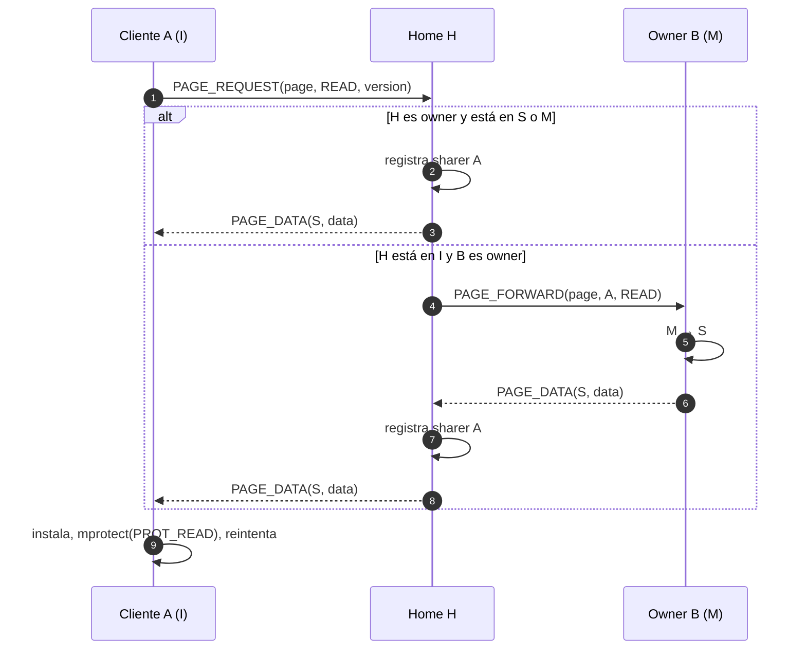

**Figura 10.** Lectura remota con transferencia o reenvío.

#### 9.9.2 Escritura con invalidación

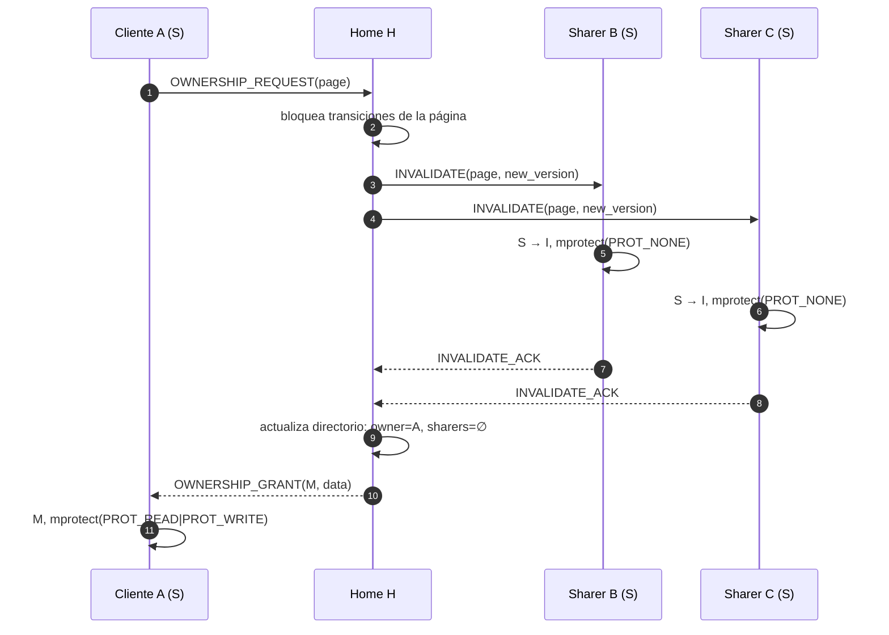

**Figura 11.** Escritura con invalidación de todas las copias.

#### 9.9.3 Write-back por expulsión

```mermaid
sequenceDiagram
    autonumber
    participant A as Nodo A (M)
    participant H as Home H

    A->>A: necesita marco; elige víctima en M
    A->>H: PAGE_WRITEBACK(page, version, data)
    H->>H: actualiza versión y estado (S o I)
    H-->>A: PAGE_WRITEBACK_ACK
    A->>A: mprotect(PROT_NONE); madvise(DONTNEED)
    A->>A: libera marco
```

**Figura 12.** Write-back antes de expulsar una página modificada.

#### 9.9.4 Heartbeat y detección de fallos

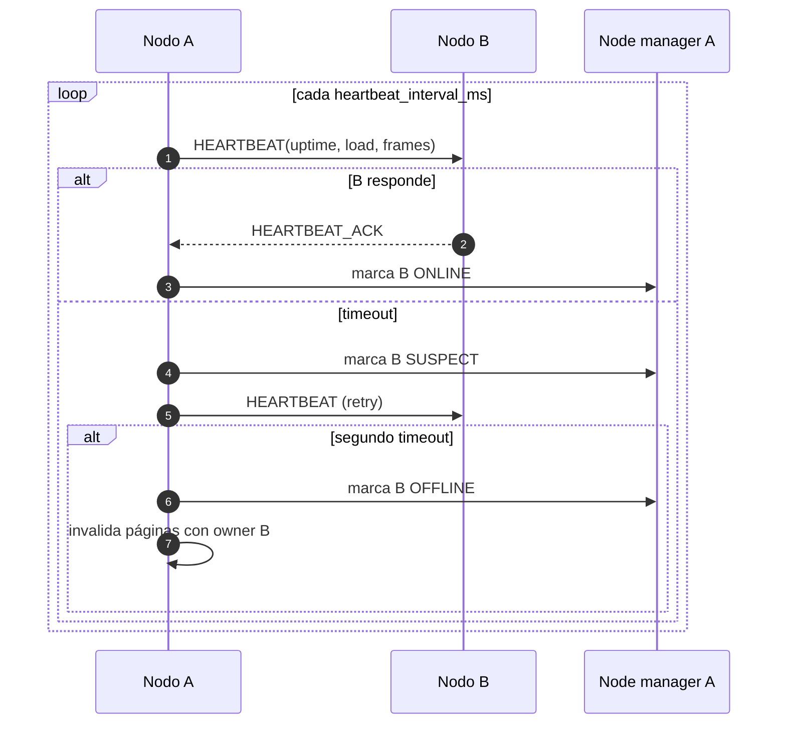

**Figura 13.** Heartbeat y detección de nodo caído.

### 9.10 Timeouts, reintentos e idempotencia

| Parámetro | Default | Uso |
|---|---:|---|
| `network_timeout_ms` | 2000 | Espera de respuesta a una solicitud. |
| `retry_count` | 3 | Reintentos por solicitud. |
| `retry_backoff_ms` | 250 | Espera entre reintentos; se duplica. |
| `heartbeat_interval_ms` | 1000 | Frecuencia de latidos. |
| `heartbeat_timeout_ms` | 3000 | Umbral para `SUSPECT`. |
| `connect_timeout_ms` | 2000 | Timeout de `connect`. |
| `send_timeout_ms` | 2000 | Timeout de `send`. |
| `recv_timeout_ms` | 5000 | Timeout de `recv` de un marco. |

**Idempotencia.** Cada solicitud lleva un `request_id` único generado por el emisor:

```text
request_id = (node_id << 48) | (timestamp_ms << 8) | sequence
```

El receptor mantiene una **caché de respuestas recientes** (por ejemplo, las últimas 1024 por par). Si llega un `request_id` repetido, reenvía la respuesta almacenada en lugar de ejecutar la operación otra vez.

Esto es crítico para:

- Reintentos tras timeout.
- Duplicados por reconexión.
- Invalidaciones repetidas.

### 9.11 Checksum

El campo `checksum` contiene un CRC32 calculado sobre:

```text
CRC32(payload || data)
```

No se incluye la cabecera para permitir que el receptor valide antes de confiar en `payload_len`. Si el checksum no coincide:

1. Se descarta el mensaje.
2. Se incrementa `errors`.
3. Se responde `ERROR` con código `DSM_ERR_CHECKSUM` si la solicitud era una petición.
4. Se registra el evento.

### 9.12 Errores de protocolo

| Código | Nombre | Causa |
|---:|---|---|
| `0x0000` | `DSM_OK` | Sin error. |
| `0x0001` | `DSM_ERR_MAGIC` | `magic` inválido. |
| `0x0002` | `DSM_ERR_VERSION` | Versión no soportada. |
| `0x0003` | `DSM_ERR_TYPE` | Tipo de mensaje desconocido. |
| `0x0004` | `DSM_ERR_LEN` | `header_len` o `payload_len` inválidos. |
| `0x0005` | `DSM_ERR_CHECKSUM` | CRC32 no coincide. |
| `0x0006` | `DSM_ERR_NODE` | Nodo destino desconocido. |
| `0x0007` | `DSM_ERR_PAGE` | Página inexistente. |
| `0x0008` | `DSM_ERR_STATE` | Transición MSI inválida. |
| `0x0009` | `DSM_ERR_TIMEOUT` | Timeout interno. |
| `0x000A` | `DSM_ERR_BUSY` | Recurso ocupado. |
| `0x000B` | `DSM_ERR_NOMEM` | Sin marcos. |
| `0x000C` | `DSM_ERR_DENIED` | Operación no permitida. |
| `0x000D` | `DSM_ERR_PROTOCOL` | Mensaje fuera de secuencia. |

### 9.13 Versionado del protocolo

- `version = 1` para la versión base.
- El receptor acepta la misma versión mayor y rechaza el resto con `DSM_ERR_VERSION`.
- Los campos `reserved` deben enviarse en cero y se ignoran al recibir.
- Agregar un mensaje nuevo no rompe compatibilidad si el receptor responde `DSM_ERR_TYPE`.
- Cambiar el tamaño de la cabecera **sí** rompe compatibilidad y requiere `version = 2`.

### 9.14 Seguridad básica

La versión base no implementa criptografía. Medidas mínimas:

- Validar `magic`, `version`, `header_len` y `payload_len` antes de reservar memoria.
- Limitar `payload_len` a `max_message_size`.
- No confiar en `src_node`; verificar contra la conexión.
- Cerrar la conexión ante un marco inválido.
- Evitar logs con datos binarios completos.
- Documentar que el laboratorio es una red de confianza.

### 9.15 Criterios de aceptación del Módulo 2

- [ ] Cada nodo abre sus cuatro puertos.
- [ ] El listener acepta conexiones y las entrega al pool.
- [ ] El framing lee marcos completos.
- [ ] La cabecera mide exactamente 64 bytes.
- [ ] Se validan `magic`, versión, longitudes y checksum.
- [ ] Se implementan `PAGE_REQUEST`, `PAGE_DATA`, `INVALIDATE` e `INVALIDATE_ACK`.
- [ ] Se implementan heartbeat y detección de caída.
- [ ] Los timeouts y reintentos funcionan.
- [ ] Los duplicados se detectan por `request_id`.
- [ ] El cierre de conexión libera recursos.

---

## 10. Módulo 3: concurrencia y sincronización

### 10.1 Modelo de concurrencia

El sistema es concurrente en tres dimensiones:

1. **Hilos de usuario** de la aplicación, que acceden a la memoria DSM.
2. **Hilos internos** del runtime: red, heartbeat, estadísticas, web y resolución de fallos.
3. **Procesos/nodos** distintos, que se comunican por red.

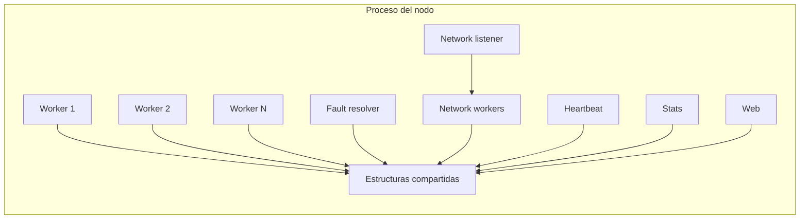

**Figura 14.** Hilos y estructuras compartidas dentro de un nodo.

### 10.2 Estructuras compartidas y su protección

| Estructura | Compartida por | Protección | Notas |
|---|---|---|---|
| Tabla de nodos | Heartbeat, red, CLI, web | `rwlock` o mutex | Lecturas frecuentes. |
| Tabla de páginas local | Workers, resolver, red | Mutex por página + hash lock | Granularidad fina. |
| Directorio de coherencia | Red, resolver | Mutex por entrada | Serializa transiciones. |
| Pool de marcos | Resolver, red | Mutex + semáforo de marcos | Evita doble asignación. |
| Cola de fallos | Handler, resolver | Semáforo + mutex corto | El handler no bloquea. |
| Tabla de conexiones | Listener, workers, heartbeat | Mutex | Protege `fd` y estado. |
| Estadísticas | Todos | Atómicos o mutex de stats | Contadores de 64 bits. |
| Configuración | Todos | Solo lectura tras init | No requiere lock en runtime. |
| Log | Todos | Mutex de log | Serializa líneas. |
| Estado de shutdown | Todos | Atómico + condvar | Cierre ordenado. |

### 10.3 Tipos de sincronización usados

| Primitiva | Uso | Motivo |
|---|---|---|
| `pthread_mutex_t` | Exclusión mutua corta. | Simple y predecible. |
| `pthread_rwlock_t` | Tabla de nodos y configuración. | Muchas lecturas, pocas escrituras. |
| `pthread_cond_t` | Espera de página en vuelo, shutdown. | Despertar por condición. |
| `sem_t` | Cola de fallos, marcos libres, despertar de hilos. | `sem_post` es async-signal-safe. |
| `_Atomic uint64_t` | Contadores de estadísticas. | Sin lock en el camino caliente. |
| `pthread_barrier_t` | Arranque coordinado de workers (opcional). | Sincronizar inicio de prueba. |

**Semáforos POSIX.** Se usan semáforos sin nombre (`sem_init`) dentro del proceso. El diseño evita semáforos con nombre para no depender del sistema de archivos y para simplificar la limpieza.

### 10.4 Jerarquía de locks

Para prevenir interbloqueos se define un **orden global** de adquisición:

```text
Nivel 1: g_shutdown_lock
Nivel 2: g_node_table_lock
Nivel 3: g_directory_lock (bucket)
Nivel 4: page->lock
Nivel 5: g_frame_lock
Nivel 6: conn->tx_lock
Nivel 7: g_stats_lock
Nivel 8: g_log_lock
```

Reglas:

1. Un hilo solo puede adquirir un lock de nivel **mayor** que los que ya tiene.
2. Nunca se adquiere un lock de nivel menor mientras se tiene uno mayor.
3. No se hace E/S de red mientras se tiene un lock de nivel 3 o 4.
4. No se hace `malloc` mientras se tiene un lock de nivel 4 o superior.
5. `g_log_lock` es el último y se libera antes de cualquier otro.
6. Si se necesita otro lock, se libera el actual y se reintenta.
7. Si se necesitan dos locks de página, se adquieren en orden creciente de `page_id`.
8. La búsqueda en la tabla hash toma el lock del bucket y lo libera antes de tomar el lock de la página.

**Excepción documentada.** El resolver puede tomar `page->lock` y luego `g_frame_lock`, en ese orden. Nunca al revés.

### 10.5 Reglas de la tabla de páginas

La entrada de página tiene un lock propio. Las transiciones se hacen en este orden:

```text
lock(page)
  verificar residencia y estado
  si hay que esperar: cond_wait(page->cv, page->lock)
  cambiar residency a FETCHING
unlock(page)

  /* sin lock: solicitud de red */

lock(page)
  instalar datos
  cambiar msi_state
  cambiar residency a RESIDENT
  broadcast(page->cv)
unlock(page)
```

**Nunca** se mantiene `page->lock` durante una llamada de red. Si se mantuviera, un nodo lento bloquearía a todos los hilos que tocan esa página y podría producir un interbloqueo distribuido.

### 10.6 Condiciones de carrera identificadas

| # | Carrera | Consecuencia | Mitigación |
|---:|---|---|---|
| 1 | Dos hilos fallan en la misma página. | Dos solicitudes duplicadas. | `FETCHING` + `cond_wait`. |
| 2 | Expulsión mientras otro hilo accede. | Página liberada en uso. | `refcount` y `refcount > 0` impide expulsar. |
| 3 | Invalidación mientras hay lectura. | Lectura de datos inconsistentes. | `refcount`; la invalidación espera. |
| 4 | Dos escritores solicitan propiedad. | Dos owners `M`. | El home serializa por página. |
| 5 | Heartbeat y cierre de nodo. | Uso de nodo marcado `OFFLINE`. | `node_table_lock` + verificación de estado. |
| 6 | Cierre de conexión mientras se envía. | `EPIPE` o `SIGPIPE`. | `SIGPIPE` ignorado; `tx_lock`; reintento. |
| 7 | Actualización de estadísticas. | Contadores perdidos. | Atómicos. |
| 8 | Shutdown con solicitudes en vuelo. | Uso después de liberar. | Fase de drenaje y `shutdown_flag`. |
| 9 | `accept` y cierre del listener. | `fd` inválido. | Cierre con `shutdown(fd, SHUT_RDWR)`. |
| 10 | Fallo durante `mprotect`. | Estado inconsistente. | Reintento y marca `ERROR`. |
| 11 | Reutilización de `request_id`. | Respuesta incorrecta. | Generador atómico y caché por par. |
| 12 | Dos hilos liberan el mismo objeto. | Doble `free`. | `refcount` de objeto y API documentada. |

### 10.7 Prevención de interbloqueos

Estrategias, en orden de prioridad:

1. **Orden global de locks** (sección 10.4).
2. **No hacer red con locks tomados.**
3. **Timeouts** en `pthread_mutex_timedlock` para locks de nivel 4 y 6.
4. **`trylock`** en caminos de recuperación y en el cierre.
5. **Un solo owner por transición de página**, serializado por el home.
6. **Colas acotadas** para evitar bloqueos indefinidos por productor/consumidor.
7. **Reintento con backoff** en lugar de espera infinita.
8. **Detección de espera circular** en modo diagnóstico (grafo de espera opcional).

**Timeouts propuestos:**

| Lock | Timeout | Acción al vencer |
|---|---:|---|
| `page->lock` | 500 ms | Registrar y reintentar. |
| `conn->tx_lock` | 1000 ms | Marcar conexión `DOWN`. |
| `g_directory_lock` | 500 ms | Reintentar; si persiste, error. |
| `g_frame_lock` | 200 ms | Intentar expulsión alternativa. |
| `pthread_cond_wait` de página | `network_timeout_ms * retry_count` | Marcar `ERROR`. |

### 10.8 Grafo de espera (diagnóstico)

En modo `log_level = debug` se puede mantener un grafo de espera:

- Nodo: `(thread_id, recurso)`.
- Arista: un hilo espera un recurso retenido por otro.
- Detección: recorrido en busca de ciclos cada `deadlock_check_ms`.
- Acción: log con el ciclo y aborto controlado del hilo o del nodo.

En producción el grafo se desactiva por costo. Los timeouts son el mecanismo principal.

### 10.9 Señales frente a sockets

La convivencia entre `SIGSEGV` y la red es el punto más delicado del proyecto.

| Problema | Riesgo | Solución |
|---|---|---|
| Handler de `SIGSEGV` toma un mutex tomado por el hilo interrumpido. | Interbloqueo. | El handler solo encola y hace `sem_post`. |
| `SIGSEGV` interrumpe `accept`. | `EINTR`. | `SA_RESTART` y reintento explícito. |
| `SIGSEGV` interrumpe `recv`/`send`. | Datos parciales. | `recv_all`/`send_all` con reintento. |
| `SIGPIPE` al escribir en socket cerrado. | Proceso terminado. | `signal(SIGPIPE, SIG_IGN)` o `MSG_NOSIGNAL`. |
| `SIGTERM` durante una transición. | Estado inconsistente. | Handler de cierre que activa `shutdown_flag`. |
| Señal entregada a un hilo distinto. | Contexto incorrecto. | `pthread_sigmask` para dirigir señales. |
| `SIGSEGV` real (bug). | Bucle infinito de fallos. | Validar `si_addr`; reenviar si no es del DSM. |
| Reentrada en el handler. | Corrupción. | Bandera `in_fault` por hilo. |

**Enmascaramiento por hilo.** Los hilos internos (red, heartbeat, web) bloquean `SIGSEGV` con `pthread_sigmask`, de modo que solo los hilos de usuario que tocan la ventana DSM reciben la señal. Esto reduce el riesgo de que un fallo se atienda en un hilo sin contexto DSM.

```c
sigset_t set;
sigemptyset(&set);
sigaddset(&set, SIGSEGV);
pthread_sigmask(SIG_BLOCK, &set, NULL);   /* en hilos internos */
```

### 10.10 Cierre ordenado

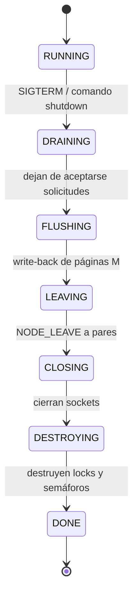

**Figura 15.** Cierre ordenado de un nodo.

| Fase | Acción | Timeout |
|---|---|---:|
| `DRAINING` | Rechazar nuevas solicitudes; esperar las activas. | 5 s |
| `FLUSHING` | Write-back de páginas `M`. | 10 s |
| `LEAVING` | Enviar `NODE_LEAVE` y esperar ACK. | 2 s |
| `CLOSING` | `shutdown` y `close` de sockets. | 2 s |
| `DESTROYING` | `pthread_join`, `sem_destroy`, `munmap`. | 5 s |

Si una fase excede su timeout, se registra y se continúa con la siguiente para no colgar la demo.

### 10.11 Criterios de aceptación del Módulo 3

- [ ] Todos los hilos internos se crean y se unen correctamente.
- [ ] Las estructuras compartidas tienen protección documentada.
- [ ] Se respeta la jerarquía de locks.
- [ ] No hay red con locks de página tomados.
- [ ] El handler no toma locks de larga duración.
- [ ] Los timeouts evitan esperas infinitas.
- [ ] El cierre ordenado no deja hilos ni sockets abiertos.
- [ ] Las pruebas de estrés con varios hilos no producen corrupción.
- [ ] `valgrind --tool=helgrind` o `ThreadSanitizer` no reportan carreras críticas en los escenarios base.

---

## 11. Estructuras de datos, tipos y tamaños

### 11.1 Convenciones

| Convención | Decisión |
|---|---|
| Tipos enteros | `<stdint.h>`: `uint8_t`, `uint16_t`, `uint32_t`, `uint64_t`. |
| Booleanos | `uint8_t` con `0`/`1`, para evitar diferencias de `_Bool`. |
| Atómicos | `_Atomic` de `<stdatomic.h>` para banderas y contadores. |
| Direcciones | `void *` en local; `uint64_t` para `page_id` y `object_id`. |
| Tiempo | `uint64_t` en milisegundos desde `CLOCK_MONOTONIC`. |
| Alineamiento | Natural del compilador; sin `#pragma pack`. |
| Orden en red | Big-endian para todos los campos multibyte. |
| Orden en memoria | El del host; no se comparte memoria entre procesos. |
| Cadenas | `char[N]` con terminación `\0` garantizada. |
| Reservados | Se envían en cero y se ignoran al recibir. |
| Verificación | `_Static_assert` en C11 para cada tamaño crítico. |

```c
_Static_assert(sizeof(dsm_msg_header_t) == 64, "header must be 64 bytes");
_Static_assert(sizeof(dsm_node_info_t) == 112, "node info must be 112 bytes");
_Static_assert(sizeof(dsm_page_info_t) == 64, "page info must be 64 bytes");
_Static_assert(sizeof(dsm_directory_entry_t) == 64, "directory entry must be 64 bytes");
_Static_assert(sizeof(dsm_stats_t) == 128, "stats must be 128 bytes");
_Static_assert(sizeof(dsm_config_t) == 704, "config must be 704 bytes");
```

> **Nota.** Los tamaños se verificaron con la ABI x86-64 de Linux (LP64). En otra ABI pueden cambiar; por eso se usan tipos de ancho fijo y `_Static_assert`.

### 11.2 `dsm_node_info_t` — 112 bytes

Describe un nodo en la tabla de nodos.

```c
typedef struct dsm_node_info {
    uint32_t node_id;           /*   0 */
    uint32_t state;             /*   4: ONLINE / SUSPECT / OFFLINE */
    char     host[64];          /*   8 */
    uint16_t port;              /*  72 */
    uint16_t reserved16;        /*  74 */
    uint64_t memory_bytes;      /*  80 */
    uint64_t last_seen_ms;      /*  88 */
    uint32_t load_percent;      /*  96 */
    uint32_t capabilities;      /* 100 */
    uint32_t protocol_version;  /* 104 */
    uint32_t reserved32;        /* 108 */
} dsm_node_info_t;              /* 112 bytes */
```

| Offset | Campo | Tipo | Bytes |
|---:|---|---|---:|
| 0 | `node_id` | `uint32_t` | 4 |
| 4 | `state` | `uint32_t` | 4 |
| 8 | `host` | `char[64]` | 64 |
| 72 | `port` | `uint16_t` | 2 |
| 74 | `reserved16` | `uint16_t` | 2 |
| 80 | `memory_bytes` | `uint64_t` | 8 |
| 88 | `last_seen_ms` | `uint64_t` | 8 |
| 96 | `load_percent` | `uint32_t` | 4 |
| 100 | `capabilities` | `uint32_t` | 4 |
| 104 | `protocol_version` | `uint32_t` | 4 |
| 108 | `reserved32` | `uint32_t` | 4 |
| **Total** | | | **112** |

### 11.3 `dsm_page_info_t` — 64 bytes

Describe una página en la tabla local.

```c
typedef struct dsm_page_info {
    uint64_t page_id;          /*  0 */
    uint64_t object_id;        /*  8 */
    uint64_t version;          /* 16 */
    uint64_t sharers;          /* 24: bitmap de nodos */
    uint64_t last_access_ms;   /* 32 */
    uint32_t home_node;        /* 40 */
    uint32_t owner_node;       /* 44 */
    uint32_t refcount;         /* 48 */
    uint32_t frame_slot;       /* 52 */
    uint8_t  state;            /* 56: M / S / I */
    uint8_t  is_resident;      /* 57 */
    uint8_t  is_dirty;         /* 58 */
    uint8_t  flags;            /* 59 */
    uint32_t reserved;         /* 60 */
} dsm_page_info_t;              /* 64 bytes */
```

### 11.4 `dsm_directory_entry_t` — 64 bytes

Describe una página en el directorio del `home_node`.

```c
typedef struct dsm_directory_entry {
    uint64_t page_id;            /*  0 */
    uint64_t object_id;          /*  8 */
    uint64_t version;            /* 16 */
    uint64_t sharers;            /* 24: bitmap de nodos */
    uint64_t last_update_ms;     /* 32 */
    uint32_t owner_node;         /* 40 */
    uint32_t home_node;          /* 44 */
    uint64_t pending_request_id; /* 48 */
    uint8_t  state;              /* 56 */
    uint8_t  flags;              /* 57 */
    uint16_t reserved;           /* 58 */
} dsm_directory_entry_t;          /* 64 bytes */
```

**Uso del bitmap `sharers`.** Cada bit representa un `node_id`. Con 64 bits se soportan hasta 64 nodos; el diseño limita a 16, por lo que sobran bits para máscaras auxiliares.

### 11.5 `dsm_object_t` — 112 bytes

Describe un objeto compartido.

```c
typedef struct dsm_object {
    uint64_t object_id;      /*   0 */
    uint64_t first_page_id;  /*   8 */
    uint64_t page_count;     /*  16 */
    uint64_t size_bytes;     /*  24 */
    uint32_t creator_node;   /*  32 */
    uint32_t flags;          /*  36 */
    void    *local_base;     /*  40 */
    char     name[64];       /*  48 */
} dsm_object_t;              /* 112 bytes */
```

### 11.6 `dsm_frame_t` — 40 bytes

Describe un marco del pool local.

```c
typedef struct dsm_frame {
    uint32_t slot;           /*  0 */
    uint32_t flags;          /*  4: FREE / USED / PINNED */
    uint64_t page_id;        /*  8 */
    void    *addr;           /* 16 */
    uint64_t last_used_ms;   /* 24 */
    uint32_t owner_node;     /* 32 */
    uint32_t state;          /* 36 */
} dsm_frame_t;                /* 40 bytes */
```

### 11.7 `dsm_local_page_t` — 56 bytes

Entrada interna de la tabla local, complementaria a `dsm_page_info_t`:

```c
typedef struct dsm_local_page {
    uint64_t page_id;                 /*  0 */
    uint64_t object_id;               /*  8 */
    uint64_t version;                 /* 16 */
    void    *local_addr;              /* 24 */
    uint32_t frame_slot;              /* 32 */
    uint32_t refcount;                /* 36 */
    uint8_t  msi_state;               /* 40 */
    uint8_t  residency;               /* 41 */
    uint8_t  is_dirty;                /* 42 */
    uint8_t  flags;                   /* 43 */
    uint32_t pending_request_id_low;  /* 44 */
    uint32_t reserved;                /* 48 */
    uint32_t reserved2;               /* 52 */
} dsm_local_page_t;                   /* 56 bytes */
```

### 11.8 `dsm_stats_t` — 128 bytes

Contadores por nodo.

```c
typedef struct dsm_stats {
    uint64_t page_faults;             /*   0 */
    uint64_t local_hits;              /*   8 */
    uint64_t remote_reads;            /*  16 */
    uint64_t remote_writes;           /*  24 */
    uint64_t invalidations_sent;      /*  32 */
    uint64_t invalidations_received;  /*  40 */
    uint64_t evictions;               /*  48 */
    uint64_t bytes_sent;              /*  56 */
    uint64_t bytes_received;          /*  64 */
    uint64_t messages_sent;           /*  72 */
    uint64_t messages_received;       /*  80 */
    uint64_t timeouts;                /*  88 */
    uint64_t errors;                  /*  96 */
    uint64_t uptime_ms;               /* 104 */
    uint64_t pages_resident;          /* 112 */
    uint64_t frames_free;             /* 120 */
} dsm_stats_t;                         /* 128 bytes */
```

### 11.9 `dsm_config_t` — 704 bytes

Configuración completa del nodo.

```c
typedef struct dsm_config {
    uint32_t config_version;          /*   0 */
    uint32_t page_size;               /*   4 */
    uint64_t node_memory;             /*   8 */
    uint64_t window_size;             /*  16 */
    uint32_t max_nodes;               /*  24 */
    uint32_t node_id;                 /*  28 */
    char     bind_address[64];        /*  32 */
    uint16_t listen_port;             /*  96 */
    uint16_t control_port;            /*  98 */
    uint16_t heartbeat_port;          /* 100 */
    uint16_t web_port;                /* 102 */
    uint16_t web_enabled;             /* 104 */
    uint16_t reserved16;              /* 106 */
    char     seed_host[256];          /* 108 */
    uint16_t seed_port;               /* 364 */
    uint16_t reserved16b;             /* 366 */
    uint32_t heartbeat_interval_ms;   /* 368 */
    uint32_t heartbeat_timeout_ms;    /* 372 */
    uint32_t network_timeout_ms;      /* 376 */
    uint32_t connect_timeout_ms;      /* 380 */
    uint32_t retry_count;             /* 384 */
    uint32_t retry_backoff_ms;        /* 388 */
    uint32_t max_message_size;        /* 392 */
    uint32_t thread_pool_size;        /* 396 */
    uint32_t fault_queue_size;        /* 400 */
    uint32_t eviction_policy;         /* 404 */
    uint32_t log_level;               /* 408 */
    char     log_file[256];           /* 412 */
    uint32_t stats_interval_ms;       /* 668 */
    uint32_t barrier_timeout_ms;      /* 672 */
    uint32_t replication_factor;      /* 676 */
    uint32_t checkpoint_interval_ms;  /* 680 */
    uint32_t scheduler_policy;        /* 684 */
    uint32_t port_range_start;        /* 688 */
    uint32_t port_range_end;          /* 692 */
    uint32_t reserved32;              /* 696 */
} dsm_config_t;                        /* 704 bytes */
```

| Rango | Campo | Tipo | Bytes |
|---:|---|---|---:|
| 0 | `config_version` | `uint32_t` | 4 |
| 4 | `page_size` | `uint32_t` | 4 |
| 8 | `node_memory` | `uint64_t` | 8 |
| 16 | `window_size` | `uint64_t` | 8 |
| 24 | `max_nodes` | `uint32_t` | 4 |
| 28 | `node_id` | `uint32_t` | 4 |
| 32 | `bind_address` | `char[64]` | 64 |
| 96 | `listen_port` | `uint16_t` | 2 |
| 98 | `control_port` | `uint16_t` | 2 |
| 100 | `heartbeat_port` | `uint16_t` | 2 |
| 102 | `web_port` | `uint16_t` | 2 |
| 104 | `web_enabled` | `uint16_t` | 2 |
| 106 | `reserved16` | `uint16_t` | 2 |
| 108 | `seed_host` | `char[256]` | 256 |
| 364 | `seed_port` | `uint16_t` | 2 |
| 366 | `reserved16b` | `uint16_t` | 2 |
| 368 | `heartbeat_interval_ms` | `uint32_t` | 4 |
| 372 | `heartbeat_timeout_ms` | `uint32_t` | 4 |
| 376 | `network_timeout_ms` | `uint32_t` | 4 |
| 380 | `connect_timeout_ms` | `uint32_t` | 4 |
| 384 | `retry_count` | `uint32_t` | 4 |
| 388 | `retry_backoff_ms` | `uint32_t` | 4 |
| 392 | `max_message_size` | `uint32_t` | 4 |
| 396 | `thread_pool_size` | `uint32_t` | 4 |
| 400 | `fault_queue_size` | `uint32_t` | 4 |
| 404 | `eviction_policy` | `uint32_t` | 4 |
| 408 | `log_level` | `uint32_t` | 4 |
| 412 | `log_file` | `char[256]` | 256 |
| 668 | `stats_interval_ms` | `uint32_t` | 4 |
| 672 | `barrier_timeout_ms` | `uint32_t` | 4 |
| 676 | `replication_factor` | `uint32_t` | 4 |
| 680 | `checkpoint_interval_ms` | `uint32_t` | 4 |
| 684 | `scheduler_policy` | `uint32_t` | 4 |
| 688 | `port_range_start` | `uint32_t` | 4 |
| 692 | `port_range_end` | `uint32_t` | 4 |
| 696 | `reserved32` | `uint32_t` | 4 |
| **Total** | | | **704** |

> **Observación.** `dsm_config_t` es una estructura **en memoria**, no se transmite por red. Los mensajes de configuración usan payloads pequeños y versionados.

### 11.10 `dsm_msg_header_t` — 64 bytes

Ya definida en la sección 9.6. Se repite aquí por completitud de la tabla de tamaños.

| Offset | Campo | Tipo | Bytes |
|---:|---|---|---:|
| 0 | `request_id` | `uint64_t` | 8 |
| 8 | `page_id` | `uint64_t` | 8 |
| 16 | `magic` | `uint32_t` | 4 |
| 20 | `version` | `uint16_t` | 2 |
| 22 | `type` | `uint16_t` | 2 |
| 24 | `flags` | `uint32_t` | 4 |
| 28 | `header_len` | `uint32_t` | 4 |
| 32 | `payload_len` | `uint32_t` | 4 |
| 36 | `src_node` | `uint32_t` | 4 |
| 40 | `dst_node` | `uint32_t` | 4 |
| 44 | `status` | `uint32_t` | 4 |
| 48 | `checksum` | `uint32_t` | 4 |
| 52 | `payload_off` | `uint32_t` | 4 |
| 56 | `ttl` | `uint16_t` | 2 |
| 58 | `reserved` | `uint16_t` | 2 |
| 60 | `reserved2` | `uint32_t` | 4 |
| **Total** | | | **64** |

### 11.11 Resumen de tamaños

| Estructura | Bytes | Uso |
|---|---:|---|
| `dsm_msg_header_t` | 64 | Cabecera de todo mensaje. |
| `dsm_node_info_t` | 112 | Tabla de nodos. |
| `dsm_page_info_t` | 64 | Tabla de páginas local. |
| `dsm_directory_entry_t` | 64 | Directorio del home. |
| `dsm_object_t` | 112 | Objeto compartido. |
| `dsm_frame_t` | 40 | Marco del pool. |
| `dsm_local_page_t` | 56 | Entrada interna local. |
| `dsm_stats_t` | 128 | Estadísticas por nodo. |
| `dsm_config_t` | 704 | Configuración en memoria. |
| `dsm_hello_payload_t` | 128 | Presentación. |
| `dsm_join_request_t` | 120 | Ingreso. |
| `dsm_join_response_t` | 32 | Respuesta de ingreso. |
| `dsm_page_req_payload_t` | 24 | Solicitud de página. |
| `dsm_page_data_payload_t` | 40 | Datos de página (sin datos). |
| `dsm_invalidate_payload_t` | 32 | Invalidación. |
| `dsm_invalidate_ack_payload_t` | 24 | ACK de invalidación. |
| `dsm_ownership_grant_payload_t` | 40 | Concesión de propiedad. |
| `dsm_heartbeat_payload_t` | 48 | Latido. |
| `dsm_stats_payload_t` | 128 | Estadísticas en red. |
| `dsm_error_payload_t` | 64 | Error. |
| `dsm_object_req_t` | 88 | Crear, adjuntar o liberar objeto. |
| `dsm_object_resp_t` | 48 | Respuesta de objeto. |
| `dsm_checkpoint_t` | 40 | Checkpoint (extra 2). |

### 11.12 Tamaño de un marco típico

Con `page_size = 4096`:

```text
PAGE_DATA sin datos       = 64 + 40               = 104 bytes
PAGE_DATA con datos       = 64 + 40 + 4096        = 4200 bytes
INVALIDATE                = 64 + 32               = 96 bytes
INVALIDATE_ACK            = 64 + 24               = 88 bytes
HEARTBEAT                 = 64 + 48               = 112 bytes
```

Con `max_message_size = 8192`, un `PAGE_DATA` de 4 KB cabe con margen. Si se configura `page_size = 8192`, el marco sería `64 + 40 + 8192 = 8296` y habría que subir `max_message_size` a 16384.

### 11.13 Límites del sistema

| Constante | Valor | Justificación |
|---|---:|---|
| `DSM_MAX_NODES` | 16 | Bitmap de 64 bits y rango de puertos. |
| `DSM_MAX_OBJECTS` | 64 | Suficiente para el proyecto. |
| `DSM_MAX_PAGES_PER_OBJECT` | 65536 | 256 MB con páginas de 4 KB. |
| `DSM_MAX_MESSAGE_SIZE` | 8192 | Cubre una página de 4 KB. |
| `DSM_MAX_CONNECTIONS` | 256 | Malla completa de 16 nodos (120 pares) con margen. |
| `DSM_MAX_THREADS` | 128 | Workers + internos. |
| `DSM_MAX_NAME` | 64 | Nombres de objeto. |
| `DSM_MAX_HOST` | 64 | IPv4/IPv6 textual. |
| `DSM_MAX_PATH` | 256 | Rutas de logs y archivos. |
| `DSM_MAX_FAULT_QUEUE` | 4096 | Fallos pendientes. |

### 11.14 Cálculo de capacidad

Con los valores por defecto:

```text
page_size        = 4096 bytes
node_memory      = 1 MB = 1048576 bytes
frames_per_node  = 1048576 / 4096 = 256
window_size      = 256 MB
pages_in_window  = 268435456 / 4096 = 65536
max_nodes        = 16
total_frames     = 16 * 256 = 4096
total_memory     = 4096 * 4096 = 16 MB
```

Con 4 nodos:

```text
total_frames  = 4 * 256 = 1024
total_memory  = 1024 * 4096 = 4 MB
```

**Memoria de metadatos por nodo:**

| Estructura | Cantidad | Bytes cada una | Total |
|---|---:|---:|---:|
| `dsm_frame_t` | 256 | 40 | 10 240 B |
| `dsm_local_page_t` | 256 | 56 | 14 336 B |
| `dsm_page_info_t` | 256 | 64 | 16 384 B |
| `dsm_directory_entry_t` | 256 | 64 | 16 384 B |
| `dsm_node_info_t` | 16 | 112 | 1 792 B |
| `dsm_object_t` | 64 | 112 | 7 168 B |
| `dsm_stats_t` | 1 | 128 | 128 B |
| **Total aproximado** | | | **66 432 B ≈ 65 KB** |

Los metadatos son aproximadamente el 6.3 % de 1 MB. Es un overhead aceptable para el proyecto.

### 11.15 Serialización

La serialización se hace campo por campo, no con `memcpy` de la estructura completa:

```c
void dsm_header_encode(const dsm_msg_header_t *h, uint8_t out[64]);
void dsm_header_decode(const uint8_t in[64], dsm_msg_header_t *h);
```

Motivos:

1. Evitar problemas de **padding** y alineación.
2. Garantizar **big-endian** en la red.
3. Permitir compatibilidad entre versiones.
4. Facilitar pruebas unitarias de ida y vuelta.

Funciones auxiliares:

```c
static inline void put_u16(uint8_t **p, uint16_t v);
static inline void put_u32(uint8_t **p, uint32_t v);
static inline void put_u64(uint8_t **p, uint64_t v);
static inline uint16_t get_u16(const uint8_t **p);
static inline uint32_t get_u32(const uint8_t **p);
static inline uint64_t get_u64(const uint8_t **p);
```

**Prueba de serialización.** Para cada mensaje se verifica:

```text
decode(encode(x)) == x
sizeof(encoded) == tamaño esperado
```

### 11.16 Criterios de aceptación de estructuras

- [ ] Cada estructura usa tipos de ancho fijo.
- [ ] Los tamaños coinciden con la tabla y con `_Static_assert`.
- [ ] No hay `#pragma pack` que dependa del compilador.
- [ ] La serialización es explícita y big-endian.
- [ ] Los campos reservados se inicializan en cero.
- [ ] Los límites están definidos como constantes.
- [ ] El cálculo de capacidad es consistente con la configuración.

---

## 12. API del DSM

### 12.1 Principios del API

1. **Transparencia.** La aplicación usa punteros normales; no ve `page_id` ni mensajes.
2. **Explícito en el ciclo de vida.** Crear, adjuntar y liberar son llamadas explícitas.
3. **Errores por valor de retorno.** No se usa `errno` como mecanismo principal.
4. **Sin callbacks obligatorios.** La aplicación no registra manejadores.
5. **Seguro ante varios hilos.** Las funciones son reentrantes salvo las de inicialización y cierre.
6. **Alineado con C11.** Sin extensiones de GCC en la interfaz pública.

### 12.2 Tipos públicos

```c
typedef struct dsm_object   dsm_object_t;   /* opaco */
typedef struct dsm_barrier  dsm_barrier_t;  /* opaco */
typedef struct dsm_mutex    dsm_mutex_t;    /* opaco */
typedef int32_t             dsm_status_t;
```

Los tipos son **opacos**: la aplicación no accede a sus campos. Esto permite cambiar la implementación sin romper el API.

### 12.3 Funciones de inicialización y cierre

| Función | Descripción |
|---|---|
| `dsm_init` | Inicializa el runtime con una configuración. |
| `dsm_shutdown` | Cierra el runtime de forma ordenada. |
| `dsm_node_id` | Devuelve el identificador del nodo actual. |
| `dsm_version` | Devuelve la versión del runtime. |

```c
dsm_status_t dsm_init(const dsm_config_t *cfg);
dsm_status_t dsm_shutdown(void);
uint32_t     dsm_node_id(void);
const char  *dsm_version(void);
```

**`dsm_init`**

| Aspecto | Detalle |
|---|---|
| Entrada | `cfg` validada; no puede ser `NULL`. |
| Efecto | Reserva la ventana, instala el handler, arranca hilos, se une al clúster. |
| Retorno | `DSM_OK` o código negativo. |
| Errores | `DSM_ERR_INVAL`, `DSM_ERR_MMAP`, `DSM_ERR_SIGACTION`, `DSM_ERR_NET`, `DSM_ERR_TIMEOUT`. |
| Concurrencia | Debe llamarse una sola vez, antes de crear hilos de usuario. |

**`dsm_shutdown`**

| Aspecto | Detalle |
|---|---|
| Entrada | Ninguna. |
| Efecto | Drena solicitudes, hace write-back, cierra sockets, libera recursos. |
| Retorno | `DSM_OK` o `DSM_ERR_STATE` si no estaba inicializado. |
| Concurrencia | Debe llamarse después de unir los hilos de usuario. |

### 12.4 Funciones de objetos

| Función | Descripción |
|---|---|
| `dsm_create` | Crea un objeto compartido. |
| `dsm_attach` | Adjunta un objeto existente. |
| `dsm_detach` | Desadjunta un objeto sin destruirlo. |
| `dsm_destroy` | Destruye un objeto creado por este nodo. |
| `dsm_object_size` | Devuelve el tamaño del objeto. |
| `dsm_object_name` | Devuelve el nombre del objeto. |

```c
dsm_status_t dsm_create(const char *name,
                        size_t size,
                        uint32_t flags,
                        dsm_object_t **out);

dsm_status_t dsm_attach(const char *name,
                        dsm_object_t **out);

dsm_status_t dsm_detach(dsm_object_t *obj);

dsm_status_t dsm_destroy(dsm_object_t *obj);

size_t       dsm_object_size(const dsm_object_t *obj);

const char  *dsm_object_name(const dsm_object_t *obj);
```

| Función | Entrada | Salida | Errores |
|---|---|---|---|
| `dsm_create` | Nombre único, tamaño > 0, flags. | Puntero al objeto. | `DSM_ERR_INVAL`, `DSM_ERR_EXIST`, `DSM_ERR_NOMEM`, `DSM_ERR_TIMEOUT`. |
| `dsm_attach` | Nombre existente. | Puntero al objeto. | `DSM_ERR_NOENT`, `DSM_ERR_TIMEOUT`, `DSM_ERR_STATE`. |
| `dsm_detach` | Objeto adjunto. | `DSM_OK`. | `DSM_ERR_INVAL`, `DSM_ERR_BUSY`. |
| `dsm_destroy` | Objeto creado por el nodo. | `DSM_OK`. | `DSM_ERR_PERM`, `DSM_ERR_BUSY`. |

**Flags de `dsm_create`:**

| Flag | Valor | Significado |
|---|---:|---|
| `DSM_OBJ_PRIVATE` | `0x01` | Solo el creador puede adjuntar. |
| `DSM_OBJ_PERSIST` | `0x02` | El objeto sobrevive al cierre del creador (extra). |
| `DSM_OBJ_ZERO` | `0x04` | Inicializa las páginas en cero. |
| `DSM_OBJ_REPLICATED` | `0x08` | Solicita réplica (extra 2). |

### 12.5 Funciones de memoria

| Función | Descripción |
|---|---|
| `dsm_malloc` | Reserva un bloque dentro de un objeto. |
| `dsm_calloc` | Reserva e inicializa en cero. |
| `dsm_free` | Libera un bloque. |
| `dsm_ptr` | Traduce un offset a puntero local. |
| `dsm_offset` | Traduce un puntero local a offset. |

```c
void        *dsm_malloc(dsm_object_t *obj, size_t size);
void        *dsm_calloc(dsm_object_t *obj, size_t count, size_t size);
void         dsm_free(dsm_object_t *obj, void *ptr);
void        *dsm_ptr(const dsm_object_t *obj, size_t offset);
size_t       dsm_offset(const dsm_object_t *obj, const void *ptr);
```

**Semántica.** El asignador es un **bump allocator** por objeto para la versión base:

- Cada objeto tiene un `next_free_offset`.
- `dsm_malloc` devuelve `local_base + next_free_offset` y avanza el offset alineado a 16 bytes.
- `dsm_free` es un no-op en la versión base; se documenta como limitación.
- El objeto se libera completo con `dsm_destroy`.

Esto es suficiente para matrices, archivos y contadores. Un asignador con listas libres se puede agregar en el prototipo 2 si el tiempo lo permite.

> **Advertencia.** `dsm_malloc` devuelve una dirección **local**. No es válida en otro proceso ni se debe enviar por red. Para compartir datos entre nodos se usan offsets o índices dentro del objeto.

### 12.6 Funciones de sincronización

| Función | Descripción |
|---|---|
| `dsm_barrier_create` | Crea una barrera distribuida. |
| `dsm_barrier_wait` | Espera a que lleguen todos los nodos. |
| `dsm_barrier_destroy` | Destruye la barrera. |
| `dsm_mutex_create` | Crea un mutex distribuido. |
| `dsm_mutex_lock` | Adquiere el mutex. |
| `dsm_mutex_unlock` | Libera el mutex. |
| `dsm_mutex_destroy` | Destruye el mutex. |
| `dsm_atomic_add` | Suma atómica sobre una página. |

```c
dsm_barrier_t *dsm_barrier_create(uint32_t participants);
dsm_status_t   dsm_barrier_wait(dsm_barrier_t *b, int timeout_ms);
dsm_status_t   dsm_barrier_destroy(dsm_barrier_t *b);

dsm_mutex_t   *dsm_mutex_create(dsm_object_t *obj, size_t offset);
dsm_status_t   dsm_mutex_lock(dsm_mutex_t *m, int timeout_ms);
dsm_status_t   dsm_mutex_unlock(dsm_mutex_t *m);
dsm_status_t   dsm_mutex_destroy(dsm_mutex_t *m);

uint64_t       dsm_atomic_add(dsm_object_t *obj, size_t offset, uint64_t value);
```

Las funciones `create` devuelven `NULL` en caso de error. Para obtener el código exacto se usan las variantes `_ex`, que devuelven `dsm_status_t` y el puntero por salida:

```c
dsm_status_t dsm_barrier_create_ex(uint32_t participants, dsm_barrier_t **out);
dsm_status_t dsm_mutex_create_ex(dsm_object_t *obj, size_t offset, dsm_mutex_t **out);
```

**Barrera distribuida.** Se implementa con un coordinador (el `home_node` de la primera página del objeto) y mensajes `BARRIER_ARRIVE` / `BARRIER_RELEASE`. El timeout evita esperas infinitas si un nodo cae.

**Mutex distribuido.** Se implementa con un token en el home y una cola de espera. Para la versión base se puede sustituir por:

- Un lock local por nodo, si cada nodo escribe una región distinta.
- `dsm_atomic_add` para contadores.
- Partición de datos para evitar contención.

El mutex distribuido completo se considera una mejora del prototipo 2.

**`dsm_atomic_add`.** Requiere que la página esté en `M` en el nodo que ejecuta la operación. El runtime:

1. Fuerza la propiedad de la página.
2. Ejecuta una suma atómica local.
3. Deja la página en `M` con la versión incrementada.

Esto garantiza incrementos correctos entre nodos, a costa de invalidaciones.

### 12.7 Funciones de consulta

| Función | Descripción |
|---|---|
| `dsm_stats` | Copia las estadísticas del nodo. |
| `dsm_nodes` | Copia la tabla de nodos. |
| `dsm_pages` | Copia la tabla de páginas local. |
| `dsm_objects` | Copia la lista de objetos. |
| `dsm_node_status` | Consulta el estado de un nodo remoto. |

```c
dsm_status_t dsm_stats(dsm_stats_t *out);
dsm_status_t dsm_nodes(dsm_node_info_t *out, size_t max, size_t *count);
dsm_status_t dsm_pages(dsm_page_info_t *out, size_t max, size_t *count);
dsm_status_t dsm_objects(dsm_object_t **out, size_t max, size_t *count);
dsm_status_t dsm_node_status(uint32_t node_id, dsm_node_info_t *out, int timeout_ms);
```

Todas son **de solo lectura** y seguras para llamar desde la CLI o la web.

### 12.8 Funciones de configuración y utilidades

```c
dsm_status_t dsm_config_defaults(dsm_config_t *cfg);
dsm_status_t dsm_config_load(const char *path, dsm_config_t *cfg);
dsm_status_t dsm_config_validate(const dsm_config_t *cfg);
dsm_status_t dsm_config_save(const char *path, const dsm_config_t *cfg);

const char  *dsm_strerror(dsm_status_t status);
void         dsm_set_log_level(int level);
```

### 12.9 Códigos de error del API

| Código | Valor | Nombre | Significado |
|---|---:|---|---|
| `DSM_OK` | 0 | OK | Sin error. |
| `DSM_ERR_MMAP` | -1 | MMAP | Falló `mmap`. |
| `DSM_ERR_MPROTECT` | -2 | MPROTECT | Falló `mprotect`. |
| `DSM_ERR_SIGACTION` | -3 | SIGACTION | Falló `sigaction`. |
| `DSM_ERR_NOMEM` | -4 | NOMEM | Sin memoria o marcos. |
| `DSM_ERR_NOT_MAPPED` | -5 | NOT_MAPPED | Dirección fuera de la ventana. |
| `DSM_ERR_PAGE_FAULT` | -6 | PAGE_FAULT | Fallo no resuelto. |
| `DSM_ERR_TIMEOUT` | -7 | TIMEOUT | Tiempo agotado. |
| `DSM_ERR_INVAL` | -8 | INVAL | Parámetro inválido. |
| `DSM_ERR_BUSY` | -9 | BUSY | Recurso ocupado. |
| `DSM_ERR_STATE` | -10 | STATE | Estado inconsistente. |
| `DSM_ERR_NOENT` | -11 | NOENT | Objeto o página no existe. |
| `DSM_ERR_EXIST` | -12 | EXIST | El objeto ya existe. |
| `DSM_ERR_PERM` | -13 | PERM | Operación no permitida. |
| `DSM_ERR_AGAIN` | -14 | AGAIN | Reintentar. |
| `DSM_ERR_OVERFLOW` | -15 | OVERFLOW | Tamaño excedido. |
| `DSM_ERR_NOTSUP` | -16 | NOTSUP | No soportado. |
| `DSM_ERR_NET` | -17 | NET | Error de red. |
| `DSM_ERR_PROTOCOL` | -18 | PROTOCOL | Error de protocolo. |
| `DSM_ERR_CHECKSUM` | -19 | CHECKSUM | Checksum inválido. |
| `DSM_ERR_SHUTDOWN` | -20 | SHUTDOWN | Runtime cerrado. |

**Relación con el protocolo.** Los códigos negativos son del API local. Los códigos `0x0001–0x000D` son estados de red y se traducen al API con una tabla:

| Estado de red | Código API |
|---|---|
| `DSM_NET_OK` | `DSM_OK` |
| `DSM_NET_ERR_MAGIC` | `DSM_ERR_PROTOCOL` |
| `DSM_NET_ERR_VERSION` | `DSM_ERR_NOTSUP` |
| `DSM_NET_ERR_TYPE` | `DSM_ERR_NOTSUP` |
| `DSM_NET_ERR_LEN` | `DSM_ERR_PROTOCOL` |
| `DSM_NET_ERR_CHECKSUM` | `DSM_ERR_CHECKSUM` |
| `DSM_NET_ERR_NODE` | `DSM_ERR_NOENT` |
| `DSM_NET_ERR_PAGE` | `DSM_ERR_NOENT` |
| `DSM_NET_ERR_STATE` | `DSM_ERR_STATE` |
| `DSM_NET_ERR_TIMEOUT` | `DSM_ERR_TIMEOUT` |
| `DSM_NET_ERR_BUSY` | `DSM_ERR_BUSY` |
| `DSM_NET_ERR_NOMEM` | `DSM_ERR_NOMEM` |
| `DSM_NET_ERR_DENIED` | `DSM_ERR_PERM` |
| `DSM_NET_ERR_PROTOCOL` | `DSM_ERR_PROTOCOL` |

### 12.10 Ejemplo de uso — matriz distribuida

```c
#include "dsm.h"
#include <stdio.h>

#define N 1024
#define ELEMS (N * N)

int main(void)
{
    dsm_config_t cfg;
    dsm_config_defaults(&cfg);
    cfg.node_id = 0;

    dsm_status_t rc = dsm_init(&cfg);
    if (rc != DSM_OK) {
        fprintf(stderr, "dsm_init: %s\n", dsm_strerror(rc));
        return 1;
    }

    dsm_object_t *obj = NULL;
    size_t bytes = ELEMS * sizeof(double);

    if (dsm_create("matriz", bytes, DSM_OBJ_ZERO, &obj) != DSM_OK) {
        dsm_shutdown();
        return 1;
    }

    double *m = dsm_malloc(obj, bytes);
    if (!m) {
        dsm_destroy(obj);
        dsm_shutdown();
        return 1;
    }

    /* Cada nodo inicializa su franja; el acceso dispara los fallos de página. */
    uint32_t id = dsm_node_id();
    uint32_t nodes = 4;
    size_t rows_per_node = N / nodes;
    size_t start = id * rows_per_node;
    size_t end = (id == nodes - 1) ? N : start + rows_per_node;

    for (size_t i = start; i < end; i++) {
        for (size_t j = 0; j < N; j++) {
            m[i * N + j] = (double)(i + j);
        }
    }

    /* Barrera para que todos terminen antes de leer. */
    dsm_barrier_t *b = dsm_barrier_create(nodes);
    if (b) {
        dsm_barrier_wait(b, 30000);
        dsm_barrier_destroy(b);
    }

    /* Verificación local de una celda. */
    printf("nodo %u: m[0][0] = %.1f\n", id, m[0]);

    dsm_destroy(obj);
    dsm_shutdown();
    return 0;
}
```

### 12.11 Ejemplo de uso — contador concurrente

```c
dsm_object_t *obj;
uint64_t *counter;

dsm_create("contador", sizeof(uint64_t), DSM_OBJ_ZERO, &obj);
counter = dsm_malloc(obj, sizeof(uint64_t));

for (int i = 0; i < 10000; i++) {
    dsm_atomic_add(obj, 0, 1);
}

/* El valor final debe ser 10000 * número_de_hilos. */
```

### 12.12 Reglas de uso

| Regla | Motivo |
|---|---|
| Llamar `dsm_init` antes de cualquier otra función. | El runtime debe estar inicializado. |
| No usar punteros DSM después de `dsm_detach`. | La memoria puede invalidarse. |
| No pasar punteros locales a otros nodos. | Las direcciones virtuales difieren. |
| Usar offsets o índices para compartir. | Es la única representación global. |
| Sincronizar con barreras antes de leer resultados. | Evita leer datos incompletos. |
| No llamar `dsm_shutdown` desde un worker. | Debe hacerse desde el hilo principal. |
| Verificar siempre el retorno. | Los errores de red no son excepcionales. |

### 12.13 Criterios de aceptación del API

- [ ] Todas las funciones están declaradas en `dsm.h`.
- [ ] Los tipos opacos no exponen la implementación.
- [ ] Cada función documenta entradas, salidas y errores.
- [ ] Los códigos de error son consistentes con el protocolo.
- [ ] Los ejemplos compilan conceptualmente contra el API.
- [ ] El API permite escribir las tres aplicaciones de prueba.
- [ ] Las funciones de consulta son seguras desde CLI y web.

---

## 13. Configuración del sistema

### 13.1 Archivo de configuración

El sistema usa un archivo de texto plano, `config/dsm.conf`, con formato `clave = valor`:

- Comentarios con `#`.
- Espacios ignorados alrededor de `=` y `#`.
- Claves en minúsculas y con guiones bajos.
- Valores numéricos sin sufijos; las unidades están en el nombre de la clave.
- Una clave por línea.
- Sin secciones; el orden no importa.

```ini
# Ejemplo mínimo
node_id   = 0
page_size = 4096
node_memory = 1048576
seed_host = 127.0.0.1
seed_port = 50000
```

### 13.2 Tabla de parámetros

| Clave | Tipo | Unidad | Default | Rango válido | Descripción |
|---|---|---|---:|---|---|
| `config_version` | entero | — | 1 | 1 | Versión del formato. |
| `node_id` | entero | — | 0 | 0–15 | Identificador del nodo. |
| `bind_address` | cadena | — | `0.0.0.0` | IPv4/IPv6 | Dirección de escucha. |
| `listen_port` | entero | puerto | 50000 | 50000–50099 | Puerto del protocolo. |
| `control_port` | entero | puerto | 50001 | 50000–50099 | Puerto de control. |
| `heartbeat_port` | entero | puerto | 50002 | 50000–50099 | Puerto de latidos. |
| `web_port` | entero | puerto | 50003 | 50000–50099 | Puerto web. |
| `web_enabled` | booleano | — | 1 | 0/1 | Activa la web. |
| `seed_host` | cadena | — | `127.0.0.1` | host válido | Nodo semilla. |
| `seed_port` | entero | puerto | 50000 | 50000–50099 | Puerto de la semilla. |
| `page_size` | entero | bytes | 4096 | 4096–65536, potencia de 2 | Tamaño de página. |
| `node_memory` | entero | bytes | 1048576 | ≥ 16 páginas | Memoria aportada. |
| `window_size` | entero | bytes | 268435456 | ≥ `node_memory` | Ventana virtual. |
| `max_nodes` | entero | — | 16 | 2–16 | Nodos máximos. |
| `heartbeat_interval_ms` | entero | ms | 1000 | 100–60000 | Intervalo de latido. |
| `heartbeat_timeout_ms` | entero | ms | 3000 | ≥ 2 × intervalo | Umbral de sospecha. |
| `network_timeout_ms` | entero | ms | 2000 | 100–60000 | Timeout de solicitud. |
| `retry_count` | entero | — | 3 | 0–10 | Reintentos. |
| `retry_backoff_ms` | entero | ms | 250 | 0–10000 | Backoff inicial. |
| `connect_timeout_ms` | entero | ms | 2000 | 100–60000 | Timeout de conexión. |
| `max_message_size` | entero | bytes | 8192 | ≥ `page_size` + 256 | Tamaño máximo de marco. |
| `thread_pool_size` | entero | — | 4 | 1–64 | Workers de red. |
| `fault_queue_size` | entero | — | 1024 | 16–65536 | Cola de fallos. |
| `eviction_policy` | cadena | — | `lru` | `lru`, `clock` | Política de reemplazo. |
| `log_level` | cadena | — | `info` | `error`, `warn`, `info`, `debug`, `trace` | Nivel de log. |
| `log_file` | cadena | ruta | `logs/dsm.log` | ruta escribible | Archivo de log. |
| `stats_interval_ms` | entero | ms | 5000 | 500–600000 | Intervalo de métricas. |
| `barrier_timeout_ms` | entero | ms | 30000 | 1000–600000 | Timeout de barrera. |
| `replication_factor` | entero | — | 0 | 0–3 | Réplicas (extra 2). |
| `checkpoint_interval_ms` | entero | ms | 0 | 0 o ≥ 1000 | Checkpoints (extra 2). |
| `scheduler_policy` | cadena | — | `round_robin` | `round_robin`, `least_loaded` | Asignación de home. |
| `port_range_start` | entero | puerto | 50000 | 50000 | Inicio del rango. |
| `port_range_end` | entero | puerto | 50099 | 50099 | Fin del rango. |

### 13.3 Ejemplo completo — nodo 0 (semilla)

```ini
# ============================================================
# dsm.conf — Nodo 0 (semilla)
# Proyecto IC-6600 — Sistema DSM
# ============================================================

config_version = 1

# --- Identidad -------------------------------------------------
node_id      = 0
bind_address = 0.0.0.0

# --- Puertos ---------------------------------------------------
listen_port    = 50000
control_port   = 50001
heartbeat_port = 50002
web_port       = 50003
web_enabled    = 1
port_range_start = 50000
port_range_end   = 50099

# --- Semilla ---------------------------------------------------
seed_host = 127.0.0.1
seed_port = 50000

# --- Memoria ---------------------------------------------------
page_size   = 4096
node_memory = 1048576
window_size = 268435456
max_nodes   = 16

# --- Red -------------------------------------------------------
heartbeat_interval_ms = 1000
heartbeat_timeout_ms  = 3000
network_timeout_ms    = 2000
connect_timeout_ms    = 2000
retry_count           = 3
retry_backoff_ms      = 250
max_message_size      = 8192
thread_pool_size      = 4
fault_queue_size      = 1024

# --- Políticas -------------------------------------------------
eviction_policy  = lru
scheduler_policy = round_robin

# --- Logs y métricas ------------------------------------------
log_level         = info
log_file          = logs/dsm-node0.log
stats_interval_ms = 5000

# --- Sincronización -------------------------------------------
barrier_timeout_ms = 30000

# --- Extras ----------------------------------------------------
replication_factor      = 0
checkpoint_interval_ms  = 0
```

### 13.4 Ejemplo — nodo 1

```ini
node_id      = 1
bind_address = 0.0.0.0

listen_port    = 50004
control_port   = 50005
heartbeat_port = 50006
web_port       = 50007

seed_host = 192.168.1.10
seed_port = 50000

page_size   = 4096
node_memory = 1048576
window_size = 268435456

log_file = logs/dsm-node1.log
```

### 13.5 Puertos por nodo

| Nodo | `listen_port` | `control_port` | `heartbeat_port` | `web_port` |
|---:|---:|---:|---:|---:|
| 0 | 50000 | 50001 | 50002 | 50003 |
| 1 | 50004 | 50005 | 50006 | 50007 |
| 2 | 50008 | 50009 | 50010 | 50011 |
| 3 | 50012 | 50013 | 50014 | 50015 |
| 4 | 50016 | 50017 | 50018 | 50019 |
| … | … | … | … | … |
| 15 | 50060 | 50061 | 50062 | 50063 |

Los puertos `50064–50099` quedan libres para herramientas, pruebas o nodos adicionales fuera del diseño base.

### 13.6 Precedencia de configuración

```text
Defaults del código
      ↓
Archivo dsm.conf
      ↓
Variables de entorno DSM_*
      ↓
Argumentos de línea de comandos
```

Gana la última fuente que define la clave.

**Variables de entorno:**

| Variable | Equivalente |
|---|---|
| `DSM_CONFIG` | Ruta del archivo. |
| `DSM_NODE_ID` | `node_id` |
| `DSM_SEED_HOST` | `seed_host` |
| `DSM_SEED_PORT` | `seed_port` |
| `DSM_LOG_LEVEL` | `log_level` |

**Argumentos de línea de comandos:**

```text
dsm-node --config config/dsm.conf \
         --node-id 1 \
         --seed 192.168.1.10:50000 \
         --log-level debug \
         --web-port 50007
```

| Argumento | Efecto |
|---|---|
| `--config PATH` | Archivo de configuración. |
| `--node-id N` | Sobrescribe `node_id`. |
| `--seed HOST:PORT` | Sobrescribe semilla. |
| `--listen-port P` | Sobrescribe `listen_port`. |
| `--web-port P` | Sobrescribe `web_port`. |
| `--log-level LEVEL` | Sobrescribe `log_level`. |
| `--foreground` | No daemoniza. |
| `--check-config` | Valida y sale. |
| `--version` | Muestra versión y sale. |

### 13.7 Validación

`dsm_config_validate` aplica estas reglas:

| # | Regla | Error |
|---:|---|---|
| 1 | `config_version == 1`. | `DSM_ERR_NOTSUP` |
| 2 | `node_id < max_nodes`. | `DSM_ERR_INVAL` |
| 3 | `page_size` es potencia de 2. | `DSM_ERR_INVAL` |
| 4 | `page_size` es múltiplo de `sysconf(_SC_PAGESIZE)`. | `DSM_ERR_INVAL` |
| 5 | `node_memory % page_size == 0`. | `DSM_ERR_INVAL` |
| 6 | `node_memory / page_size >= 16`. | `DSM_ERR_INVAL` |
| 7 | `window_size >= node_memory`. | `DSM_ERR_INVAL` |
| 8 | `window_size % page_size == 0`. | `DSM_ERR_INVAL` |
| 9 | Los cuatro puertos están en `[port_range_start, port_range_end]`. | `DSM_ERR_INVAL` |
| 10 | Los cuatro puertos son distintos. | `DSM_ERR_INVAL` |
| 11 | Los puertos no chocan con otro nodo de la misma máquina. | `DSM_ERR_BUSY` |
| 12 | `heartbeat_timeout_ms >= 2 * heartbeat_interval_ms`. | `DSM_ERR_INVAL` |
| 13 | `max_message_size >= page_size + 256`. | `DSM_ERR_INVAL` |
| 14 | `retry_count <= 10`. | `DSM_ERR_INVAL` |
| 15 | `thread_pool_size` en `[1, 64]`. | `DSM_ERR_INVAL` |
| 16 | `log_level` es uno de los permitidos. | `DSM_ERR_INVAL` |
| 17 | `log_file` es escribible o su directorio existe. | `DSM_ERR_PERM` |
| 18 | `seed_host` es resoluble si `node_id != 0`. | `DSM_ERR_NOENT` |
| 19 | `replication_factor <= max_nodes - 1`. | `DSM_ERR_INVAL` |

**Mensajes de error.** La validación devuelve el número de regla y el nombre de la clave:

```text
dsm.conf:12: invalid value for 'heartbeat_timeout_ms': 1000
  must be >= 2 * heartbeat_interval_ms (2000)
```

### 13.8 Modo `--check-config`

```text
$ dsm-node --config config/dsm.conf --check-config
dsm.conf: OK
  node_id        = 0
  page_size      = 4096
  node_memory    = 1048576 (256 frames)
  window_size    = 268435456 (65536 pages)
  ports          = 50000, 50001, 50002, 50003
  seed           = 127.0.0.1:50000
```

Este modo se usa en la demo antes de arrancar el clúster.

### 13.9 Configuración de la demo

| Nodo | Máquina | IP | `node_id` | Puertos |
|---:|---|---|---:|---|
| 0 | `[COMPLETAR: equipo]` | `[COMPLETAR: IP]` | 0 | 50000–50003 |
| 1 | `[COMPLETAR: equipo]` | `[COMPLETAR: IP]` | 1 | 50004–50007 |
| 2 | `[COMPLETAR: equipo]` | `[COMPLETAR: IP]` | 2 | 50008–50011 |
| 3 | `[COMPLETAR: equipo]` | `[COMPLETAR: IP]` | 3 | 50012–50015 |

> **Pendiente.** La cantidad de equipos del laboratorio no está confirmada. Si solo hay 2, los nodos 2 y 3 se ejecutan en las mismas máquinas con puertos distintos, o se reduce la demo a 2 nodos.

### 13.10 Criterios de aceptación de configuración

- [ ] El archivo de ejemplo es válido.
- [ ] Todas las claves tienen default, tipo, unidad y rango.
- [ ] La validación rechaza valores inválidos con mensaje claro.
- [ ] `--check-config` funciona sin arrancar el nodo.
- [ ] Los puertos por nodo no se solapan.
- [ ] La precedencia está documentada y probada.
- [ ] La configuración de la demo está completa o marcada como pendiente.

---

## 14. Aplicaciones de prueba

### 14.1 Objetivo

Las aplicaciones deben demostrar que el DSM sirve para cargas reales, no solo para pruebas unitarias. Se definen tres:

1. **Matrices** — carga de cómputo intensivo y datos grandes.
2. **Archivo/video** — carga de E/S y verificación de integridad.
3. **Incrementos concurrentes** — prueba de estrés y coherencia.

Las tres usan el API público y no conocen el protocolo interno.

### 14.2 Aplicación 1 — Matrices

#### 14.2.1 Descripción

Se distribuye una matriz cuadrada de `N × N` elementos `double` en el espacio DSM. Cada nodo inicializa y procesa una franja de filas. Luego se realiza una operación colectiva (por ejemplo, suma de todos los elementos) y se verifica el resultado.

```text
N = 1024  → 1024 × 1024 × 8 B = 8 MB
N = 2048  → 2048 × 2048 × 8 B = 32 MB
```

Con 4 nodos y 1 MB por nodo, la matriz de 8 MB **no cabe** en memoria física simultánea: el DSM debe paginar, expulsar y recargar. Eso es intencional: demuestra la paginación bajo demanda.

> **Nota.** Si la matriz excede la memoria total del clúster, la aplicación debe procesarla por bloques para evitar thrashing extremo. El diseño permite ambos modos:
>
> - **Modo A (demostración de paginación):** matriz mayor que la memoria total; se mide el thrashing.
> - **Modo B (demostración de rendimiento):** matriz que cabe; se mide speedup.

#### 14.2.2 Distribución

```c
size_t rows_per_node = N / nodes;
size_t start = node_id * rows_per_node;
size_t end   = (node_id == nodes - 1) ? N : start + rows_per_node;
```

Cada nodo escribe solo sus filas. Las filas contiguas reducen el false sharing porque cada fila ocupa varias páginas.

#### 14.2.3 Operaciones

| Fase | Operación | Medición |
|---|---|---|
| 1 | `dsm_create("matriz", N*N*8, DSM_OBJ_ZERO)` | Tiempo de creación. |
| 2 | Inicialización de la franja local. | Fallos de página, bytes transferidos. |
| 3 | Barrera. | Tiempo de barrera. |
| 4 | Suma local de la franja. | Tiempo de cómputo. |
| 5 | Reducción global con `dsm_atomic_add`. | Contención, invalidaciones. |
| 6 | Verificación del resultado. | Correcto/incorrecto. |
| 7 | `dsm_destroy`. | Write-back, tiempo de cierre. |

#### 14.2.4 Resultado esperado

Para una matriz inicializada con `m[i][j] = i + j`:

```text
suma_total = Σ_{i=0}^{N-1} Σ_{j=0}^{N-1} (i + j)
           = N * Σ_i i + N * Σ_j j
           = 2 * N * (N-1) * N / 2
           = N^2 * (N - 1)
```

Para `N = 1024`: `1024^2 * 1023 = 1 072 693 248`.

La aplicación compara el valor calculado con la fórmula y reporta `OK` o `MISMATCH`.

#### 14.2.5 Métricas

- Tiempo total.
- Fallos de página por nodo.
- Lecturas remotas y escrituras remotas.
- Invalidaciones.
- Bytes transferidos.
- Speedup respecto a 1 nodo.
- Eficiencia (`speedup / nodes`).

### 14.3 Aplicación 2 — Archivo/video

#### 14.3.1 Descripción

Se toma un archivo binario (por ejemplo, un video corto o una imagen grande), se carga en un objeto DSM y se procesa en paralelo por bloques. Cada nodo procesa un conjunto de bloques y calcula un checksum parcial. Al final se combina el checksum y se compara con el checksum del archivo original.

```text
archivo       = [COMPLETAR: ruta y nombre]
tamaño        = [COMPLETAR: bytes]
bloques       = tamaño / (nodes * block_size)
block_size    = 64 KB (propuesto)
```

#### 14.3.2 Modos de procesamiento

| Modo | Operación | Verificación |
|---|---|---|
| `copy` | Copiar el archivo al DSM y leerlo de vuelta. | Checksum idéntico. |
| `invert` | Invertir bits de cada byte. | Checksum esperado. |
| `gray` | Convertir frames de video a escala de grises. | Tamaño y checksum por frame. |
| `hash` | Calcular SHA-256 por bloque. | Hash combinado. |

Para la versión base se implementa `copy` y `hash`. `gray` se implementa si el tiempo lo permite.

#### 14.3.3 Distribución

```c
size_t chunk = size / nodes;
size_t start = node_id * chunk;
size_t end   = (node_id == nodes - 1) ? size : start + chunk;
```

Cada nodo lee su rango, calcula un checksum parcial y lo publica en una estructura compartida. El nodo 0 combina los checksums.

#### 14.3.4 Resultado esperado

```text
checksum_original = [COMPLETAR: valor]
checksum_dsm      = [COMPLETAR: valor]
resultado         = OK / MISMATCH
```

#### 14.3.5 Métricas

- Throughput (MB/s).
- Tiempo por fase: carga, procesamiento, verificación.
- Fallos de página.
- Bytes transferidos.
- Uso de memoria por nodo.

> **Pendiente.** El archivo o video concreto no está definido. Se deja el marcador `[COMPLETAR]` y se propone usar un video de 10–30 s en 480p o una imagen de 20–50 MB.

### 14.4 Aplicación 3 — Incrementos concurrentes

#### 14.4.1 Descripción

Es la prueba de estrés de coherencia. Varios hilos en varios nodos incrementan un contador compartido muchas veces. El resultado final debe ser exactamente `hilos × incrementos`.

```text
hilos_por_nodo = 4
nodos          = 4
incrementos    = 10000
total_esperado = 4 * 4 * 10000 = 160000
```

#### 14.4.2 Variantes

| Variante | Descripción | Qué prueba |
|---|---|---|
| `atomic` | Usa `dsm_atomic_add`. | Corrección de la operación atómica. |
| `mutex` | Usa `dsm_mutex_lock` / `unlock`. | Mutex distribuido. |
| `naive` | `*counter += 1` sin sincronización. | Pérdida de actualizaciones esperada. |
| `padded` | Contadores separados por página. | Reducción de false sharing. |

La variante `naive` **debe fallar** (resultado menor al esperado). Eso demuestra que la coherencia de página no es atomicidad de aplicación y justifica el API de sincronización.

#### 14.4.3 Resultado esperado

```text
atomic: total = 160000  → OK
mutex:  total = 160000  → OK
naive:  total < 160000  → pérdida esperada
padded: total = 160000  → OK, menos invalidaciones
```

#### 14.4.4 Métricas

- Total final.
- Invalidaciones por segundo.
- Ping-pong de páginas.
- Tiempo total.
- Throughput de incrementos por segundo.

### 14.5 Guía de adaptación al API

| Cambio | Antes | Después |
|---|---|---|
| Reserva | `malloc(size)` | `dsm_malloc(obj, size)` |
| Liberación | `free(ptr)` | `dsm_free(obj, ptr)` o `dsm_destroy(obj)` |
| Arreglo global | `double *m` | `double *m = dsm_malloc(obj, bytes)` |
| Índice compartido | puntero | offset dentro del objeto |
| Sincronización | `pthread_mutex_t` | `dsm_mutex_t` o `dsm_atomic_add` |
| Espera colectiva | `pthread_barrier_t` | `dsm_barrier_t` |
| Verificación | local | checksum o comparación contra patrón |

**Reglas:**

1. No usar `malloc` para datos que deben compartirse.
2. Alinear estructuras a 64 bytes para evitar false sharing.
3. Separar contadores en páginas distintas si hay contención.
4. Usar barreras antes de leer resultados de otros nodos.
5. Verificar el retorno de cada llamada DSM.

### 14.6 Datos de prueba

| Dato | Estado | Propuesta |
|---|---|---|
| Matriz `N` | Pendiente | 1024 para demo, 2048 para estrés. |
| Archivo | Pendiente | `[COMPLETAR: ruta]` |
| Video | Pendiente | 10–30 s, 480p. |
| Hilos | Definido | 4 por nodo. |
| Incrementos | Definido | 10 000 por hilo. |
| Nodos | Definido | 4 ideales, 2 mínimo. |

### 14.7 Criterios de aceptación de las aplicaciones

- [ ] Las tres aplicaciones usan solo el API público.
- [ ] La matriz produce el resultado esperado.
- [ ] El archivo produce el checksum esperado.
- [ ] Los incrementos atómicos dan el total exacto.
- [ ] La variante `naive` muestra pérdida de actualizaciones.
- [ ] Cada aplicación reporta métricas.
- [ ] Cada aplicación se puede ejecutar con 2 y con 4 nodos.
- [ ] Los datos de prueba están documentados o marcados como pendientes.

---

## 15. Plan de pruebas y métricas

### 15.1 Estrategia

| Nivel | Objetivo | Herramienta | Cuándo |
|---|---|---|---|
| Unitario | Verificar funciones aisladas. | C + `assert` + script. | Cada commit. |
| Integración | Verificar dos o más módulos. | Clúster local de 2 nodos. | Fin de semana 1–2. |
| Coherencia | Verificar MSI. | Escenarios controlados. | Prototipo 1 en adelante. |
| Estrés | Verificar concurrencia y estabilidad. | Varios hilos y nodos. | Prototipo 2. |
| Regresión | Evitar retrocesos. | Suite completa. | Antes de cada entrega. |
| Rendimiento | Medir latencia y throughput. | Scripts de medición. | Prototipo 2 y final. |

### 15.2 Entornos

| Entorno | Descripción | Uso |
|---|---|---|
| Local 1 proceso | Un nodo en una terminal. | Unitarias. |
| Local 2 procesos | Dos nodos en la misma máquina. | Integración. |
| Local 4 procesos | Cuatro nodos en la misma máquina. | Estrés y demo de respaldo. |
| Laboratorio 2 equipos | Dos máquinas físicas. | Integración real. |
| Laboratorio 4 equipos | Cuatro máquinas físicas. | Demo ideal. |

### 15.3 Pruebas unitarias

| ID | Prueba | Entrada | Resultado esperado |
|---|---|---|---|
| `U-01` | Reserva de ventana | `window_size = 256 MB` | `mmap` OK, `PROT_NONE`. |
| `U-02` | Cálculo de página | Dirección conocida | `page_id` correcto. |
| `U-03` | Dirección fuera de ventana | Puntero externo | `DSM_INVALID_PAGE_ID`. |
| `U-04` | Serialización de cabecera | Cabecera de prueba | 64 bytes, ida y vuelta igual. |
| `U-05` | Checksum | Payload conocido | CRC32 esperado. |
| `U-06` | Validación de configuración | Valores inválidos | Error con clave y regla. |
| `U-07` | Parseo de `dsm.conf` | Archivo de ejemplo | Todos los campos cargados. |
| `U-08` | Cálculo de puertos | `node_id = 3` | 50012–50015. |
| `U-09` | Tamaños de structs | `_Static_assert` | Compila sin error. |
| `U-10` | `dsm_strerror` | Cada código | Cadena no vacía. |
| `U-11` | Bump allocator | Varias reservas | Offsets alineados. |
| `U-12` | Detección de escritura | `ucontext` simulado | `DSM_FAULT_WRITE`. |

### 15.4 Pruebas de integración

| ID | Prueba | Procedimiento | Resultado esperado |
|---|---|---|---|
| `I-01` | Arranque de 2 nodos | Nodo 0 semilla, nodo 1 se une. | Ambos `ONLINE`. |
| `I-02` | Heartbeat | Esperar 5 s. | Latidos y `last_seen_ms` actualizado. |
| `I-03` | Crear y adjuntar | Nodo 0 crea, nodo 1 adjunta. | Mismo `object_id`. |
| `I-04` | Lectura remota | Nodo 1 lee página escrita por 0. | Valor correcto. |
| `I-05` | Escritura remota | Nodo 1 escribe, nodo 0 lee. | Valor actualizado. |
| `I-06` | Invalidación | Nodo 0 en `S`, nodo 1 escribe. | Nodo 0 pasa a `I`. |
| `I-07` | Write-back | Nodo 0 en `M` expulsa. | Home recibe datos. |
| `I-08` | Timeout | Se corta un enlace. | `DSM_ERR_TIMEOUT` y reintento. |
| `I-09` | Nodo caído | `kill -9` al nodo 1. | Nodo 0 lo marca `OFFLINE`. |
| `I-10` | Cierre ordenado | `SIGTERM` al nodo 0. | `NODE_LEAVE` y cierre limpio. |
| `I-11` | CLI | `dsm-cli nodes`. | Tabla con nodos. |
| `I-12` | Web | `GET /api/nodes`. | JSON válido. |

### 15.5 Pruebas de coherencia MSI

| ID | Escenario | Secuencia | Verificación |
|---|---|---|---|
| `C-01` | Lectura compartida | A lee, B lee. | Ambos en `S`, mismo valor. |
| `C-02` | Escritura exclusiva | A escribe, B lee. | A en `M`, B pasa a `I`, luego `S` con nuevo valor. |
| `C-03` | Dos escritores | A escribe, B escribe. | Un solo `M` a la vez. |
| `C-04` | Ping-pong | A y B alternan 1000 escrituras. | Valor final correcto; se miden invalidaciones. |
| `C-05` | False sharing | Dos contadores en la misma página. | Se detecta contención; se compara con versión padded. |
| `C-06` | Expulsión en `M` | Forzar presión de memoria. | Write-back y versión actualizada. |
| `C-07` | Invalidación concurrente | Varios sharers. | Todos responden `INVALIDATE_ACK`. |
| `C-08` | Fallo durante invalidación | Se corta un sharer. | Timeout y transición controlada. |
| `C-09` | Coalescing | Dos hilos fallan juntos. | Una sola solicitud. |
| `C-10` | Versión | Lectura tras escritura. | `version` aumenta solo con escritura. |

### 15.6 Pruebas de estrés

| ID | Prueba | Configuración | Métrica |
|---|---|---|---|
| `S-01` | Incrementos atómicos | 4 nodos × 4 hilos × 10 000. | Total exacto, tiempo. |
| `S-02` | Incrementos con mutex | Igual. | Total exacto, contención. |
| `S-03` | Matriz 2048 | 4 nodos. | Tiempo, fallos, thrashing. |
| `S-04` | Archivo 100 MB | 4 nodos. | Throughput. |
| `S-05` | Fallos masivos | 16 hilos por nodo. | Estabilidad, sin corrupción. |
| `S-06` | Expulsión continua | `node_memory` pequeño. | Sin pérdida de datos. |
| `S-07` | Nodo lento | `tc` o `sleep` inyectado. | Timeouts y recuperación. |
| `S-08` | Caída y reingreso | Reiniciar un nodo. | Rejoin correcto o error documentado. |

### 15.7 Pruebas de fallos

| ID | Fallo | Inyección | Comportamiento esperado |
|---|---|---|---|
| `F-01` | Nodo caído con páginas `M`. | `kill -9`. | Página no disponible; error claro. |
| `F-02` | Pérdida de conexión. | Cortar cable o `iptables`. | Reconnect con backoff. |
| `F-03` | Mensaje corrupto. | Alterar bytes. | `DSM_ERR_CHECKSUM`. |
| `F-04` | Mensaje gigante. | `payload_len` falso. | Cierre de conexión. |
| `F-05` | Puerto ocupado. | Otro proceso escucha. | Error al arrancar. |
| `F-06` | Disco lleno (log). | Limitar espacio. | Warning, no crash. |
| `F-07` | Memoria insuficiente. | `ulimit`. | `DSM_ERR_NOMEM`. |
| `F-08` | `SIGSEGV` real. | Bug intencional. | Se reenvía, no se oculta. |
| `F-09` | Cierre durante transición. | `SIGTERM` en carga. | Cierre ordenado o aborto controlado. |
| `F-10` | Reloj inconsistente. | Cambiar hora. | Se usa `CLOCK_MONOTONIC`. |

### 15.8 Métricas

| Métrica | Definición | Unidad | Fuente |
|---|---|---|---|
| Fallos de página | `SIGSEGV` del DSM atendidos. | conteo | `dsm_stats_t.page_faults` |
| Hits locales | Accesos sin fallo. | conteo | `local_hits` |
| Lecturas remotas | `PAGE_REQUEST` respondidos. | conteo | `remote_reads` |
| Escrituras remotas | `OWNERSHIP_REQUEST` atendidos. | conteo | `remote_writes` |
| Invalidaciones enviadas | `INVALIDATE` emitidos. | conteo | `invalidations_sent` |
| Invalidaciones recibidas | `INVALIDATE` recibidos. | conteo | `invalidations_received` |
| Expulsiones | Páginas expulsadas. | conteo | `evictions` |
| Bytes enviados/recibidos | Tráfico TCP. | bytes | `bytes_sent`, `bytes_received` |
| Mensajes | Marcos enviados/recibidos. | conteo | `messages_sent`, `messages_received` |
| Timeouts | Solicitudes vencidas. | conteo | `timeouts` |
| Errores | Errores de protocolo y API. | conteo | `errors` |
| Latencia de fallo | Tiempo entre `SIGSEGV` y reintento. | ms | Instrumentación |
| Latencia de página remota | Tiempo de `PAGE_REQUEST` a `PAGE_DATA`. | ms | Instrumentación |
| Throughput | Operaciones o MB por segundo. | ops/s, MB/s | Cálculo |
| Speedup | `T(1) / T(n)`. | factor | Cálculo |
| Eficiencia | `speedup / n`. | porcentaje | Cálculo |
| Memoria residente | Páginas residentes por nodo. | páginas | `pages_resident` |
| Marcos libres | Marcos disponibles. | conteo | `frames_free` |

**Fórmulas:**

```text
speedup(n)    = T(1) / T(n)
eficiencia(n) = speedup(n) / n
throughput    = bytes_procesados / tiempo_total
latencia_p50  = percentil 50 de las latencias
latencia_p95  = percentil 95 de las latencias
```

### 15.9 Evidencia

| Evidencia | Formato | Dónde |
|---|---|---|
| Salida de `make` | texto | `results/build.txt` |
| Arranque de nodos | texto | `results/startup.log` |
| Logs de heartbeat | texto | `results/heartbeat.log` |
| Logs de páginas | texto | `results/pages.log` |
| Salida de CLI | texto | `results/cli.txt` |
| Capturas de web | PNG | `results/web/` |
| Resultados de matriz | CSV | `results/matrix.csv` |
| Resultados de archivo | CSV | `results/file.csv` |
| Resultados de estrés | CSV | `results/stress.csv` |
| `git log` | texto | `results/git-log.txt` |

### 15.10 Trazabilidad

| Requisito | Diseño | Prueba |
|---|---|---|
| Paginación bajo demanda | §8 | `U-01`, `I-04`, `C-01` |
| `mmap` / `mprotect` | §8.2, §8.4 | `U-01`, `I-04` |
| `SIGSEGV` / `sigaction` | §8.5–8.8 | `U-02`, `U-12`, `I-04` |
| Sockets TCP/IP | §9 | `I-01`, `I-08` |
| Pthreads | §10 | `S-01`, `S-05` |
| Semáforos POSIX | §10.3 | `S-01`, `I-10` |
| MSI | §7 | `C-01`–`C-10` |
| Directorio | §7.6 | `C-02`, `C-07` |
| Heartbeat | §6.5.3, §9.9.4 | `I-02`, `I-09` |
| API | §12 | `U-10`, `I-03` |
| Protocolo | §9 | `U-04`, `F-03` |
| Configuración | §13 | `U-06`, `U-07`, `U-08` |
| Aplicaciones | §14 | `S-01`–`S-04` |
| CLI / web | §6.2 | `I-11`, `I-12` |

### 15.11 Calendario de pruebas

| Semana | Pruebas | Entregable |
|---|---|---|
| 1 | Unitarias y configuración. | E1 |
| 2 | Integración 2 nodos, lectura remota. | E2 |
| 3 | MSI completo, estrés, aplicaciones. | E3 |
| 4 | Regresión, rendimiento, demo. | Final |

### 15.12 Criterios de aceptación del plan

- [ ] Cada requisito tiene al menos una prueba.
- [ ] Cada prueba tiene entrada, procedimiento y resultado esperado.
- [ ] Las métricas están definidas y son medibles.
- [ ] La evidencia se guarda en `results/`.
- [ ] Las pruebas se pueden reproducir con scripts.
- [ ] Los fallos conocidos se documentan.

---

## 16. Plan de trabajo, riesgos y decisiones

### 16.1 Calendario

| Semana | Fechas | Entregable | Actividades |
|---|---|---|---|
| 1 | 27 oct – 6 nov | **E1** | Diseño, API, protocolo, estructuras, configuración. |
| 2 | 7 nov – 13 nov | **E2** | Prototipo 1: memoria, red, MSI básico, 2 nodos. |
| 3 | 14 nov – 20 nov | **E3** | Prototipo 2: concurrencia, estrés, aplicaciones, métricas. |
| 4 | 21 nov – 27 nov | **Final** | Regresión, rendimiento, manual, demo y defensa. |

### 16.2 Hitos

| Hito | Fecha | Criterio de cierre |
|---|---|---|
| Diseño congelado | 6 nov 2026 | E1 entregado. |
| Primera página remota | 11 nov 2026 | `PAGE_REQUEST` / `PAGE_DATA` funcionando. |
| MSI básico | 13 nov 2026 | Lectura y escritura con invalidación. |
| 4 nodos estables | 18 nov 2026 | Clúster de 4 sin caídas. |
| Aplicaciones | 19 nov 2026 | Matriz y archivo con resultados correctos. |
| Estrés | 20 nov 2026 | Incrementos y matriz bajo carga. |
| Demo ensayada | 25 nov 2026 | Guion completo en 90 min. |
| Demo final | 27 nov 2026 | Revisión en laboratorio. |

### 16.3 Distribución de trabajo

| Área | Responsable principal | Apoyo |
|---|---|---|
| Memoria y paginación | [COMPLETAR: integrante] | [COMPLETAR: integrante] |
| Red y protocolo | [COMPLETAR: integrante] | [COMPLETAR: integrante] |
| Coherencia MSI | [COMPLETAR: integrante] | [COMPLETAR: integrante] |
| Concurrencia | [COMPLETAR: integrante] | [COMPLETAR: integrante] |
| Aplicaciones | [COMPLETAR: integrante] | [COMPLETAR: integrante] |
| Pruebas y métricas | [COMPLETAR: integrante] | [COMPLETAR: integrante] |
| Documentación | Ambos | — |
| Demo y defensa | Ambos | — |

> **Regla del curso.** Ambos integrantes deben poder explicar todas las partes. La distribución anterior es de carga, no de exclusividad de conocimiento.

### 16.4 Riesgos

| # | Riesgo | Prob. | Impacto | Mitigación |
|---:|---|---|---|---|
| 1 | Inestabilidad del handler `SIGSEGV`. | Alta | Alto | Handler mínimo, `sigaltstack`, pruebas de una página. |
| 2 | Interbloqueo por locks y red. | Alta | Alto | Jerarquía, timeouts, no red con locks. |
| 3 | MSI incompleto. | Media | Alto | Implementar primero `S`, luego `M`, luego invalidación. |
| 4 | Demasiado alcance. | Alta | Medio | Priorizar 2 nodos y una página. |
| 5 | Red del laboratorio restringida. | Media | Alto | Probar puertos; fallback local. |
| 6 | Pocos equipos disponibles. | Media | Medio | Modo multi-proceso en una máquina. |
| 7 | Pérdida de datos por expulsión. | Media | Alto | Write-back obligatorio antes de liberar. |
| 8 | False sharing severo. | Media | Medio | Padding y partición. |
| 9 | Thrashing. | Media | Medio | Ajustar `node_memory` y tamaño de problema. |
| 10 | Git con un solo autor. | Media | Alto | Commits frecuentes de ambos. |
| 11 | Falta de tiempo para extras. | Alta | Bajo | Extras solo después del E3. |
| 12 | Demo no reproducible. | Media | Alto | Scripts, configuración de respaldo, video grabado. |
| 13 | Un integrante no puede explicar. | Baja | Alto | Ensayo cruzado. |
| 14 | Diferencias de ABI en tamaños. | Baja | Medio | `_Static_assert` y tipos fijos. |
| 15 | Logs que llenan el disco. | Baja | Bajo | Rotación y límite. |

### 16.5 Decisiones tomadas

| # | Decisión | Alternativas | Motivo |
|---:|---|---|---|
| 1 | C11 | C99, C17 | Confirmado por el profesor. |
| 2 | Ventana local + pool de marcos | Direcciones idénticas | Evita requerir la misma dirección virtual. |
| 3 | Runtime embebido | Proceso separado | El `SIGSEGV` ocurre en el proceso que accede. |
| 4 | MSI simplificado | MESI, MOESI | Menos estados, suficiente para el curso. |
| 5 | Directorio distribuido | Centralizado | Evita cuello de botella y punto único de fallo. |
| 6 | TCP persistente | UDP, conexión por mensaje | Confiabilidad y menos overhead. |
| 7 | Página 4 KB | 8 KB, 64 KB | Menos false sharing, más mensajes. |
| 8 | 1 MB por nodo | 4 MB, 16 MB | Cabe en el laboratorio y demuestra paginación. |
| 9 | 4 nodos ideales | 2 nodos | Equilibrio entre demo y recursos. |
| 10 | LRU aproximado | Clock, aleatorio | Simplicidad y buena localidad. |
| 11 | CLI + web | Solo CLI | Confirmado por el equipo. |
| 12 | Extras condicionados | Extras obligatorios | Base primero. |

### 16.6 Decisiones pendientes

| # | Tema | Impacto | Responsable | Fecha límite |
|---:|---|---|---|---|
| 1 | URL del repositorio Git. | Portada y referencias. | Ambos | Antes del E1. |
| 2 | Cantidad de equipos del laboratorio. | Configuración de la demo. | Ambos | Antes del E2. |
| 3 | Cita de la demo. | Entrega final. | Ambos | Antes del E3. |
| 4 | Dataset de matriz y video. | Aplicaciones. | Ambos | Antes del E3. |
| 5 | Formato final del informe. | Presentación. | Ambos | Antes del E1. |
| 6 | Manual de usuario separado. | Entrega final. | Ambos | Antes del E3. |
| 7 | Extra 1 vs Extra 2. | Alcance. | Ambos | Después del E3. |
| 8 | Profesor y semestre exactos. | Portada. | Ambos | Antes del E1. |

> Los datos de la portada (profesor, semestre) deben confirmarse contra el PDF o la plataforma del curso. Se dejan como `[COMPLETAR]` si no se confirman.

### 16.7 Control de cambios

- Todo cambio de diseño se registra en una tabla de cambios.
- Los cambios de protocolo requieren actualizar §9 y §11.
- Los cambios de API requieren actualizar §12 y los ejemplos.
- Los cambios de configuración requieren actualizar §13 y `dsm.conf.example`.
- Cada prototipo documenta sus diferencias respecto al diseño anterior.

| Versión | Fecha | Cambio | Autor |
|---|---|---|---|
| 1.0 | 6 nov 2026 | Diseño inicial. | Ambos |

### 16.8 Estimación de esfuerzo

| Actividad | Horas estimadas |
|---|---:|
| Diseño (E1) | 24 |
| Memoria y paginación | 30 |
| Red y protocolo | 26 |
| MSI y directorio | 28 |
| Concurrencia | 20 |
| Aplicaciones | 24 |
| Pruebas y métricas | 20 |
| Documentación | 18 |
| Demo y defensa | 10 |
| **Total** | **200** |

La estimación es gruesa y se ajusta al final de cada semana.

---

## 17. Conclusiones

### 17.1 Sobre el diseño

El diseño propuesto cumple con los requisitos del proyecto:

1. Usa **C11** y **Linux**.
2. Usa **sockets TCP/IP** para la comunicación.
3. Usa **Pthreads** y **semáforos POSIX** para la concurrencia.
4. Usa **`mmap`**, **`mprotect`** y **`sigaction`** para la paginación bajo demanda.
5. Implementa **MSI** con estados `M`, `S` e `I`.
6. Provee **API**, **protocolo** y **configuración** completos.
7. Define **estructuras**, **tipos** y **tamaños** verificables.
8. Incluye **aplicaciones de prueba** y **plan de pruebas**.

### 17.2 Sobre la arquitectura

La decisión de usar una **ventana local con identificadores globales de página** es la más importante del diseño. Permite:

- Que los nodos no compartan direcciones virtuales.
- Que el tamaño de la ventana sea independiente de la memoria física.
- Que el protocolo use `page_id` y la aplicación use punteros locales.
- Que el sistema sea portable entre procesos y máquinas.

El **pool de marcos** mantiene el modelo simple: cada nodo aporta memoria física y el sistema la suma lógicamente. La expulsión con write-back preserva la coherencia.

### 17.3 Sobre la coherencia

MSI es suficiente para el proyecto y más simple que MESI o MOESI. Las invariantes y la tabla de transiciones cubren los casos principales:

- Lectura compartida.
- Escritura exclusiva.
- Invalidación de sharers.
- Write-back por expulsión.
- Reenvío cuando el home no tiene los datos.

Los casos borde (coalescing, expulsión con `refcount`, owner caído) están identificados y tienen política definida.

### 17.4 Sobre la concurrencia

El punto más riesgoso es la convivencia entre `SIGSEGV` y los sockets. La regla de oro es:

> El handler de señal **no** hace trabajo pesado: solo registra el fallo, despierta al resolver y duerme al hilo.

Junto con la jerarquía de locks, los timeouts y la prohibición de hacer red con locks de página tomados, esto reduce la probabilidad de interbloqueo.

### 17.5 Sobre el alcance

El diseño es ambicioso pero está priorizado:

1. Primero una página, dos nodos, lectura remota.
2. Luego escritura e invalidación.
3. Luego varias páginas y varios hilos.
4. Luego las aplicaciones.
5. Al final los extras.

Los extras (ejecución distribuida y tolerancia a fallos) quedan condicionados a que la base esté estable.

### 17.6 Trabajo futuro

- Implementar el prototipo 1 (E2).
- Implementar el prototipo 2 (E3).
- Medir y ajustar.
- Evaluar extras.
- Preparar la demo y la defensa.

---

## 18. Referencias

Agarwal, A., Simoni, R., Hennessy, J., & Horowitz, M. (1988). An evaluation of directory schemes for cache coherence. *Proceedings of the 15th Annual International Symposium on Computer Architecture*, 280–289.

Amza, C., Cox, A. L., Dwarkadas, S., Keleher, P., Lu, H., Rajamony, R., Yu, W., & Zwaenepoel, W. (1996). TreadMarks: Shared memory computing on networks of workstations. *IEEE Computer, 29*(2), 18–28.

Butenhof, D. R. (1997). *Programming with POSIX Threads*. Addison-Wesley.

Carter, J. B., Bennett, J. K., & Zwaenepoel, W. (1991). Implementation and performance of Munin. *Proceedings of the 13th ACM Symposium on Operating Systems Principles*, 152–164.

Culler, D. E., Singh, J. P., & Gupta, A. (1999). *Parallel Computer Architecture: A Hardware/Software Approach*. Morgan Kaufmann.

Herlihy, M., & Shavit, N. (2020). *The Art of Multiprocessor Programming* (2nd ed.). Morgan Kaufmann.

IEEE. (2017). *IEEE Standard for Information Technology—Portable Operating System Interface (POSIX), Base Specifications, Issue 7*. IEEE Std 1003.1-2017.

ISO/IEC. (2011). *ISO/IEC 9899:2011 — Programming languages — C*. International Organization for Standardization.

ISO/IEC/IEEE. (2011). *ISO/IEC/IEEE 42010:2011 — Systems and software engineering — Architecture description*. International Organization for Standardization.

Li, K., & Hudak, P. (1989). Memory coherence in shared virtual memory systems. *ACM Transactions on Computer Systems, 7*(4), 321–359.

Linux man-pages project. (2024). *mmap(2), mprotect(2), madvise(2), sigaction(2), signal(7), sem_overview(7), pthreads(7), tcp(7)*. https://man7.org/linux/man-pages/

Patterson, D. A., & Hennessy, J. L. (2017). *Computer Organization and Design: The Hardware/Software Interface* (5th ed.). Morgan Kaufmann.

Silberschatz, A., Galvin, P. B., & Gagne, G. (2018). *Operating System Concepts* (10th ed.). Wiley.

Stevens, W. R., Fenner, B., & Rudoff, A. M. (2004). *UNIX Network Programming, Volume 1: The Sockets Networking API* (3rd ed.). Addison-Wesley.

Tanenbaum, A. S., & van Steen, M. (2017). *Distributed Systems* (3rd ed.). Maarten van Steen. https://www.distributed-systems.net/

Tanenbaum, A. S., & Bos, H. (2015). *Modern Operating Systems* (4th ed.). Pearson.

Instituto Tecnológico de Costa Rica, Escuela de Ingeniería en Computación. (2026). *Proyecto SO — Sistema de Memoria Compartida Distribuida (DSM)* [Enunciado del curso IC-6600]. `[COMPLETAR: nombre del profesor si se requiere citar como autor]`.

Instituto Tecnológico de Costa Rica. (2026). *Lineamientos de presentación de trabajos escritos*. Escuela de Ingeniería en Computación. `[COMPLETAR: enlace o nombre exacto del documento]`

> **Nota sobre referencias.** Las referencias bibliográficas se consultaron durante octubre de 2026. Las páginas de manual corresponden a Linux man-pages 6.x. La referencia del enunciado debe ajustarse al nombre y la fecha exactos del PDF entregado por el profesor.

---

## 19. Anexos

### Anexo A — Glosario

| Término | Definición |
|---|---|
| **DSM** | Memoria Compartida Distribuida: espacio de memoria lógicamente compartido sobre nodos físicamente separados. |
| **Nodo** | Proceso que ejecuta el runtime DSM y aporta memoria al sistema. |
| **Marco** | Unidad de memoria física del pool de un nodo; contiene una página. |
| **Página** | Unidad de memoria virtual y de coherencia; 4 KB por defecto. |
| **`page_id`** | Identificador global de una página. |
| **`object_id`** | Identificador global de un objeto compartido. |
| **Home** | Nodo que mantiene la entrada de directorio de una página. |
| **Owner** | Nodo que posee la copia válida más reciente de una página. |
| **Sharer** | Nodo con una copia en estado `S`. |
| **MSI** | Protocolo de coherencia con estados Modified, Shared, Invalid. |
| **Fallo de página** | Acceso a una página sin permisos; genera `SIGSEGV`. |
| **Coalescing** | Fusión de varios fallos sobre la misma página en una sola solicitud. |
| **Write-back** | Escritura de una página modificada al home antes de liberarla. |
| **Invalidación** | Acción de marcar como inválida una copia en otro nodo. |
| **Thrashing** | Expulsión y recarga excesiva de páginas. |
| **False sharing** | Contención causada por datos distintos en la misma página. |
| **Ping-pong** | Alternancia de escrituras sobre la misma página entre nodos. |
| **Heartbeat** | Mensaje periódico para detectar nodos vivos. |
| **Framing** | Delimitación de mensajes dentro de un flujo TCP. |
| **Idempotencia** | Propiedad de una operación de poder repetirse sin cambiar el resultado. |
| **Barrera** | Punto de sincronización donde todos los nodos esperan. |
| **Bump allocator** | Asignador que solo avanza un puntero, sin reutilizar huecos. |

### Anexo B — Cálculo detallado de tamaños

#### B.1 Cabecera de 64 bytes

```text
request_id   8
page_id      8
magic        4
version      2
type         2
flags        4
header_len   4
payload_len  4
src_node     4
dst_node     4
status       4
checksum     4
payload_off  4
ttl          2
reserved     2
reserved2    4
----------------
Total       64
```

Alineamiento natural: 8 bytes. No hay padding porque el orden de campos agrupa los `uint64_t` al inicio y los `uint16_t` juntos.

#### B.2 Configuración de 704 bytes

```text
4 + 4 + 8 + 8 + 4 + 4                =  32
64 (bind_address)                    =  96
2 + 2 + 2 + 2 + 2 + 2                = 108
256 (seed_host)                      = 364
2 + 2                                = 368
4 + 4 + 4 + 4 + 4 + 4                = 392
4 + 4 + 4 + 4 + 4                    = 412
256 (log_file)                       = 668
4 + 4 + 4 + 4 + 4 + 4 + 4 + 4        = 704
```

Los cuatro primeros campos ocupan 32 bytes porque `node_memory` y `window_size` son `uint64_t` y fuerzan alineamiento a 8. El total es múltiplo de 8, por lo que no hay padding final.

#### B.3 Marco de página

```text
PAGE_DATA = header (64) + payload (40) + data (4096) = 4200 bytes
```

Con `max_message_size = 8192`, el margen es de 3992 bytes.

### Anexo C — Referencia rápida de mensajes

| Tipo | Código | Payload | Tamaño total típico |
|---|---:|---|---:|
| `HELLO` | `0x0001` | `dsm_hello_payload_t` | 192 |
| `HELLO_ACK` | `0x0002` | — | 64 |
| `JOIN_REQUEST` | `0x0003` | `dsm_join_request_t` | 184 |
| `JOIN_RESPONSE` | `0x0004` | `dsm_join_response_t` | 96 |
| `NODE_JOIN_BROADCAST` | `0x0005` | `dsm_hello_payload_t` | 192 |
| `NODE_LEAVE` | `0x0006` | — | 64 |
| `HEARTBEAT` | `0x0010` | `dsm_heartbeat_payload_t` | 112 |
| `HEARTBEAT_ACK` | `0x0011` | `dsm_heartbeat_payload_t` | 112 |
| `PAGE_REQUEST` | `0x0020` | `dsm_page_req_payload_t` | 88 |
| `PAGE_DATA` | `0x0021` | `dsm_page_data_payload_t` + datos | 104 + `page_size` |
| `PAGE_FORWARD` | `0x0022` | `dsm_page_req_payload_t` | 88 |
| `PAGE_WRITEBACK` | `0x0023` | `dsm_page_data_payload_t` + datos | 104 + `page_size` |
| `PAGE_WRITEBACK_ACK` | `0x0024` | — | 64 |
| `OWNERSHIP_REQUEST` | `0x0030` | `dsm_page_req_payload_t` | 88 |
| `OWNERSHIP_GRANT` | `0x0031` | `dsm_ownership_grant_payload_t` + datos | 104 + `page_size` |
| `OWNERSHIP_DENY` | `0x0032` | `dsm_error_payload_t` | 128 |
| `INVALIDATE` | `0x0040` | `dsm_invalidate_payload_t` | 96 |
| `INVALIDATE_ACK` | `0x0041` | `dsm_invalidate_ack_payload_t` | 88 |
| `OBJECT_CREATE` | `0x0050` | `dsm_object_req_t` | 152 |
| `OBJECT_CREATE_ACK` | `0x0051` | `dsm_object_resp_t` | 112 |
| `OBJECT_ATTACH` | `0x0052` | `dsm_object_req_t` | 152 |
| `OBJECT_ATTACH_ACK` | `0x0053` | `dsm_object_resp_t` | 112 |
| `OBJECT_RELEASE` | `0x0054` | `dsm_object_req_t` | 152 |
| `OBJECT_RELEASE_ACK` | `0x0055` | — | 64 |
| `STATS_REQUEST` | `0x0060` | — | 64 |
| `STATS_RESPONSE` | `0x0061` | `dsm_stats_payload_t` | 192 |
| `ERROR` | `0x0080` | `dsm_error_payload_t` | 128 |
| `ACK` | `0x0081` | — | 64 |
| `SHUTDOWN` | `0x0090` | — | 64 |
| `SHUTDOWN_ACK` | `0x0091` | — | 64 |
| `CHECKPOINT` | `0x00A0` | `dsm_checkpoint_t` | 104 |
| `CHECKPOINT_ACK` | `0x00A1` | — | 64 |

### Anexo D — Comandos de la CLI

```text
dsm-cli [--host HOST] [--port PORT] [--json] COMANDO [ARGS]
```

| Comando | Descripción | Ejemplo |
|---|---|---|
| `status` | Estado general del nodo. | `dsm-cli status` |
| `nodes` | Tabla de nodos. | `dsm-cli nodes` |
| `objects` | Objetos compartidos. | `dsm-cli objects` |
| `pages` | Tabla de páginas local. | `dsm-cli pages --limit 20` |
| `page <id>` | Detalle de una página. | `dsm-cli page 1024` |
| `stats` | Estadísticas. | `dsm-cli stats` |
| `stats --watch 1s` | Estadísticas en vivo. | `dsm-cli stats --watch 1s` |
| `invalidate <id>` | Fuerza invalidación (debug). | `dsm-cli invalidate 1024` |
| `log-level <n>` | Cambia el nivel de log. | `dsm-cli log-level debug` |
| `shutdown` | Cierre ordenado. | `dsm-cli shutdown` |
| `help` | Ayuda. | `dsm-cli help` |

**Salida de ejemplo:**

```text
$ dsm-cli nodes
NODE  STATE    HOST            PORT   MEMORY   LOAD   LAST_SEEN
0     ONLINE   192.168.1.10    50000  1 MB     12%    0.4 s
1     ONLINE   192.168.1.11    50004  1 MB     18%    0.6 s
2     ONLINE   192.168.1.12    50008  1 MB     9%     0.5 s
3     SUSPECT  192.168.1.13    50012  1 MB     —      4.2 s
```

### Anexo E — API web

La web es **de solo lectura** en la versión base.

| Método | Ruta | Descripción | Formato |
|---|---|---|---|
| `GET` | `/` | Panel HTML. | HTML |
| `GET` | `/api/status` | Estado del nodo. | JSON |
| `GET` | `/api/nodes` | Tabla de nodos. | JSON |
| `GET` | `/api/objects` | Objetos. | JSON |
| `GET` | `/api/pages` | Páginas. | JSON |
| `GET` | `/api/stats` | Estadísticas. | JSON |
| `GET` | `/api/metrics` | Métricas en texto. | `text/plain` |
| `GET` | `/healthz` | Salud del proceso. | `text/plain` |

**Ejemplo `GET /api/nodes`:**

```json
{
  "node_id": 0,
  "count": 2,
  "nodes": [
    {
      "node_id": 0,
      "state": "ONLINE",
      "host": "192.168.1.10",
      "port": 50000,
      "memory_bytes": 1048576,
      "load_percent": 12,
      "last_seen_ms": 412
    },
    {
      "node_id": 1,
      "state": "ONLINE",
      "host": "192.168.1.11",
      "port": 50004,
      "memory_bytes": 1048576,
      "load_percent": 18,
      "last_seen_ms": 601
    }
  ]
}
```

**Seguridad.** La web escucha en `0.0.0.0` por defecto para la demo. En un entorno real se limitaría a `127.0.0.1` o a la red del laboratorio. No se implementa autenticación en la versión base.

### Anexo F — Marcadores pendientes

| Marcador | Sección | Qué falta |
|---|---|---|
| `[COMPLETAR: URL del repositorio]` | Portada | Enlace de Git. |
| `[COMPLETAR: equipo]` | §13.9 | Nombre o número de equipos. |
| `[COMPLETAR: IP]` | §13.9 | IPs del laboratorio. |
| `[COMPLETAR: integrante]` | §16.3 | Asignación de áreas. |
| `[COMPLETAR: ruta y nombre]` | §14.3 | Archivo de prueba. |
| `[COMPLETAR: bytes]` | §14.3 | Tamaño del archivo. |
| `[COMPLETAR: valor]` | §14.3 | Checksums esperados. |
| `[COMPLETAR: enlace o nombre exacto]` | §18 | Lineamientos de formato. |
| `[COMPLETAR: profesor]` | Portada | Confirmar nombre. |
| `[COMPLETAR: semestre]` | Portada | Confirmar semestre. |

### Anexo G — Checklist del Entregable 1

- [x] Portada con institución, escuela, curso, proyecto, integrantes y fecha.
- [x] Resumen ejecutivo.
- [x] Índice.
- [x] Introducción con problema, motivación, objetivos, alcance, supuestos y restricciones.
- [x] Marco teórico.
- [x] Arquitectura general con diagramas.
- [x] Modelo de memoria y pool de marcos.
- [x] Administración distribuida y heartbeat.
- [x] Ciclo de vida del nodo.
- [x] Modelo de hilos.
- [x] MSI con estados, invariantes, tabla y diagrama.
- [x] Directorio de coherencia.
- [x] Módulo 1: `mmap`, `mprotect`, `SIGSEGV`, `sigaction`.
- [x] Módulo 2: red, listener, framing, protocolo.
- [x] Módulo 3: concurrencia, locks, semáforos, deadlocks.
- [x] Estructuras, tipos y tamaños.
- [x] API completa.
- [x] Protocolo completo.
- [x] Configuración completa.
- [x] Aplicaciones de prueba.
- [x] Plan de pruebas y métricas.
- [x] Plan de trabajo, riesgos y decisiones.
- [x] Conclusiones.
- [x] Referencias.
- [x] Anexos.
- [ ] URL del repositorio.
- [ ] Datos del laboratorio.
- [ ] Dataset definitivo.

### Anexo H — Notas para la conversión a Word/PDF

Este documento está en Markdown para facilitar su edición. Para convertirlo al formato académico final:

| Elemento | Acción sugerida |
|---|---|
| Portada | Reemplazar la tabla por la portada institucional. |
| Índice | Generar índice automático en Word o con Pandoc. |
| Figuras Mermaid | Exportar a PNG/SVG o renderizar con Mermaid CLI. |
| Tablas | Aplicar el estilo de tabla institucional. |
| Código | Usar fuente monoespaciada y numeración de líneas si se solicita. |
| Numeración | Numerar páginas, figuras y tablas según el formato del curso. |
| Referencias | Aplicar APA 7 u otro estilo indicado por el profesor. |
| Anexos | Mantener los anexos al final, con numeración propia. |

**Comandos de referencia para la conversión:**

```bash
# Markdown a PDF con Pandoc y LaTeX
pandoc 01_Entregable_1_Diseno.md -o 01_Entregable_1_Diseno.pdf \
       --toc --number-sections --pdf-engine=xelatex

# Markdown a DOCX
pandoc 01_Entregable_1_Diseno.md -o 01_Entregable_1_Diseno.docx \
       --toc --number-sections

# Renderizar Mermaid (si se usa mermaid-cli)
mmdc -i diagrama.mmd -o diagrama.png
```

> **Nota.** La conversión no forma parte de este entregable; se documenta para que el equipo pueda aplicar el formato definitivo sin rehacer el contenido.

---

*Fin del documento.*
