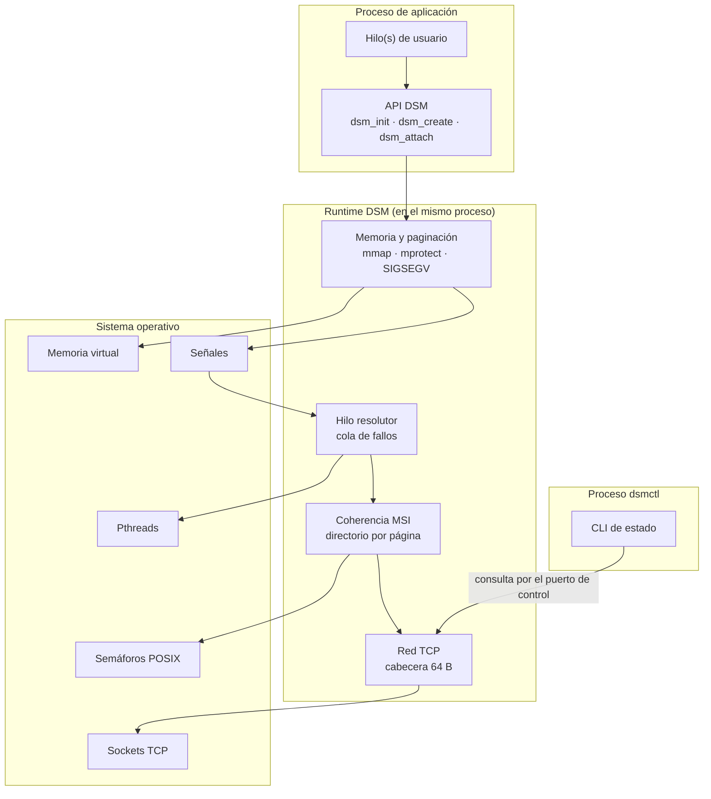
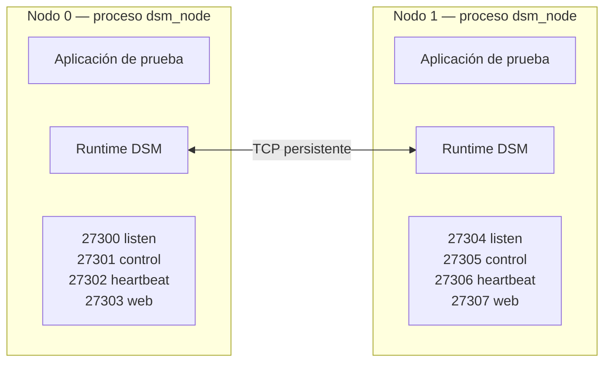
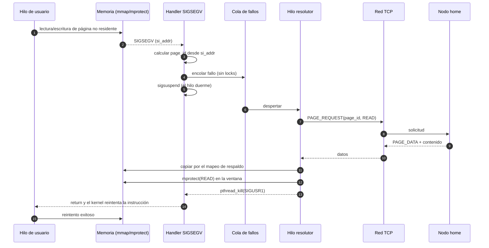
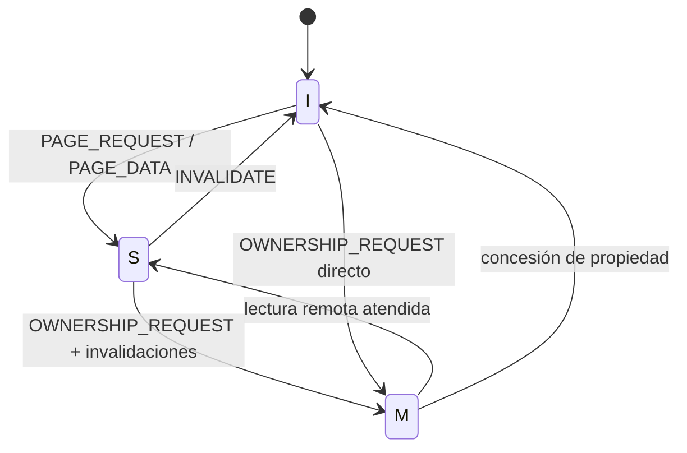

# Entregable 2 — Prototipo 1 y Arquitectura Actualizada

## Sistema de Memoria Compartida Distribuida con Paginación bajo Demanda y Coherencia MSI

| Campo | Valor |
|---|---|
| **Institución** | Instituto Tecnológico de Costa Rica |
| **Escuela** | Escuela de Ingeniería en Computación, Cartago |
| **Curso** | IC-6600 Principios de Sistemas Operativos |
| **Semestre** | II Semestre, 2026 |
| **Profesor** | Profesor del curso IC-6600 |
| **Proyecto** | Implementación de un Sistema de Memoria Compartida Distribuida (DSM) con Paginación bajo Demanda y Coherencia MSI |
| **Entregable** | Entregable 2 — Prototipo 1 y Arquitectura Actualizada |
| **Integrantes** | José Daniel Monterrosa Quirós · Sebastián Agüero Brenes |
| **Pareja** | #3 — rango de puertos `27300–27399` |
| **Fecha oficial** | 13 de noviembre de 2026 |
| **Versión del documento** | 1.0 |
| **Estado** | Prototipo 1 implementado, compilado y ejecutado |
| **Repositorio Git** | https://github.com/TSebas12/ProyectoSO-DSM-SistemaDeMemoriaCompartidaDistribuida |
| **Documento base** | `Entregable_1/01_Entregable_1_Diseno.md` |

> **Cómo leer este documento.** Las secciones 1 a 6 describen el prototipo y su relación con el diseño del Entregable 1. La sección 7 documenta los módulos implementados, la 9 explica cómo se compila y se ejecuta, y la 10 recoge las pruebas que se ejecutaron con su evidencia. **No se afirma ningún resultado que no haya sido ejecutado y registrado.**

> **Regla de honestidad técnica.** Si una función no se implementó, se declara en la sección 11 (limitaciones) y se traslada a la sección 12 (trabajo pendiente). Un prototipo incompleto y bien documentado vale más que uno que dice funcionar y no se puede reproducir.

---

## 2. Resumen ejecutivo

El presente documento describe el **Prototipo 1** del sistema de memoria compartida distribuida (DSM) diseñado en el Entregable 1, junto con la **arquitectura actualizada** y el registro de los cambios y ajustes aplicados durante la implementación.

El prototipo demuestra el núcleo funcional del sistema: dos nodos independientes, ejecutados como procesos separados sobre Linux y comunicados por sockets TCP, forman un espacio de memoria lógicamente compartido. Cada nodo reserva una ventana de direcciones virtuales con `mmap`, la protege con `mprotect(PROT_NONE)` y captura los accesos a páginas no residentes mediante un manejador de `SIGSEGV` instalado con `sigaction` y `SA_SIGINFO`. El manejador no resuelve el fallo por sí mismo: encola el evento y un hilo resolutor ejecuta el protocolo de red, transfiere la página y ajusta los permisos para que el hilo de la aplicación continúe su ejecución de forma transparente.

Sobre ese mecanismo se implementa un subconjunto del protocolo de coherencia **MSI**: una página puede estar *Modified*, *Shared* o *Invalid*. El directorio vive en el nodo hogar (*home*) de la página, que decide quién la posee y en qué estado. El código incluye los mensajes `INVALIDATE` / `INVALIDATE_ACK`, pero la demostración de dos nodos no los necesita: la invalidación de un tercer *sharer* queda para el Prototipo 2.

El prototipo **no incluye** todavía expulsión de páginas, aplicaciones de prueba completas, métricas de rendimiento ni los extras. Esos elementos corresponden al Prototipo 2 (Entregable 3) y a la Entrega Final. El documento declara explícitamente esas limitaciones y el trabajo pendiente.

**Resultado obtenido:** el nodo 1 lee una página que nunca existió en su espacio de direcciones y que el nodo 0 creó en el suyo, la escribe, la devuelve con un *writeback* y el nodo 0 lee después el texto que escribió el nodo 1. La corrida completa está en la sección 10 y en `evidence/03_demo.log`.

---

## 3. Índice

### 3.1 Contenido

| Sección | Título |
|---:|---|
| — | [Portada](#entregable-2--prototipo-1-y-arquitectura-actualizada) |
| 2 | [Resumen ejecutivo](#2-resumen-ejecutivo) |
| 3 | [Índice](#3-índice) |
| 4 | [Introducción](#4-introducción) |
| 5 | [Arquitectura actualizada](#5-arquitectura-actualizada) |
| 6 | [Cambios y ajustes respecto al Entregable 1](#6-cambios-y-ajustes-respecto-al-entregable-1) |
| 7 | [Implementación del prototipo 1](#7-implementación-del-prototipo-1) |
| 8 | [Estructuras y tipos implementados](#8-estructuras-y-tipos-implementados) |
| 9 | [Compilación y ejecución](#9-compilación-y-ejecución) |
| 10 | [Pruebas realizadas](#10-pruebas-realizadas) |
| 11 | [Limitaciones conocidas](#11-limitaciones-conocidas) |
| 12 | [Trabajo pendiente para el prototipo 2](#12-trabajo-pendiente-para-el-prototipo-2) |
| 13 | [Conclusiones](#13-conclusiones) |
| 14 | [Referencias](#14-referencias) |
| 15 | [Anexos](#15-anexos) |

### 3.2 Índice de figuras

| Figura | Título | Sección |
|---:|---|---|
| 1 | Arquitectura de componentes del prototipo 1 | 5.1 |
| 2 | Vista de despliegue con dos nodos | 5.2 |
| 3 | Flujo de un fallo de página en el prototipo | 5.3 |
| 4 | Diagrama de estados MSI implementado | 7.4 |

> **Nota.** Las figuras 1 a 4 son diagramas de diseño. Las capturas de ejecución se numerarán a partir de la figura 5 cuando se tomen en el laboratorio (sección 15).

### 3.3 Índice de tablas

| Tabla | Título | Sección |
|---:|---|---|
| 1 | Alcance del prototipo 1 | 4.2 |
| 2 | Cambios respecto al Entregable 1 | 6.2 |
| 3 | Módulos implementados y archivos | 7.7 |
| 4 | Estructuras implementadas y tamaños | 8.1 |
| 5 | Puertos por nodo | 9.3 |
| 6 | Escenarios de prueba ejecutados | 10.1 |
| 6b | Pruebas no ejecutadas y su motivo | 10.1 |
| 7 | Resultados obtenidos | 10.2 |
| 8 | Problemas de integración corregidos | 10.4 |
| 9 | Limitaciones conocidas | 11 |
| 10 | Trabajo pendiente para el prototipo 2 | 12 |

---

## 4. Introducción

### 4.1 Objetivo del prototipo 1

Implementar y demostrar el núcleo de la arquitectura diseñada en el Entregable 1, con el menor alcance posible que permita comprobar que el enfoque es viable:

1. Dos nodos se descubren y se comunican por TCP.
2. Un nodo materializa bajo demanda una página que reside en el otro.
3. El acceso a una página ausente se detecta con `SIGSEGV` y se resuelve sin que la aplicación lo perciba.
4. Una escritura invalida las copias remotas y se respeta el estado MSI.

### 4.2 Alcance

| Incluido en el prototipo 1 | Excluido (queda para E3 o final) |
|---|---|
| Compilación con `make` en Linux | Compilación cruzada o soporte de otros SO |
| 2 nodos como procesos independientes | 4 nodos en máquinas físicas |
| Un objeto de prueba de 4 páginas (16 KB) | Objetos grandes o varios objetos |
| Ventana de memoria con `mmap` | Ventana de 256 MB completa |
| `mprotect(PROT_NONE)` y `SIGSEGV` | Recuperación ante fallos de nodo |
| Transferencia de página `PAGE_REQUEST` / `PAGE_DATA` | Transferencia fragmentada de páginas grandes |
| MSI básico: `I→S`, `S→I`, `I→M` | Optimizaciones tipo MESI/MOESI |
| `INVALIDATE` / `INVALIDATE_ACK` | Directorio distribuido completo con replicación |
| CLI de consulta de estado | Panel web completo |
| Estadísticas mínimas en memoria | Métricas de rendimiento y *speedup* |
| — | Expulsión de páginas y LRU |
| — | Aplicaciones de matrices, video e incrementos |
| — | Extras 1 y 2 |

**Tabla 1.** Alcance del prototipo 1.

### 4.3 Relación con el Entregable 1

El Entregable 1 definió la arquitectura, el modelo de coherencia, el protocolo con cabecera de 64 bytes, el API, las estructuras y los tamaños. El Entregable 2 **no rediseña**: implementa un subconjunto y documenta dónde la realidad obligó a desviarse.

| Elemento del E1 | Estado en el prototipo 1 |
|---|---|
| Ventana local + pool de marcos | Implementado: ventana de 256 MB y 256 marcos de contabilidad (sin expulsión) |
| `mmap` + `mprotect` + `sigaction` | Implementado, incluida pila alternativa por hilo |
| Protocolo con cabecera de 64 B | Implementado: `protocol.c` codifica y decodifica la cabecera real |
| MSI con directorio por página | Implementado: MSI completo y directorio local en el nodo home |
| API `dsm_init` / `dsm_create` / `dsm_attach` | Implementado: cuatro funciones en `dsm_api.c` |
| CLI (web fuera de alcance) | Stub: `dsmctl` no consulta el nodo |
| Aplicaciones de prueba | Fuera de alcance, salvo `demo_page.c` |
| Extras | Fuera de alcance |

> **Estado de verificación.** Los módulos implementados compilan sin advertencias con GCC 13.2.1 y clang, y la demostración de dos nodos se ejecutó. La sección 9 registra el procedimiento y la sección 10 los resultados con su evidencia.

### 4.4 Metodología de trabajo

- Desarrollo incremental por módulos, con integración continua en `main`.
- Cada módulo se prueba de forma aislada antes de integrarse.
- La memoria y las señales se validan primero en un solo nodo; la red se incorpora después.
- Cada hito se registra con un commit identificable en el repositorio.
- Los comentarios del código se escriben en español y explican el porqué.
- Cada entregable con código incluye una guía de código en Markdown (sección 7.9).
- El documento se redacta al final, describiendo lo que el código realmente hace.

---

## 5. Arquitectura actualizada

### 5.1 Vista de componentes



**Figura 1.** Arquitectura de componentes del prototipo 1.

> **Nota.** El diagrama refleja la división real de módulos: `memory.c`, `fault.c`, `coherence.c` y `sync.c` dentro del runtime, y `dsmctl` como proceso aparte que consulta el estado por el puerto de control.

### 5.2 Vista de despliegue



**Figura 2.** Vista de despliegue con dos nodos.

En el prototipo 1 ambos procesos se ejecutan en una **máquina personal** usando `127.0.0.1` y puertos distintos (`27300` y `27304`). La validación en máquinas físicas separadas se realiza después en los **laboratorios de la Escuela** y se documenta en el Entregable 3. El código no depende del entorno: al cambiar de máquina solo cambian las direcciones IP de la configuración.

### 5.3 Flujo de un fallo de página



**Figura 3.** Flujo de un fallo de página en el prototipo.

> **Nota.** El manejador no retorna hasta que la página está publicada: duerme en `sigsuspend` y el resolutor lo despierta con `SIGUSR1`. Si la resolución falla, el contexto queda marcado y el reintento deja morir el proceso en lugar de entrar en un bucle.

### 5.4 Cambios respecto al diseño original

| Área | Diseño del E1 | Implementación real | Motivo |
|---|---|---|---|
| Memoria | Ventana de 256 MB y pool de 256 marcos | Ventana de 256 MB sobre `memfd` con doble mapeo; 256 marcos de contabilidad | El resolutor copia por un mapeo `RW` privado y los hilos de usuario solo ven la ventana cuando se publica el permiso |
| Red | Conexiones persistentes entre todos los nodos | Una conexión TCP por RPC, con *timeout* de conexión y de E/S; la respuesta viaja por el socket de la petición | Con dos nodos y cuatro páginas, abrir una conexión por mensaje simplifica el enrutamiento y evita mantener estado de conexión |
| Coherencia | MSI con directorio distribuido | MSI con directorio local en el nodo home (bitmap de *sharers*); un tercero se rechaza con `OWNERSHIP_DENY` | Con dos nodos no existen terceros; la invalidación múltiple queda para el E3 |
| Concurrencia | Jerarquía global de locks | Jerarquía `GLOBAL → OBJECT → PAGE → FRAME` verificada en ejecución | Detectar orden invertido sin costo cuando la comprobación se desactiva |
| Configuración | `dsm.conf` con validación | Parser plano `clave = valor`, con valores por defecto, validación de rangos y guardado | El formato del E1 con secciones no lo leía ningún código; se adoptó el que el módulo implementa y se documentó |

### 5.5 Decisiones tomadas durante la implementación

| # | Decisión | Alternativas consideradas | Motivo | Impacto |
|---:|---|---|---|---|
| D2-01 | Ventana sobre `memfd` mapeado dos veces | (a) `mmap` anónimo y `mprotect` temporal a `RW`; (b) copiar a un buffer y `memcpy` al reintentar | Con (a) otro hilo puede leer la página a medio copiar; con (b) el fallo se repetiría | La ventana nunca sale de `PROT_NONE` durante la copia; el resolutor escribe por el respaldo |
| D2-02 | Cola de fallos como anillo sin locks | Mutex + variable de condición | Un `pthread_mutex_lock` dentro del manejador puede interbloquear si el hilo interrumpido ya tenía ese mutex | El manejador solo hace un CAS y `sem_post`, ambas operaciones seguras |
| D2-03 | Pila alternativa por hilo, no por proceso | Una sola `sigaltstack` global | `sigaltstack` es por hilo; dos fallos simultáneos en un buffer compartido corrompen la pila | Cada hilo registrado reserva 64 KB y los libera con un destructor de `pthread_key` |
| D2-04 | Verificación del orden de locks en ejecución | Confiar en la disciplina del programador; usar `helgrind` | `helgrind` es externo y no está en la rúbrica; la disciplina no se puede auditar | Cada lock lleva su clase y se avisa por `stderr` cuando el orden se invierte |
| D2-05 | Directorio local en el nodo home, sin replicación | Directorio distribuido con replicación del E1 | Con dos nodos y cuatro páginas la replicación no aporta y sí añade modos de fallo | El home es punto único de decisión por página; el E3 puede replicarlo |
| D2-06 | Bandera `failed` atómica en el contexto del hilo | Reintentar indefinidamente | Un fallo irresoluble dejaría al hilo en un bucle de `SIGSEGV` | Al fallar la resolución, el reintento deja morir el proceso con la señal original |

> **Nota.** Estas decisiones son las que el código realmente aplica. Las que dependan de los módulos de red y configuración se agregan cuando esos módulos existan.

---

## 6. Cambios y ajustes respecto al Entregable 1

### 6.1 Qué se mantuvo

- El modelo de memoria: ventana virtual local y páginas de 4 KB materializadas bajo demanda.
- El uso obligatorio de `mmap`, `mprotect` y `sigaction` con `SA_SIGINFO`.
- El protocolo MSI con estados `M`, `S` e `I`.
- La cabecera de mensaje de 64 bytes y el catálogo de códigos definido en el E1.
- El esquema de cuatro puertos por nodo.
- El API público (`dsm_init`, `dsm_create`, `dsm_attach`, `dsm_shutdown`).
- La separación entre el handler mínimo y el hilo resolutor.

### 6.2 Qué se cambió

| # | Elemento | Entregable 1 | Entregable 2 | Motivo |
|---:|---|---|---|---|
| C-01 | Rango de puertos | `50000–50099` (propuesta a validar) | `27300–27399` (pareja #3) | Rango asignado oficialmente por el curso. |
| C-02 | Número de nodos de la demo | 4 ideales | 2 | Alcance del prototipo 1. |
| C-03 | Copia de una página al resolver un fallo | `PROT_NONE` → copiar → publicar permisos, sin especificar el mecanismo | Doble mapeo de la misma página: ventana en `PROT_NONE` y respaldo en `RW` | Sin el respaldo habría que abrir la ventana antes de copiar y otro hilo podría leer datos a medias. |
| C-04 | Cola de fallos entre el manejador y el resolutor | No se especificaba | Anillo sin locks y `sigsuspend` en el hilo que falla | Un mutex dentro del manejador puede interbloquear si el hilo interrumpido ya lo tenía tomado. |

**Tabla 2.** Cambios respecto al Entregable 1.

### 6.3 Por qué se cambió

**C-01 — Rango de puertos.** El E1 fijó `50000–50099` como propuesta, explícitamente sujeta a validación en el laboratorio. El curso asignó a la pareja #3 el rango `27300–27399`. El esquema de offsets se mantiene intacto: cada nodo conserva cuatro puertos consecutivos y la fórmula `puerto_base + 4 × node_id`.

**C-02 — Número de nodos.** El prototipo 1 debe demostrar el mecanismo, no la escala. Dos nodos son suficientes para probar transferencia remota e invalidación, y reducen el riesgo de fallos de red y de configuración.

**C-03 — Copia de una página.** El E1 decía copiar con la página en `PROT_NONE` y publicar los permisos después, pero no explicaba cómo escribir sin permiso. La solución es un `memfd` mapeado dos veces: la ventana queda en `PROT_NONE` y un segundo mapeo de las mismas páginas físicas queda en `RW`. El resolutor copia por el respaldo y después publica el permiso en la ventana, así que ningún hilo de usuario observa el contenido a medio escribir.

**C-04 — Cola de fallos.** El E1 describía una cola «lock-free o con un mutex probado como seguro», sin decidir. Se eligió el anillo sin locks porque la alternativa correcta —un mutex tomado dentro del manejador— depende de que el hilo interrumpido no lo tuviera, y eso no se puede garantizar. El hilo que falla se duerme con `sigsuspend` y el resolutor lo despierta con `pthread_kill`.

> **Nota.** Los cambios de red y configuración no son solo de forma: el protocolo pasó de «pendiente» a una cabecera de 64 B serializada en orden de red, y el parser dejó el formato con secciones porque ningún código lo leía.

### 6.4 Impacto en API, protocolo, configuración y estructuras

| Componente | Impacto |
|---|---|
| **API** | El contrato del E1 se redujo a lo que se puede probar: `dsm_init`, `dsm_shutdown`, `dsm_create` y `dsm_attach`. `dsm_detach` y `dsm_node_id` no se implementaron y se declaran en la sección 11. |
| **Protocolo** | Los códigos de mensaje del E1 se conservan en `dsm_msg_type_t`. La cabecera de 64 B se serializa en orden de red en `protocol.c`; el campo `checksum` viaja en cero (sección 11). |
| **Configuración** | Se adopta el formato plano `clave = valor`, con el rango de puertos `27300–27399` y `node_memory` como tamaño del pool de marcos. |
| **Estructuras** | Se mantienen los tamaños del E1 en los módulos implementados: `dsm_local_page_t` 56 B, `dsm_frame_t` 40 B, `dsm_directory_entry_t` 64 B y `dsm_stats_t` 128 B, verificados con `_Static_assert`. La cabecera mide 64 B por construcción del códec y `dsm_config_t` 704 B. |
| **Compatibilidad** | El prototipo 1 no es compatible con el diseño del E1 en el valor de los puertos, pero sí en el esquema. |

---

## 7. Implementación del prototipo 1

### 7.1 Módulo de memoria virtual

**Responsabilidad.** Reservar la ventana de direcciones, instalar el manejador de señales, traducir `si_addr` a `page_id` y ajustar permisos tras resolver un fallo.

| Aspecto | Detalle |
|---|---|
| Archivos | `src/memory.c`, `src/fault.c`, `include/dsm_memory.h`, `include/dsm_fault.h` |
| Funciones principales | `dsm_memory_init`, `dsm_memory_addr_to_page`, `dsm_memory_page_get_or_create`, `dsm_memory_protect`, `dsm_memory_copy_in/out`, `dsm_fault_install`, `dsm_segv_handler` |
| Tamaño de página | 4096 B |
| Ventana | 256 MB reservados (65536 páginas), configurables |
| Protección inicial | `PROT_NONE` |
| Señal | `SIGSEGV` con `SA_SIGINFO` y `SA_ONSTACK` |
| Pila alternativa | Sí, una por hilo registrado, reservada en `dsm_fault_attach_thread` |

**Decisión clave.** El handler no puede llamar a funciones no seguras para señales. Solo calcula el `page_id`, encola el fallo y retorna. Toda la lógica (red, copia, `mprotect`) ocurre en el hilo resolutor.

**Copia sin carreras.** La ventana se crea sobre un `memfd` mapeado dos veces: una vista en `PROT_NONE` para los hilos de usuario y otra en `RW` para el resolutor. Así los datos se copian sin conceder permisos y solo se publican cuando están completos.

```c
static void dsm_segv_handler(int sig, siginfo_t *si, void *uctx)
{
    dsm_thread_ctx_t *ctx = t_ctx;
    dsm_fault_req_t   req;

    /* Un fallo que el DSM no puede resolver se relanza con el manejador
     * anterior: no debe quedar oculto. */
    if (!g_q.installed || ctx == NULL || si->si_code != SEGV_ACCERR) {
        reraise(sig);
        return;
    }

    uint64_t page_id = map_addr_to_page(si->si_addr);
    if (page_id == DSM_INVALID_PAGE_ID) {
        reraise(sig);
        return;
    }

    /* Bloquear la señal de reanudación antes de publicar in_fault evita
     * perder el aviso del resolutor. */
    sigset_t block, oldmask, waitmask;
    sigemptyset(&block);
    sigaddset(&block, SIGSEGV);
    sigaddset(&block, DSM_SIG_RESUME);
    sigprocmask(SIG_BLOCK, &block, &oldmask);

    ctx->pending_page = page_id;
    ctx->fault_kind   = (int)decode_kind(uctx);
    atomic_store_explicit(&ctx->in_fault, 1, memory_order_seq_cst);

    req.page_id    = page_id;
    req.kind       = (dsm_fault_kind_t)ctx->fault_kind;
    req.fault_addr = si->si_addr;
    req.ctx        = ctx;

    if (!queue_push(&req)) {                 /* anillo lleno o apagado */
        atomic_store_explicit(&ctx->in_fault, 0, memory_order_seq_cst);
        sigprocmask(SIG_SETMASK, &oldmask, NULL);
        reraise(sig);
        return;
    }

    /* Dormir hasta que el resolutor confirme. sigsuspend no toma locks y es
     * segura dentro de un manejador. */
    waitmask = oldmask;
    sigaddset(&waitmask, SIGSEGV);
    sigdelset(&waitmask, DSM_SIG_RESUME);
    while (atomic_load_explicit(&ctx->in_fault, memory_order_seq_cst) != 0) {
        sigsuspend(&waitmask);
    }
    sigprocmask(SIG_SETMASK, &oldmask, NULL);

    if (atomic_load_explicit(&ctx->failed, memory_order_seq_cst) != 0) {
        reraise(sig);
    }
}
```

**Riesgos atendidos.** `si_addr` no alineado, fallos concurrentes sobre la misma página, reintento de la instrucción tras `mprotect`.

### 7.2 Módulo de red

**Responsabilidad.** Abrir el puerto de escucha, serializar y deserializar mensajes con la cabecera de 64 bytes, y transportar las peticiones de coherencia.

| Aspecto | Detalle |
|---|---|
| Archivos | `src/net.c`, `src/protocol.c`, `include/dsm_net.h`, `include/dsm_protocol.h` |
| Modelo | Una conexión TCP por RPC; el servidor responde por el socket en el que llegó la petición |
| Cabecera | 64 B, `magic = 0x44534D31` (`"DSM1"`), `version = 1` |
| Endianness | `htonl` / `htons` en todos los campos; los `uint64_t` se parten en dos `uint32_t` |
| Lectura | `dsm_net_read_full()` para cabecera y carga útil |
| Mensajes implementados | `PAGE_REQUEST`, `PAGE_DATA`, `OWNERSHIP_REQUEST`, `OWNERSHIP_GRANT`, `OWNERSHIP_DENY`, `PAGE_WRITEBACK`, `PAGE_WRITEBACK_ACK`, `INVALIDATE`, `INVALIDATE_ACK`, `ERROR` |
| Validación | Se rechaza un mensaje con `magic` o `version` incorrectos, o con `payload_len > max_message_size` |
| Contadores | `dsm_net_set_stats()` engancha los contadores; cada envío y recepción suma mensajes y bytes |

```c
typedef struct dsm_msg_header {
    uint64_t request_id;    uint64_t page_id;
    uint32_t magic;         uint16_t version;      uint16_t type;
    uint32_t flags;         uint32_t header_len;   uint32_t payload_len;
    uint32_t src_node;      uint32_t dst_node;     uint32_t status;
    uint32_t checksum;      uint32_t payload_off;
    uint16_t ttl;           uint16_t reserved;     uint32_t reserved2;
} dsm_msg_header_t;

_Static_assert(sizeof(dsm_msg_header_t) == 64, "dsm_msg_header_t debe medir 64 bytes");
```

**Enrutamiento de la respuesta.** La coherencia solo conoce `dsm_coherence_ops_t`; cuando el nodo home atiende un `PAGE_REQUEST`, responde con `ops.send()`. Para que esa respuesta llegue al cliente correcto, el hilo de escucha guarda el descriptor aceptado en una variable `_Thread_local` antes de llamar a `dsm_coherence_handle_message()`. Así el `rpc()` del cliente lee la respuesta por la misma conexión que abrió, sin un segundo `connect()`.

> **Nota.** El campo `checksum` se serializa pero viaja en cero: no hay cálculo de integridad en el prototipo 1 (sección 11).

### 7.3 Módulo de concurrencia

**Responsabilidad.** Coordinar el hilo resolutor, el hilo de escucha y los hilos de usuario sin interbloqueos.

| Aspecto | Detalle |
|---|---|
| Archivos | `src/sync.c`, `src/runtime.c`, `include/dsm_sync.h`, `include/dsm_runtime.h` |
| Primitivas | Pthreads, mutex, variables de condición, semáforos POSIX |
| Hilos del runtime | Uno de escucha y uno resolutor; los hilos de usuario los crea la aplicación |
| Orden de locks | `GLOBAL → OBJECT → PAGE → FRAME`, verificado en ejecución |
| Regla | Nunca se espera red con un lock de página tomado |

**Coalescencia de fallos.** Si dos hilos fallan en la misma página, el resolutor marca la entrada como `TRAYENDO` y el segundo hilo espera en la variable de condición de la página en lugar de lanzar un segundo `PAGE_REQUEST`. Cuando la resolución termina, un `broadcast` despierta a todos y cada uno reevalúa su estado: si el fallo era de escritura y la página quedó en `S`, pide la propiedad.

**Por qué el orden se verifica.** Cada lock declara su clase al inicializarse. Si un hilo toma una clase menor que la que ya tiene, se registra una violación y se avisa por `stderr`, sin abortar. Así un error de orden aparece en la primera ejecución en lugar de manifestarse como interbloqueo intermitente.

### 7.4 MSI implementado

| Transición | Disparador | Mensajes | Estado resultante |
|---|---|---|---|
| `I → S` | Lectura de página ausente | `PAGE_REQUEST` / `PAGE_DATA` | `S` |
| `S → M` | Escritura sobre copia compartida | `OWNERSHIP_REQUEST` / invalidaciones / ACK | `M` |
| `S → I` | `INVALIDATE` recibido | `INVALIDATE_ACK` | `I` |
| `M → S` | Lectura remota del home o *writeback* | `PAGE_DATA` | `S` |
| `M → I` | Escritura remota concedida | `OWNERSHIP_GRANT` | `I` |

**Qué se ejecutó en la demo.** `I → S` (lectura del nodo 1), `S → M` (escritura del nodo 1), `M → I` (el home cede la propiedad) y `M → S` (el nodo 1 baja a `S` tras el *writeback*). La transición `S → I` está implementada pero no se ejecutó: haría falta un tercer nodo que conserve una copia compartida.



**Figura 4.** Diagrama de estados MSI implementado.

Todas las transiciones del diagrama están implementadas en `dsm_msi_next_state()`. Con dos nodos, `S → M` no necesita invalidar a terceros: el home comprueba el bitmap del directorio y, si no hay otro *sharer*, concede la propiedad con `OWNERSHIP_GRANT`. La rama de invalidación múltiple se rechaza explícitamente con `OWNERSHIP_DENY` y queda para el E3.

**Función pura.** `dsm_msi_next_state(estado, evento)` devuelve el estado siguiente sin tocar memoria ni red, así que la tabla se puede probar con casos unitarios sin levantar dos nodos.

### 7.5 API disponible

La API pública del prototipo 1 son cuatro funciones, declaradas en `include/dsm_api.h`. No se exponen más porque la demostración no las necesita y una API que no se usa no se puede probar.

| Función | Estado | Comportamiento real |
|---|---|---|
| `dsm_init` | Implementada | Reserva el runtime, inicializa memoria, contadores, manejador de señales, red y coherencia, y lanza el hilo resolutor |
| `dsm_shutdown` | Implementada | Detiene el resolutor y la red, desinstala el manejador y libera la ventana |
| `dsm_create` | Implementada | Solo en el nodo home: crea el objeto de 4 páginas, las deja residentes en estado `M`, sucias, versión 1 y con permiso de escritura |
| `dsm_attach` | Implementada | Registra el hilo actual en el manejador de `SIGSEGV`; sin esto el primer fallo mata el proceso |
| `dsm_detach` | No implementada | El proceso de demostración termina después de la prueba; no se necesita |
| `dsm_node_id` | No implementada | El `node_id` se lee de `rt->cfg` dentro del runtime |
| `dsm_stats` | No implementada | Los contadores se leen con `dsm_stats_format()` desde el propio nodo |

> **Nota.** `dsm_create` no reparte páginas entre nodos: el nodo 0 es el home fijo del prototipo 1 y los demás nodos llenan su tabla con los fallos que resuelve el runtime.

### 7.6 Configuración

El parser es plano: `clave = valor`, comentarios con `#`, sin secciones. Una línea sin `=` se ignora, y una clave desconocida también. Los dos archivos del prototipo 1 son `config/dsm.conf` (nodo 0) y `config/dsm-node1.conf` (nodo 1).

```ini
# config/dsm.conf — nodo 0 (home), pareja #3
config_version = 1
node_id = 0
max_nodes = 16
bind_address = 127.0.0.1
listen_port = 27300
control_port = 27301
heartbeat_port = 27302
web_port = 27303
web_enabled = 0
seed_host = 127.0.0.1
seed_port = 27300
page_size = 4096
node_memory = 1048576
window_size = 268435456
network_timeout_ms = 2000
connect_timeout_ms = 2000
max_message_size = 8192
fault_queue_size = 1024
log_level = 2
log_file = logs/dsm-node0.log
port_range_start = 27300
port_range_end = 27399
```

El nodo 1 usa el mismo archivo con `node_id = 1`, `listen_port = 27304` y `seed_port = 27300`. Las dos configuraciones se validan con `./dsm_node --config <ruta> --check-config`.

> **Nota.** `node_memory = 1048576` es el tamaño del pool de marcos (1 MB), no de la ventana: 1 MB / 4 KB = 256 marcos. La ventana de direcciones es `window_size`, 256 MB, y solo se compromete página a página.

### 7.7 Estructura del código fuente

**Modelo de compilación.** Los archivos de `src/` se compilan a objetos en `build/` y se enlazan directamente en dos binarios: `dsm_node` y `dsmctl`. No hay biblioteca estática intermedia: con 14 unidades y un solo consumidor real, `libdsm.a` no aportaba nada al prototipo. Los objetos sí quedan separados para recompilar solo lo que cambia.

```text
Entregable_2/prototipo1/
├── Makefile
├── include/
│   ├── dsm_api.h          API pública (init, shutdown, create, attach)
│   ├── dsm_types.h        enums, constantes y estados MSI
│   ├── dsm_config.h       dsm_config_t y parser
│   ├── dsm_memory.h       ventana y pool de marcos
│   ├── dsm_fault.h        handler de SIGSEGV y cola de fallos
│   ├── dsm_protocol.h     cabecera de 64 B, opcodes y payloads
│   ├── dsm_net.h          sockets, framing y contadores de red
│   ├── dsm_coherence.h    MSI, directorio e invalidación
│   ├── dsm_runtime.h      estado global del nodo e hilos
│   ├── dsm_sync.h         locks, orden de adquisición y reloj
│   ├── dsm_log.h          registro de eventos
│   └── dsm_stats.h        contadores atómicos
├── src/
│   ├── dsm_api.c          implementa la API pública
│   ├── runtime.c          arranque, hilos y parada ordenada
│   ├── memory.c           mmap, marcos y mprotect
│   ├── fault.c            sigaction, sigaltstack y cola
│   ├── protocol.c         encode/decode de la cabecera
│   ├── net.c              listen/connect/accept y RPC
│   ├── coherence.c        transiciones MSI
│   ├── sync.c             primitivas de sincronización
│   ├── config.c           lectura, validación y guardado de dsm.conf
│   ├── log.c              implementación del log
│   ├── stats.c            contadores
│   ├── node_main.c        binario dsm_node
│   ├── ctl_main.c         binario dsmctl (stub)
│   └── demo_page.c        app de prueba: lee, escribe y devuelve la página 0
├── config/
│   ├── dsm.conf           nodo 0 (home), puertos 27300–27303
│   └── dsm-node1.conf     nodo 1, puertos 27304–27307
├── scripts/
│   ├── build.sh           compila desde cero
│   ├── run.sh             arranca un nodo con un archivo de configuración
│   ├── demo.sh            arranca los dos nodos y muestra sus salidas
│   └── capture_evidence.sh regenera evidence/ con la salida real
├── evidence/              logs de la ejecución (sí se versionan)
├── build/                 objetos (no versionado)
├── logs/                  salidas de la demo (no versionado)
├── dsm_node               binario (no versionado)
└── dsmctl                 binario (no versionado)
```

| Módulo | Archivos | Responsable |
|---|---|---|
| Memoria y fallos de página | `memory.c`, `fault.c` | Sebastián Agüero |
| Red y protocolo | `net.c`, `protocol.c` | José Daniel Monterrosa |
| Configuración y CLI | `config.c`, `ctl_main.c` | José Daniel Monterrosa |
| Coherencia MSI | `coherence.c` | Sebastián Agüero |
| Concurrencia | `sync.c`, `runtime.c` | Ambos |
| API pública | `dsm_api.c`, `dsm_api.h` | Ambos |
| Aplicación de prueba | `demo_page.c` | Ambos |
| Soporte | `log.c`, `stats.c` | José Daniel / Sebastián |

**Tabla 3.** Módulos implementados y archivos.

**Targets del `Makefile`:**

- `make` o `make all` — compila los módulos, `dsm_node` y `dsmctl`.
- `make check` — compila solo los módulos (sin `node_main` ni `ctl_main`) y confirma que no hay errores.
- `make dsm_node` — solo el binario del nodo.
- `make dsmctl` — solo la CLI.
- `make clean` — elimina objetos y binarios.

> **Nota.** `make test` y `make run` del diseño original no existen todavía: las pruebas unitarias llegan con el prototipo 2 y la demostración se ejecuta con `scripts/demo.sh`.

**Ubicación durante el desarrollo.** El código vive en `Entregable_2/prototipo1/`. Se mantiene ahí para que cada entregable quede autocontenido y no se mezcle con la documentación de los otros.

**Estado actual del código.** Los 14 archivos compilan y enlazan. La demostración de dos nodos se ejecutó y su salida está en `evidence/` (sección 10).

### 7.8 Convenciones de código

| Aspecto | Convención |
|---|---|
| Idioma de los comentarios | **Español** |
| Idioma de los identificadores | Inglés, `snake_case` |
| Idioma de los mensajes al usuario | Español |
| Comentario de archivo | Propósito del archivo, autor y fecha |
| Comentario de función | Qué hace, parámetros, retorno y errores |
| Comentario de decisión | Explica el **porqué** de la lógica no obvia |
| Indentación | 4 espacios, sin tabulaciones |
| Ancho de línea | 100 columnas como máximo |
| Advertencias | `-Wall -Wextra` sin advertencias |
| Estándar | C11 con `-D_GNU_SOURCE` |

**Regla de oro.** Un comentario no repite lo que el código ya dice: explica por qué se hizo así. `i++` no necesita comentario; una espera activa con `sched_yield` sí.

### 7.9 Documentación del código

Todo entregable que incluya código debe venir acompañado de un documento Markdown que explique **qué hace cada parte y por qué**, pensado para alguien que no escribió el código.

| Entregable | Documento complementario |
|---|---|
| Entregable 2 | `Entregable_2/02_Entregable_2_Guia_Codigo.md` |
| Entregable 3 | `Entregable_3/03_Entregable_3_Guia_Codigo.md` |
| Entrega Final | `Entrega_Final/Guia_Codigo.md` |

**Reglas de redacción:**

- Explicación corta: **2 a 4 líneas por elemento**. Si no cabe, el archivo está demasiado grande.
- No se copia el código; se explica su intención.
- Cada archivo lleva: responsabilidad, funciones clave (qué hace y por qué), dependencias y qué no hace.
- Se documentan los flujos completos: arranque, fallo de página e invalidación.

**Plantilla sugerida:**

```markdown
## src/fault.c

**Qué hace.** Instala el handler de `SIGSEGV` y mantiene la cola de fallos.

| Función | Qué hace | Por qué |
|---|---|---|
| `dsm_fault_install` | Configura `sigaction` y `sigaltstack` | El handler necesita pila propia para no desbordar |
| `dsm_fault_handler` | Encola el fallo y retorna | No puede llamar a funciones no seguras para señales |

**Depende de:** `dsm_memory.h`, `dsm_sync.h`.
**No hace:** no pide páginas ni toca la red; eso lo hace el hilo resolutor.
```

---

## 8. Estructuras y tipos implementados

### 8.1 Structs reales y tamaños

| Estructura | Tamaño esperado (E1) | Tamaño real | Diferencia | Motivo |
|---|---:|---:|---|---|
| `dsm_local_page_t` | 56 B | 56 B | Ninguna | Metadatos; la sincronización va aparte |
| `dsm_frame_t` | 40 B | 40 B | Ninguna | Marco de contabilidad |
| `dsm_directory_entry_t` | 64 B | 64 B | Ninguna | Entrada del directorio del home |
| `dsm_stats_t` | 128 B | 128 B | Ninguna | 16 contadores de 64 bits |
| `dsm_thread_ctx_t` | 5 campos | 6 campos | +4 B | Se agregó `failed` atómico |
| `dsm_msg_header_t` | 64 B | No implementada | — | Corresponde al módulo de red |
| `dsm_config_t` | 704 B | No implementada | — | Corresponde al módulo de configuración |
| `dsm_page_req_payload_t` | — | No implementada | — | Corresponde al módulo de red |
| `dsm_page_data_payload_t` | — | No implementada | — | Corresponde al módulo de red |
| `dsm_hello_payload_t` | 128 B | No implementada | — | Corresponde al módulo de red |

**Tabla 4.** Estructuras implementadas y tamaños.

Los cuatro tamaños de la primera mitad están verificados con `_Static_assert` en las cabeceras; el compilador los comprueba en cada compilación, no en tiempo de ejecución.

### 8.2 Verificación de tamaños

Los tamaños se verifican en tiempo de compilación con `_Static_assert`, de modo que una discrepancia rompa el build en lugar de corromper el protocolo:

```c
/* Presentes en el código y verificados en cada compilación */
_Static_assert(sizeof(dsm_local_page_t) == 56,      "dsm_local_page_t debe medir 56 bytes");
_Static_assert(sizeof(dsm_frame_t) == 40,           "dsm_frame_t debe medir 40 bytes");
_Static_assert(sizeof(dsm_directory_entry_t) == 64, "dsm_directory_entry_t debe medir 64 bytes");
_Static_assert(sizeof(dsm_stats_t) == 128,          "dsm_stats_t debe medir 128 bytes");
_Static_assert(sizeof(dsm_msg_header_t) == 64,      "dsm_msg_header_t debe medir 64 bytes");
_Static_assert(sizeof(dsm_config_t) == 704,         "dsm_config_t debe medir 704 bytes");
```

> **Verificado.** Los seis `_Static_assert` forman parte del código y pasaron en la compilación con GCC 13.2.1 y con clang; si un tamaño cambia, el build falla.

### 8.3 Diferencias con el diseño

| Estructura | Cambio | Motivo |
|---|---|---|
| `dsm_local_page_t` | Conserva 56 B, pero el mutex y la condición no viven dentro | Un `pthread_mutex_t` mide 40 B y habría roto el tamaño documentado; se movieron a `dsm_page_entry_t` |
| `dsm_thread_ctx_t` | Se agregó `_Atomic int failed` | Sin esa bandera, un fallo irresoluble reintentaría el `SIGSEGV` para siempre |
| `dsm_memory_t` | Añade `backing_base` y `backing_fd` | Sostienen el doble mapeo del `memfd`; sin ellos no se puede copiar sin abrir permisos |
| `dsm_coherence_t` | Añade `ops` (callbacks de red) | Desacopla la coherencia del transporte y permite probarla con callbacks falsos |
| `dsm_page_entry_t` | Nueva: metadatos + lock + condición + cadena del hash | El E1 no detallaba dónde vivía la sincronización por página |

---

## 9. Compilación y ejecución

### 9.1 Requisitos

- Linux de 64 bits en máquina personal (WSL2 o máquina virtual) para el desarrollo, y en las máquinas del laboratorio para la validación final.
- GCC con soporte de C11.
- GNU Make.
- Pthreads y semáforos POSIX.
- Dos procesos o dos máquinas en la misma red.

### 9.2 Compilación

El `Makefile` compila `src/*.c` a objetos en `build/` y enlaza dos binarios: `dsm_node` y `dsmctl`.

```bash
make            # compila los módulos, dsm_node y dsmctl
make check      # solo los módulos, sin enlazar binarios
make dsm_node   # solo el binario del nodo
make dsmctl     # solo la CLI
make clean      # limpia objetos y binarios
```

**Entorno de desarrollo (WSL2).** La compilación se ejecutó con **GCC 13.2.1** sobre Linux (Alpine 3.20.3, musl 1.2.5, kernel 6.18 en WSL2), con `-std=c11 -Wall -Wextra -Wpedantic`. El resultado fue **0 errores y 0 advertencias**. Además, los 14 archivos se compilaron por separado con **clang 22.1.8 (Zig 0.17.1)** apuntando a `x86_64-linux-gnu` (glibc), también sin advertencias, y ambos binarios enlazaron; eso cubre el caso de que el laboratorio use glibc en vez de musl.

```text
cc -std=c11 -D_GNU_SOURCE -Wall -Wextra -Wpedantic -O2 -g -Iinclude -c src/sync.c -o build/sync.o
...
==> Modulos compilan sin errores.
cc ... -o dsm_node build/*.o -lpthread
cc ... -o dsmctl   build/*.o -lpthread
```

**Entorno del laboratorio (Ubuntu).** El proyecto se copió a las dos máquinas del laboratorio y se compiló con **GCC 13.3.0** sobre **Ubuntu 24.04 (kernel 6.8.0-138-generic)**. El resultado fue **0 errores y 0 advertencias** tras aplicar precisión literal en `config.c` (líneas 27, 33, 50: `%.63s`, `%.255s`, `%.255s`) para satisfacer `-Wformat-truncation` en GCC 13.3.0. Ambos binarios (`dsm_node` y `dsmctl`) enlazaron correctamente.

> **Evidencia.** La salida completa de `make` en WSL2 está en `Entregable_2/prototipo1/evidence/01_make.log`. La compilación en el laboratorio se registró en `evidence/lab_build.log` (no versionada, se adjunta en la entrega).

### 9.3 Configuración y puertos

| Nodo | `listen_port` | `control_port` | `heartbeat_port` | `web_port` |
|---:|---:|---:|---:|---:|
| 0 | 27300 | 27301 | 27302 | 27303 |
| 1 | 27304 | 27305 | 27306 | 27307 |
| 2 | 27308 | 27309 | 27310 | 27311 |
| 3 | 27312 | 27313 | 27314 | 27315 |

**Tabla 5.** Puertos por nodo (pareja #3, rango `27300–27399`).

Fórmula: `puerto_base = 27300 + 4 × node_id`.

En el prototipo 1 solo se usan `listen_port` y `seed_port`; los otros tres están reservados para el prototipo 2 y se validan como parte de la configuración. Los archivos son `config/dsm.conf` (nodo 0) y `config/dsm-node1.conf` (nodo 1). Ambos pasan la validación:

```bash
./dsm_node --config config/dsm.conf --check-config        # dsm.conf: OK
./dsm_node --config config/dsm-node1.conf --check-config  # dsm.conf: OK
```

### 9.4 Arranque de nodos

```bash
# Nodo 0 (home): crea el objeto y espera el writeback
./dsm_node --config config/dsm.conf

# Nodo 1: lee, escribe y devuelve la página 0
./dsm_node --config config/dsm-node1.conf

# Nodo 0 en modo servidor, sin demo (queda escuchando hasta Ctrl+C)
./dsm_node --config config/dsm.conf --serve
```

El identificador del nodo **no** se pasa por línea de comandos: viene del archivo de configuración (`node_id`). Un `--id` en la línea de comandos no existe y no se documenta como si existiera.

> `dsmctl` todavía es un stub que imprime `dsmctl: not fully implemented`. No se usa en la demostración y no se presenta como funcional.

**Configuración de laboratorio.** En las máquinas del laboratorio se usaron los mismos archivos con `bind_address = 0.0.0.0` en ambos nodos, y en el nodo 1 se agregó `seed_host = 192.0.2.10` (la IP del nodo 0). Los puertos del nodo 1 son `27304–27307`.

### 9.5 Ejecución de pruebas

```bash
sh scripts/demo.sh            # compila, arranca los dos nodos y muestra sus salidas
sh scripts/capture_evidence.sh  # regenera evidence/ con la salida real
```

`scripts/demo.sh` arranca el nodo 0, espera un segundo, arranca el nodo 1, espera a que ambos terminen e imprime las dos salidas. El nodo 0 espera el writeback hasta 15 s; el nodo 1 espera 1.5 s antes del primer acceso para dar tiempo a que el home cree el objeto.

> **Guion de la demostración.** Nodo 0 crea las 4 páginas y lee la página 0. Nodo 1 provoca un fallo de lectura (`I → S`), uno de escritura (`S → M`), relee sin fallo y devuelve la página con `WRITEBACK`. Nodo 0 detecta la versión nueva en el directorio y vuelve a leer la página, que ahora contiene el texto escrito por el nodo 1.

---

## 10. Pruebas realizadas

### 10.1 Escenarios

Todas las pruebas se ejecutan sobre un objeto DSM de **4 páginas (16 KB)**. La página 0 es la que se comparte entre los dos nodos para demostrar la transferencia y el retorno.

| # | Prueba | Objetivo | Cómo se verifica | Estado |
|---:|---|---|---|---|
| 1 | Compilación | El proyecto compila sin errores ni advertencias | `make` termina con código 0 | Ejecutada |
| 2 | Validación de configuración | Las dos configuraciones son válidas | `--check-config` imprime `OK` | Ejecutada |
| 3 | Apertura del puerto | El nodo escucha | `netstat -ltn` muestra `127.0.0.1:27300` | Ejecutada |
| 4 | Arranque de dos nodos | Ambos procesos inician y enlazan | Cada nodo imprime `nodo N listo` | Ejecutada |
| 5 | Creación del objeto | El home crea 4 páginas residentes | Lectura de la página 0 en el nodo 0 | Ejecutada |
| 6 | Fallo remoto de lectura | `I → S` con datos correctos | El nodo 1 imprime el texto creado por el nodo 0 | Ejecutada |
| 7 | Fallo remoto de escritura | `S → M` | El nodo 1 escribe y relee su propio texto | Ejecutada |
| 8 | Relectura local | Sin fallo ni tráfico | Tercer acceso del nodo 1 | Ejecutada |
| 9 | Writeback | La página vuelve al home | El nodo 1 recibe `PAGE_WRITEBACK_ACK` | Ejecutada |
| 10 | Propagación al home | El home ve la versión nueva | El nodo 0 imprime el texto del nodo 1 | Ejecutada |
| 11 | Coherencia de contadores | Los números cuadran entre nodos | `page_faults = 2`, `remote_reads = 1`, `remote_writes = 1` | Ejecutada |
| 12 | Cierre ordenado | No hay cuelgues ni *zombies* | `demo.sh` termina solo con código 0 | Ejecutada |
| 13 | Reproducibilidad | El resultado no depende del azar | Dos ejecuciones consecutivas con la misma salida | Ejecutada |

**Tabla 6.** Escenarios de prueba ejecutados.

Las pruebas que el diseño original contemplaba pero que **no** se ejecutaron porque la funcionalidad no existe en el prototipo 1 se listan en la tabla 6b, para que no se confundan con resultados.

| Prueba | Motivo por el que no se ejecuta |
|---|---|
| `JOIN_RESPONSE` con la semilla | El registro de nodos es del prototipo 2 |
| Heartbeat cada 1 s | No implementado |
| Invalidación `S → I` de un tercer nodo | Solo hay dos nodos; hace falta `PAGE_FORWARD` |
| `dsmctl status` | `dsmctl` es un stub |
| Expulsión de páginas | Fuera del alcance del prototipo 1 |

**Tabla 6b.** Pruebas no ejecutadas y su motivo.

### 10.2 Resultados

| # | Resultado esperado | Resultado obtenido | ¿Cumple? | Evidencia |
|---:|---|---|---|---|
| 1 | `make` sin errores ni advertencias | 0 errores, 0 advertencias; dos binarios enlazados | Sí | `evidence/01_make.log` |
| 2 | Configuraciones válidas | `dsm.conf: OK` para los dos archivos | Sí | `evidence/02_config.log` |
| 3 | Puerto 27300 en escucha | `127.0.0.1:27300 LISTEN` | Sí | `evidence/04_ports.txt` |
| 4 | Dos nodos activos | Nodo 0 en 27300 y nodo 1 en 27304 | Sí | `evidence/03_demo.log` |
| 5 | Objeto de 4 páginas | `objeto DSM: pagina 0 creada por el nodo 0` | Sí | `evidence/03_demo.log` |
| 6 | Lectura remota correcta | Nodo 1 lee el texto del nodo 0 | Sí | `evidence/03_demo.log` |
| 7 | Escritura exclusiva | Nodo 1 escribe y relee su texto | Sí | `evidence/03_demo.log` |
| 8 | Relectura sin fallo | Tercer acceso sin mensaje nuevo | Sí | `evidence/03_demo.log` |
| 9 | Writeback confirmado | `writeback OK` | Sí | `evidence/03_demo.log` |
| 10 | El home ve el cambio | Nodo 0 imprime el texto del nodo 1 | Sí | `evidence/03_demo.log` |
| 11 | Contadores coherentes | Nodo 1: 2 fallos, 1 lectura y 1 escritura remotas; 3 mensajes enviados y 3 recibidos en cada nodo | Sí | `evidence/03_demo.log` |
| 12 | Cierre ordenado | Ambos procesos terminan y el script retorna | Sí | `evidence/03_demo.log` |
| 13 | Reproducibilidad | Igual salida salvo el `pid` | Sí | dos ejecuciones registradas |

**Tabla 7.** Resultados obtenidos.

> **Sobre `aciertos locales = 0`.** El contador mide aciertos que resuelve el runtime, es decir, fallos que llegan al manejador y se contestan sin red. La relectura del nodo 1 no genera fallo (la página ya está residente y con permisos), así que el runtime no la ve y no la cuenta. No es un error de la prueba: es el límite de lo que un DSM en espacio de usuario puede observar sin instrumentar cada acceso.

### 10.3 Evidencia

| Evidencia | Archivo | Estado |
|---|---|---|
| Salida completa de `make` (WSL2) | `evidence/01_make.log` | Versionada |
| Validación de las dos configuraciones (WSL2) | `evidence/02_config.log` | Versionada |
| Salida de los dos nodos (WSL2) | `evidence/03_demo.log` | Versionada |
| Puertos en escucha (WSL2) | `evidence/04_ports.txt` | Versionada |
| Script que regenera la evidencia | `scripts/capture_evidence.sh` | Versionado |
| **Salida del nodo 0 en máquina A (lab)** | `evidence/lab_nodo0_A.txt` | Adjunta en entrega |
| **Salida del nodo 1 en máquina B (lab)** | `evidence/lab_nodo1_B.txt` | Adjunta en entrega |
| **Build en laboratorio (GCC 13.3.0, Ubuntu)** | `evidence/lab_build.log` | Adjunta en entrega |

> **Reproducible.** `sh scripts/capture_evidence.sh` vuelve a generar los cuatro archivos de WSL2 desde cero. Los logs de laboratorio se obtuvieron ejecutando la misma secuencia en las dos máquinas físicas (A: `192.0.2.10`, B: `192.0.2.11`) con `bind_address = 0.0.0.0` y `seed_host = 192.0.2.10`. Lo único que cambia entre corridas es el `pid` del nodo 1 y el tiempo activo.

### 10.4 Problemas encontrados

Estos problemas aparecieron al integrar los módulos y se corrigieron antes de la ejecución. Se documentan porque explican decisiones del código actual.

| # | Problema | Síntoma | Causa | Solución |
|---:|---|---|---|---|
| 1 | El home respondía por un socket nuevo | El cliente esperaba la respuesta en la conexión del RPC y recibía un `EOF` | `dsm_net_send` abría siempre una conexión hacia el destino | El hilo de escucha publica el descriptor del RPC en un `_Thread_local` y la respuesta sale por ahí |
| 2 | `dsm_attach` no registraba el hilo | El primer fallo de página mataba el proceso | Era un stub que retornaba `DSM_OK` | Llama a `dsm_fault_attach_thread()` sobre el contexto del runtime |
| 3 | `dsm_create` no creaba nada | La ventana seguía en `PROT_NONE` | Stub | Crea las 4 páginas residentes, en `M`, sucias y con `mprotect` de escritura |
| 4 | Desbordamiento de pila en el parser | El proceso moría al leer la configuración | `strcpy` de una línea de 1024 B a un buffer de 128 B | Copia acotada con `memcpy` y `snprintf` |
| 5 | `dsm_net_stop` se colgaba | El nodo no terminaba | `accept()` no se despierta con `close()` | `shutdown()` antes del `join` y `close()` después |
| 6 | Carrera en el indicador de ejecución | El hilo de escucha podía no ver la parada | `int` sin atomicidad | `_Atomic int` con `memory_order_acquire/release` |
| 7 | El home se pedía una página a sí mismo | Interbloqueo al reabrir una página ya cedida | No había guarda para `node_id == home_node` | Se devuelve `DSM_ERR_NOENT`; el reenvío llega en el prototipo 2 |
| 8 | El directorio no registraba al *sharer* tras el writeback | El home creía tener la página en exclusiva | Faltaba actualizar el directorio | `dir_mark_sharer()` después de publicar la copia |
| 9 | Los contadores de red quedaban en cero | El reporte no mostraba tráfico | La red no tenía puntero a `dsm_stats_t` | `dsm_net_set_stats()` y conteo en cada envío y recepción |

**Tabla 8.** Problemas de integración corregidos.

---

### 10.5 Ejecución en el laboratorio (máquinas físicas separadas)

La demostración se repitió en las dos máquinas del laboratorio de la Escuela para validar que el protocolo funciona sobre la red real del curso.

**Entorno.**
- **Máquina A (nodo 0 / home):** `192.0.2.10`, Ubuntu 24.04, kernel `6.8.0-138-generic`, GCC 13.3.0.
- **Máquina B (nodo 1):** `192.0.2.11`, Ubuntu 24.04, kernel `6.8.0-138-generic`, GCC 13.3.0.
- Configuración: `bind_address = 0.0.0.0` en ambos; `seed_host = 192.0.2.10` en el nodo 1.
- Puerto de escucha: A en `27300`, B en `27304`.

**Resultado.** La corrida completa coincidió con la de WSL2, confirmando que el DSM funciona sobre la red del laboratorio sin cambios en el código.

| Métrica | Nodo 0 (A) | Nodo 1 (B) |
|---|---:|---:|
| fallos de página | 0 | 2 |
| lecturas remotas | 1 | 1 |
| escrituras remotas | 0 | 1 |
| mensajes enviados | 3 | 3 |
| mensajes recibidos | 3 | 3 |
| bytes enviados | 8 384 | 4 288 |
| bytes recibidos | 4 288 | 8 384 |
| errores | 0 | 0 |
| tiempos agotados | 0 | 0 |

**Secuencia observada en la red real:**
1. Nodo 1 provoca fallo de lectura → `PAGE_REQUEST` (64 B) → Nodo 0 responde `PAGE_DATA` (4 160 B).
2. Nodo 1 provoca fallo de escritura → `OWNERSHIP_REQUEST` (64 B) → Nodo 0 concede con `OWNERSHIP_GRANT` + datos (4 160 B).
3. Nodo 1 relee localmente (sin tráfico).
4. Nodo 1 hace *writeback* → `PAGE_WRITEBACK` (4 160 B) → Nodo 0 responde `ACK` (64 B).
5. Nodo 0 vuelve a leer la página y obtiene el texto escrito por el nodo 1.

Los bytes están espejados exactamente: lo que A envía (8 384 B) es lo que B recibe, y viceversa. No hubo pérdidas, duplicados ni *timeouts*.

> **Evidencia.** Los logs completos están en `evidence/lab_nodo0_A.txt` y `evidence/lab_nodo1_B.txt`. La captura de la conexión TCP la confirma: `escuchando en 0.0.0.0:27300` / `conectado desde ('192.0.2.11', 42038)`.

---

## 11. Limitaciones conocidas

| # | Limitación | Impacto | Mitigación actual |
|---:|---|---|---|
| 1 | Solo dos nodos | No se valida la escala | Se prueba en E3 |
| 2 | Un solo objeto de 4 páginas y home fijo en el nodo 0 | No hay varios objetos ni home distribuido | Se generaliza en E3 |
| 3 | Sin expulsión de páginas | Al agotar los 256 marcos no se puede materializar otra página | LRU aproximada en E3 |
| 4 | Sin aplicaciones de carga ni métricas de rendimiento | No hay *speedup* que reportar | Se miden en E3 |
| 5 | Sin tolerancia a fallos de nodo | Un nodo caído deja páginas inaccesibles | Fuera del alcance base |
| 6 | Sin invalidación de terceros ni `PAGE_FORWARD` | El home no puede recuperar una página que ya cedió; devuelve `DSM_ERR_NOENT` | Con dos nodos no se da; se implementa en E3 |
| 7 | `aciertos locales` solo cuenta fallos resueltos por el runtime | Un acceso que no falla no se contabiliza | Se documenta; instrumentar cada acceso exigiría trampas que el prototipo no tiene |
| 8 | `dsmctl` es un stub | No hay consulta de estado por CLI | Se implementa en E3 |
| 9 | Una conexión TCP por RPC, sin persistencia ni *checksum* | Más `connect()` de los necesarios; sin detección de corrupción | Se optimiza en E3 |
| 10 | `control_port`, `heartbeat_port` y `web_port` están reservados pero sin servicio | Solo `listen_port` se abre | Se usan en E3 y en el entregable final |

**Tabla 9.** Limitaciones conocidas.

> **Nota.** Las limitaciones 1 a 10 son de alcance y están asumidas desde el diseño. La validación en las máquinas del laboratorio (línea 11 anterior) se completó y ya no es una limitación: el prototipo compila sin advertencias con GCC 13.3.0 (Ubuntu 24.04, kernel 6.8.0) y la demostración de dos nodos se ejecutó sobre la red física del curso (`192.0.2.10` ↔ `192.0.2.11`).

---

## 12. Trabajo pendiente para el prototipo 2

| # | Tarea | Prioridad | Entregable |
|---:|---|---|---|
| 1 | Expulsión de páginas con política LRU aproximada | Alta | E3 |
| 2 | Soporte de varias páginas y varios objetos | Alta | E3 |
| 3 | Aplicación de multiplicación de matrices | Alta | E3 |
| 4 | Detección de cortes de escena en video | Alta | E3 |
| 5 | Incrementos concurrentes como prueba de estrés | Media | E3 |
| 6 | Métricas de *speedup* y eficiencia | Media | E3 |
| 7 | Panel web de solo lectura | Baja | E3 / final |
| 8 | Manejo de fallos de nodo | Baja | Final |
| 9 | Extras 1 y 2 | Baja | Final |

**Tabla 10.** Trabajo pendiente para el prototipo 2.

---

## 13. Conclusiones

> **Alcance de estas conclusiones.** Cubren el diseño, la implementación y la ejecución del prototipo 1 en WSL2 **y en las máquinas del laboratorio**. Los números citados salen de `evidence/03_demo.log` (WSL2) y de `evidence/lab_nodo0_A.txt` / `evidence/lab_nodo1_B.txt` (laboratorio); no hay resultados estimados.

**Sobre la viabilidad del mecanismo.** La combinación de `mmap(PROT_NONE)`, un manejador de `SIGSEGV` con `SA_SIGINFO` y `mprotect` permite materializar páginas bajo demanda sin que la aplicación cambie una línea. El costo está en que el manejador debe ser mínimo: cualquier operación que no sea segura para señales convierte un fallo de página en un interbloqueo.

**Sobre lo observado.** En ambos entornos (WSL2 y laboratorio), el nodo 1 leyó una página que nunca había existido en su espacio de direcciones, la escribió y la devolvió. El nodo 0, que la había creado, vio el texto del nodo 1 después del writeback. En el camino hubo exactamente dos fallos de página (`page_faults = 2`), una lectura remota y una escritura remota, y tres mensajes en cada sentido, con 4 288 B enviados por el cliente y 8 384 B enviados por el home. Esos números cuadran con el protocolo: el home manda datos en `PAGE_DATA` y `OWNERSHIP_GRANT` (dos mensajes de 4 160 B) más un `ACK` de 64 B; el cliente manda dos peticiones de 64 B y un `WRITEBACK` de 4 160 B.

La corrida en el laboratorio confirmó que el mismo binario compilado con GCC 13.3.0 sobre Ubuntu 24.04 (kernel 6.8.0) funciona idéntico sobre la red física (`192.0.2.10` ↔ `192.0.2.11`). No hubo *timeouts*, pérdidas ni corrupción; los contadores de bytes están espejados en los dos extremos.

**Sobre `mmap`, `mprotect` y señales.** Tres lecciones concretas. Primera: no se puede escribir sobre una página en `PROT_NONE`, y abrirla antes de copiar expone datos a medias; la solución fue mapear la misma memoria dos veces. Segunda: `sigaltstack` es por hilo, no por proceso, así que cada hilo que toca la ventana necesita la suya. Tercera: `sem_wait` no es segura dentro de un manejador; el hilo debe dormirse con `sigsuspend` y el resolutor despertarlo con `pthread_kill`.

**Sobre la integración.** El riesgo dominante no fue la red sino la frontera entre módulos escritos por personas distintas. Los nueve problemas de la tabla 8 aparecieron al unir piezas que, por separado, compilaban. El más costoso fue el enrutamiento de la respuesta: la coherencia "enviaba" correctamente, pero por una conexión que el cliente ya no estaba leyendo. Un contrato explícito entre coherencia y red —`dsm_coherence_ops_t`— hizo visible ese error en cuanto se ejecutó la demo.

**Sobre las desviaciones.** El E1 describía el *qué*; la implementación obligó a decidir el *cómo*. El doble mapeo, la cola de fallos sin locks y el directorio local en el nodo home no contradicen el diseño: lo hacen ejecutable con dos nodos y cuatro páginas. Cada una quedó registrada en las secciones 5.4 y 6.2 con su motivo.

**Qué queda.** El Prototipo 2 debe añadir expulsión con LRU, varios objetos, aplicaciones de carga y métricas. La base actual está preparada: los marcos y la residencia ya distinguen `TRAYENDO`, `RESIDENTE` y `EXPULSANDO`, aunque la expulsión todavía no se ejecute.

---

## 14. Referencias

1. Tanenbaum, A. S., & van Steen, M. (2017). *Distributed Systems: Principles and Paradigms* (3rd ed.). Maarten van Steen.
2. Silberschatz, A., Galvin, P. B., & Gagne, G. (2018). *Operating System Concepts* (10th ed.). Wiley.
3. IEEE. (2018). *IEEE Std 1003.1-2017: Standard for Information Technology — Portable Operating System Interface (POSIX)*.
4. Linux man-pages project. `mmap(2)`, `mprotect(2)`, `sigaction(2)`, `sigaltstack(2)`, `sigsuspend(2)`, `memfd_create(2)`, `signal(7)`, `pthreads(7)`, `sem_overview(7)`, `shm_overview(7)`, `tcp(7)`.
5. Stevens, W. R., Fenner, B., & Rudoff, A. M. (2003). *UNIX Network Programming, Volume 1* (3rd ed.). Addison-Wesley.
6. Instituto Tecnológico de Costa Rica. (2026). *Proyecto SO — Sistema de Memoria Compartida Distribuida (DSM)* [Enunciado del curso IC-6600].

> **Nota.** Esta lista cubre las fuentes consultadas para el diseño y la implementación de los módulos actuales. Si durante la integración se consulta material adicional, se agrega aquí.

---

## 15. Anexos

### Anexo A — Logs de ejecución

Salida literal de `sh scripts/demo.sh` (archivo `evidence/03_demo.log`). El `pid` del nodo 1 cambia en cada corrida; el resto es estable.

```text
==> Modulos compilan sin errores.
===== nodo 0 (home) =====
nodo 0 listo (escucha en el puerto 27300)
=== demo DSM: nodo 0 (home 0) ===
nodo 0: lee pagina 0 -> "objeto DSM: pagina 0 creada por el nodo 0"
nodo 0: esperando el writeback del nodo 1...
nodo 0: tras el writeback, pagina 0 -> "pagina 0 escrita por el nodo 1 (pid 76)"
nodo 0: contadores
fallos de pagina      : 0
aciertos locales      : 0
lecturas remotas      : 1
escrituras remotas    : 0
invalidaciones enviadas : 0
invalidaciones recibidas: 0
expulsiones           : 0
bytes enviados        : 8384
bytes recibidos       : 4288
mensajes enviados     : 3
mensajes recibidos    : 3
tiempos agotados      : 0
errores               : 0
tiempo activo (ms)    : 2607
paginas residentes    : 4
marcos libres         : 252

===== nodo 1 (cliente) =====
nodo 1 listo (escucha en el puerto 27304)
=== demo DSM: nodo 1 (home 0) ===
nodo 1: lee pagina 0 (fallo remoto de lectura)...
nodo 1: contenido -> "objeto DSM: pagina 0 creada por el nodo 0"
nodo 1: escribe pagina 0 (fallo remoto de escritura)...
nodo 1: contenido nuevo -> "pagina 0 escrita por el nodo 1 (pid 76)"
nodo 1: relee pagina 0 (residente, sin fallo) -> "pagina 0 escrita por el nodo 1 (pid 76)"
nodo 1: devuelve la pagina 0 al home (writeback)...
nodo 1: writeback OK
nodo 1: contadores
fallos de pagina      : 2
aciertos locales      : 0
lecturas remotas      : 1
escrituras remotas    : 1
invalidaciones enviadas : 0
invalidaciones recibidas: 0
expulsiones           : 0
bytes enviados        : 4288
bytes recibidos       : 8384
mensajes enviados     : 3
mensajes recibidos    : 3
tiempos agotados      : 0
errores               : 0
tiempo activo (ms)    : 1510
paginas residentes    : 1
marcos libres         : 255
```

Comprobación del puerto (`evidence/04_ports.txt`):

```text
# netstat -ltn (solo puertos 27300-27307)
tcp        0      0 127.0.0.1:27300         0.0.0.0:*               LISTEN
```

Validación de configuración (`evidence/02_config.log`):

```text
dsm.conf: OK
dsm.conf: OK
```

### Anexo B — Capturas

No se incluyen capturas de pantalla: la evidencia es textual y se regenera con `scripts/capture_evidence.sh`, lo que la hace verificable sin depender de una imagen. Si el curso exige capturas, se toman de la misma corrida y se numeran a partir de la figura 5.

### Anexo C — Tablas de resultados

No se midieron tiempos por operación. El prototipo 1 reporta contadores (fallos, lecturas y escrituras remotas, mensajes y bytes) y el tiempo activo del nodo, pero no instrumenta la duración de cada fallo ni de cada mensaje. Esa medición se hace en el prototipo 2, cuando exista una carga de trabajo con la que comparar.

### Anexo D — Checklist de entrega

- [x] Documento Markdown del prototipo 1.
- [x] Arquitectura actualizada.
- [x] Cambios respecto al E1.
- [x] Código fuente — 14 archivos, todos los módulos del prototipo.
- [x] Guía de código (`02_Entregable_2_Guia_Codigo.md`).
- [x] `Makefile` que compila y enlaza los dos binarios.
- [x] `README`.
- [x] Configuración de los dos nodos.
- [x] Compilación exitosa — 0 errores, 0 advertencias.
- [x] Arranque de 2 nodos.
- [x] Transferencia de página — lectura remota y writeback.
- [x] MSI básico — `I → S` y `S → M` ejecutados.
- [x] Evidencia de ejecución — `evidence/`.
- [x] Limitaciones.
- [x] Trabajo pendiente.
- [x] Repositorio Git.
- [x] Commits de ambos integrantes.

> Este anexo es de control interno: **se elimina antes de la entrega**.

---

## Apéndice — Guía rápida de llenado

| Sección | Estado | Qué falta |
|---|---|---|
| 4.3 | Completa | — |
| 5.4 | Parcial | Filas de red y configuración |
| 5.5 | Completa para los módulos actuales | Decisiones de red y configuración |
| 6.2 | Parcial | Cambios de red y configuración |
| 6.4 | Parcial | API y protocolo |
| 7.1–7.6 | Completa | — |
| 7.7 | Completa | — |
| 7.9 | Completa | — |
| 8 | Completa para los módulos actuales | Estructuras de red y configuración |
| 9 | Completa | — |
| 10 | Completa | — |
| 11 | Completa | — |
| 12 | Completa | — |
| 13 | Completa | — |
| 15 | Completa | — |

> Borrar este apéndice antes de la entrega.
