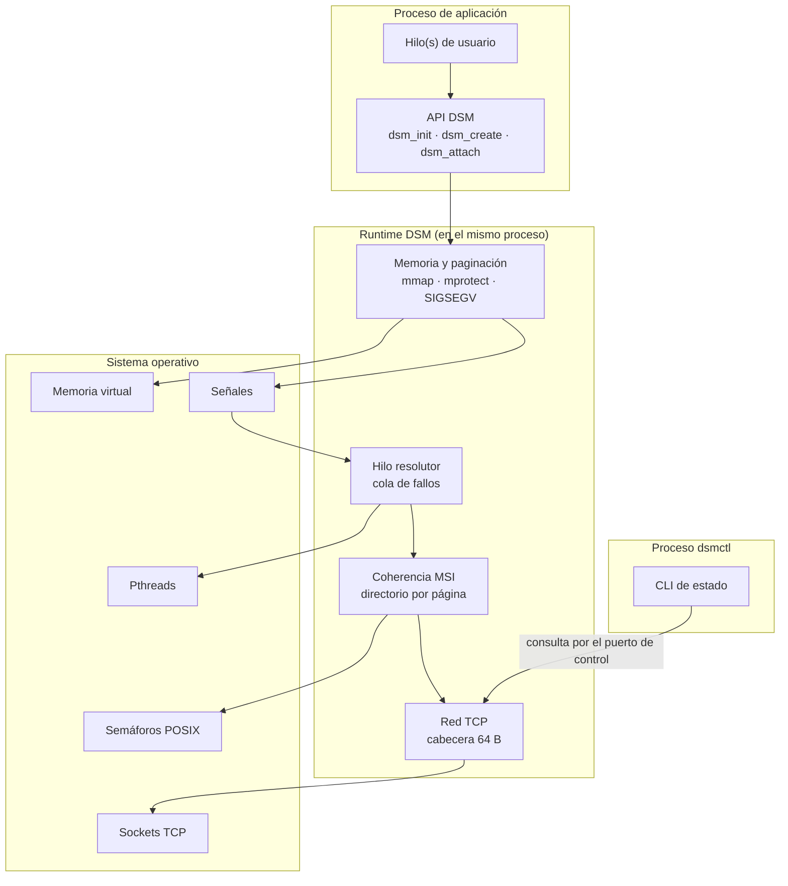
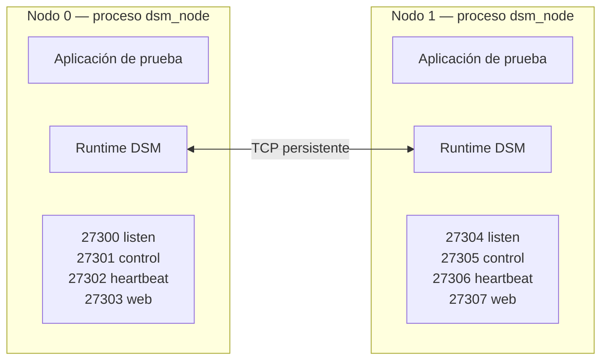
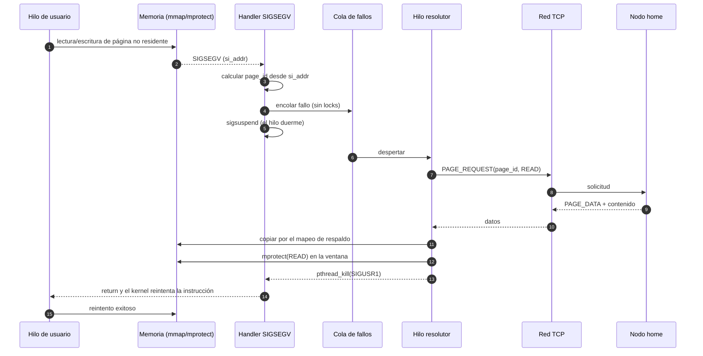
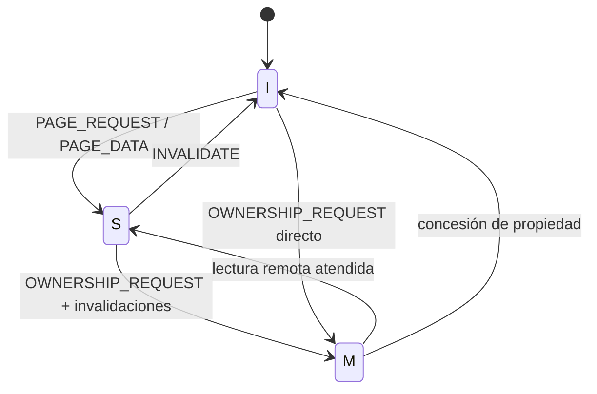

# Entregable 2 — Prototipo 1 y Arquitectura Actualizada

## Sistema de Memoria Compartida Distribuida con Paginación bajo Demanda y Coherencia MSI

| Campo | Valor |
|---|---|
| **Institución** | Instituto Tecnológico de Costa Rica |
| **Escuela** | Escuela de Ingeniería en Computación, Cartago |
| **Curso** | IC-6600 Principios de Sistemas Operativos |
| **Semestre** | II Semestre, 2026 |
| **Profesor** | Profesor del curso IC-6600 |
| **Proyecto** | Implementación de un Sistema de Memoria Compartida Distribuida (DSM) con Paginación bajo Demanda y Coherencia MSI |
| **Entregable** | Entregable 2 — Prototipo 1 y Arquitectura Actualizada |
| **Integrantes** | José Daniel Monterrosa Quirós · Sebastián Agüero Brenes |
| **Pareja** | #3 — rango de puertos `27300–27399` |
| **Fecha oficial** | 13 de noviembre de 2026 |
| **Versión del documento** | 0.1 (borrador estructurado) |
| **Estado** | En construcción — pendiente de completar con la implementación |
| **Repositorio Git** | https://github.com/TSebas12/ProyectoSO-DSM-SistemaDeMemoriaCompartidaDistribuida |
| **Documento base** | `Entregable_1/01_Entregable_1_Diseno.md` |

> **Cómo leer este documento.** Las secciones 1 a 6 describen el prototipo y su relación con el diseño del Entregable 1 y están redactadas en su mayor parte. La sección 7 documenta los módulos ya escritos y deja marcado lo que falta. Los marcadores `[PENDIENTE: ...]` señalan siempre lo mismo: algo que depende de compilar, de ejecutar o de un módulo que todavía no existe. **No se debe afirmar ningún resultado que no haya sido ejecutado y registrado.**

> **Regla de honestidad técnica.** Si una función no se implementó, se declara en la sección 11 (limitaciones) y se traslada a la sección 12 (trabajo pendiente). Un prototipo incompleto y bien documentado vale más que uno que dice funcionar y no se puede reproducir.

---

## 2. Resumen ejecutivo

El presente documento describe el **Prototipo 1** del sistema de memoria compartida distribuida (DSM) diseñado en el Entregable 1, junto con la **arquitectura actualizada** y el registro de los cambios y ajustes aplicados durante la implementación.

El prototipo demuestra el núcleo funcional del sistema: dos nodos independientes, ejecutados como procesos separados sobre Linux y comunicados por sockets TCP, forman un espacio de memoria lógicamente compartido. Cada nodo reserva una ventana de direcciones virtuales con `mmap`, la protege con `mprotect(PROT_NONE)` y captura los accesos a páginas no residentes mediante un manejador de `SIGSEGV` instalado con `sigaction` y `SA_SIGINFO`. El manejador no resuelve el fallo por sí mismo: encola el evento y un hilo resolutor ejecuta el protocolo de red, transfiere la página y ajusta los permisos para que el hilo de la aplicación continúe su ejecución de forma transparente.

Sobre ese mecanismo se implementa un subconjunto del protocolo de coherencia **MSI**: una página puede estar *Modified*, *Shared* o *Invalid*, y las escrituras invalidan las copias remotas mediante mensajes `INVALIDATE` / `INVALIDATE_ACK` coordinados por el nodo hogar (*home*) de cada página.

El prototipo **no incluye** todavía expulsión de páginas, aplicaciones de prueba completas, métricas de rendimiento ni los extras. Esos elementos corresponden al Prototipo 2 (Entregable 3) y a la Entrega Final. El documento declara explícitamente esas limitaciones y el trabajo pendiente.

**Resultado esperado:** un hilo del nodo 1 lee correctamente una página cuyo contenido reside en el nodo 0, y una escritura posterior del nodo 0 invalida la copia del nodo 1, que vuelve a obtenerla al acceder de nuevo.

---

## 3. Índice

### 3.1 Contenido

| Sección | Título |
|---:|---|
| — | [Portada](#entregable-2--prototipo-1-y-arquitectura-actualizada) |
| 2 | [Resumen ejecutivo](#2-resumen-ejecutivo) |
| 3 | [Índice](#3-índice) |
| 4 | [Introducción](#4-introducción) |
| 5 | [Arquitectura actualizada](#5-arquitectura-actualizada) |
| 6 | [Cambios y ajustes respecto al Entregable 1](#6-cambios-y-ajustes-respecto-al-entregable-1) |
| 7 | [Implementación del prototipo 1](#7-implementación-del-prototipo-1) |
| 8 | [Estructuras y tipos implementados](#8-estructuras-y-tipos-implementados) |
| 9 | [Compilación y ejecución](#9-compilación-y-ejecución) |
| 10 | [Pruebas realizadas](#10-pruebas-realizadas) |
| 11 | [Limitaciones conocidas](#11-limitaciones-conocidas) |
| 12 | [Trabajo pendiente para el prototipo 2](#12-trabajo-pendiente-para-el-prototipo-2) |
| 13 | [Conclusiones](#13-conclusiones) |
| 14 | [Referencias](#14-referencias) |
| 15 | [Anexos](#15-anexos) |

### 3.2 Índice de figuras

| Figura | Título | Sección |
|---:|---|---|
| 1 | Arquitectura de componentes del prototipo 1 | 5.1 |
| 2 | Vista de despliegue con dos nodos | 5.2 |
| 3 | Flujo de un fallo de página en el prototipo | 5.3 |
| 4 | Diagrama de estados MSI implementado | 7.4 |

> **Nota.** Las figuras 1 a 4 son diagramas de diseño. Las capturas de ejecución se numerarán a partir de la figura 5 cuando se tomen en el laboratorio (sección 15).

### 3.3 Índice de tablas

| Tabla | Título | Sección |
|---:|---|---|
| 1 | Alcance del prototipo 1 | 4.2 |
| 2 | Cambios respecto al Entregable 1 | 6.2 |
| 3 | Módulos implementados y archivos | 7.7 |
| 4 | Estructuras implementadas y tamaños | 8.1 |
| 5 | Puertos por nodo | 9.3 |
| 6 | Escenarios de prueba | 10.1 |
| 7 | Resultados obtenidos | 10.2 |
| 8 | Limitaciones conocidas | 11 |
| 9 | Trabajo pendiente para el prototipo 2 | 12 |

---

## 4. Introducción

### 4.1 Objetivo del prototipo 1

Implementar y demostrar el núcleo de la arquitectura diseñada en el Entregable 1, con el menor alcance posible que permita comprobar que el enfoque es viable:

1. Dos nodos se descubren y se comunican por TCP.
2. Un nodo materializa bajo demanda una página que reside en el otro.
3. El acceso a una página ausente se detecta con `SIGSEGV` y se resuelve sin que la aplicación lo perciba.
4. Una escritura invalida las copias remotas y se respeta el estado MSI.

### 4.2 Alcance

| Incluido en el prototipo 1 | Excluido (queda para E3 o final) |
|---|---|
| Compilación con `make` en Linux | Compilación cruzada o soporte de otros SO |
| 2 nodos como procesos independientes | 4 nodos en máquinas físicas |
| Un objeto de prueba de 4 páginas (16 KB) | Objetos grandes o varios objetos |
| Ventana de memoria con `mmap` | Ventana de 256 MB completa |
| `mprotect(PROT_NONE)` y `SIGSEGV` | Recuperación ante fallos de nodo |
| Transferencia de página `PAGE_REQUEST` / `PAGE_DATA` | Transferencia fragmentada de páginas grandes |
| MSI básico: `I→S`, `S→I`, `I→M` | Optimizaciones tipo MESI/MOESI |
| `INVALIDATE` / `INVALIDATE_ACK` | Directorio distribuido completo con replicación |
| CLI de consulta de estado | Panel web completo |
| Estadísticas mínimas en memoria | Métricas de rendimiento y *speedup* |
| — | Expulsión de páginas y LRU |
| — | Aplicaciones de matrices, video e incrementos |
| — | Extras 1 y 2 |

**Tabla 1.** Alcance del prototipo 1.

### 4.3 Relación con el Entregable 1

El Entregable 1 definió la arquitectura, el modelo de coherencia, el protocolo con cabecera de 64 bytes, el API, las estructuras y los tamaños. El Entregable 2 **no rediseña**: implementa un subconjunto y documenta dónde la realidad obligó a desviarse.

| Elemento del E1 | Estado en el prototipo 1 |
|---|---|
| Ventana local + pool de marcos | Implementado: ventana de 256 MB y 256 marcos de contabilidad (sin expulsión) |
| `mmap` + `mprotect` + `sigaction` | Implementado, incluida pila alternativa por hilo |
| Protocolo con cabecera de 64 B | Pendiente: corresponde al módulo de red |
| MSI con directorio por página | Implementado: MSI completo y directorio local en el nodo home |
| API `dsm_init` / `dsm_create` / `dsm_attach` | Pendiente: corresponde al runtime y a `dsm_api.c` |
| CLI (web fuera de alcance) | Pendiente: corresponde a `dsmctl` |
| Aplicaciones de prueba | Fuera de alcance |
| Extras | Fuera de alcance |

> **Estado de verificación.** El código de los módulos marcados como implementados está escrito y revisado, pero **todavía no se compiló**: el equipo no tiene un entorno Linux disponible al momento de redactar esta versión. La sección 9 registra el procedimiento y la sección 10 los resultados, que se completan en el laboratorio.

### 4.4 Metodología de trabajo

- Desarrollo incremental por módulos, con integración continua en `main`.
- Cada módulo se prueba de forma aislada antes de integrarse.
- La memoria y las señales se validan primero en un solo nodo; la red se incorpora después.
- Cada hito se registra con un commit identificable en el repositorio.
- Los comentarios del código se escriben en español y explican el porqué.
- Cada entregable con código incluye una guía de código en Markdown (sección 7.9).
- El documento se redacta al final, describiendo lo que el código realmente hace.

---

## 5. Arquitectura actualizada

### 5.1 Vista de componentes



**Figura 1.** Arquitectura de componentes del prototipo 1.

> **Nota.** El diagrama refleja la división real de módulos: `memory.c`, `fault.c`, `coherence.c` y `sync.c` dentro del runtime, y `dsmctl` como proceso aparte que consulta el estado por el puerto de control.

### 5.2 Vista de despliegue



**Figura 2.** Vista de despliegue con dos nodos.

En el prototipo 1 ambos procesos se ejecutan en una **máquina personal** usando `127.0.0.1` y puertos distintos (`27300` y `27304`). La validación en máquinas físicas separadas se realiza después en los **laboratorios de la Escuela** y se documenta en el Entregable 3. El código no depende del entorno: al cambiar de máquina solo cambian las direcciones IP de la configuración.

### 5.3 Flujo de un fallo de página



**Figura 3.** Flujo de un fallo de página en el prototipo.

> **Nota.** El manejador no retorna hasta que la página está publicada: duerme en `sigsuspend` y el resolutor lo despierta con `SIGUSR1`. Si la resolución falla, el contexto queda marcado y el reintento deja morir el proceso en lugar de entrar en un bucle.

### 5.4 Cambios respecto al diseño original

| Área | Diseño del E1 | Implementación real | Motivo |
|---|---|---|---|
| Memoria | Ventana de 256 MB y pool de 256 marcos | Ventana de 256 MB sobre `memfd` con doble mapeo; 256 marcos de contabilidad | El resolutor copia por un mapeo `RW` privado y los hilos de usuario solo ven la ventana cuando se publica el permiso |
| Red | Conexiones persistentes entre todos los nodos | Pendiente: la define el módulo de red | Pendiente |
| Coherencia | MSI con directorio distribuido | MSI con directorio local en el nodo home (bitmap de *sharers*); un tercero se rechaza con `OWNERSHIP_DENY` | Con dos nodos no existen terceros; la invalidación múltiple queda para el E3 |
| Concurrencia | Jerarquía global de locks | Jerarquía `GLOBAL → OBJECT → PAGE → FRAME` verificada en ejecución | Detectar orden invertido sin costo cuando la comprobación se desactiva |
| Configuración | `dsm.conf` con validación | Pendiente: la define el módulo de configuración | Pendiente |

### 5.5 Decisiones tomadas durante la implementación

| # | Decisión | Alternativas consideradas | Motivo | Impacto |
|---:|---|---|---|---|
| D2-01 | Ventana sobre `memfd` mapeado dos veces | (a) `mmap` anónimo y `mprotect` temporal a `RW`; (b) copiar a un buffer y `memcpy` al reintentar | Con (a) otro hilo puede leer la página a medio copiar; con (b) el fallo se repetiría | La ventana nunca sale de `PROT_NONE` durante la copia; el resolutor escribe por el respaldo |
| D2-02 | Cola de fallos como anillo sin locks | Mutex + variable de condición | Un `pthread_mutex_lock` dentro del manejador puede interbloquear si el hilo interrumpido ya tenía ese mutex | El manejador solo hace un CAS y `sem_post`, ambas operaciones seguras |
| D2-03 | Pila alternativa por hilo, no por proceso | Una sola `sigaltstack` global | `sigaltstack` es por hilo; dos fallos simultáneos en un buffer compartido corrompen la pila | Cada hilo registrado reserva 64 KB y los libera con un destructor de `pthread_key` |
| D2-04 | Verificación del orden de locks en ejecución | Confiar en la disciplina del programador; usar `helgrind` | `helgrind` es externo y no está en la rúbrica; la disciplina no se puede auditar | Cada lock lleva su clase y se avisa por `stderr` cuando el orden se invierte |
| D2-05 | Directorio local en el nodo home, sin replicación | Directorio distribuido con replicación del E1 | Con dos nodos y cuatro páginas la replicación no aporta y sí añade modos de fallo | El home es punto único de decisión por página; el E3 puede replicarlo |
| D2-06 | Bandera `failed` atómica en el contexto del hilo | Reintentar indefinidamente | Un fallo irresoluble dejaría al hilo en un bucle de `SIGSEGV` | Al fallar la resolución, el reintento deja morir el proceso con la señal original |

> **Nota.** Estas decisiones son las que el código realmente aplica. Las que dependan de los módulos de red y configuración se agregan cuando esos módulos existan.

---

## 6. Cambios y ajustes respecto al Entregable 1

### 6.1 Qué se mantuvo

- El modelo de memoria: ventana virtual local y páginas de 4 KB materializadas bajo demanda.
- El uso obligatorio de `mmap`, `mprotect` y `sigaction` con `SA_SIGINFO`.
- El protocolo MSI con estados `M`, `S` e `I`.
- La cabecera de mensaje de 64 bytes y el catálogo de códigos definido en el E1.
- El esquema de cuatro puertos por nodo.
- El API público (`dsm_init`, `dsm_create`, `dsm_attach`, `dsm_shutdown`).
- La separación entre el handler mínimo y el hilo resolutor.

### 6.2 Qué se cambió

| # | Elemento | Entregable 1 | Entregable 2 | Motivo |
|---:|---|---|---|---|
| C-01 | Rango de puertos | `50000–50099` (propuesta a validar) | `27300–27399` (pareja #3) | Rango asignado oficialmente por el curso. |
| C-02 | Número de nodos de la demo | 4 ideales | 2 | Alcance del prototipo 1. |
| C-03 | Copia de una página al resolver un fallo | `PROT_NONE` → copiar → publicar permisos, sin especificar el mecanismo | Doble mapeo de la misma página: ventana en `PROT_NONE` y respaldo en `RW` | Sin el respaldo habría que abrir la ventana antes de copiar y otro hilo podría leer datos a medias. |
| C-04 | Cola de fallos entre el manejador y el resolutor | No se especificaba | Anillo sin locks y `sigsuspend` en el hilo que falla | Un mutex dentro del manejador puede interbloquear si el hilo interrumpido ya lo tenía tomado. |

**Tabla 2.** Cambios respecto al Entregable 1.

### 6.3 Por qué se cambió

**C-01 — Rango de puertos.** El E1 fijó `50000–50099` como propuesta, explícitamente sujeta a validación en el laboratorio. El curso asignó a la pareja #3 el rango `27300–27399`. El esquema de offsets se mantiene intacto: cada nodo conserva cuatro puertos consecutivos y la fórmula `puerto_base + 4 × node_id`.

**C-02 — Número de nodos.** El prototipo 1 debe demostrar el mecanismo, no la escala. Dos nodos son suficientes para probar transferencia remota e invalidación, y reducen el riesgo de fallos de red y de configuración.

**C-03 — Copia de una página.** El E1 decía copiar con la página en `PROT_NONE` y publicar los permisos después, pero no explicaba cómo escribir sin permiso. La solución es un `memfd` mapeado dos veces: la ventana queda en `PROT_NONE` y un segundo mapeo de las mismas páginas físicas queda en `RW`. El resolutor copia por el respaldo y después publica el permiso en la ventana, así que ningún hilo de usuario observa el contenido a medio escribir.

**C-04 — Cola de fallos.** El E1 describía una cola «lock-free o con un mutex probado como seguro», sin decidir. Se eligió el anillo sin locks porque la alternativa correcta —un mutex tomado dentro del manejador— depende de que el hilo interrumpido no lo tuviera, y eso no se puede garantizar. El hilo que falla se duerme con `sigsuspend` y el resolutor lo despierta con `pthread_kill`.

> **Pendiente.** Los cambios asociados a los módulos de red y configuración se agregan cuando esos módulos estén implementados.

### 6.4 Impacto en API, protocolo, configuración y estructuras

| Componente | Impacto |
|---|---|
| **API** | Las firmas del E1 se mantienen como contrato. En esta versión están implementados los módulos internos que el API usará (`dsm_memory_*`, `dsm_fault_*`, `dsm_coherence_*`); las funciones públicas `dsm_init`, `dsm_create`, `dsm_attach` y `dsm_detach` quedan en `dsm_api.c`, todavía sin escribir. |
| **Protocolo** | Los códigos de mensaje del E1 se conservan tal cual en `dsm_msg_type_t`. La cabecera de 64 B y su serialización son responsabilidad del módulo de red, que aún no existe. |
| **Configuración** | Cambia el valor por defecto del rango de puertos a `27300–27399`; el resto de claves se mantiene. |
| **Estructuras** | Se mantienen los tamaños del E1 en los módulos implementados: `dsm_local_page_t` 56 B, `dsm_frame_t` 40 B, `dsm_directory_entry_t` 64 B y `dsm_stats_t` 128 B, verificados con `_Static_assert`. La cabecera de 64 B y `dsm_config_t` de 704 B pertenecen a los módulos pendientes. |
| **Compatibilidad** | El prototipo 1 no es compatible con el diseño del E1 en el valor de los puertos, pero sí en el esquema. |

---

## 7. Implementación del prototipo 1

### 7.1 Módulo de memoria virtual

**Responsabilidad.** Reservar la ventana de direcciones, instalar el manejador de señales, traducir `si_addr` a `page_id` y ajustar permisos tras resolver un fallo.

| Aspecto | Detalle |
|---|---|
| Archivos | `src/memory.c`, `src/fault.c`, `include/dsm_memory.h`, `include/dsm_fault.h` |
| Funciones principales | `dsm_memory_init`, `dsm_memory_addr_to_page`, `dsm_memory_page_get_or_create`, `dsm_memory_protect`, `dsm_memory_copy_in/out`, `dsm_fault_install`, `dsm_segv_handler` |
| Tamaño de página | 4096 B |
| Ventana | 256 MB reservados (65536 páginas), configurables |
| Protección inicial | `PROT_NONE` |
| Señal | `SIGSEGV` con `SA_SIGINFO` y `SA_ONSTACK` |
| Pila alternativa | Sí, una por hilo registrado, reservada en `dsm_fault_attach_thread` |

**Decisión clave.** El handler no puede llamar a funciones no seguras para señales. Solo calcula el `page_id`, encola el fallo y retorna. Toda la lógica (red, copia, `mprotect`) ocurre en el hilo resolutor.

**Copia sin carreras.** La ventana se crea sobre un `memfd` mapeado dos veces: una vista en `PROT_NONE` para los hilos de usuario y otra en `RW` para el resolutor. Así los datos se copian sin conceder permisos y solo se publican cuando están completos.

```c
static void dsm_segv_handler(int sig, siginfo_t *si, void *uctx)
{
    dsm_thread_ctx_t *ctx = t_ctx;
    dsm_fault_req_t   req;

    /* Un fallo que el DSM no puede resolver se relanza con el manejador
     * anterior: no debe quedar oculto. */
    if (!g_q.installed || ctx == NULL || si->si_code != SEGV_ACCERR) {
        reraise(sig);
        return;
    }

    uint64_t page_id = map_addr_to_page(si->si_addr);
    if (page_id == DSM_INVALID_PAGE_ID) {
        reraise(sig);
        return;
    }

    /* Bloquear la señal de reanudación antes de publicar in_fault evita
     * perder el aviso del resolutor. */
    sigset_t block, oldmask, waitmask;
    sigemptyset(&block);
    sigaddset(&block, SIGSEGV);
    sigaddset(&block, DSM_SIG_RESUME);
    sigprocmask(SIG_BLOCK, &block, &oldmask);

    ctx->pending_page = page_id;
    ctx->fault_kind   = (int)decode_kind(uctx);
    atomic_store_explicit(&ctx->in_fault, 1, memory_order_seq_cst);

    req.page_id    = page_id;
    req.kind       = (dsm_fault_kind_t)ctx->fault_kind;
    req.fault_addr = si->si_addr;
    req.ctx        = ctx;

    if (!queue_push(&req)) {                 /* anillo lleno o apagado */
        atomic_store_explicit(&ctx->in_fault, 0, memory_order_seq_cst);
        sigprocmask(SIG_SETMASK, &oldmask, NULL);
        reraise(sig);
        return;
    }

    /* Dormir hasta que el resolutor confirme. sigsuspend no toma locks y es
     * segura dentro de un manejador. */
    waitmask = oldmask;
    sigaddset(&waitmask, SIGSEGV);
    sigdelset(&waitmask, DSM_SIG_RESUME);
    while (atomic_load_explicit(&ctx->in_fault, memory_order_seq_cst) != 0) {
        sigsuspend(&waitmask);
    }
    sigprocmask(SIG_SETMASK, &oldmask, NULL);

    if (atomic_load_explicit(&ctx->failed, memory_order_seq_cst) != 0) {
        reraise(sig);
    }
}
```

**Riesgos atendidos.** `si_addr` no alineado, fallos concurrentes sobre la misma página, reintento de la instrucción tras `mprotect`.

### 7.2 Módulo de red

**Responsabilidad.** Establecer y mantener las conexiones TCP, serializar y deserializar mensajes con la cabecera de 64 bytes, y atender solicitudes y respuestas.

| Aspecto | Detalle |
|---|---|
| Archivos | `src/net.c`, `src/protocol.c`, `include/dsm_net.h`, `include/dsm_protocol.h` |
| Modelo | Pendiente de definir en el módulo de red |
| Cabecera | 64 B, `magic = 0x44534D31` |
| Endianness | `htonl` / `ntohl` en todos los campos |
| Lectura | `read_full()` para cabecera y payload |
| Mensajes implementados | Pendiente: el catálogo de códigos ya está fijado en `dsm_msg_type_t` |

```c
/* Pendiente: pegar la cabecera real y la función de envío cuando exista net.c. */
```

### 7.3 Módulo de concurrencia

**Responsabilidad.** Coordinar hilos de usuario, hilo resolutor, hilo de escucha y hilo de heartbeat sin interbloqueos.

| Aspecto | Detalle |
|---|---|
| Archivos | `src/sync.c`, `src/runtime.c`, `include/dsm_sync.h`, `include/dsm_runtime.h` |
| Primitivas | Pthreads, mutex, variables de condición, semáforos POSIX |
| Hilos del runtime | Uno de escucha, uno resolutor y uno de heartbeat; los hilos de usuario los crea la aplicación |
| Orden de locks | `GLOBAL → OBJECT → PAGE → FRAME`, verificado en ejecución |
| Regla | Nunca se espera red con un lock de página tomado |

**Coalescencia de fallos.** Si dos hilos fallan en la misma página, el resolutor marca la entrada como `TRAYENDO` y el segundo hilo espera en la variable de condición de la página en lugar de lanzar un segundo `PAGE_REQUEST`. Cuando la resolución termina, un `broadcast` despierta a todos y cada uno reevalúa su estado: si el fallo era de escritura y la página quedó en `S`, pide la propiedad.

**Por qué el orden se verifica.** Cada lock declara su clase al inicializarse. Si un hilo toma una clase menor que la que ya tiene, se registra una violación y se avisa por `stderr`, sin abortar. Así un error de orden aparece en la primera ejecución en lugar de manifestarse como interbloqueo intermitente.

### 7.4 MSI implementado

| Transición | Disparador | Mensajes | Estado resultante |
|---|---|---|---|
| `I → S` | Lectura de página ausente | `PAGE_REQUEST` / `PAGE_DATA` | `S` |
| `S → M` | Escritura sobre copia compartida | `OWNERSHIP_REQUEST` / invalidaciones / ACK | `M` |
| `S → I` | `INVALIDATE` recibido | `INVALIDATE_ACK` | `I` |
| `M → S` | Lectura remota del home | `PAGE_DATA` | `S` |
| `M → I` | Escritura remota concedida | `OWNERSHIP_GRANT` | `I` |



**Figura 4.** Diagrama de estados MSI implementado.

Todas las transiciones del diagrama están implementadas en `dsm_msi_next_state()`. Con dos nodos, `S → M` no necesita invalidar a terceros: el home comprueba el bitmap del directorio y, si no hay otro *sharer*, concede la propiedad con `OWNERSHIP_GRANT`. La rama de invalidación múltiple se rechaza explícitamente con `OWNERSHIP_DENY` y queda para el E3.

**Función pura.** `dsm_msi_next_state(estado, evento)` devuelve el estado siguiente sin tocar memoria ni red, así que la tabla se puede probar con casos unitarios sin levantar dos nodos.

### 7.5 API disponible

| Función | Estado | Observaciones |
|---|---|---|
| `dsm_init` | Pendiente | Va en `dsm_api.c`; orquesta `dsm_memory_init`, `dsm_fault_install` y `dsm_coherence_init` |
| `dsm_shutdown` | Pendiente | Debe llamar a `dsm_fault_shutdown()` para que el resolutor salga del bucle |
| `dsm_create` | Pendiente | Reserva el objeto y define el rango de `page_id` |
| `dsm_attach` | Pendiente | Registra el hilo con `dsm_fault_attach_thread()` antes de tocar la ventana |
| `dsm_detach` | Pendiente | Llama a `dsm_fault_detach_thread()` |
| `dsm_node_id` | Pendiente | Devuelve el `node_id` del runtime |
| `dsm_stats` | Parcial | `dsm_stats_format()` ya produce el resumen; falta exponerlo por el API |

### 7.6 Configuración

```ini
# config/dsm.conf — ejemplo para el prototipo 1 (pareja #3)

[identity]
node_id         = 0
max_nodes       = 4

[network]
bind_address    = 0.0.0.0
listen_port     = 27300
seed_host       = 127.0.0.1
seed_port       = 27300
port_range_start = 27300
port_range_end   = 27399

[ports]
control_port    = 27301
heartbeat_port  = 27302
web_port        = 27303

[memory]
page_size       = 4096
pool_frames     = 256
window_size     = 268435456

[timing]
heartbeat_interval_ms = 1000
heartbeat_timeout_ms  = 5000
network_timeout_ms    = 3000
```

> **Nota.** El archivo `config/dsm.conf` lo produce el módulo de configuración, que todavía no existe. Las claves del ejemplo son las del E1 y sus valores coinciden con los predeterminados del código ya escrito: página de 4096 B, ventana de 256 MB, 256 marcos y espera de red de 3000 ms.

### 7.7 Estructura del código fuente

**Modelo de compilación.** Los archivos de `src/` se compilan en una biblioteca estática `libdsm.a`. Los binarios `dsm_node` y `dsmctl` enlazan esa biblioteca, y las pruebas hacen lo mismo. Así el runtime queda separado de los programas que lo usan y el mismo código se reutiliza en los tres. Todos los artefactos se generan en `build/`, que no se versiona.

```text
ProyectoSO/
├── Makefile
├── README.md
├── config/
│   ├── dsm.conf.example
│   └── dsm.conf           configuración local (no versionada)
├── include/
│   ├── dsm.h              API pública del DSM
│   ├── dsm_types.h        enums, constantes y estados MSI
│   ├── dsm_config.h       dsm_config_t y parser
│   ├── dsm_memory.h       ventana y pool de marcos
│   ├── dsm_fault.h        handler de SIGSEGV y cola de fallos
│   ├── dsm_protocol.h     cabecera de 64 B, opcodes y payloads
│   ├── dsm_net.h          sockets, framing y conexiones
│   ├── dsm_coherence.h    MSI, directorio e invalidación
│   ├── dsm_runtime.h      estado global del nodo e hilos
│   ├── dsm_sync.h         locks y variables de condición
│   ├── dsm_log.h          registro de eventos
│   └── dsm_stats.h        contadores
├── src/
│   ├── dsm_api.c          implementa el API público
│   ├── runtime.c          arranque, hilos y parada ordenada
│   ├── memory.c           mmap, marcos y mprotect
│   ├── fault.c            sigaction, sigaltstack y cola
│   ├── protocol.c         encode/decode y checksum
│   ├── net.c              listen/connect/accept y read_full
│   ├── coherence.c        transiciones MSI
│   ├── sync.c             primitivas de sincronización
│   ├── config.c           lectura y validación de dsm.conf
│   ├── log.c              implementación del log
│   └── stats.c            contadores
├── apps/
│   ├── node_main.c        binario dsm_node
│   ├── ctl_main.c         binario dsmctl
│   └── demo_page.c        app de prueba: lee y escribe la página 0
├── tests/
│   ├── test_config.c
│   ├── test_protocol.c
│   ├── test_fault.c
│   └── test_msi.c
├── scripts/
│   ├── demo.sh            guion de demostración
│   └── check_ports.sh     verifica los puertos 27300–27399
├── build/                 artefactos de compilación (no versionado)
└── evidence/
```

| Módulo | Archivos | Responsable |
|---|---|---|
| Memoria y fallos de página | `memory.c`, `fault.c` | Sebastián Agüero |
| Red y protocolo | `net.c`, `protocol.c` | José Daniel Monterrosa |
| Configuración y CLI | `config.c`, `ctl_main.c` | José Daniel Monterrosa |
| Coherencia MSI | `coherence.c` | Sebastián Agüero |
| Concurrencia | `sync.c`, `runtime.c` | Ambos |
| API pública | `dsm_api.c`, `dsm.h` | Ambos |
| Aplicación de prueba | `demo_page.c` | Ambos |
| Soporte | `log.c`, `stats.c` | José Daniel / Sebastián |

**Tabla 3.** Módulos implementados y archivos.

**Targets del `Makefile`:**

- `make` o `make all` — compila `libdsm.a`, `dsm_node` y `dsmctl`.
- `make dsm_node` — solo el binario del nodo.
- `make dsmctl` — solo la CLI.
- `make test` — compila y ejecuta las pruebas.
- `make run` — arranca dos nodos locales para la demostración.
- `make clean` — elimina objetos y binarios.

> **Nota.** Esta estructura es la definitiva para el prototipo 1. Si durante la implementación cambia, la sección 6.2 lo registra como un cambio respecto al E1.

**Ubicación durante el desarrollo.** Mientras el prototipo está en construcción, el código vive en `Entregable_2/prototipo1/` con esta misma distribución (`include/`, `src/`, `Makefile`). Al cerrar el entregable se traslada a la raíz del repositorio. La razón es simple: así el entregable queda autocontenido y no se mezcla con la documentación de los otros entregables.

**Estado actual del código.** Implementados los módulos de memoria, señales, coherencia MSI, sincronización y contadores (sección 7.1, 7.3 y 7.4). Pendientes los de configuración, red, protocolo y CLI (sección 7.2 y 7.6), que corresponden al otro integrante. El `Makefile` de esa carpeta compila los módulos terminados con `make check`; todavía no enlaza binarios.

### 7.8 Convenciones de código

| Aspecto | Convención |
|---|---|
| Idioma de los comentarios | **Español** |
| Idioma de los identificadores | Inglés, `snake_case` |
| Idioma de los mensajes al usuario | Español |
| Comentario de archivo | Propósito del archivo, autor y fecha |
| Comentario de función | Qué hace, parámetros, retorno y errores |
| Comentario de decisión | Explica el **porqué** de la lógica no obvia |
| Indentación | 4 espacios, sin tabulaciones |
| Ancho de línea | 100 columnas como máximo |
| Advertencias | `-Wall -Wextra` sin advertencias |
| Estándar | C11 con `-D_GNU_SOURCE` |

**Regla de oro.** Un comentario no repite lo que el código ya dice: explica por qué se hizo así. `i++` no necesita comentario; una espera activa con `sched_yield` sí.

### 7.9 Documentación del código

Todo entregable que incluya código debe venir acompañado de un documento Markdown que explique **qué hace cada parte y por qué**, pensado para alguien que no escribió el código.

| Entregable | Documento complementario |
|---|---|
| Entregable 2 | `Entregable_2/02_Entregable_2_Guia_Codigo.md` |
| Entregable 3 | `Entregable_3/03_Entregable_3_Guia_Codigo.md` |
| Entrega Final | `Entrega_Final/Guia_Codigo.md` |

**Reglas de redacción:**

- Explicación corta: **2 a 4 líneas por elemento**. Si no cabe, el archivo está demasiado grande.
- No se copia el código; se explica su intención.
- Cada archivo lleva: responsabilidad, funciones clave (qué hace y por qué), dependencias y qué no hace.
- Se documentan los flujos completos: arranque, fallo de página e invalidación.

**Plantilla sugerida:**

```markdown
## src/fault.c

**Qué hace.** Instala el handler de `SIGSEGV` y mantiene la cola de fallos.

| Función | Qué hace | Por qué |
|---|---|---|
| `dsm_fault_install` | Configura `sigaction` y `sigaltstack` | El handler necesita pila propia para no desbordar |
| `dsm_fault_handler` | Encola el fallo y retorna | No puede llamar a funciones no seguras para señales |

**Depende de:** `dsm_memory.h`, `dsm_sync.h`.
**No hace:** no pide páginas ni toca la red; eso lo hace el hilo resolutor.
```

---

## 8. Estructuras y tipos implementados

### 8.1 Structs reales y tamaños

| Estructura | Tamaño esperado (E1) | Tamaño real | Diferencia | Motivo |
|---|---:|---:|---|---|
| `dsm_local_page_t` | 56 B | 56 B | Ninguna | Metadatos; la sincronización va aparte |
| `dsm_frame_t` | 40 B | 40 B | Ninguna | Marco de contabilidad |
| `dsm_directory_entry_t` | 64 B | 64 B | Ninguna | Entrada del directorio del home |
| `dsm_stats_t` | 128 B | 128 B | Ninguna | 16 contadores de 64 bits |
| `dsm_thread_ctx_t` | 5 campos | 6 campos | +4 B | Se agregó `failed` atómico |
| `dsm_msg_header_t` | 64 B | No implementada | — | Corresponde al módulo de red |
| `dsm_config_t` | 704 B | No implementada | — | Corresponde al módulo de configuración |
| `dsm_page_req_payload_t` | — | No implementada | — | Corresponde al módulo de red |
| `dsm_page_data_payload_t` | — | No implementada | — | Corresponde al módulo de red |
| `dsm_hello_payload_t` | 128 B | No implementada | — | Corresponde al módulo de red |

**Tabla 4.** Estructuras implementadas y tamaños.

Los cuatro tamaños de la primera mitad están verificados con `_Static_assert` en las cabeceras; el compilador los comprueba en cada compilación, no en tiempo de ejecución.

### 8.2 Verificación de tamaños

Los tamaños se verifican en tiempo de compilación con `_Static_assert`, de modo que una discrepancia rompa el build en lugar de corromper el protocolo:

```c
/* Ya presentes en el código */
_Static_assert(sizeof(dsm_local_page_t) == 56,      "dsm_local_page_t debe medir 56 bytes");
_Static_assert(sizeof(dsm_frame_t) == 40,           "dsm_frame_t debe medir 40 bytes");
_Static_assert(sizeof(dsm_directory_entry_t) == 64, "dsm_directory_entry_t debe medir 64 bytes");
_Static_assert(sizeof(dsm_stats_t) == 128,          "dsm_stats_t debe medir 128 bytes");

/* Contrato para el módulo de red, todavía sin implementar */
_Static_assert(sizeof(dsm_msg_header_t) == 64, "header must be 64 bytes");
_Static_assert(sizeof(dsm_config_t) == 704,    "config must be 704 bytes");
```

> **Pendiente de verificación.** Los cuatro primeros se comprueban al compilar en el laboratorio; hasta entonces solo se validó la sintaxis. Los dos últimos pertenecen a módulos que aún no existen.

### 8.3 Diferencias con el diseño

| Estructura | Cambio | Motivo |
|---|---|---|
| `dsm_local_page_t` | Conserva 56 B, pero el mutex y la condición no viven dentro | Un `pthread_mutex_t` mide 40 B y habría roto el tamaño documentado; se movieron a `dsm_page_entry_t` |
| `dsm_thread_ctx_t` | Se agregó `_Atomic int failed` | Sin esa bandera, un fallo irresoluble reintentaría el `SIGSEGV` para siempre |
| `dsm_memory_t` | Añade `backing_base` y `backing_fd` | Sostienen el doble mapeo del `memfd`; sin ellos no se puede copiar sin abrir permisos |
| `dsm_coherence_t` | Añade `ops` (callbacks de red) | Desacopla la coherencia del transporte y permite probarla con callbacks falsos |
| `dsm_page_entry_t` | Nueva: metadatos + lock + condición + cadena del hash | El E1 no detallaba dónde vivía la sincronización por página |

---

## 9. Compilación y ejecución

### 9.1 Requisitos

- Linux de 64 bits en máquina personal (WSL2 o máquina virtual) para el desarrollo, y en las máquinas del laboratorio para la validación final.
- GCC con soporte de C11.
- GNU Make.
- Pthreads y semáforos POSIX.
- Dos procesos o dos máquinas en la misma red.

### 9.2 Compilación

El `Makefile` compila `src/*.c` en `libdsm.a` y enlaza con ella los binarios `dsm_node` y `dsmctl`.

```bash
make            # compila libdsm.a, dsm_node y dsmctl
make dsm_node   # solo el binario del nodo
make dsmctl     # solo la CLI
make test       # compila y ejecuta las pruebas
make run        # arranca dos nodos locales
make clean      # limpia objetos y binarios
```

> **Estado.** El `Makefile` definitivo se integra cuando existan todos los módulos. Mientras tanto, `Entregable_2/prototipo1/Makefile` compila los cinco módulos ya escritos con `make check`, sin enlazar. La salida real de `make` se pega aquí después de la primera compilación en el laboratorio.

### 9.3 Configuración y puertos

| Nodo | `listen_port` | `control_port` | `heartbeat_port` | `web_port` |
|---:|---:|---:|---:|---:|
| 0 | 27300 | 27301 | 27302 | 27303 |
| 1 | 27304 | 27305 | 27306 | 27307 |
| 2 | 27308 | 27309 | 27310 | 27311 |
| 3 | 27312 | 27313 | 27314 | 27315 |

**Tabla 5.** Puertos por nodo (pareja #3, rango `27300–27399`).

Fórmula: `puerto_base = 27300 + 4 × node_id`.

### 9.4 Arranque de nodos

```bash
# Nodo 0 (semilla)
./build/dsm_node --config config/dsm.conf --id 0

# Nodo 1
./build/dsm_node --config config/dsm.conf --id 1

# Consulta de estado
./build/dsmctl status --node 0
```

> Los binarios se generan en `build/` y `config/dsm.conf` es local (no se versiona); el repositorio incluye `dsm.conf.example`. Las opciones `--config` y `--id` son las definitivas.

### 9.5 Ejecución de pruebas

```bash
./scripts/demo.sh 2>&1 | tee evidence/demo.log
```

> **Guion de la demostración.** El `scripts/demo.sh` lo escribe el integrante responsable de la red. La secuencia prevista es: arrancar el nodo 0, arrancar el nodo 1, ejecutar la aplicación de prueba que lee la página 0 desde el nodo 1, escribir desde el nodo 0 para provocar la invalidación y consultar el estado con `dsmctl`. El guion definitivo se documenta cuando el script exista.

---

## 10. Pruebas realizadas

### 10.1 Escenarios

Todas las pruebas se ejecutan sobre un objeto DSM de **4 páginas (16 KB)**. La página 0 es la que se comparte entre los dos nodos para demostrar la transferencia y la invalidación.

| # | Prueba | Objetivo | Cómo se verifica | Estado |
|---:|---|---|---|---|
| 1 | Compilación | El proyecto compila sin errores | `make` termina con código 0 | Por ejecutar |
| 2 | Arranque de dos nodos | Ambos procesos inician | Dos `dsm_node` activos | Por ejecutar |
| 3 | Apertura de puertos | Cada nodo escucha | `ss -ltnp` muestra 27300 y 27304 | Por ejecutar |
| 4 | Registro con la semilla | El nodo 1 se une | Log `JOIN_RESPONSE` | Por ejecutar |
| 5 | Heartbeat | Se detectan nodos vivos | Log de latidos cada 1 s | Por ejecutar |
| 6 | Reserva de ventana | `mmap` exitoso | Log con dirección y tamaño | Por ejecutar |
| 7 | Protección inicial | Páginas en `PROT_NONE` | Lectura provoca `SIGSEGV` | Por ejecutar |
| 8 | Captura de `si_addr` | El handler identifica la página | Log del `page_id` calculado | Por ejecutar |
| 9 | `PAGE_REQUEST` | Se solicita la página remota | Log del mensaje enviado | Por ejecutar |
| 10 | `PAGE_DATA` | Se recibe el contenido | Log del mensaje recibido | Por ejecutar |
| 11 | Reanudación del hilo | La lectura continúa | El programa imprime el valor correcto | Por ejecutar |
| 12 | Transición `I → S` | Se obtiene copia compartida | Estado de página = `S` | Por ejecutar |
| 13 | Invalidación `S → I` | La escritura remota invalida | Log `INVALIDATE` / `INVALIDATE_ACK` | Por ejecutar |
| 14 | CLI de estado | Se consulta el nodo | Salida de `dsmctl status` | Por ejecutar |

**Tabla 6.** Escenarios de prueba.

### 10.2 Resultados

| # | Resultado esperado | Resultado obtenido | ¿Cumple? | Evidencia |
|---:|---|---|---|---|
| 1 | `make` sin errores | Pendiente | — | `evidence/01_make.log` |
| 2 | Dos nodos activos | Pendiente | — | `evidence/02_nodo0.log` |
| 3 | Puertos abiertos | Pendiente | — | `evidence/03_puertos.txt` |
| 4 | Unión al clúster | Pendiente | — | `evidence/04_join.log` |
| 5 | Latidos periódicos | Pendiente | — | `evidence/05_heartbeat.log` |
| 6 | Ventana reservada | Pendiente | — | `evidence/06_mmap.log` |
| 7 | `SIGSEGV` capturado | Pendiente | — | `evidence/07_fault.log` |
| 8 | `si_addr` correcto | Pendiente | — | `evidence/08_siaddr.log` |
| 9 | `PAGE_REQUEST` enviado | Pendiente | — | `evidence/09_request.log` |
| 10 | `PAGE_DATA` recibido | Pendiente | — | `evidence/10_data.log` |
| 11 | Lectura correcta | Pendiente | — | `evidence/11_lectura.log` |
| 12 | Página en `S` | Pendiente | — | `evidence/12_msi.log` |
| 13 | Invalidación correcta | Pendiente | — | `evidence/13_invalidate.log` |
| 14 | CLI responde | Pendiente | — | `evidence/14_cli.txt` |

**Tabla 7.** Resultados obtenidos.

### 10.3 Evidencia

| Evidencia | Archivo | Estado |
|---|---|---|
| Salida de `make` | `evidence/01_make.log` | Pendiente |
| Arranque del nodo 0 | `evidence/02_nodo0.log` | Pendiente |
| Arranque del nodo 1 | `evidence/03_nodo1.log` | Pendiente |
| Puertos en escucha | `evidence/04_puertos.txt` | Pendiente |
| Logs de heartbeat | `evidence/05_heartbeat.log` | Pendiente |
| `PAGE_REQUEST` / `PAGE_DATA` | `evidence/06_paginas.log` | Pendiente |
| Salida de la CLI | `evidence/07_cli.txt` | Pendiente |
| Captura de la terminal | `evidence/08_captura.png` | Pendiente |
| `git log` con ambos autores | `evidence/09_gitlog.txt` | Pendiente |

> **Pendiente.** Las capturas y los fragmentos de log se insertan después de la ejecución en el laboratorio. La carpeta `evidence/` no se versiona salvo los archivos `.log`, que sí quedan en el repositorio como prueba.

### 10.4 Problemas encontrados

Estos problemas se detectaron en la revisión del código, antes de la primera compilación. Se documentan porque explican por qué el diseño actual difiere del E1.

| # | Problema | Síntoma | Causa | Solución |
|---:|---|---|---|---|
| 1 | Copia de página con permisos abiertos | Otro hilo podía leer una página a medio copiar | Para escribir había que poner la ventana en `RW`, y eso la hacía visible antes de tiempo | Doble mapeo del `memfd`: la ventana nunca sale de `PROT_NONE` durante la copia |
| 2 | `pthread_sigmask` dentro del manejador | Llamada no segura para señales | Se usó la variante de Pthreads por inercia | `sigprocmask`, que sí está en la lista de funciones seguras |
| 3 | Una sola pila alternativa para todo el proceso | Dos fallos simultáneos comparten pila y corrompen el proceso | `sigaltstack` es un atributo por hilo, no por proceso | Cada hilo registrado reserva su pila y la libera con un destructor de `pthread_key` |
| 4 | Comprobación de orden de locks desactivada | Diagnósticos falsos: la pila quedaba desbalanceada | `check_order()` retornaba antes de apilar la clase | La pila se actualiza siempre; solo la comprobación es condicional |
| 5 | `OWNERSHIP_DENY` enviado como `DSM_MSG_ERROR` | El cliente no distinguía una negación de protocolo de un error de transporte | Se reutilizó el ayudante de errores | Se separó `send_status()` y se agregó `send_deny()` con el tipo correcto |

---

## 11. Limitaciones conocidas

| # | Limitación | Impacto | Mitigación actual |
|---:|---|---|---|
| 1 | Solo dos nodos | No se valida la escala | Se prueba en E3 |
| 2 | Sin expulsión de páginas | El pool no se recicla | Se implementa en E3 |
| 3 | Sin aplicaciones de prueba | No hay carga real | Se implementan en E3 |
| 4 | Sin métricas de rendimiento | No hay *speedup* | Se miden en E3 |
| 5 | Sin tolerancia a fallos de nodo | Un nodo caído bloquea páginas | Fuera del alcance base |
| 6 | Sin invalidación de terceros | El home niega la propiedad si hay otro *sharer* | Con dos nodos no ocurre; se implementa en E3 |
| 7 | Sin expulsión ni reutilización de marcos | Al agotar los 256 marcos, la página no se puede materializar | Se implementa en E3 con LRU aproximada |
| 8 | Compilación no verificada al cierre de esta versión | El código está escrito y revisado, pero no compilado | Se compila en el laboratorio antes de la entrega |

**Tabla 8.** Limitaciones conocidas.

> **Nota.** Las limitaciones 1 a 7 son de alcance y están asumidas desde el diseño. La 8 es temporal: desaparece en cuanto se ejecute `make check` en Linux.

---

## 12. Trabajo pendiente para el prototipo 2

| # | Tarea | Prioridad | Entregable |
|---:|---|---|---|
| 1 | Expulsión de páginas con política LRU aproximada | Alta | E3 |
| 2 | Soporte de varias páginas y varios objetos | Alta | E3 |
| 3 | Aplicación de multiplicación de matrices | Alta | E3 |
| 4 | Detección de cortes de escena en video | Alta | E3 |
| 5 | Incrementos concurrentes como prueba de estrés | Media | E3 |
| 6 | Métricas de *speedup* y eficiencia | Media | E3 |
| 7 | Panel web de solo lectura | Baja | E3 / final |
| 8 | Manejo de fallos de nodo | Baja | Final |
| 9 | Validación en máquinas del laboratorio | Media | E3 / final |
| 10 | Extras 1 y 2 | Baja | Final |

**Tabla 9.** Trabajo pendiente para el prototipo 2.

---

## 13. Conclusiones

> **Versión preliminar.** Estas conclusiones cubren el diseño y el código revisado. Los resultados experimentales se agregan después de ejecutar el prototipo en el laboratorio; hasta entonces no se afirma ningún comportamiento observado.

**Sobre la viabilidad del mecanismo.** La combinación de `mmap(PROT_NONE)`, un manejador de `SIGSEGV` con `SA_SIGINFO` y `mprotect` permite materializar páginas bajo demanda sin que la aplicación cambie una línea. El costo está en que el manejador debe ser mínimo: cualquier operación que no sea segura para señales convierte un fallo de página en un interbloqueo.

**Sobre `mmap`, `mprotect` y señales.** Tres lecciones concretas. Primera: no se puede escribir sobre una página en `PROT_NONE`, y abrirla antes de copiar expone datos a medias; la solución fue mapear la misma memoria dos veces. Segunda: `sigaltstack` es por hilo, no por proceso, así que cada hilo que toca la ventana necesita la suya. Tercera: `sem_wait` no es segura dentro de un manejador; el hilo debe dormirse con `sigsuspend` y el resolutor despertarlo con `pthread_kill`.

**Sobre las desviaciones.** El E1 describía el *qué*; la implementación obligó a decidir el *cómo*. El doble mapeo, la cola de fallos sin locks y el directorio local en el nodo home no contradicen el diseño: lo hacen ejecutable con dos nodos y cuatro páginas. Cada una quedó registrada en las secciones 5.4 y 6.2 con su motivo.

**Sobre los riesgos.** El riesgo dominante no era la red sino la concurrencia: interbloqueo por señal y carrera en la copia. Ambos se atacaron en el diseño, no con parches posteriores, y la jerarquía de locks se verifica en ejecución para que un error de orden aparezca en la primera prueba.

**Qué queda.** El Prototipo 2 debe añadir expulsión con LRU, varios objetos, aplicaciones de carga y métricas. La base actual está preparada: los marcos y la residencia ya distinguen `TRAYENDO`, `RESIDENTE` y `EXPULSANDO`, aunque la expulsión todavía no se ejecute.

---

## 14. Referencias

1. Tanenbaum, A. S., & van Steen, M. (2017). *Distributed Systems: Principles and Paradigms* (3rd ed.). Maarten van Steen.
2. Silberschatz, A., Galvin, P. B., & Gagne, G. (2018). *Operating System Concepts* (10th ed.). Wiley.
3. IEEE. (2018). *IEEE Std 1003.1-2017: Standard for Information Technology — Portable Operating System Interface (POSIX)*.
4. Linux man-pages project. `mmap(2)`, `mprotect(2)`, `sigaction(2)`, `sigaltstack(2)`, `sigsuspend(2)`, `memfd_create(2)`, `signal(7)`, `pthreads(7)`, `sem_overview(7)`, `shm_overview(7)`, `tcp(7)`.
5. Stevens, W. R., Fenner, B., & Rudoff, A. M. (2003). *UNIX Network Programming, Volume 1* (3rd ed.). Addison-Wesley.
6. Instituto Tecnológico de Costa Rica. (2026). *Proyecto SO — Sistema de Memoria Compartida Distribuida (DSM)* [Enunciado del curso IC-6600].

> **Nota.** Esta lista cubre las fuentes consultadas para el diseño y la implementación de los módulos actuales. Si durante la integración se consulta material adicional, se agrega aquí.

---

## 15. Anexos

### Anexo A — Logs de ejecución

> **Pendiente.** Se pegan aquí los fragmentos representativos de `evidence/`: arranque de los dos nodos, `PAGE_REQUEST` / `PAGE_DATA`, `INVALIDATE` / `INVALIDATE_ACK` y la salida de `dsmctl status`. Se transcriben tal como salgan, sin editarlos.

```text
Pendiente de la ejecución en el laboratorio.
```

### Anexo B — Capturas

> **Pendiente.** Capturas de la terminal con los dos nodos activos y, si existe, del panel de estado. Se numeran a partir de la figura 5.

### Anexo C — Tablas de resultados

> **Pendiente.** Tabla de tiempos por operación (fallo de página local, fallo remoto, invalidación) medida con `dsm_stats` y `dsm_now_ms()`. Solo se incluye si la medición se ejecutó.

### Anexo D — Checklist de entrega

- [x] Documento Markdown del prototipo 1.
- [x] Arquitectura actualizada.
- [x] Cambios respecto al E1.
- [ ] Código fuente — parcial: módulos de memoria, señales, coherencia, sincronización y contadores.
- [x] Guía de código (`02_Entregable_2_Guia_Codigo.md`).
- [x] `Makefile` provisional (`make check`).
- [x] `README`.
- [x] Configuración de ejemplo.
- [ ] Compilación exitosa.
- [ ] Arranque de 2 nodos.
- [ ] Transferencia de página.
- [ ] MSI básico — código escrito, sin ejecutar.
- [ ] Evidencia de ejecución.
- [x] Limitaciones.
- [x] Trabajo pendiente.
- [x] Repositorio Git.
- [ ] Commits de ambos integrantes.

> Este anexo es de control interno: **se elimina antes de la entrega**.

---

## Apéndice — Guía rápida de llenado

| Sección | Estado | Qué falta |
|---|---|---|
| 4.3 | Completa | — |
| 5.4 | Parcial | Filas de red y configuración |
| 5.5 | Completa para los módulos actuales | Decisiones de red y configuración |
| 6.2 | Parcial | Cambios de red y configuración |
| 6.4 | Parcial | API y protocolo |
| 7.1–7.6 | Parcial | 7.2 (red) y 7.5 (API pública) |
| 7.7 | Completa | — |
| 7.9 | Completa | — |
| 8 | Completa para los módulos actuales | Estructuras de red y configuración |
| 9 | Pendiente de ejecución | Salidas reales de `make` y de los nodos |
| 10 | Pendiente de ejecución | Resultados y evidencia |
| 11 | Completa | — |
| 12 | Completa | — |
| 13 | Preliminar | Agregar resultados experimentales |
| 15 | Pendiente de ejecución | Logs y capturas |

> Borrar este apéndice antes de la entrega.
