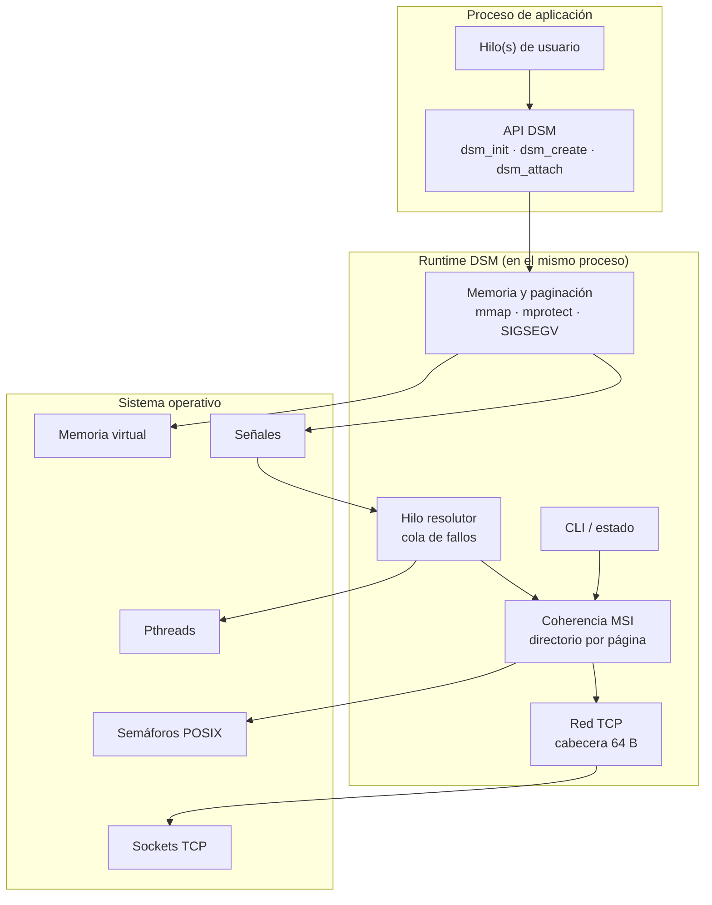
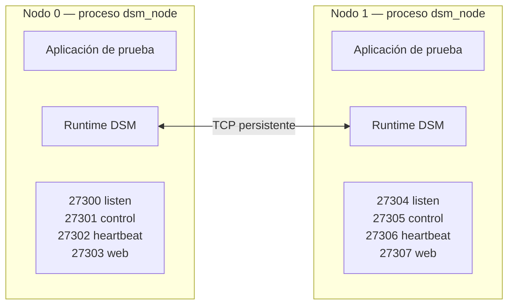
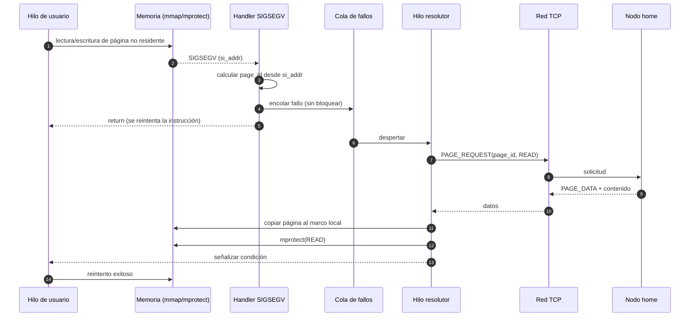
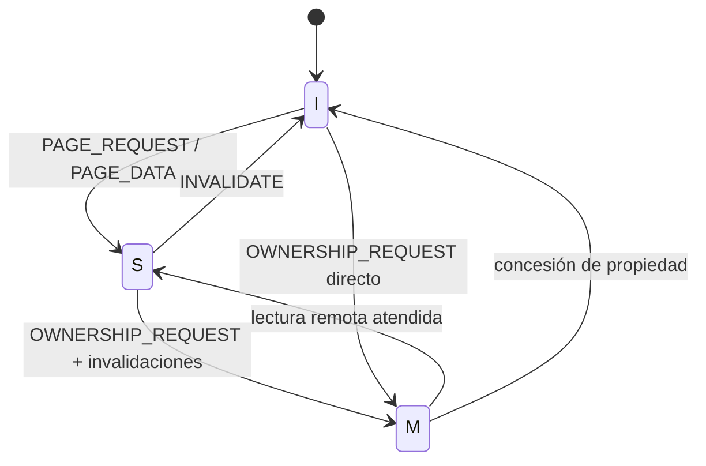

# Entregable 2 — Prototipo 1 y Arquitectura Actualizada

## Sistema de Memoria Compartida Distribuida con Paginación bajo Demanda y Coherencia MSI

| Campo | Valor |
|---|---|
| **Institución** | Instituto Tecnológico de Costa Rica |
| **Escuela** | Escuela de Ingeniería en Computación, Cartago |
| **Curso** | IC-6600 Principios de Sistemas Operativos |
| **Semestre** | II Semestre, 2026 |
| **Profesor** | Profesor del curso IC-6600 |
| **Proyecto** | Implementación de un Sistema de Memoria Compartida Distribuida (DSM) con Paginación bajo Demanda y Coherencia MSI |
| **Entregable** | Entregable 2 — Prototipo 1 y Arquitectura Actualizada |
| **Integrantes** | José Daniel Monterrosa Quirós · Sebastián Agüero Brenes |
| **Pareja** | #3 — rango de puertos `27300–27399` |
| **Fecha oficial** | 13 de noviembre de 2026 |
| **Versión del documento** | 0.1 (borrador estructurado) |
| **Estado** | En construcción — pendiente de completar con la implementación |
| **Repositorio Git** | https://github.com/TSebas12/ProyectoSO-DSM-SistemaDeMemoriaCompartidaDistribuida |
| **Documento base** | `Entregable_1/01_Entregable_1_Diseno.md` |

> **Cómo leer este documento.** Las secciones 1 a 6 describen el prototipo y su relación con el diseño del Entregable 1 y están redactadas en su mayor parte; los marcadores `[PENDIENTE: ...]` señalan lo que depende del código y de la ejecución real. Las secciones 7 a 15 se completan durante y después de la implementación. **No se debe afirmar ningún resultado que no haya sido ejecutado y registrado.**

> **Regla de honestidad técnica.** Si una función no se implementó, se declara en la sección 11 (limitaciones) y se traslada a la sección 12 (trabajo pendiente). Un prototipo incompleto y bien documentado vale más que uno que dice funcionar y no se puede reproducir.

---

## 2. Resumen ejecutivo

El presente documento describe el **Prototipo 1** del sistema de memoria compartida distribuida (DSM) diseñado en el Entregable 1, junto con la **arquitectura actualizada** y el registro de los cambios y ajustes aplicados durante la implementación.

El prototipo demuestra el núcleo funcional del sistema: dos nodos independientes, ejecutados como procesos separados sobre Linux y comunicados por sockets TCP, forman un espacio de memoria lógicamente compartido. Cada nodo reserva una ventana de direcciones virtuales con `mmap`, la protege con `mprotect(PROT_NONE)` y captura los accesos a páginas no residentes mediante un manejador de `SIGSEGV` instalado con `sigaction` y `SA_SIGINFO`. El manejador no resuelve el fallo por sí mismo: encola el evento y un hilo resolutor ejecuta el protocolo de red, transfiere la página y ajusta los permisos para que el hilo de la aplicación continúe su ejecución de forma transparente.

Sobre ese mecanismo se implementa un subconjunto del protocolo de coherencia **MSI**: una página puede estar *Modified*, *Shared* o *Invalid*, y las escrituras invalidan las copias remotas mediante mensajes `INVALIDATE` / `INVALIDATE_ACK` coordinados por el nodo hogar (*home*) de cada página.

El prototipo **no incluye** todavía expulsión de páginas, aplicaciones de prueba completas, métricas de rendimiento ni los extras. Esos elementos corresponden al Prototipo 2 (Entregable 3) y a la Entrega Final. El documento declara explícitamente esas limitaciones y el trabajo pendiente.

**Resultado esperado:** un hilo del nodo 1 lee correctamente una página cuyo contenido reside en el nodo 0, y una escritura posterior del nodo 0 invalida la copia del nodo 1, que vuelve a obtenerla al acceder de nuevo.

---

## 3. Índice

### 3.1 Contenido

| Sección | Título |
|---:|---|
| — | [Portada](#entregable-2--prototipo-1-y-arquitectura-actualizada) |
| 2 | [Resumen ejecutivo](#2-resumen-ejecutivo) |
| 3 | [Índice](#3-índice) |
| 4 | [Introducción](#4-introducción) |
| 5 | [Arquitectura actualizada](#5-arquitectura-actualizada) |
| 6 | [Cambios y ajustes respecto al Entregable 1](#6-cambios-y-ajustes-respecto-al-entregable-1) |
| 7 | [Implementación del prototipo 1](#7-implementación-del-prototipo-1) |
| 8 | [Estructuras y tipos implementados](#8-estructuras-y-tipos-implementados) |
| 9 | [Compilación y ejecución](#9-compilación-y-ejecución) |
| 10 | [Pruebas realizadas](#10-pruebas-realizadas) |
| 11 | [Limitaciones conocidas](#11-limitaciones-conocidas) |
| 12 | [Trabajo pendiente para el prototipo 2](#12-trabajo-pendiente-para-el-prototipo-2) |
| 13 | [Conclusiones](#13-conclusiones) |
| 14 | [Referencias](#14-referencias) |
| 15 | [Anexos](#15-anexos) |

### 3.2 Índice de figuras

| Figura | Título | Sección |
|---:|---|---|
| 1 | Arquitectura de componentes del prototipo 1 | 5.1 |
| 2 | Vista de despliegue con dos nodos | 5.2 |
| 3 | Flujo de un fallo de página en el prototipo | 5.3 |
| 4 | Diagrama de estados MSI implementado | 7.4 |

> `[PENDIENTE: ajustar la numeración cuando se inserten las capturas de ejecución.]`

### 3.3 Índice de tablas

| Tabla | Título | Sección |
|---:|---|---|
| 1 | Alcance del prototipo 1 | 4.2 |
| 2 | Cambios respecto al Entregable 1 | 6.2 |
| 3 | Módulos implementados y archivos | 7.7 |
| 4 | Estructuras implementadas y tamaños | 8.1 |
| 5 | Puertos por nodo | 9.3 |
| 6 | Escenarios de prueba | 10.1 |
| 7 | Resultados obtenidos | 10.2 |
| 8 | Limitaciones conocidas | 11 |
| 9 | Trabajo pendiente para el prototipo 2 | 12 |

---

## 4. Introducción

### 4.1 Objetivo del prototipo 1

Implementar y demostrar el núcleo de la arquitectura diseñada en el Entregable 1, con el menor alcance posible que permita comprobar que el enfoque es viable:

1. Dos nodos se descubren y se comunican por TCP.
2. Un nodo materializa bajo demanda una página que reside en el otro.
3. El acceso a una página ausente se detecta con `SIGSEGV` y se resuelve sin que la aplicación lo perciba.
4. Una escritura invalida las copias remotas y se respeta el estado MSI.

### 4.2 Alcance

| Incluido en el prototipo 1 | Excluido (queda para E3 o final) |
|---|---|
| Compilación con `make` en Linux | Compilación cruzada o soporte de otros SO |
| 2 nodos como procesos independientes | 4 nodos en máquinas físicas |
| Un objeto de prueba de 4 páginas (16 KB) | Objetos grandes o varios objetos |
| Ventana de memoria con `mmap` | Ventana de 256 MB completa |
| `mprotect(PROT_NONE)` y `SIGSEGV` | Recuperación ante fallos de nodo |
| Transferencia de página `PAGE_REQUEST` / `PAGE_DATA` | Transferencia fragmentada de páginas grandes |
| MSI básico: `I→S`, `S→I`, `I→M` | Optimizaciones tipo MESI/MOESI |
| `INVALIDATE` / `INVALIDATE_ACK` | Directorio distribuido completo con replicación |
| CLI de consulta de estado | Panel web completo |
| Estadísticas mínimas en memoria | Métricas de rendimiento y *speedup* |
| — | Expulsión de páginas y LRU |
| — | Aplicaciones de matrices, video e incrementos |
| — | Extras 1 y 2 |

**Tabla 1.** Alcance del prototipo 1.

### 4.3 Relación con el Entregable 1

El Entregable 1 definió la arquitectura, el modelo de coherencia, el protocolo con cabecera de 64 bytes, el API, las estructuras y los tamaños. El Entregable 2 **no rediseña**: implementa un subconjunto y documenta dónde la realidad obligó a desviarse.

| Elemento del E1 | Estado en el prototipo 1 |
|---|---|
| Ventana local + pool de marcos | `[PENDIENTE: implementado / parcial / no implementado]` |
| `mmap` + `mprotect` + `sigaction` | `[PENDIENTE]` |
| Protocolo con cabecera de 64 B | `[PENDIENTE]` |
| MSI con directorio por página | `[PENDIENTE]` |
| API `dsm_init` / `dsm_create` / `dsm_attach` | `[PENDIENTE]` |
| CLI (web fuera de alcance) | `[PENDIENTE]` |
| Aplicaciones de prueba | Fuera de alcance |
| Extras | Fuera de alcance |

### 4.4 Metodología de trabajo

- Desarrollo incremental por módulos, con integración continua en `main`.
- Cada módulo se prueba de forma aislada antes de integrarse.
- La memoria y las señales se validan primero en un solo nodo; la red se incorpora después.
- Cada hito se registra con un commit identificable en el repositorio.
- Los comentarios del código se escriben en español y explican el porqué.
- Cada entregable con código incluye una guía de código en Markdown (sección 7.9).
- El documento se redacta al final, describiendo lo que el código realmente hace.

---

## 5. Arquitectura actualizada

### 5.1 Vista de componentes



**Figura 1.** Arquitectura de componentes del prototipo 1.

> `[PENDIENTE: reemplazar por el diagrama definitivo si la implementación cambia la organización de módulos.]`

### 5.2 Vista de despliegue



**Figura 2.** Vista de despliegue con dos nodos.

En el prototipo 1 ambos procesos se ejecutan en una **máquina personal** usando `127.0.0.1` y puertos distintos (`27300` y `27304`). La validación en máquinas físicas separadas se realiza después en los **laboratorios de la Escuela** y se documenta en el Entregable 3. El código no depende del entorno: al cambiar de máquina solo cambian las direcciones IP de la configuración.

### 5.3 Flujo de un fallo de página



**Figura 3.** Flujo de un fallo de página en el prototipo.

> `[PENDIENTE: verificar el flujo real contra el código y ajustar el diagrama.]`

### 5.4 Cambios respecto al diseño original

> `[PENDIENTE: completar durante la implementación.]`

| Área | Diseño del E1 | Implementación real | Motivo |
|---|---|---|---|
| Memoria | Ventana de 256 MB y pool de 256 marcos | `[PENDIENTE]` | `[PENDIENTE]` |
| Red | Conexiones persistentes entre todos los nodos | `[PENDIENTE]` | `[PENDIENTE]` |
| Coherencia | MSI con directorio distribuido | `[PENDIENTE]` | `[PENDIENTE]` |
| Concurrencia | Jerarquía global de locks | `[PENDIENTE]` | `[PENDIENTE]` |
| Configuración | `dsm.conf` con validación | `[PENDIENTE]` | `[PENDIENTE]` |

### 5.5 Decisiones tomadas durante la implementación

> `[PENDIENTE: una entrada por decisión, con contexto, alternativas y consecuencia.]`

| # | Decisión | Alternativas consideradas | Motivo | Impacto |
|---:|---|---|---|---|
| D2-01 | `[PENDIENTE]` | `[PENDIENTE]` | `[PENDIENTE]` | `[PENDIENTE]` |
| D2-02 | `[PENDIENTE]` | `[PENDIENTE]` | `[PENDIENTE]` | `[PENDIENTE]` |

---

## 6. Cambios y ajustes respecto al Entregable 1

### 6.1 Qué se mantuvo

- El modelo de memoria: ventana virtual local y páginas de 4 KB materializadas bajo demanda.
- El uso obligatorio de `mmap`, `mprotect` y `sigaction` con `SA_SIGINFO`.
- El protocolo MSI con estados `M`, `S` e `I`.
- La cabecera de mensaje de 64 bytes y el catálogo de códigos definido en el E1.
- El esquema de cuatro puertos por nodo.
- El API público (`dsm_init`, `dsm_create`, `dsm_attach`, `dsm_shutdown`).
- La separación entre el handler mínimo y el hilo resolutor.

### 6.2 Qué se cambió

| # | Elemento | Entregable 1 | Entregable 2 | Motivo |
|---:|---|---|---|---|
| C-01 | Rango de puertos | `50000–50099` (propuesta a validar) | `27300–27399` (pareja #3) | Rango asignado oficialmente por el curso. |
| C-02 | Número de nodos de la demo | 4 ideales | 2 | Alcance del prototipo 1. |
| C-03 | `[PENDIENTE]` | `[PENDIENTE]` | `[PENDIENTE]` | `[PENDIENTE]` |
| C-04 | `[PENDIENTE]` | `[PENDIENTE]` | `[PENDIENTE]` | `[PENDIENTE]` |

**Tabla 2.** Cambios respecto al Entregable 1.

### 6.3 Por qué se cambió

**C-01 — Rango de puertos.** El E1 fijó `50000–50099` como propuesta, explícitamente sujeta a validación en el laboratorio. El curso asignó a la pareja #3 el rango `27300–27399`. El esquema de offsets se mantiene intacto: cada nodo conserva cuatro puertos consecutivos y la fórmula `puerto_base + 4 × node_id`.

**C-02 — Número de nodos.** El prototipo 1 debe demostrar el mecanismo, no la escala. Dos nodos son suficientes para probar transferencia remota e invalidación, y reducen el riesgo de fallos de red y de configuración.

> `[PENDIENTE: agregar el motivo de cada cambio C-03 en adelante.]`

### 6.4 Impacto en API, protocolo, configuración y estructuras

| Componente | Impacto |
|---|---|
| **API** | `[PENDIENTE: ¿se mantuvieron las firmas del E1? ¿alguna función quedó fuera del prototipo?]` |
| **Protocolo** | `[PENDIENTE: ¿se implementaron todos los mensajes? ¿algún código o payload cambió?]` |
| **Configuración** | Cambia el valor por defecto del rango de puertos a `27300–27399`; el resto de claves se mantiene. |
| **Estructuras** | `[PENDIENTE: comparar tamaños reales con los del E1 (cabecera 64 B, config 704 B).]` |
| **Compatibilidad** | El prototipo 1 no es compatible con el diseño del E1 en el valor de los puertos, pero sí en el esquema. |

---

## 7. Implementación del prototipo 1

### 7.1 Módulo de memoria virtual

**Responsabilidad.** Reservar la ventana de direcciones, instalar el manejador de señales, traducir `si_addr` a `page_id` y ajustar permisos tras resolver un fallo.

| Aspecto | Detalle |
|---|---|
| Archivos | `src/memory.c`, `src/fault.c`, `include/dsm_memory.h`, `include/dsm_fault.h` |
| Funciones principales | `[PENDIENTE]` |
| Tamaño de página | 4096 B |
| Ventana | `[PENDIENTE: tamaño real reservado]` |
| Protección inicial | `PROT_NONE` |
| Señal | `SIGSEGV` con `SA_SIGINFO` y `SA_ONSTACK` |
| Pila alternativa | `[PENDIENTE: sigaltstack configurado sí/no]` |

**Decisión clave.** El handler no puede llamar a funciones no seguras para señales. Solo calcula el `page_id`, encola el fallo y retorna. Toda la lógica (red, copia, `mprotect`) ocurre en el hilo resolutor.

```c
/* [PENDIENTE: pegar el handler real una vez implementado] */
```

**Riesgos atendidos.** `si_addr` no alineado, fallos concurrentes sobre la misma página, reintento de la instrucción tras `mprotect`.

### 7.2 Módulo de red

**Responsabilidad.** Establecer y mantener las conexiones TCP, serializar y deserializar mensajes con la cabecera de 64 bytes, y atender solicitudes y respuestas.

| Aspecto | Detalle |
|---|---|
| Archivos | `src/net.c`, `src/protocol.c`, `include/dsm_net.h`, `include/dsm_protocol.h` |
| Modelo | `[PENDIENTE: un hilo por conexión / epoll / selector]` |
| Cabecera | 64 B, `magic = 0x44534D31` |
| Endianness | `htonl` / `ntohl` en todos los campos |
| Lectura | `read_full()` para cabecera y payload |
| Mensajes implementados | `[PENDIENTE: lista real]` |

```c
/* [PENDIENTE: pegar la estructura real de la cabecera y la función de envío] */
```

### 7.3 Módulo de concurrencia

**Responsabilidad.** Coordinar hilos de usuario, hilo resolutor, hilo de escucha y hilo de heartbeat sin interbloqueos.

| Aspecto | Detalle |
|---|---|
| Archivos | `src/sync.c`, `src/runtime.c`, `include/dsm_sync.h`, `include/dsm_runtime.h` |
| Primitivas | Pthreads, mutex, variables de condición, semáforos POSIX |
| Hilos del runtime | `[PENDIENTE: escucha, resolutor, heartbeat, ...]` |
| Orden de locks | `[PENDIENTE: documentar la jerarquía real]` |
| Regla | Nunca se espera red con un lock de página tomado |

> `[PENDIENTE: describir el mecanismo de coalescencia de fallos sobre una misma página.]`

### 7.4 MSI implementado

| Transición | Disparador | Mensajes | Estado resultante |
|---|---|---|---|
| `I → S` | Lectura de página ausente | `PAGE_REQUEST` / `PAGE_DATA` | `S` |
| `S → M` | Escritura sobre copia compartida | `OWNERSHIP_REQUEST` / invalidaciones / ACK | `M` |
| `S → I` | `INVALIDATE` recibido | `INVALIDATE_ACK` | `I` |
| `M → S` | Lectura remota del home | `PAGE_DATA` | `S` |
| `M → I` | Escritura remota concedida | `OWNERSHIP_GRANT` | `I` |



**Figura 4.** Diagrama de estados MSI implementado.

> `[PENDIENTE: marcar qué transiciones están realmente implementadas y cuáles no.]`

### 7.5 API disponible

| Función | Estado | Observaciones |
|---|---|---|
| `dsm_init` | `[PENDIENTE]` | `[PENDIENTE]` |
| `dsm_shutdown` | `[PENDIENTE]` | `[PENDIENTE]` |
| `dsm_create` | `[PENDIENTE]` | `[PENDIENTE]` |
| `dsm_attach` | `[PENDIENTE]` | `[PENDIENTE]` |
| `dsm_detach` | `[PENDIENTE]` | `[PENDIENTE]` |
| `dsm_node_id` | `[PENDIENTE]` | `[PENDIENTE]` |
| `dsm_stats` | `[PENDIENTE]` | `[PENDIENTE]` |

### 7.6 Configuración

```ini
# config/dsm.conf — ejemplo para el prototipo 1 (pareja #3)

[identity]
node_id         = 0
max_nodes       = 4

[network]
bind_address    = 0.0.0.0
listen_port     = 27300
seed_host       = 127.0.0.1
seed_port       = 27300
port_range_start = 27300
port_range_end   = 27399

[ports]
control_port    = 27301
heartbeat_port  = 27302
web_port        = 27303

[memory]
page_size       = 4096
pool_frames     = 256
window_size     = 268435456

[timing]
heartbeat_interval_ms = 1000
heartbeat_timeout_ms  = 5000
network_timeout_ms    = 3000
```

> `[PENDIENTE: reemplazar por el archivo real y documentar las claves efectivamente leídas.]`

### 7.7 Estructura del código fuente

**Modelo de compilación.** Los archivos de `src/` se compilan en una biblioteca estática `libdsm.a`. Los binarios `dsm_node` y `dsmctl` enlazan esa biblioteca, y las pruebas hacen lo mismo. Así el runtime queda separado de los programas que lo usan y el mismo código se reutiliza en los tres. Todos los artefactos se generan en `build/`, que no se versiona.

```text
ProyectoSO/
├── Makefile
├── README.md
├── config/
│   ├── dsm.conf.example
│   └── dsm.conf           configuración local (no versionada)
├── include/
│   ├── dsm.h              API pública del DSM
│   ├── dsm_types.h        enums, constantes y estados MSI
│   ├── dsm_config.h       dsm_config_t y parser
│   ├── dsm_memory.h       ventana y pool de marcos
│   ├── dsm_fault.h        handler de SIGSEGV y cola de fallos
│   ├── dsm_protocol.h     cabecera de 64 B, opcodes y payloads
│   ├── dsm_net.h          sockets, framing y conexiones
│   ├── dsm_coherence.h    MSI, directorio e invalidación
│   ├── dsm_runtime.h      estado global del nodo e hilos
│   ├── dsm_sync.h         locks y variables de condición
│   ├── dsm_log.h          registro de eventos
│   └── dsm_stats.h        contadores
├── src/
│   ├── dsm_api.c          implementa el API público
│   ├── runtime.c          arranque, hilos y parada ordenada
│   ├── memory.c           mmap, marcos y mprotect
│   ├── fault.c            sigaction, sigaltstack y cola
│   ├── protocol.c         encode/decode y checksum
│   ├── net.c              listen/connect/accept y read_full
│   ├── coherence.c        transiciones MSI
│   ├── sync.c             primitivas de sincronización
│   ├── config.c           lectura y validación de dsm.conf
│   ├── log.c              implementación del log
│   └── stats.c            contadores
├── apps/
│   ├── node_main.c        binario dsm_node
│   ├── ctl_main.c         binario dsmctl
│   └── demo_page.c        app de prueba: lee y escribe la página 0
├── tests/
│   ├── test_config.c
│   ├── test_protocol.c
│   ├── test_fault.c
│   └── test_msi.c
├── scripts/
│   ├── demo.sh            guion de demostración
│   └── check_ports.sh     verifica los puertos 27300–27399
├── build/                 artefactos de compilación (no versionado)
└── evidence/
```

| Módulo | Archivos | Responsable |
|---|---|---|
| Memoria y fallos de página | `memory.c`, `fault.c` | Sebastián Agüero |
| Red y protocolo | `net.c`, `protocol.c` | José Daniel Monterrosa |
| Configuración y CLI | `config.c`, `ctl_main.c` | José Daniel Monterrosa |
| Coherencia MSI | `coherence.c` | Sebastián Agüero |
| Concurrencia | `sync.c`, `runtime.c` | Ambos |
| API pública | `dsm_api.c`, `dsm.h` | Ambos |
| Aplicación de prueba | `demo_page.c` | Ambos |
| Soporte | `log.c`, `stats.c` | José Daniel / Sebastián |

**Tabla 3.** Módulos implementados y archivos.

**Targets del `Makefile`:**

- `make` o `make all` — compila `libdsm.a`, `dsm_node` y `dsmctl`.
- `make dsm_node` — solo el binario del nodo.
- `make dsmctl` — solo la CLI.
- `make test` — compila y ejecuta las pruebas.
- `make run` — arranca dos nodos locales para la demostración.
- `make clean` — elimina objetos y binarios.

> **Nota.** Esta estructura es la definitiva para el prototipo 1. Si durante la implementación cambia, la sección 6.2 lo registra como un cambio respecto al E1.

### 7.8 Convenciones de código

| Aspecto | Convención |
|---|---|
| Idioma de los comentarios | **Español** |
| Idioma de los identificadores | Inglés, `snake_case` |
| Idioma de los mensajes al usuario | Español |
| Comentario de archivo | Propósito del archivo, autor y fecha |
| Comentario de función | Qué hace, parámetros, retorno y errores |
| Comentario de decisión | Explica el **porqué** de la lógica no obvia |
| Indentación | 4 espacios, sin tabulaciones |
| Ancho de línea | 100 columnas como máximo |
| Advertencias | `-Wall -Wextra` sin advertencias |
| Estándar | C11 con `-D_GNU_SOURCE` |

**Regla de oro.** Un comentario no repite lo que el código ya dice: explica por qué se hizo así. `i++` no necesita comentario; una espera activa con `sched_yield` sí.

### 7.9 Documentación del código

Todo entregable que incluya código debe venir acompañado de un documento Markdown que explique **qué hace cada parte y por qué**, pensado para alguien que no escribió el código.

| Entregable | Documento complementario |
|---|---|
| Entregable 2 | `Entregable_2/02_Entregable_2_Guia_Codigo.md` |
| Entregable 3 | `Entregable_3/03_Entregable_3_Guia_Codigo.md` |
| Entrega Final | `Entrega_Final/Guia_Codigo.md` |

**Reglas de redacción:**

- Explicación corta: **2 a 4 líneas por elemento**. Si no cabe, el archivo está demasiado grande.
- No se copia el código; se explica su intención.
- Cada archivo lleva: responsabilidad, funciones clave (qué hace y por qué), dependencias y qué no hace.
- Se documentan los flujos completos: arranque, fallo de página e invalidación.

**Plantilla sugerida:**

```markdown
## src/fault.c

**Qué hace.** Instala el handler de `SIGSEGV` y mantiene la cola de fallos.

| Función | Qué hace | Por qué |
|---|---|---|
| `dsm_fault_install` | Configura `sigaction` y `sigaltstack` | El handler necesita pila propia para no desbordar |
| `dsm_fault_handler` | Encola el fallo y retorna | No puede llamar a funciones no seguras para señales |

**Depende de:** `dsm_memory.h`, `dsm_sync.h`.
**No hace:** no pide páginas ni toca la red; eso lo hace el hilo resolutor.
```

---

## 8. Estructuras y tipos implementados

### 8.1 Structs reales y tamaños

| Estructura | Tamaño esperado (E1) | Tamaño real | Diferencia | Motivo |
|---|---:|---:|---|---|
| `dsm_msg_header_t` | 64 B | `[PENDIENTE]` | `[PENDIENTE]` | `[PENDIENTE]` |
| `dsm_config_t` | 704 B | `[PENDIENTE]` | `[PENDIENTE]` | `[PENDIENTE]` |
| `dsm_page_req_payload_t` | `[PENDIENTE]` | `[PENDIENTE]` | `[PENDIENTE]` | `[PENDIENTE]` |
| `dsm_page_data_payload_t` | `[PENDIENTE]` | `[PENDIENTE]` | `[PENDIENTE]` | `[PENDIENTE]` |
| `dsm_hello_payload_t` | 128 B | `[PENDIENTE]` | `[PENDIENTE]` | `[PENDIENTE]` |
| `dsm_stats_t` | `[PENDIENTE]` | `[PENDIENTE]` | `[PENDIENTE]` | `[PENDIENTE]` |

**Tabla 4.** Estructuras implementadas y tamaños.

### 8.2 Verificación de tamaños

Los tamaños se verifican en tiempo de compilación con `_Static_assert`, de modo que una discrepancia rompa el build en lugar de corromper el protocolo:

```c
_Static_assert(sizeof(dsm_msg_header_t) == 64, "header must be 64 bytes");
_Static_assert(sizeof(dsm_config_t) == 704, "config must be 704 bytes");
```

> `[PENDIENTE: pegar la salida real de compilación y la tabla de offsets.]`

### 8.3 Diferencias con el diseño

> `[PENDIENTE: enumerar cada estructura que se apartó del E1, con el motivo.]`

| Estructura | Cambio | Motivo |
|---|---|---|
| `[PENDIENTE]` | `[PENDIENTE]` | `[PENDIENTE]` |

---

## 9. Compilación y ejecución

### 9.1 Requisitos

- Linux de 64 bits en máquina personal (WSL2 o máquina virtual) para el desarrollo, y en las máquinas del laboratorio para la validación final.
- GCC con soporte de C11.
- GNU Make.
- Pthreads y semáforos POSIX.
- Dos procesos o dos máquinas en la misma red.

### 9.2 Compilación

El `Makefile` compila `src/*.c` en `libdsm.a` y enlaza con ella los binarios `dsm_node` y `dsmctl`.

```bash
make            # compila libdsm.a, dsm_node y dsmctl
make dsm_node   # solo el binario del nodo
make dsmctl     # solo la CLI
make test       # compila y ejecuta las pruebas
make run        # arranca dos nodos locales
make clean      # limpia objetos y binarios
```

> `[PENDIENTE: pegar la salida real de make.]`

### 9.3 Configuración y puertos

| Nodo | `listen_port` | `control_port` | `heartbeat_port` | `web_port` |
|---:|---:|---:|---:|---:|
| 0 | 27300 | 27301 | 27302 | 27303 |
| 1 | 27304 | 27305 | 27306 | 27307 |
| 2 | 27308 | 27309 | 27310 | 27311 |
| 3 | 27312 | 27313 | 27314 | 27315 |

**Tabla 5.** Puertos por nodo (pareja #3, rango `27300–27399`).

Fórmula: `puerto_base = 27300 + 4 × node_id`.

### 9.4 Arranque de nodos

```bash
# Nodo 0 (semilla)
./build/dsm_node --config config/dsm.conf --id 0

# Nodo 1
./build/dsm_node --config config/dsm.conf --id 1

# Consulta de estado
./build/dsmctl status --node 0
```

> Los binarios se generan en `build/` y `config/dsm.conf` es local (no se versiona); el repositorio incluye `dsm.conf.example`. Las opciones `--config` y `--id` son las definitivas.

### 9.5 Ejecución de pruebas

```bash
./scripts/demo.sh 2>&1 | tee evidence/demo.log
```

> `[PENDIENTE: describir el guion real de la demostración.]`

---

## 10. Pruebas realizadas

### 10.1 Escenarios

Todas las pruebas se ejecutan sobre un objeto DSM de **4 páginas (16 KB)**. La página 0 es la que se comparte entre los dos nodos para demostrar la transferencia y la invalidación.

| # | Prueba | Objetivo | Cómo se verifica | Estado |
|---:|---|---|---|---|
| 1 | Compilación | El proyecto compila sin errores | `make` termina con código 0 | `[PENDIENTE]` |
| 2 | Arranque de dos nodos | Ambos procesos inician | Dos `dsm_node` activos | `[PENDIENTE]` |
| 3 | Apertura de puertos | Cada nodo escucha | `ss -ltnp` muestra 27300 y 27304 | `[PENDIENTE]` |
| 4 | Registro con la semilla | El nodo 1 se une | Log `JOIN_RESPONSE` | `[PENDIENTE]` |
| 5 | Heartbeat | Se detectan nodos vivos | Log de latidos cada 1 s | `[PENDIENTE]` |
| 6 | Reserva de ventana | `mmap` exitoso | Log con dirección y tamaño | `[PENDIENTE]` |
| 7 | Protección inicial | Páginas en `PROT_NONE` | Lectura provoca `SIGSEGV` | `[PENDIENTE]` |
| 8 | Captura de `si_addr` | El handler identifica la página | Log del `page_id` calculado | `[PENDIENTE]` |
| 9 | `PAGE_REQUEST` | Se solicita la página remota | Log del mensaje enviado | `[PENDIENTE]` |
| 10 | `PAGE_DATA` | Se recibe el contenido | Log del mensaje recibido | `[PENDIENTE]` |
| 11 | Reanudación del hilo | La lectura continúa | El programa imprime el valor correcto | `[PENDIENTE]` |
| 12 | Transición `I → S` | Se obtiene copia compartida | Estado de página = `S` | `[PENDIENTE]` |
| 13 | Invalidación `S → I` | La escritura remota invalida | Log `INVALIDATE` / `INVALIDATE_ACK` | `[PENDIENTE]` |
| 14 | CLI de estado | Se consulta el nodo | Salida de `dsmctl status` | `[PENDIENTE]` |

**Tabla 6.** Escenarios de prueba.

### 10.2 Resultados

| # | Resultado esperado | Resultado obtenido | ¿Cumple? | Evidencia |
|---:|---|---|---|---|
| 1 | `make` sin errores | `[PENDIENTE]` | `[PENDIENTE]` | `evidence/01_make.log` |
| 2 | Dos nodos activos | `[PENDIENTE]` | `[PENDIENTE]` | `evidence/02_nodo0.log` |
| 3 | Puertos abiertos | `[PENDIENTE]` | `[PENDIENTE]` | `evidence/03_puertos.txt` |
| 4 | Unión al clúster | `[PENDIENTE]` | `[PENDIENTE]` | `evidence/04_join.log` |
| 5 | Latidos periódicos | `[PENDIENTE]` | `[PENDIENTE]` | `evidence/05_heartbeat.log` |
| 6 | Ventana reservada | `[PENDIENTE]` | `[PENDIENTE]` | `evidence/06_mmap.log` |
| 7 | `SIGSEGV` capturado | `[PENDIENTE]` | `[PENDIENTE]` | `evidence/07_fault.log` |
| 8 | `si_addr` correcto | `[PENDIENTE]` | `[PENDIENTE]` | `evidence/08_siaddr.log` |
| 9 | `PAGE_REQUEST` enviado | `[PENDIENTE]` | `[PENDIENTE]` | `evidence/09_request.log` |
| 10 | `PAGE_DATA` recibido | `[PENDIENTE]` | `[PENDIENTE]` | `evidence/10_data.log` |
| 11 | Lectura correcta | `[PENDIENTE]` | `[PENDIENTE]` | `evidence/11_lectura.log` |
| 12 | Página en `S` | `[PENDIENTE]` | `[PENDIENTE]` | `evidence/12_msi.log` |
| 13 | Invalidación correcta | `[PENDIENTE]` | `[PENDIENTE]` | `evidence/13_invalidate.log` |
| 14 | CLI responde | `[PENDIENTE]` | `[PENDIENTE]` | `evidence/14_cli.txt` |

**Tabla 7.** Resultados obtenidos.

### 10.3 Evidencia

| Evidencia | Archivo | Estado |
|---|---|---|
| Salida de `make` | `evidence/01_make.log` | `[PENDIENTE]` |
| Arranque del nodo 0 | `evidence/02_nodo0.log` | `[PENDIENTE]` |
| Arranque del nodo 1 | `evidence/03_nodo1.log` | `[PENDIENTE]` |
| Puertos en escucha | `evidence/04_puertos.txt` | `[PENDIENTE]` |
| Logs de heartbeat | `evidence/05_heartbeat.log` | `[PENDIENTE]` |
| `PAGE_REQUEST` / `PAGE_DATA` | `evidence/06_paginas.log` | `[PENDIENTE]` |
| Salida de la CLI | `evidence/07_cli.txt` | `[PENDIENTE]` |
| Captura de la terminal | `evidence/08_captura.png` | `[PENDIENTE]` |
| `git log` con ambos autores | `evidence/09_gitlog.txt` | `[PENDIENTE]` |

> `[PENDIENTE: insertar las capturas y pegar los fragmentos de log más relevantes.]`

### 10.4 Problemas encontrados

> `[PENDIENTE: una entrada por problema, con síntoma, causa, solución y aprendizaje.]`

| # | Problema | Síntoma | Causa | Solución |
|---:|---|---|---|---|
| 1 | `[PENDIENTE]` | `[PENDIENTE]` | `[PENDIENTE]` | `[PENDIENTE]` |

---

## 11. Limitaciones conocidas

| # | Limitación | Impacto | Mitigación actual |
|---:|---|---|---|
| 1 | Solo dos nodos | No se valida la escala | Se prueba en E3 |
| 2 | Sin expulsión de páginas | El pool no se recicla | Se implementa en E3 |
| 3 | Sin aplicaciones de prueba | No hay carga real | Se implementan en E3 |
| 4 | Sin métricas de rendimiento | No hay *speedup* | Se miden en E3 |
| 5 | Sin tolerancia a fallos de nodo | Un nodo caído bloquea páginas | Fuera del alcance base |
| 6 | `[PENDIENTE]` | `[PENDIENTE]` | `[PENDIENTE]` |

**Tabla 8.** Limitaciones conocidas.

> `[PENDIENTE: agregar las limitaciones reales que aparezcan durante la implementación.]`

---

## 12. Trabajo pendiente para el prototipo 2

| # | Tarea | Prioridad | Entregable |
|---:|---|---|---|
| 1 | Expulsión de páginas con política LRU aproximada | Alta | E3 |
| 2 | Soporte de varias páginas y varios objetos | Alta | E3 |
| 3 | Aplicación de multiplicación de matrices | Alta | E3 |
| 4 | Detección de cortes de escena en video | Alta | E3 |
| 5 | Incrementos concurrentes como prueba de estrés | Media | E3 |
| 6 | Métricas de *speedup* y eficiencia | Media | E3 |
| 7 | Panel web de solo lectura | Baja | E3 / final |
| 8 | Manejo de fallos de nodo | Baja | Final |
| 9 | Validación en máquinas del laboratorio | Media | E3 / final |
| 10 | Extras 1 y 2 | Baja | Final |

**Tabla 9.** Trabajo pendiente para el prototipo 2.

---

## 13. Conclusiones

> `[PENDIENTE: redactar al final, con base en los resultados reales.]`

Puntos que debe cubrir:

1. Qué se logró demostrar y con qué evidencia.
2. Qué se aprendió sobre `mmap`, `mprotect`, `SIGSEGV` y la coordinación con red.
3. Qué desviaciones respecto al E1 resultaron necesarias y por qué.
4. Qué riesgos se materializaron y cómo se resolvieron.
5. Qué queda para el Prototipo 2.

---

## 14. Referencias

1. Tanenbaum, A. S., & van Steen, M. (2017). *Distributed Systems: Principles and Paradigms* (3rd ed.). Maarten van Steen.
2. Silberschatz, A., Galvin, P. B., & Gagne, G. (2018). *Operating System Concepts* (10th ed.). Wiley.
3. IEEE. (2018). *IEEE Std 1003.1-2017: Standard for Information Technology — Portable Operating System Interface (POSIX)*.
4. Linux man-pages project. `mmap(2)`, `mprotect(2)`, `sigaction(2)`, `signal(7)`, `pthreads(7)`, `sem_overview(7)`, `tcp(7)`.
5. Stevens, W. R., Fenner, B., & Rudoff, A. M. (2003). *UNIX Network Programming, Volume 1* (3rd ed.). Addison-Wesley.
6. Instituto Tecnológico de Costa Rica. (2026). *Proyecto SO — Sistema de Memoria Compartida Distribuida (DSM)* [Enunciado del curso IC-6600].

> `[PENDIENTE: agregar las referencias que se consulten durante la implementación.]`

---

## 15. Anexos

### Anexo A — Logs de ejecución

> `[PENDIENTE: pegar los logs completos o los fragmentos representativos.]`

```text
[PENDIENTE]
```

### Anexo B — Capturas

> `[PENDIENTE: insertar las capturas de terminal y del panel de estado.]`

### Anexo C — Tablas de resultados

> `[PENDIENTE: incluir las tablas de tiempos y estados si se midieron.]`

### Anexo D — Checklist de entrega

- [ ] Documento Markdown del prototipo 1.
- [ ] Arquitectura actualizada.
- [ ] Cambios respecto al E1.
- [ ] Código fuente.
- [ ] Guía de código (`02_Entregable_2_Guia_Codigo.md`).
- [ ] `Makefile`.
- [ ] `README`.
- [ ] Configuración de ejemplo.
- [ ] Compilación exitosa.
- [ ] Arranque de 2 nodos.
- [ ] Transferencia de página.
- [ ] MSI básico.
- [ ] Evidencia de ejecución.
- [ ] Limitaciones.
- [ ] Trabajo pendiente.
- [ ] Repositorio Git.
- [ ] Commits de ambos integrantes.

> Este anexo es de control interno: **se elimina antes de la entrega**.

---

## Apéndice — Guía rápida de llenado

| Sección | Qué falta | Cuándo se completa |
|---|---|---|
| 4.3 | Estado real de cada elemento del E1 | Al cerrar la implementación |
| 5.4 | Tabla de desviaciones | Durante el desarrollo |
| 5.5 | Decisiones tomadas | Durante el desarrollo |
| 6.2 | Cambios C-03 en adelante | Al cerrar la implementación |
| 6.4 | Impacto real en API y estructuras | Al cerrar la implementación |
| 7.1–7.6 | Código, funciones y archivos reales | Al implementar cada módulo |
| 7.7 | Verificar que el árbol coincida con los archivos reales | Al crear los archivos |
| 7.9 | Guía de código complementaria | Al cerrar la implementación |
| 8 | Tamaños reales y diferencias | Al compilar |
| 9 | Comandos y salidas reales | Al ejecutar |
| 10 | Resultados y evidencia | Al probar |
| 11 | Limitaciones reales | Al probar |
| 12 | Pendientes confirmados | Al cerrar |
| 13 | Conclusiones | Al final |
| 15 | Logs y capturas | Al final |

> Borrar este apéndice antes de la entrega.
