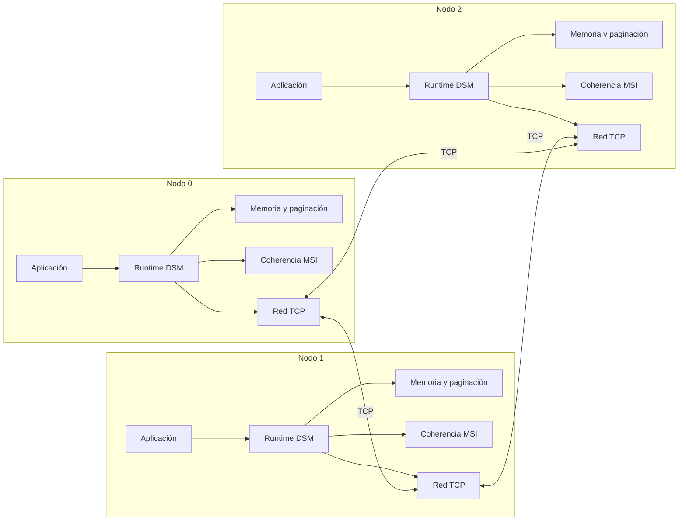

# DSM — Sistema de Memoria Compartida Distribuida

> Diseño de un sistema DSM con paginación bajo demanda y coherencia MSI sobre Linux, escrito en C11.

**Estado:** documentación de diseño completada · implementación en curso
**Curso:** IC-6600 Principios de Sistemas Operativos
**Institución:** Instituto Tecnológico de Costa Rica — Escuela de Ingeniería en Computación

---

## Descripción

Este proyecto implementa un subsistema de **Memoria Compartida Distribuida (DSM)** en espacio de usuario. Varios nodos independientes, conectados por TCP/IP, aportan memoria física y forman un espacio de memoria lógicamente compartido.

Las aplicaciones usan punteros normales. El runtime se encarga de:

- Traer páginas bajo demanda con `mmap`, `mprotect` y `sigaction`.
- Mantener la coherencia entre copias con un protocolo **MSI**.
- Transferir páginas e invalidar copias por la red.
- Sincronizar hilos y nodos con Pthreads y semáforos POSIX.

El objetivo es aplicar conceptos de sistemas operativos —memoria virtual, paginación, señales, concurrencia y coherencia de caché— en un sistema funcional y demostrable.

## Características de diseño

| Área | Decisión |
|---|---|
| Lenguaje | C11 |
| Sistema operativo | Linux |
| Transporte | Sockets TCP/IP persistentes |
| Memoria | Ventana local de 256 MB + pool de 256 marcos de 4 KB por nodo |
| Coherencia | MSI (`Modified`, `Shared`, `Invalid`) con directorio distribuido |
| Concurrencia | Pthreads, mutex, semáforos POSIX y variables atómicas |
| Fallos de página | `mmap` + `mprotect` + `SIGSEGV` con `SA_SIGINFO` |
| Nodos | 4 ideales, 2 mínimo |
| Puertos | 4 por nodo dentro de `50000–50099` |
| Interfaces | CLI y web básica de consulta |

## Arquitectura



## Estado de los entregables

| Entregable | Fecha | Estado |
|---|---|---|
| E1 — Documento de diseño | 6 nov 2026 | ✅ Completado |
| E2 — Prototipo 1 y arquitectura actualizada | 13 nov 2026 | ⏳ Pendiente |
| E3 — Prototipo 2 y arquitectura actualizada | 20 nov 2026 | ⏳ Pendiente |
| Entrega final — Demo en vivo | 27 nov 2026 | ⏳ Pendiente |

## Estructura del repositorio

```text
ProyectoSO/
├── README.md
├── 00_Proyecto_DSM_General.md        Documento maestro del proyecto
├── Entregable_1/
│   ├── INSTRUCCIONES.md
│   └── 01_Entregable_1_Diseno.md     Diseño formal, API, protocolo y estructuras
├── Entregable_2/
│   └── INSTRUCCIONES.md
├── Entregable_3/
│   └── INSTRUCCIONES.md
└── Entrega_Final/
    └── INSTRUCCIONES.md
```

Cuando comience la implementación se agregarán `src/`, `include/`, `config/`, `apps/`, `tests/` y `scripts/`.

## Documentación

- [Documento maestro del proyecto](00_Proyecto_DSM_General.md)
- [Entregable 1 — Documento de diseño](Entregable_1/01_Entregable_1_Diseno.md)
- [Instrucciones del Entregable 1](Entregable_1/INSTRUCCIONES.md)
- [Instrucciones del Entregable 2](Entregable_2/INSTRUCCIONES.md)
- [Instrucciones del Entregable 3](Entregable_3/INSTRUCCIONES.md)
- [Instrucciones de la Entrega Final](Entrega_Final/INSTRUCCIONES.md)

## Tecnologías y conceptos

`C11` · `Linux` · `TCP/IP` · `Pthreads` · `semáforos POSIX` · `mmap` · `mprotect` · `sigaction` · `SIGSEGV` · `MSI` · `memoria virtual` · `sistemas distribuidos`

## Autores

- José Daniel Monterrosa Quirós
- Sebastián Aguero Brenes

## Nota académica

Proyecto desarrollado para el curso **IC-6600 Principios de Sistemas Operativos** del Instituto Tecnológico de Costa Rica. El enunciado original pertenece al profesor del curso y no se distribuye en este repositorio.
