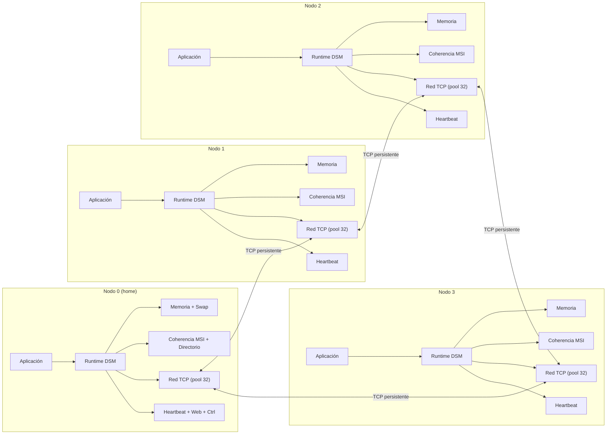

# DSM — Sistema de Memoria Compartida Distribuida

> Diseño de un sistema DSM con paginación bajo demanda y coherencia MSI sobre Linux, escrito en C11.

**Estado:** **E3 (Prototipo 2) completado** · validado en WSL2 con 4 nodos en loopback y en 2 PCs del laboratorio (6 aplicaciones) · E2 validado además en 2 máquinas físicas · pendientes: capturas de evidencia y manual de usuario · limitaciones en el [entregable 3](Entregable_3/03_Entregable_3_Prototipo_2.md)
**Curso:** IC-6600 Principios de Sistemas Operativos
**Institución:** Instituto Tecnológico de Costa Rica — Escuela de Ingeniería en Computación
**Repositorio:** https://github.com/TSebas12/ProyectoSO-DSM-SistemaDeMemoriaCompartidaDistribuida.git

---

## Descripción

Este proyecto implementa un subsistema de **Memoria Compartida Distribuida (DSM)** en espacio de usuario. Varios nodos independientes, conectados por TCP/IP, aportan memoria física y forman un espacio de memoria lógicamente compartido.

Las aplicaciones usan punteros normales (`dsm_malloc`/`dsm_free`). El runtime se encarga de:

- Traer páginas bajo demanda con `mmap`, `mprotect` y `sigaction` (`SIGSEGV` handler + hilo resolver dedicado).
- Mantener la coherencia entre copias con protocolo **MSI** (`Modified`, `Shared`, `Invalid`) y directorio distribuido por página en el nodo *home* (nodo 0).
- Transferir páginas, invalidar copias y hacer writeback por la red con conexiones TCP persistentes y pool de 32 workers.
- Sincronizar hilos y nodos con Pthreads, semáforos POSIX, variables atómicas y barrera centralizada.
- Expulsar páginas con política LRU aproximada (`last_used_ms`) y swap local en el home (`logs/swap-nodeN.bin`).

El objetivo es aplicar conceptos de sistemas operativos —memoria virtual, paginación, señales, concurrencia y coherencia de caché— en un sistema funcional, medible y operable.

## Características de diseño

| Área | Decisión |
|---|---|
| Lenguaje | C11 (`-std=c11 -D_GNU_SOURCE`) |
| Sistema operativo | Linux (probado en WSL2 Alpine, Ubuntu 24.04, Debian 12) |
| Transporte | Sockets TCP/IP persistentes + pool 32 workers por nodo |
| Memoria | Ventana 256 MB + 256 marcos de 4 KB por nodo (1 MB/nodo) |
| Coherencia | MSI con directorio por página en home + `op_lock` serializador |
| Expulsión | LRU aproximado + swap local en home (archivo disperso 256 MB) |
| Concurrencia | Pthreads, mutex/cond con clases y verificación de orden, `_Atomic` |
| Fallos de página | `mmap(PROT_NONE)` + `mprotect` + `SIGSEGV` (`SA_SIGINFO`) + cola lock-free |
| Nodos | 4 ideales (mínimo 2), hasta 16 configurables |
| Puertos | 4 por nodo en rango `27300–27399` (pareja #3) |
| Asignación | Determinista por secuencia (`seq` por nodo + caché en home) |
| Observabilidad | `dsmctl` (CLI TCP texto) + panel web HTTP de solo lectura (`/`, `/stats.json`) |
| Operación | `lab.sh` unifica build, demo, apps, control, IP, show, stop |

## Arquitectura



## Estado de los entregables

| Entregable | Fecha | Estado |
|---|---|---|
| E1 — Documento de diseño | 6 nov 2026 | ✅ Completado |
| E2 — Prototipo 1 y arquitectura actualizada | 13 nov 2026 | ✅ **Completado — validado en WSL2 y laboratorio (2 máquinas físicas)** |
| E3 — Prototipo 2 y arquitectura actualizada | 20 nov 2026 | ✅ **Completado — validado en WSL2 (4 nodos) y en 2 PCs del laboratorio (6 aplicaciones)** |
| Entrega final — Demo en vivo | 27 nov 2026 | ⏳ Pendiente |

## Resultados medidos

Datos de corridas ejecutadas y registradas; no son estimaciones.

**Prototipo 2 — 4 procesos en WSL2 (loopback `127.0.0.1`):**

| Prueba | Nodos | Fallos de página | Expulsiones | Swap (home) | Errores / timeouts |
|---|---|---|---|---|---|
| `demo` | 2 | 2 / 2 | 0 | 0 | 0 / 0 |
| `matrices --size 64` | 4 | 18 / 12 / 12 / 12 | 0 | 0 | 0 / 0 |
| `matrices --size 192` | 4 | 162 / 108 / 108 / 108 | 0 | 0 | 0 / 0 |
| `file` (1 MB) | 2 | 259 / 129 | 0 | 0 | 0 / 0 |
| `counter --iters 100 --threads 2` | 2 | 3 / 2 | 0 | 0 | 0 / 0 |
| `bench` (64 páginas) | 2 | 96 / 96 | 0 | 0 | 0 / 0 |
| `evict --pages 64 --frames 32` | 2 | 65 / 93 | 123 / 61 | 503 808 B | 0 / 0 |

**Verificación de datos:** `matrices` → `verificacion: OK (0 discrepancias)` · `file` → `checksum completo = 0xc2dc9dc5` · `counter` → `suma = 400, esperado = 400` · `evict` → `(suma 0)`.

**Latencias de `bench` (WSL2):** lectura local ~0.06 µs · lectura remota 130–280 µs · escritura remota 120–230 µs.

**Prototipo 1 — 2 máquinas físicas (13 nov 2026):** `demo` con fallos de página 2/2, 1 reenvío y 3 barreras.

**Prototipo 2 — 2 PCs del laboratorio (19 nov 2026):**

| Equipo | Rol | IP | Puertos |
|---|---|---|---|
| PC A | home / nodo 0 | `192.0.2.10` | 27300–27303 |
| PC B | cliente / nodo 1 | `192.0.2.11` | 27304–27307 |

Las dos con Linux Mint 22.3. `nodes_2.conf` con las dos direcciones y el `seed_host` del nodo 1 apuntando a A.

Se ejecutaron las seis aplicaciones (`demo`, `file`, `counter`, `bench`, `evict` y `matrices`) sobre las dos máquinas, arrancando A primero y B dentro de los 2 minutos siguientes.

| Prueba | PC A (home) | PC B (nodo 1) |
|---|---|---|
| `demo` | leyó `'hola desde el nodo 1'` tras el writeback; 2 fallos, 3 barreras, 0 errores | 2 fallos, 1 lectura y 1 escritura remotas |
| `file` (1 MB) | checksum `0xc2dc9dc5`, `2 bloques, OK`; 259 fallos, `swap=8192` | tramo `524288..1048576`, checksum `0x21fc9dc5`, 129 fallos |
| `counter` (100×2) | `suma = 400, esperado = 400, OK`; 3 fallos | `2 hilos x 100 incrementos`; 2 fallos |
| `bench` (64 páginas) | 0.06 / 932.72 / 680.84 µs (local / lectura / escritura) | 0.03 / 879.88 / 860.62 µs |
| `evict` (64p/32f) | 100 expulsiones, 46 sucias, `swap=409600 B`, 0 libres | 66 expulsiones, 5 sucias, `swap=0`, 0 libres |
| `matrices` (64×64) | filas `0..32`, 1.72 ms, `OK (0 discrepancias)` | filas `32..64`, 16.82 ms, `OK (0 discrepancias)` |

El detalle de cada corrida está en el [entregable 3](Entregable_3/03_Entregable_3_Prototipo_2.md), §9.3.1.

## Estructura del repositorio

```text
ProyectoSO/
├── README.md
├── 00_Proyecto_DSM_General.md           Documento maestro del proyecto
├── Entregable_1/
│   ├── INSTRUCCIONES.md
│   ├── 01_Entregable_1_Diseno.md        Diseño formal, API, protocolo y estructuras
│   └── 01_Entregable_1_Diseno.pdf       Versión pública del entregable (sanitizado)
├── Entregable_2/
│   ├── INSTRUCCIONES.md
│   ├── 02_Entregable_2_Prototipo_1.md   Documento del prototipo 1
│   ├── 02_Entregable_2_Guia_Codigo.md   Guía módulo por módulo
│   └── prototipo1/                      Código, configuración, evidencia
├── Entregable_3/
│   ├── INSTRUCCIONES.md
│   ├── 03_Entregable_3_Prototipo_2.md   **Documento completo (15 secciones)**
│   ├── 03_Entregable_3_Guia_Codigo.md   **Guía módulo por módulo**
│   └── prototipo2/                      **Código, Makefile, configs, lab.sh**
│       ├── include/                     18 cabeceras públicas
│       ├── src/                         25 módulos .c
│       ├── config/                      node0.conf..node3.conf + nodes.conf + nodes_2.conf
│       ├── Makefile
│       └── lab.sh
└── Entrega_Final/
    └── INSTRUCCIONES.md
```

## Documentación

- [Documento maestro del proyecto](00_Proyecto_DSM_General.md)
- [Entregable 1 — Documento de diseño](Entregable_1/01_Entregable_1_Diseno.md)
- [Entregable 2 — Prototipo 1](Entregable_2/02_Entregable_2_Prototipo_1.md)
- [Entregable 2 — Guía del código](Entregable_2/02_Entregable_2_Guia_Codigo.md)
- [Entregable 3 — Prototipo 2](Entregable_3/03_Entregable_3_Prototipo_2.md)
- [Entregable 3 — Guía del código](Entregable_3/03_Entregable_3_Guia_Codigo.md)
- [Entregable 3 — Manual de usuario](Entregable_3/04_Manual_Usuario.md)
- [Instrucciones del Entregable 1](Entregable_1/INSTRUCCIONES.md)
- [Instrucciones del Entregable 2](Entregable_2/INSTRUCCIONES.md)
- [Instrucciones del Entregable 3](Entregable_3/INSTRUCCIONES.md)
- [Instrucciones de la Entrega Final](Entrega_Final/INSTRUCCIONES.md)

## Inicio rápido

La forma principal de operar el prototipo 2 es el menú interactivo `./dsm.sh`
(recomendado para el laboratorio y para dos máquinas). `lab.sh` queda como
alternativa para WSL/loopback sin menú.

```bash
# Clonar
git clone https://github.com/TSebas12/ProyectoSO-DSM-SistemaDeMemoriaCompartidaDistribuida.git
cd ProyectoSO/Entregable_3/prototipo2

# Forma principal: menú interactivo (IPs, rol, build, arranque, apps, control,
# logs, parada y diagnóstico de red)
chmod +x dsm.sh
./dsm.sh

# Alternativa para WSL/loopback (sin menú)
make
./lab.sh demo          # demo de 1 página + 3 barreras
./lab.sh matrices --size 64
./lab.sh file          # 1 MB, checksum por bloques
./lab.sh counter --iters 100 --threads 2
./lab.sh bench         # latencias local/remoto
./lab.sh evict         # presión de memoria + swap (64 páginas, 32 marcos)
./lab.sh stress        # matrices 192 + counter 100×2

# Control y diagnóstico (lab.sh)
./lab.sh serve 0       # nodo 0 abierto (Ctrl+C para salir)
./lab.sh ctl 0 stats   # contadores
./lab.sh ctl 0 pages   # páginas locales
./lab.sh ctl 0 dir     # directorio (solo home)
./lab.sh ctl 0 objects # objetos asignados
./lab.sh ctl 0 nodes   # nodos + heartbeat
./lab.sh ip 1 192.0.2.20    # cambia IP nodo 1 (para 2 máquinas)
./lab.sh show          # nodes.conf + procesos
./lab.sh stop          # mata todos los nodos

# Panel web (si web_enabled=1 en config)
# http://<host>:27303/        HTML
# http://<host>:27303/stats.json  JSON
```

## Prueba en dos máquinas

La interfaz recomendada es `./dsm.sh`, que hace todo sin editar archivos a mano.

```bash
# En las dos PCs
cd Entregable_3/prototipo2
./dsm.sh
```

1. Opción **1**: IP de A y IP de B (los mismos valores en las dos PCs).
2. Opción **2**: rol **A** en la PC A (home, nodo 0) y rol **B** en la PC B (nodo 1).
3. Opción **3**: compilar.
4. Opción **5**: elegir la aplicación.

Arrancar siempre la PC A primero y la B dentro de los 2 minutos siguientes: la barrera de `demo` espera como máximo 120 s. Abrir TCP `27300–27315` en el firewall de cada PC.

Ejemplo validado en el laboratorio: A `192.0.2.10`, B `192.0.2.11`.

## Limitaciones conocidas

- `counter` pierde incrementos con contención alta (`--iters 2000 --threads 4` → 8000/16000): el home cede la propiedad copiando su propia copia y las escrituras de sus hilos en esa ventana no viajan al nuevo dueño.
- `evict` con 4 nodos y 512 páginas produce timeouts de red en el pico de `PAGE_RELEASE`; la configuración estable es 2 nodos con 64 páginas.
- El panel web está implementado pero no se pudo solicitar en el entorno de pruebas (Alpine sin cliente HTTP).
- Un solo home (nodo 0) sin replicación: si cae, el clúster deja de servir páginas nuevas.

Detalle completo en [Entregable 3 §11](Entregable_3/03_Entregable_3_Prototipo_2.md).

## Tecnologías y conceptos

`C11` · `Linux` · `TCP/IP` · `Pthreads` · `semáforos POSIX` · `mmap` · `mprotect` · `sigaction` · `SIGSEGV` · `MSI` · `memoria virtual` · `sistemas distribuidos` · `LRU` · `swap` · `coherencia de caché`

## Autores

- José Daniel Monterrosa Quirós
- Sebastián Agüero Brenes

## Nota académica

Proyecto desarrollado para el curso **IC-6600 Principios de Sistemas Operativos** del Instituto Tecnológico de Costa Rica. El enunciado original pertenece al profesor del curso y no se distribuye en este repositorio. Solo se publica el PDF sanitizado del Entregable 1.
