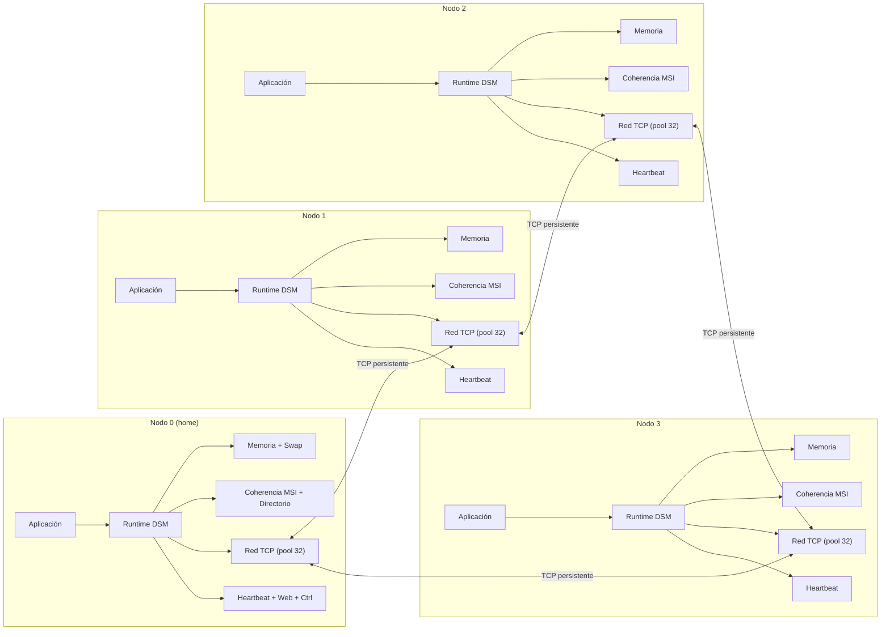

# DSM — Sistema de Memoria Compartida Distribuida

> Diseño de un sistema DSM con paginación bajo demanda y coherencia MSI sobre Linux, escrito en C11.

**Estado:** **E3 (Prototipo 2) completado y validado** · probado en WSL2 (4 nodos locales en loopback)
**Curso:** IC-6600 Principios de Sistemas Operativos
**Institución:** Instituto Tecnológico de Costa Rica — Escuela de Ingeniería en Computación
**Repositorio:** https://github.com/TSebas12/ProyectoSO-DSM-SistemaDeMemoriaCompartidaDistribuida.git

---

## Descripción

Este proyecto implementa un subsistema de **Memoria Compartida Distribuida (DSM)** en espacio de usuario. Varios nodos independientes, conectados por TCP/IP, aportan memoria física y forman un espacio de memoria lógicamente compartido.

Las aplicaciones usan punteros normales (`dsm_malloc`/`dsm_free`). El runtime se encarga de:

- Traer páginas bajo demanda con `mmap`, `mprotect` y `sigaction` (`SIGSEGV` handler + hilo resolver dedicado).
- Mantener la coherencia entre copias con protocolo **MSI** (`Modified`, `Shared`, `Invalid`) y directorio distribuido por página en el nodo *home* (nodo 0).
- Transferir páginas, invalidar copias y hacer writeback por la red con conexiones TCP persistentes y pool de 32 workers.
- Sincronizar hilos y nodos con Pthreads, semáforos POSIX, variables atómicas y barrera centralizada.
- Expulsar páginas con política LRU aproximada (`last_used_ms`) y swap local en el home (`logs/swap-nodeN.bin`).

El objetivo es aplicar conceptos de sistemas operativos —memoria virtual, paginación, señales, concurrencia y coherencia de caché— en un sistema funcional, medible y operable.

## Características de diseño

| Área | Decisión |
|---|---|
| Lenguaje | C11 (`-std=c11 -D_GNU_SOURCE`) |
| Sistema operativo | Linux (probado en WSL2 Alpine, Ubuntu 24.04, Debian 12) |
| Transporte | Sockets TCP/IP persistentes + pool 32 workers por nodo |
| Memoria | Ventana 256 MB + 256 marcos de 4 KB por nodo (1 MB/nodo) |
| Coherencia | MSI con directorio por página en home + `op_lock` serializador |
| Expulsión | LRU aproximado + swap local en home (archivo disperso 256 MB) |
| Concurrencia | Pthreads, mutex/cond con clases y verificación de orden, `_Atomic` |
| Fallos de página | `mmap(PROT_NONE)` + `mprotect` + `SIGSEGV` (`SA_SIGINFO`) + cola lock-free |
| Nodos | 4 ideales (mínimo 2), hasta 16 configurables |
| Puertos | 4 por nodo en rango `27300–27399` (pareja #3) |
| Asignación | Determinista por secuencia (`seq` por nodo + caché en home) |
| Observabilidad | `dsmctl` (CLI TCP texto) + panel web HTTP de solo lectura (`/`, `/stats.json`) |
| Operación | `lab.sh` unifica build, demo, apps, control, IP, show, stop |

## Arquitectura



## Estado de los entregables

| Entregable | Fecha | Estado |
|---|---|---|
| E1 — Documento de diseño | 6 nov 2026 | ✅ Completado |
| E2 — Prototipo 1 y arquitectura actualizada | 13 nov 2026 | ✅ **Completado — validado en WSL2 y laboratorio (2 máquinas físicas)** |
| E3 — Prototipo 2 y arquitectura actualizada | 20 nov 2026 | ✅ **Completado — validado en WSL2 (4 nodos en loopback)** |
| Entrega final — Demo en vivo | 27 nov 2026 | ⏳ Pendiente |

## Estructura del repositorio

```text
ProyectoSO/
├── README.md
├── 00_Proyecto_DSM_General.md           Documento maestro del proyecto
├── Entregable_1/
│   ├── INSTRUCCIONES.md
│   ├── 01_Entregable_1_Diseno.md        Diseño formal, API, protocolo y estructuras
│   └── 01_Entregable_1_Diseno.pdf       Versión pública del entregable (sanitizado)
├── Entregable_2/
│   ├── INSTRUCCIONES.md
│   ├── 02_Entregable_2_Prototipo_1.md   Documento del prototipo 1
│   ├── 02_Entregable_2_Guia_Codigo.md   Guía módulo por módulo
│   └── prototipo1/                      Código, configuración, evidencia
├── Entregable_3/
│   ├── INSTRUCCIONES.md
│   ├── 03_Entregable_3_Prototipo_2.md   **Documento completo (15 secciones)**
│   ├── 03_Entregable_3_Guia_Codigo.md   **Guía módulo por módulo**
│   └── prototipo2/                      **Código, Makefile, configs, lab.sh**
│       ├── include/                     18 cabeceras públicas
│       ├── src/                         25 módulos .c
│       ├── config/                      node0.conf..node3.conf + nodes.conf + nodes_2.conf
│       ├── Makefile
│       └── lab.sh
└── Entrega_Final/
    └── INSTRUCCIONES.md
```

## Documentación

- [Documento maestro del proyecto](00_Proyecto_DSM_General.md)
- [Entregable 1 — Documento de diseño](Entregable_1/01_Entregable_1_Diseno.md)
- [Entregable 2 — Prototipo 1](Entregable_2/02_Entregable_2_Prototipo_1.md)
- [Entregable 2 — Guía del código](Entregable_2/02_Entregable_2_Guia_Codigo.md)
- [Entregable 3 — Prototipo 2](Entregable_3/03_Entregable_3_Prototipo_2.md)
- [Entregable 3 — Guía del código](Entregable_3/03_Entregable_3_Guia_Codigo.md)
- [Instrucciones del Entregable 1](Entregable_1/INSTRUCCIONES.md)
- [Instrucciones del Entregable 2](Entregable_2/INSTRUCCIONES.md)
- [Instrucciones del Entregable 3](Entregable_3/INSTRUCCIONES.md)
- [Instrucciones de la Entrega Final](Entrega_Final/INSTRUCCIONES.md)

## Inicio rápido (WSL2 o Linux nativo)

```bash
# Clonar
git clone https://github.com/TSebas12/ProyectoSO-DSM-SistemaDeMemoriaCompartidaDistribuida.git
cd ProyectoSO/Entregable_3/prototipo2

# Compilar
make
# o: ./lab.sh build

# Probar (loopback 127.0.0.1; matrices usa 4 nodos, el resto 2)
./lab.sh demo          # demo de 1 página + 3 barreras
./lab.sh matrices --size 64
./lab.sh file          # 1 MB, checksum por bloques
./lab.sh counter --iters 100 --threads 2
./lab.sh bench         # latencias local/remoto
./lab.sh evict         # presión de memoria + swap (64 páginas, 32 marcos)
./lab.sh stress        # matrices 192 + counter 100×2

# Control y diagnóstico
./lab.sh serve 0       # nodo 0 abierto (Ctrl+C para salir)
./lab.sh ctl 0 stats   # contadores
./lab.sh ctl 0 pages   # páginas locales
./lab.sh ctl 0 dir     # directorio (solo home)
./lab.sh ctl 0 objects # objetos asignados
./lab.sh ctl 0 nodes   # nodos + heartbeat
./lab.sh ip 1 198.51.100.32  # cambia IP nodo 1 (para 2 máquinas)
./lab.sh show          # nodes.conf + procesos
./lab.sh stop          # mata todos los nodos

# Panel web (si web_enabled=1 en config)
# http://<host>:27303/        HTML
# http://<host>:27303/stats.json  JSON
```

## Tecnologías y conceptos

`C11` · `Linux` · `TCP/IP` · `Pthreads` · `semáforos POSIX` · `mmap` · `mprotect` · `sigaction` · `SIGSEGV` · `MSI` · `memoria virtual` · `sistemas distribuidos` · `LRU` · `swap` · `coherencia de caché`

## Autores

- José Daniel Monterrosa Quirós
- Sebastián Agüero Brenes

## Nota académica

Proyecto desarrollado para el curso **IC-6600 Principios de Sistemas Operativos** del Instituto Tecnológico de Costa Rica. El enunciado original pertenece al profesor del curso y no se distribuye en este repositorio. Solo se publica el PDF sanitizado del Entregable 1.
